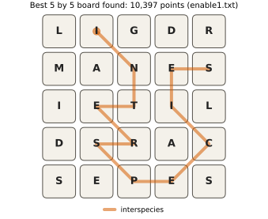
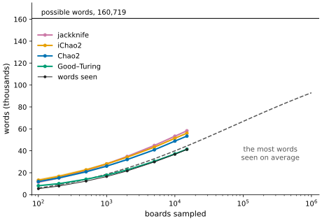

# Common Words in Boggle

The notebook estimates three things about each word and keeps them apart: how often it appears on a random board, how many points it offers, and how common it is in English. It reproduces, count for count, the post [Common on the board, rare in English](https://attobop.net/posts/boggle-words/), which revisits the 2016 version of this notebook. That version missed every Q word, and it ranked words by a single TF-IDF-like score. **The notebook is [here](https://github.com/arclabs561/games/blob/main/boggle/boggle.ipynb)**.

It also reproduces the three board scores in Peter Norvig's pytudes [Boggle notebook](https://github.com/norvig/pytudes/blob/main/ipynb/Boggle.ipynb), among them 10,112 points from 2,290 words for Boyan's 5 by 5 board, and shows that no change of one square and no swap of two improves that board. Searches from random boards do better: the best 5 by 5 board found scores 10,397 points from 2,338 words. It is the board Vanderkam (2025) found for ENABLE2K, and it is the best found, not a proved optimum.

Two newer questions have exact answers to score against. With these cubes, 160,719 words can appear on some board, and 15,000 sampled boards show 41,171 of them. The usual estimators of unseen species (Good–Turing, Chao2, iChao2 and the jackknife) put the total at 26% to 36% of the truth, with intervals far below it, because nearly half of the possible words are on fewer than one board in a million. And no 3 by 3 board scores more than `streaedlp`, 545 points, with either word list. A branch-and-bound search over classes of boards, after Vanderkam's, shows this; it reproduces his 2009 result for ENABLE2K.


*One shake of the cubes (seed 0), drawn by `figures.py`. The line traces "traveler", the longest of its 183 words.*

The official rules are in Hasbro's [Boggle instructions (PDF)](https://www.hasbro.com/common/instruct/boggle.pdf). Sixteen cubes are shaken into a 4 by 4 grid. A word is a path through neighboring cubes, at least three letters long, that uses no cube twice; the `Qu` face counts as two letters on one cube.

## Results

Unless a line says it is simulated, the number is exact. The simulated ones come from 15,000 boards drawn from one generator seeded with 20161126, as in the post, and the notebook gives their 95% intervals.

| Result | How it is known |
|---|---|
| "toe" is the most common word, on 19.1% of boards (18.5% to 19.7%). | Simulated |
| "toe" is the word most likely to be on a board: its chance is 3932205375797791/20591163668275200, about 19.10%. The next is "tee", 18.79%, and every word of four or more faces has a chance of at most 13.13%. | Exact for words of two or three faces, checked by brute force on small grids; an exact upper bound for longer words ([note](results/unseen.md)) |
| For the 968 words of two or three faces, the sample agrees with the exact chances: 41 lie outside their 95% intervals, near the 48 expected. | Exact chances against the simulated sample |
| From the 15,000 boards, Good–Turing estimates 41,482 possible words, Chao2 53,413 (52,818 to 54,038), iChao2 56,082 and the second-order jackknife 58,248: 26% to 36% of the 160,719. No interval, at any of 100 to 15,000 boards, reaches 37% of the truth. | Estimators on the simulated sample, scored against the exact count ([note](results/unseen.md)) |
| Chao2 divides the unseen words' total chance per board by the mean chance of words seen once, 6.0 × 10<sup>−5</sup>. The unseen words' mean chance is at most 8.3 × 10<sup>−6</sup>, so it counts 12,242 unseen words where there are 119,548. | Exact upper bounds on each word's chance (expected number of paths that spell it) |
| On average, fewer than half of the possible words appear in 315,245 boards, and fewer than 90% in 4,053,600,667 boards. | Exact, from the same bounds |
| A board holds 97.8 words and 140 points on average; the best of the 15,000 boards scores 969. | Simulated |
| Of the 172,723 different words of three or more letters in `enable1.txt`, 160,719 can appear on some board with these cubes and 12,004 cannot. | Exact, by matching faces to cubes; a board is built for every possible word |
| Of the 131,552 words that no sampled board showed, 12,004 are impossible and 119,548 are possible but rare. | Exact split of a simulated set |
| With the classic cubes, 169,378 of the same words are possible and 3,345 are not. | Exact |
| `perslatgsineters`, the best board for ENABLE2K (Vanderkam, 2025), scores 3,623 points from 1,044 words with `enable1.txt` and 3,625 from 1,045 with ENABLE2K, as he reports. The extra word is *tenge*. | Exact |
| A shake of the new cubes shows that board, in some orientation, with chance 8 × 1,054,080 / (16! × 6<sup>16</sup>), about 1 in 7.0 × 10<sup>18</sup>. With the classic cubes it is 8 × 221,616 / (16! × 6<sup>16</sup>), about 1 in 3.3 × 10<sup>19</sup>. | Exact, as a permanent of face counts (Ryser's formula) |
| Replacing one cube by a blank costs from 28 points (the Qu cube) to 45 points (E I O S S T) on average. | Simulated |
| Norvig's three boards score as he reports: 449 points from 252 words, 245 from 125, and Boyan's 5 by 5 board 10,112 from 2,290. | Exact; agrees with a cited source |
| Each of the 625 boards one square away from Boyan's scores less; the best of them 10,046. So the board is a strict local maximum for one-square changes. | Exact, every case |
| With Big Boggle's minimum of four letters, Boyan's board scores 9,968 from 2,146 words. | Exact |
| Hill climbing as Norvig describes it, from the board above with seed 1, reaches 3,102 points after 1,000 changes, against 3,623 for the best board. | One seeded run |
| No swap of two squares improves Boyan's board either: all 300 swaps and all 625 changes of one square to one of the 26 faces score less. | Exact, every case |
| The best 5 by 5 board found, `ligdrmanesietildsracsepes`, scores 10,397 points from 2,338 words. 269 of 1,920 searches ended on it (14.0%, 12.5% to 15.6%), and none ended higher. | Best found, not optimal: 1,920 searches, seeds listed in `results/best-5x5.json` |
| That board is Vanderkam's best 5 by 5 board for ENABLE2K, where he reports 10,406 points from 2,344 words; both counts are reproduced here. The second-best board found, at 10,383, is the board Adamovsky's DeepSearch reports as best for TWL06. | Exact scores; agree with cited sources |

**Which words are possible.** A word is possible if some shake of the cubes shows it along some path. Split it into faces, with "qu" as one face; a q followed by any other letter cannot be spelled. If each face can be given a different cube that carries it, lay those cubes along the path that runs through all 16 slots row by row, turning at each end. Each slot on that path neighbors the one before, so the word reads along it. If no such choice exists, no board shows the word. So only the matching of faces to cubes matters, not where the cubes land. When there is no matching, Hall's theorem gives a reason: some set of faces is needed more often than there are cubes carrying any of them. With the new cubes, 2,313 words are too long (more than 16 faces), 2,050 need two b's (only A B B J O O has a b), and 1,940 need two f's. The new set puts its only F and only K on one cube, so no word with an f and a k appears; the classic set has each of them on two cubes.

The tests compare `possible` with a search over every choice of cubes on random small sets, check each reason against the cube counts, and check on a sample of words that the board `witness_board` builds can be rolled and that the solver finds the word on it. A run over every possible word, for both cube sets and both word lists, found each one on its board.

## Word lists

`enable1.txt` is a copy of ENABLE, a public-domain list ("placed in the Public Domain for anyone to use as they see fit"). The notebook checks its SHA-256 digest. Copies called `enable1.txt` differ, so a reader comparing counts should use this file:

- It has 172,820 lines with CRLF endings and no final newline. Line 7,897 is "are", so "are" appears twice and "areole" is missing; there are 172,819 different words.
- It lacks "knickknack", "razzmatazz" and "razzmatazzes", which the copy in [dolph/dictionary](https://github.com/dolph/dictionary) (172,823 words) has, along with "areole".
- It matches, line for line, `ipynb/enable1.txt` in Peter Norvig's [pytudes](https://github.com/norvig/pytudes) (added in commit d9fb809, 2017), except that there line 7,897 is "areole", so that copy has 172,820 different words.
- [norvig.com/ngrams](https://norvig.com/ngrams/) lists its `enable1.txt` as "172,819 words" and 1.9 MB, which fits this file (1,916,143 bytes, 172,819 different words). Its bytes could not be fetched from here to compare, so where "are" replaced "areole" is not settled.

`enable2k.txt` is ENABLE2K (173,528 words, released in 2000, also public domain), byte for byte the copy in Dan Vanderkam's [hybrid-boggle](https://github.com/danvk/hybrid-boggle/blob/main/wordlists/enable2k.txt) (commit 0c53977). It has the same words as the copy in [BartMassey/wordlists](https://github.com/BartMassey/wordlists), whose README carries the original release notes. 802 words are only in ENABLE2K and 93 only in `enable1.txt`. Of its 173,432 words of three or more letters, 173,402 have every q followed by a u, the count of "Boggle OK" words in hybrid-boggle's word list notes; 161,361 can appear with the new cubes and 170,084 with the classic ones.

English word frequencies come from the `wordfreq` package (version 3.1.1, in the `boggle` dependency group).

## The cubes

`CUBES` is the "New Boggle" set and `CLASSIC_CUBES` the classic one, each from four listings that agree face for face: [bananagrammer.com](http://www.bananagrammer.com/2013/10/the-boggle-cube-redesign-and-its-effect.html) (2013), [luke-g.com](https://www.luke-g.com/boggle/dice.html), [robertgamble.net](http://www.robertgamble.net/2016/01/a-programmers-analysis-of-boggle.html) (2016) and Princeton's [BoggleBoard.java](https://coursera.cs.princeton.edu/algs4/assignments/boggle/files/BoggleBoard.java). No publisher document lists the faces, and the dates disagree: bananagrammer says the classic set was made from about 1976 to 1986 and the new one from 1987 to about 2008, Gamble says the new set is in games made in 1992 and since, and Princeton labels the two sets "1983" and "1992".

| Set | Cubes |
|---|---|
| Classic | AACIOT ABILTY ABJMOQu ACDEMP ACELRS ADENVZ AHMORS BIFORX DENOSW DKNOTU EEFHIY EGINTV EGKLUY EHINPS ELPSTU GILRUW |
| New | AAEEGN ABBJOO ACHOPS AFFKPS AOOTTW CIMOTU DEILRX DELRVY DISTTY EEGHNW EEINSU EHRTVW EIOSST ELRTTY HIMNQuU HLNNRZ |

## Norvig's Boggle and Inverse Boggle

Norvig's notebook (January 2020, read at commit 3b4c5dd) searches a board with a set of word prefixes where `board.py` uses a trie, and scores words with the same table. All three of his scores are reproduced, word count included. His `enable1.txt` has 172,724 words of three or more letters, one more than the copy here, because it has *areole* where this copy repeats *are*; none of his boards can spell *areole*. Boyan's board is from Justin Boyan's PhD thesis (Carnegie Mellon, 1998), found by a learned search over boards.

**Inverse Boggle** asks for the board with the highest score. Norvig changes one square at a time to a random letter and keeps changes that do not lower the score. His 500 changes from Boyan's board found nothing better. Here all 625 one-square changes to a letter were scored, and every one is worse, so this kind of climb cannot leave the board. The same holds for swaps.

## The best 5 by 5 board found



*The best 5 by 5 board found here, with one of its longest words. It scores 10,397 points from 2,338 words of `enable1.txt`.*

Searches from random boards find higher-scoring boards than Boyan's. `anneal.c` scores a board with the same trie walk as `board.get_words`, about 70 times faster; the tests compare the two on 63 boards. Each search starts from a board of random letters, drawn from Norvig's string of cube letters. It then makes 300,000 changes: one square set to a random letter, or two squares swapped. A change that lowers the score by d points is kept with chance exp(−d / t), with t falling geometrically from 300 to 5. Then the best board seen is climbed until no change of one square to any of the 26 faces, and no swap, raises the score. The settings were fixed from two pilot searches with seed 900, which the main run does not use.

| Searches | Seeds | Best found | Searches ending on it | Above Boyan's 10,112 | Median end |
|---:|---|---|---:|---:|---:|
| 1,920 | 48 seeds, 40 searches each (GitHub Actions run 44725584401) | 10,397 points, 2,338 words | 269 (14.0%, 12.5% to 15.6%) | 638 | 9,944 |

- **Published boards.** Vanderkam's [hybrid-boggle](https://github.com/danvk/hybrid-boggle) repository lists `ligdrmanesietildsracsepes` as the best 5 by 5 board found for ENABLE2K, at 10,406 points from 2,344 words, with "optimality unknown". With `enable1.txt` it scores 10,397 from 2,338 words, the best board found here. Adamovsky's [DeepSearch](https://pages.pathcom.com/~vadco/deep.html) page (TWL06) gives `RSLCSDEIAEGNTRPATESESMIDR`, 10,769 points; with `enable1.txt` it scores 10,383 from 2,285 words, the second-best board found here (49 searches). Both are found many times, from random starts. That is evidence, not proof, that no board nearby scores more.
- **Bounds.** No published bound settles the 5 by 5 case. Vanderkam ([2025](https://arxiv.org/abs/2507.02117)) proved the best 4 by 4 board by branch and bound; he estimates that the same search for 5 by 5 boards would take about a billion CPU years. No exhaustive or branch-and-bound result for 5 by 5 boards was found.
- **Boards counted.** Boards are counted up to rotation and reflection. The 1,920 searches ended on 648 different boards; the ten best are in `results/best-5x5.json`, and every search is in `results/anneal-5x5.jsonl`.


*The best 4 by 4 board for ENABLE2K (Vanderkam, 2025), with its longest word.*

## How many words can a board show?



*Four estimators of the number of possible words, with 95% intervals, against the number of boards sampled. The dashed curve bounds the average number of different words that boards show.*

Treat each sampled board as a survey plot and each word as a species. The estimators then use only how many words were seen on one board, on two, and so on. All of them stay below 37% of the truth through 15,000 boards, and their intervals narrow around values that are too low. The cause can be measured here. A word's chance of being on a board is at most the expected number of paths that spell it, which is exact and quick to compute. For words of two or three faces the chance itself is exact. By these bounds the unseen words are on average at least seven times rarer than the words seen once, whose mean chance Chao2 uses for them. The note [`results/unseen.md`](results/unseen.md) gives the formulas, every estimate, the checks, and the histogram of the bounds.

## Files and usage

- `board.py` has the cubes, the board, the word search and the sampler.
- It also has the test of which words are possible, the roll counts, and hill climbing.
- `figures.py` draws boards for the notebook and writes the five SVGs here.
- `anneal.c` and `anneal.py` score boards fast and search 5 by 5 boards; `results/` holds every search and the summary.
- `unseen.py` scores the estimators of unseen words; `chance.py` computes each word's chance or its bound.
- `bound.c` and `bound.py` search classes of boards by branch and bound.

The notebook and the tests import both modules.

```bash
uv run --group boggle --with jupyter jupyter lab boggle/boggle.ipynb
uv run --group boggle python -m boggle.figures   # the SVGs in figures/
uv run python -m boggle.anneal check                                   # C and Python scores agree
uv run python -m boggle.anneal run --seed 1 --runs 40 --procs 4 --out runs/   # about an hour on 4 cores
uv run python -m boggle.anneal summary runs/*/anneal-*.jsonl           # writes results/
uv run python -m boggle.chance        # results/chances.json, about 30 seconds
uv run python -m boggle.unseen        # results/unseen.json, about 2 minutes on 2 cores
uv run python -m boggle.bound run --shard 0 --shards 20 --out runs/   # one of 20 slices
uv run python -m boggle.bound summary runs/bound-*.txt                 # results/best-3x3.json
uv run pytest tests/test_boggle.py tests/test_boggle_unseen.py tests/test_boggle_bound.py
```

## Questions left open

- **Findability and cancellation.** Whether a player finds a word, and whether an opponent finds it too, needs an experiment with people; the post describes one.
- **Exact board probability of longer words.** For words of two or three faces the chance is exact, by counting colorings of the slots with bit masks. Four distinct faces need 5<sup>16</sup> colorings, about 1.5 × 10<sup>11</sup>, so longer words have only the upper bound. A second-moment (Bonferroni) lower bound over pairs of paths would bracket each chance.
- **An estimator that can see the tail.** The estimators here use only the counts of rare sightings. Whether a model of the chances (for example a mixture fitted to the bounds) predicts the 160,719 from 15,000 boards is untested.
- **Other editions.** Big Boggle (5 by 5) and Super Big Boggle (6 by 6) have other cubes and minimum lengths. The published listings of the 5 by 5 set disagree on one cube.
- **The best 5 by 5 board.** 1,920 searches found nothing above 10,397 points, Vanderkam's board. Whether any 5 by 5 board scores more is open: no bound is published, and branch and bound as for 4 by 4 boards is estimated at a billion CPU years. Longer searches, or a pool of boards climbed together as in Vanderkam's search, might find more.
- **The best board for `enable1.txt`.** Vanderkam's proof is for ENABLE2K. Whether `perslatgsineters` is also best for `enable1.txt` has not been checked.
