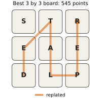

# The best 3 by 3 board

No 3 by 3 board scores more than `streaedlp`, 545 points from 267 words, with either `enable1.txt` or ENABLE2K. This reproduces Vanderkam's 2009 result for ENABLE2K, which his [hybrid-boggle](https://github.com/danvk/hybrid-boggle) README lists as proved, and extends it to `enable1.txt`. Exactly 42 boards, up to rotation and reflection, score 500 points or more with each list, the same 42 boards for both lists. Six of them score one to three points less with `enable1.txt`.

The search is `bound.c`; `best-3x3.json` is written from its 40 output files in `bound-3x3/` by `uv run python -m boggle.bound summary boggle/results/bound-3x3/bound-*.txt`, and a test checks that the file is what the script writes.

## Method

The search is branch and bound over **classes** of boards, as Vanderkam describes for his 2009 search (["Finding the Globally-Optimal 3x4 Boggle Board"](https://www.danvk.org/2025/02/10/boggle34.html), 2025; [arXiv 2507.02117](https://arxiv.org/abs/2507.02117)). The code here was written from those descriptions, not from his.

- **Classes.** A class gives each of the nine cells a set of letters and stands for every board that takes one letter from each set. The search starts from his four groups of letters, `lnrsy`, `aeiou`, `chkmpt` and `bdfgjqvwxz` (he leaves q out of his example; it is added to the last group here, as Qu). One class is made for each assignment of groups to cells, up to the eight symmetries of the square: 34,960 classes.
- **Bounds.** Two numbers bound the best score in a class from above.
  - *Max:* walk every path as in scoring, but at each cell take the letter whose continuations are worth most, and count a word once for each path that spells it.
  - *Union:* the points of every different word that some board in the class shows.

  A board's own walk is never worth more than the max walk, and a board's words are among the union's, so both bound every board in the class.
- **Branch.** A class whose smaller bound is below the threshold, 500 points, holds no board that reaches it and is dropped. Any other class is split into one class per letter of one cell: the cell with the most neighbors among those with more than one letter. A class of single letters is a board, and it is scored.

Every board is a rotation or reflection of a board in one of the searched classes, with the same score. So every board of 500 points or more is found, up to symmetry.

| | `enable1.txt` | ENABLE2K |
|---|---:|---:|
| Classes visited, boards included | 50,977,668 | 51,469,589 |
| Classes dropped by a bound | 41,640,825 | 42,035,267 |
| Boards scored | 643,232 | 655,842 |
| Boards of 500 points or more, up to symmetry | 42 | 42 |
| Best | `streaedlp`, 545 | `streaedlp`, 545 |

The search ran in 20 slices on GitHub Actions (run 44792399168, at commit f359d86), about 4.0 hours of CPU time for both lists together. The search code in `bound.c` has not changed since that commit.

## How it is checked

The result rests on `bound.c`. The 51 million classes are not kept as a certificate for a separate checker; instead the tests check the parts:

- **Against scoring every board.** `anneal.c exhaust`, a separate program that scores boards one by one, finds the same boards as the search on all 264 boards of 2 by 2 (threshold 15 points) and on all 59 boards of 3 by 3 over the letters a, e, r, s and t (threshold 200 points).
- **The bounds.** On random classes of up to 512 boards, the best board of each class, scored by `board.get_words`, is at most both bounds. For the class `lnrsy aeiou chkmpt / chkmpt aeiou lnrsy / lnrsy aeiou bdfgjvwxz` with ENABLE2K, the bounds are 9,359 and 106,383, the numbers Vanderkam's README reports for it.
- **Scores.** `bound.c` scores boards as `anneal.c` does, which the tests compare with `board.get_words`. Every board in `best-3x3.json` is rescored by `anneal.c`.
- **Published values.** The best board and its 545 points match Vanderkam's for ENABLE2K. His README prints three boards from his own run, `legsartes` (527), `lepsartes` (536) and `pecsartes` (500); all three are found here with those scores.

- **A second start.** His README's own run starts from two groups of letters, `aeiosuy` and the rest, and reports 57 boards of 500 points or more. Started from those two groups, the search here also finds 57 boards, and they are the same 42 boards, up to symmetry, as from four groups. A board is found more than once when its class holds more than one of its orientations, which happens when the class is its own rotation or mirror image. That run visited 178,297,221 classes and scored 17,606,968 boards (run 44802520763, at commit 7fe3837); its output is in `bound-3x3-two-groups/`.
