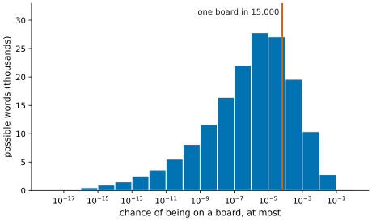

# How many words can a board show? Estimators scored against the truth

With the new cubes, 160,719 words of `enable1.txt` can appear on some board. That count is exact (`board.possible`, a matching of faces to cubes). The 15,000 sampled boards showed 41,171 of them. Four estimators of the total, given the sample, reach between 26% and 36% of the truth, and every 95% interval lies far below it. More boards help slowly: no estimator passes 37% at 15,000 boards. The cause is that most possible words are far rarer than anything a sample of this size can see. For 72,843 of the 119,548 unseen words, the chance of being on a board is below one in a million.

Numbers are written by `uv run python -m boggle.unseen` to `unseen.json` and by `uv run python -m boggle.chance` to `chances.json`; the tests check that both files are what the scripts write.

## The setting

Each board is a sampling unit, and each word is on it or not. So the data are incidence data, as in ecology, where a survey records which species occur in each plot. For a word, count the boards that show it. Qk is the number of words seen on exactly k boards, T the number of boards, and U the number of sightings. The boards are the first T of the 15,000 drawn from one generator seeded with 20161126.

| Estimator | Formula | Source |
|---|---|---|
| Good–Turing | Sobs / (1 − Q1/U) | Good (1953): 1 − Q1/U estimates the share of sightings on a new board that are of words already seen |
| Chao2 | Sobs + (T − 1)/T · Q1² / (2Q2) | Chao (1987); the incidence form of Chao1 |
| iChao2 | Chao2 + (T − 3)/(4T) · Q3/Q4 · max(Q1 − (T − 3)/(2(T − 1)) · Q2Q3/Q4, 0) | Chiu, Wang, Walther and Chao (2014) |
| Jackknife | Sobs + Q1(2T − 3)/T − Q2(T − 2)² / (T(T − 1)) | Burnham and Overton (1978), second order |

The formulas for Chao2 and iChao2, and Chao2's variance and interval, are as given in Chao and Colwell, "Thirty years of progeny from Chao's inequality", *SORT* 41 (2017), equations 2b, 3a, 3c and 6d. With T in the thousands, the factors (T − 1)/T and the like change the estimates by less than 1%. So Chao2 here is Chao1 applied to the counts of boards.

**Intervals.** Chao2's interval uses Chao's variance. The others use a standard error from resampling the boards (200 resamples, seeded by T). Each goes into Chao's log-normal interval, which never reaches below the words seen. Percentiles of the resampled estimates cannot serve as the interval. A board drawn twice turns each of its words seen once into a word seen twice. So the resampled Chao2 estimates average 40,272 at 15,000 boards, against the estimate of 53,413. The standard errors are close to the spread of independent samples: over 15 disjoint blocks of 1,000 boards, Chao2's standard deviation is 375, and the resampling standard error at 1,000 boards is 382.

## Results

Estimates of the number of possible words, with 95% intervals; the truth is 160,719.

| Boards | Seen | Good–Turing | Chao2 | iChao2 | Jackknife |
|---:|---:|---|---|---|---|
| 100 | 5,435 | 8,160 (7,673 to 8,752) | 11,920 (11,330 to 12,568) | 13,189 (12,037 to 14,542) | 11,420 (10,403 to 12,645) |
| 1,000 | 16,521 | 17,820 (17,519 to 18,211) | 26,024 (25,438 to 26,650) | 28,051 (27,181 to 28,991) | 27,978 (27,079 to 28,952) |
| 15,000 | 41,171 | 41,482 (41,329 to 41,786) | 53,413 (52,818 to 54,038) | 56,082 (55,591 to 56,589) | 58,248 (57,710 to 58,803) |
| Share of the truth at 15,000 | 26% | 26% | 33% | 35% | 36% |

The rows for 200, 500, 2,000, 5,000 and 10,000 boards are in `unseen.json`. Each estimate rises with the number of boards, and each interval narrows, around a value that is still far too low. A narrow interval here measures how much a fresh sample would move the estimate, not how far the estimate is from the truth.

*Estimates with their 95% intervals (the bands, mostly thinner than the lines), the words seen, and the truth. The dashed curve is an upper bound on the average number of different words that T boards show, from the bound on each word's chance below.*

## Why they fall short

**The chance of each word.** A word is on a board when some path spells it. So its chance is at most the expected number of paths that spell it. That expectation is exact and quick to compute: every path of L slots shows a given sequence of L faces with the same chance. It equals the number of paths of L slots times a sum over ways to give each face its own cube (`chance.expected_paths`). The paths number 12,029,640 in all, single slots included, which is the 4 by 4 term of OEIS A236690.

For words of two or three faces, the exact chance is computed too, as a finite sum over the colorings of the 16 slots (`chance.word_chance`). For "toe" it is 3932205375797791/20591163668275200, about 19.10%. The tests check the method two ways. On a 2 by 2 grid they compare it with every shake of four cubes. On 2 by 3 and 3 by 3 grids they compare it with a path search on every coloring. The sample agrees with the exact chances. Of the 968 such words, 41 have an exact chance outside the sample's 95% interval, near the 48 expected by chance alone. The standardized differences have mean −0.02 and spread 0.99. For these words the bound is 1.02 to 2.90 times the exact chance; the gap comes from words that two paths often spell on the same board.

*The bound on the chance of each of the 160,719 possible words. Words left of the line are expected on fewer than one board in 15,000; 50,866 words have a bound below 1e-7.*

**What the estimators assume.** Chao2 estimates the number of unseen words as their total chance per board divided by their mean chance (Chao and Colwell 2017, section 2.3). For the total it uses Good and Turing's estimate, Q1/T. For the mean it uses the mean chance of the words seen once, which is an upper bound on the unseen words' mean chance when those words are rarer. Both parts can be checked here:

| Quantity, at 15,000 boards | Estimate from the sample | Known |
|---|---|---|
| Unseen words | 12,242 (Chao2) | 119,548 |
| Their total chance per board | 0.73 (Good–Turing) | at most 0.99 |
| Mean chance of an unseen word | 6.0 × 10−5 (words seen once) | at most 8.3 × 10−6 |

Good and Turing's total is consistent with the bound. The mean is what fails. The unseen words are on average at least seven times rarer than the words seen once. Dividing the right total by a mean that is too large gives a count that is too small, here by a factor of 9.8. iChao2 and the jackknife use Q3 and Q4 or a different weighting of Q1 and Q2. They correct for some of the spread among the rare words, but they see only words common enough to be sampled.

**How many boards would be needed.** The average number of different words that T boards show is the sum over words of 1 − (1 − p)T, where p is the word's chance. Replacing p by its bound gives an upper bound: at most 44,430 at 15,000 boards, against 41,171 seen. That bound stays below half of the possible words until 315,245 boards, and below 90% of them until 4,053,600,667 boards. So no sample of the size anyone draws can show most of the words a board can spell, and an estimator that uses only the counts of rare sightings cannot see the rest.

## Checks

- The estimators reproduce hand-computed values on a small table of counts, and Chao2 recovers the truth within 5% when every word has the same chance (2,000 words, chance 1/1,000, 1,000 boards, seed 1), the case where Chao and Colwell show it is nearly unbiased.
- `chance.placements` is compared with a sum over every choice of cubes; its C version in `bound.c` agrees with the exact count to 12 digits on 302 words.
- Exact chances: brute force over every shake (2 by 2) and over every coloring (2 by 3 and 3 by 3), and the sample, as above.
- Path counts: 64, 10,305 and 12,029,640 for 2 by 2, 3 by 3 and 4 by 4, as in OEIS A236690.
