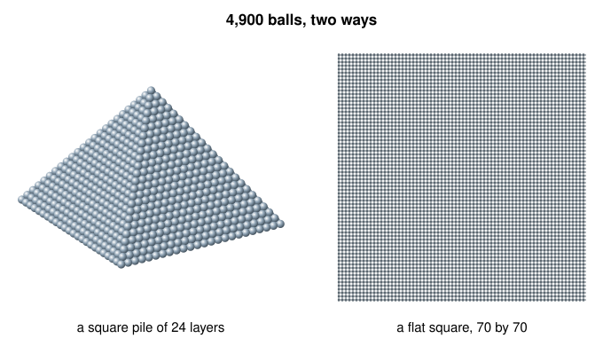
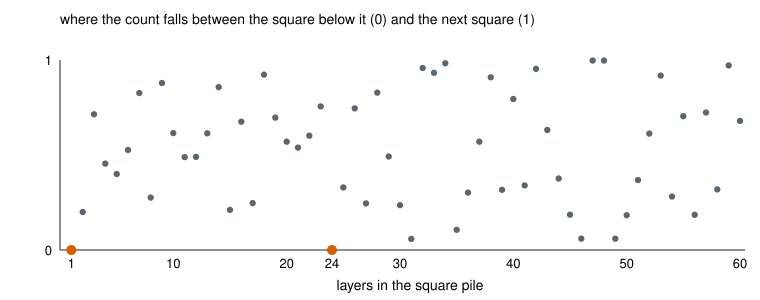

# Cannonballs

<!-- shared:summary -->

How many cannonballs are in a pile, and which piles hold a square number of them? A square pile of 24 layers holds 4,900 balls, which also make a flat square of 70 by 70. No other square pile does, apart from the single ball. Watson proved this in 1918, and the search here finds no other below 10<sup>10,000</sup> layers. Some oblong pile of short side a holds a square number of balls for 7 in 12 values of a, and never for a = 2 or 3. That rule is proved here.

<!-- /shared -->



The write-up is [`cannonballs.pdf`](cannonballs.pdf), with a narrow edition for phones in [`cannonballs-phone.pdf`](cannonballs-phone.pdf). It is meant for a parent and a young child to read together. Its first six sections use only pictures and arithmetic, and the rest proves each claim. Its section "Why only 1 and 24" proves Lucas's problem, with its six cases and the walk along two Pell equations. The section "Oblong piles that are squares" proves the rule for oblong piles.

## Piles as modeled

<!-- shared:rules -->

- A **triangle** of side n has rows of 1, 2, ..., n balls. A **square** of side n has n rows of n.
- A **tetrahedral pile** of n layers is a stack of triangles of side 1 to n, and a **square pile** a stack of squares of side 1 to n. Each ball above the bottom rests in the hollow between three or four balls below.
- An **oblong pile** on an a by b base, with a ≤ b, has layers a by b, a − 1 by b − 1, and so on, up to a ridge of b − a + 1 balls.
- The balls sit at points of the face-centered cubic lattice. Two balls touch when their centers are one diameter apart.

<!-- /shared -->

## Results

Exact unless marked.

<!-- shared:results -->

| Question | Answer | How it is known |
|---|---|---|
| Balls in a square pile of n layers | n(n + 1)(2n + 1)/6; 4,900 for 24 layers | Proved<!--raw-typst  (@prop-pyramid)-->; checked by building piles of up to 12 layers ball by ball |
| Balls in a tetrahedral pile | n(n + 1)(n + 2)/6, the number of ways to choose 3 things from n + 2 | Proved<!--raw-typst  (@prop-tetra)-->; checked the same way |
| Balls in an oblong pile | a(a + 1)(3b − a + 1)/6 | Proved<!--raw-typst  (@prop-oblong)-->; checked the same way |
| Square piles that are squares | 1 and 24 layers | Cited: Watson (1918)<!--raw-typst  (@thm-watson)-->. A walk along two Pell equations finds no other below 10<sup>10,000</sup> layers, and a plain search agrees up to 10,000,000 |
| Oblong piles that are squares | Some length works for short side a exactly when a leaves remainder 1 on division by 3, or the multiple of 3 among a and a + 1, divided by 3, is 9<sup>k</sup>(3j + 2). That is 7 in 12 values of a in the long run | Proved<!--raw-typst  (@thm-oblong, @cor-share)-->; checked against two other methods for every a up to 300 |
| Square piles that are triangles; tetrahedral piles that are squares or triangles | 1, 5, 6, 85 layers; 1, 2, 48; 1, 3, 8, 20, 34 | Cited (Finkelstein and London, Meyl, Avanesov)<!--raw-typst  (@tab-other)-->; reproduced by search up to 1,000,000 layers |
| Square piles that are cubes | Only the single ball, up to 10<sup>18</sup> layers | Search; open beyond |
| Piles with the top cut off (runs of squares) that are squares | Possible for 1, 2, 11, 23, 24 and 26 layers, and no other number up to 30 | Search, with a divisor that rules out each other case; matches OEIS A001032<!--raw-typst  (@tab-truncated)-->. For 25 layers the only run is 0² + ... + 24², proved<!--raw-typst  (@prop-25)--> |
| Touching pairs | 2n²(n − 1) in a square pile, 26,496 for 24 layers; (n − 1)n(n + 1) in a tetrahedral pile | Proved<!--raw-typst  (@prop-touch)-->; checked by counting pairs two ways |
| Balls that touch twelve others | A square pile of n − 3 layers inside the square pile (3,311 of the 4,900); a tetrahedral pile of n − 4 layers inside the tetrahedral pile | Proved<!--raw-typst  (@prop-twelve)-->; checked by counting |

<!-- /shared -->

## Where the count lands



For each square pile, the plot shows where its count falls between the square below it and the next square. Only the piles of 1 and 24 layers land on a square.

## How the results are checked

<!-- shared:checks -->

- Each count formula is compared with a pile built ball by ball, for up to 12 layers. The same code checks that no two balls overlap and that each ball above the bottom rests on at least three below.
- Touching pairs are counted two ways: by looking up each ball's twelve possible neighbors, and by measuring every pair.
- For Lucas's problem, the Pell walk and a plain search agree up to 10,000,000 layers. A test checks that the walk lists every candidate up to a million.
- The rule for oblong piles is compared with two methods that use no theory: whether some square leaves the right remainder, for a up to 300, and trying every length, for a up to 40.
- Every row of the table of coincidences is reproduced by search up to 1,000,000 layers, and the runs of squares match OEIS A001032. No result here disagrees with a published one.
- `report.py` writes every quoted number to `results.json`. Tests rerun it with smaller bounds and compare. Other tests check the committed figures, and that the shared sections of the README are what `tools/sync_docs.py` writes from `docs/` and `results.json`.

<!-- /shared -->

## Sources

The published results used are cited in the write-up. The main ones are Lucas's question ([numdam](https://www.numdam.org/item?id=NAM_1875_2_14__336_0)), Watson (1918), Anglin, [*The square pyramid puzzle*](https://doi.org/10.2307/2323911) (1990), Meyl's solution of question 1194 ([numdam](https://www.numdam.org/item/NAM_1878_2_17__464_1.pdf)), Avanesov (1967), Finkelstein and London (1972), Beukers and Top (1988), Beeckmans (1994), and [OEIS A001032](https://oeis.org/A001032). For relatives, see Hales, [*Cannonballs and honeycombs*](https://www.ams.org/notices/200004/fea-hales.pdf) (2000), and Conway and Sloane, [*Lorentzian forms for the Leech lattice*](https://neilsloane.com/doc/Me91.pdf) (1982). No data files are used.

## Open questions

<!-- shared:open -->

- **Square piles that are cubes.** Is the single ball the only square pile that holds a cube number of balls? The search found no other up to 10<sup>18</sup> layers. Four of the six cases for cubes survive every divisor up to 200, so a proof would need another idea, perhaps a bound on equations of the form |ax³ − by³| = 1 as for tetrahedral piles.
- **A short proof for the tetrahedral pile of 34 layers.** Avanesov's proof that 7,140 is the last number that is both a triangle and a tetrahedral pile uses heavy machinery. Is there a proof by Pell equations and remainders, like Anglin's for Lucas's problem?
- **Oblong piles that are triangles or cubes.** The rule for squares is proved<!--raw-typst  (@thm-oblong)-->. Which short sides allow an oblong pile with a triangular number of balls? For a fixed short side a, each extra ball of length adds a triangle of side a, so the remainder method of the square case applies, but it has not been worked out.
- **Other packings.** The piles here are pieces of the face-centered cubic packing. A pile can also be built with each new layer turned the other way, as in the hexagonal close packing, which is equally dense. Which pile shapes stay stable then, and how do their counts and touching pairs change?

<!-- /shared -->

## Usage

```bash
uv run python -m cannonballs.piles      # counts, and touching pairs of the 24-layer pile
uv run python -m cannonballs.lucas      # the searches, with default bounds
uv run python -m cannonballs.report     # writes results.json and gaps.csv (about half a minute)
uv run python -m cannonballs.figures    # writes pile.svg and gaps.svg
uv run tools/sync_docs.py cannonballs  # fills the README's shared sections from docs/ and results.json
uv run tools/typst_vendor.py cannonballs/cannonballs.typ --all   # the PDF, the phone PDF and the HTML page
```

```
$ uv run python -m cannonballs.lucas 1000000 1000
square piles that are squares, n <= 1,000,000: [1, 24]
  brute force took 0.3 s
case (1, 2, 3) ruled out mod None
case (2, 1, 3) ruled out mod 3
case (1, 6, 1) ruled out mod 3
case (6, 1, 1) ruled out mod None
case (2, 3, 1) ruled out mod 3
case (3, 2, 1) ruled out mod 3
by Pell equations, n < 10^1000: {(6, 1, 1): [24], (1, 2, 3): [1]}
...
```

Only the Python standard library is needed.

## Files

- `piles.py`: counts, piles built ball by ball, touching pairs.
- `lucas.py`: Lucas's problem, the six cases, the Pell walk, other coincidences, runs of squares, oblong piles.
- `report.py`: writes `results.json` and `gaps.csv`.
- `figures.py`: writes `pile.svg` and `gaps.svg`.
- `docs/`: the sections that the README and the write-up share, with placeholders for the numbers in `results.json`.
- `cannonballs.typ`: the write-up; `cannonballs.pdf` and `cannonballs-phone.pdf` are built from it.
