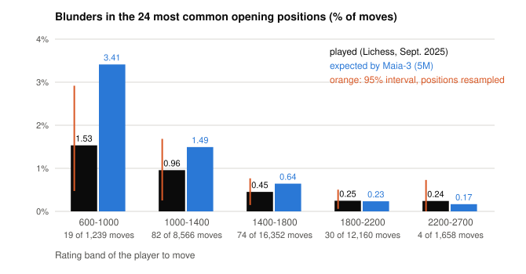

# Chess: what a rating says, and what a player at a rating plays

When does the question mark disappear from a new Lichess blitz rating? Among 960 new players, rating changes put the median at 11 games. The formula gives 10 against established opponents with rating deviations of 45 to 60, and 34 if every opponent is new. How long before the rating is close to the player's strength? At four strengths, a simulation of 20,000 players each needed 35 to 48 games to put nine players in ten within 100 points.

Once settled, a rating still wanders, with a standard deviation of about 31 points. Maia-3, an open model of human moves published at ICLR 2026, says what players at each rating play in a position. From one game it guesses a player's rating with a mean error of 199 points, against 451 for guessing the average (500 player-games), and it rates players below 1400 about 200 points too high. The bias is in Maia-3's likelihood, not in the prior: weaker players' moves look stronger to it, more so at five-minute time controls. On 1,000 player-games from August 2025, scored once, a map of the rating scale fitted on pilot games halves that bias (+166 to +88). Raising the likelihood to the power 0.56 brings the 95% intervals' coverage from 89% to 97%. Both cost a little accuracy. It expects more blunders from players below 1800 than they make. The rating results are exact or simulated with seeds; everything that uses Maia-3 is exploratory.


*Black to move after 1. e4 e5 2. Qh5 Nc6 3. Bc4, which threatens mate on f7. Arrows: Maia-3's three likeliest replies for players rated 1100 (left) and 1900 (right).*

## Rules as modeled

- **Ratings** are Lichess's Glicko-2 for standard blitz, ported from lila and scalachess (read 2026-11-20). A new player starts at 1500 with deviation 500 and volatility 0.09. Each game is its own rating period. White gets 11.78 points of advantage in the expected score. Blitz gains are multiplied by 1.005. The deviation stays within 45 to 500, and a rating is provisional while its deviation is at least 110. `glicko.py` lists every constant and where it comes from.
- **The settling model.** Each opponent is rated what the player is rated now, with deviation 60. Opponents' true strengths equal their ratings, and colors alternate. Games are played back to back, so the deviation never grows between them. A game is won with the Elo chance 1 / (1 + 10^(−gap/400)), where the gap is the player's strength minus the opponent's. Draws are left out except in one variation.
- **Maia-3** (Monroe et al., ICLR 2026) predicts a human move. It reads the position, up to seven earlier positions, and both players' ratings. Maia3-5M, the smallest of its three main models, is used here, on a CPU; a 3M checkpoint exists only as an ablation. Maia-3 trained on Lichess blitz games from January 2023 to July 2025, and every game here is from September 2025. "Both players at rating R" means the model is given R for both.
- **A blunder** is Lichess's: a move that lowers the mover's winning chances by 0.3 or more on the scale from −1 to 1, with Lichess's separate rules for moves into or out of a forced mate. Each legal move is scored by a Stockfish 17.1 search of the position after it.

## Results

| Result | Value | How it is known |
|---|---|---|
| Games until the question mark goes, opponents' deviation 45 to 60 | 10 | exact: closed form, and iteration of Lichess's update |
| The same, opponents' deviation 80 or 110; 200; all opponents new (500) | 11; 14; 34 | exact |
| Real new Lichess players: first game with deviation below 110 | median 11, quartiles 10 and 11 (960 players) | backed out of real rating changes, assuming opponents' deviation 60; Lichess 2025-09 |
| Chance of being within 100 of strength after 20 games: strength 1500; 1100 or 1900; 800; 2300 | 0.797; 0.783 to 0.785; 0.703; 0.631 | exact: all 2²⁰ records |
| Games until within 100 of strength nine times in ten: 1100; 1900; 800; 2300 | 36; 35; 43; 48 | simulated, 20,000 players each, seeds 100 to 104 |
| Spread of a settled rating around a fixed strength | standard deviation 31.5 to 31.7 | simulated (as above); 31.4 by a linear approximation |
| Two equal settled players' ratings differ by more than | 87 points, 5% of the time | from the 31.4, normal approximation |
| Real players with more than 60 games: rating within 100 of the rating at game 61, at game 20 | 0.70 (0.65 to 0.75), against 0.84 in the model | 323 real players, Wilson interval; model simulated, seed 300 |
| Decisive games for a 95% verdict, more likely than not: gaps of 50, 100, 200 points | 127, 29, 10 | exact binomial sums, Peggle's one-look rule |
| Maia-3, top move matches the move played, pilot games | 55.5% (1,266 of 2,281 positions) | exploratory; the paper reports 55.4% on other games |
| Rating from one game: mean absolute error; guessing the mean | 199 (183 to 215); 451 points | exploratory; 500 player-games, bootstrap interval |
| Rating from one game: 95% intervals that hold the rating | 86% | exploratory; same games |
| Rating from one game, mean error below 1400, August 2025: old method; rating map | +166 (142 to 190); +88 (62 to 114) | 400 player-games, scored once, bootstrap over games; plan committed, not merged |
| Rating from one game, 95% intervals that hold the rating, August 2025: old method; tempered likelihood | 88.9% (86.8 to 90.7); 96.7% (95.4 to 97.6) | 1,000 player-games, Wilson intervals; same plan |
| Rating from one game, mean absolute error, August 2025: old method; rating map; tempered | 189; 195; 205 | same games; bootstrap intervals in the text |
| Blunders in the 24 most common opening positions, below 1400 | played 1.03%, Maia-3 expected 1.74% | exploratory; 9,805 moves |

## How the results are checked

- The Glicko-2 port reproduces Glickman's worked example (1464.06, 151.52, 0.05999) and eleven test values from scalachess's tests, which include White's advantage and the starting values.
- The closed form for the deviation agrees with iteration for eight opponent deviations. The tests check that the deviation path does not depend on the results, for four records.
- The exact distribution after n games agrees with brute force over all 2ⁿ records, played one game at a time through the port, for n up to 8. The simulation's chance at 12 games falls inside its 95% interval around the exact value, and the vectorized update matches the port on 100 random games.
- The settled spread agrees with the linear approximation within 1.5 points.
- Peggle's threshold on wins is recomputed in floating point and checked against Peggle's exact one for n up to 300.
- Maia-3 as loaded here gives the same move probabilities as the authors' UCI engine, to seven decimals, in three positions (the pilot job prints them).
- `trajectories.py` is tested on a synthetic player whose record is generated by the port. It recovers the deviation path within 4 points from integer ratings, and game 10 as the first below 110.
- The files copied from the jobs into `results/` match the SHA-256 that the jobs printed. CI runs every test above.

## How many games until a rating settles?


*Left: the deviation falls the same way in the model and in real new players. Right: being within 100 of one's strength takes longer, and longest for strengths far from 1500. The 1100 curve lies under the 1900 one.*

Against evenly matched opponents with rating deviation 60, the question mark goes after 10 games. After each game, Glicko-2 sets 1/φ'² = 1/φ² + g(φ_opp)² E(1 − E), where φ is the deviation. When opponents are rated the player's current rating, E is 1/2 (up to White's small edge), whatever the results. So the deviation after n games is fixed in advance: on the Glicko-2 scale, 1/φ_n² = 1/φ_0² + n g(φ_opp)²/4. Against opponents with deviation 60 it falls from 500 to 109.2 at game 10. Real new players agree. Their deviation, backed out of each game's rating change assuming opponents' deviation 60, has median 112.5 at game 10 and 107.4 at game 11. It is 2% to 4% above the model's at every game from 1 to 60, as if opponents' deviations were a little above 60.

Being near one's strength takes longer. The first rating change is about 230 to 245 points (the real median is 242), and the changes shrink as the deviation does, so a player far from 1500 needs more games to get there. After 20 games the chance of being within 100 is 0.80 at strength 1500 and 0.63 at 2300, exactly. Nine times in ten takes 35 or 36 games at 1100 or 1900, 43 at 800 and 48 at 2300. With 10% draws it takes 42 games at 1100, and with opponents spread 100 points around the player, 38.

Real players settle more slowly than this model. Among the 323 new players with more than 60 games in the first ten files of September 2025, the rating at game 20 was within 100 of the rating at game 61 for 0.70 of them (0.65 to 0.75). The model, given the same final ratings as strengths, says 0.84. The gap is 0.15 at game 10 and 0.11 at game 30. Real strength is not fixed: new accounts include beginners who improve and strong players on new accounts. The model's strength is fixed.

A settled rating does not stop moving. At the floor deviation of 45, each decisive game moves the rating about 5.6 points. For a player of fixed strength the rating then has a standard deviation of 31.5 points (simulated) or 31.4 (by the AR(1) approximation in `settle.noise_floor`). So two settled players of equal strength have ratings more than 87 points apart 5% of the time.

Head-to-head games tell two players apart slowly too. Peggle's one-look rule declares a player better when the posterior chance, under a uniform prior, reaches 95%. For a player 100 points stronger, who wins 64% of decisive games, that verdict is more likely than not after 29 decisive games and has chance 0.9 after 103. A 50-point gap needs 127 and 412 games, and a 200-point gap 10 and 27.

## What would a 1500 play here?

`whatwould.py` prints Maia-3's move probabilities for each rating. The run below is from the Hugging Face job, since this repository's shell cannot download the model.

```
$ uv run python -m chess_ratings.whatwould --checkpoint maia3-5m.pt --moves e2e4 e7e5 d1h5 b8c6 f1c4
r1bqkbnr/pppp1ppp/2n5/4p2Q/2B1P3/8/PPPP1PPP/RNB1K1NR b KQkq - 3 3
Black to move; both players at the rating shown.
move        800   1100   1500   1900   2300
g6        63.2%  71.4%  61.2%  58.2%  82.3%
Qf6        1.9%   5.4%  18.0%  20.9%   6.1%
Qe7        6.4%   6.0%  10.4%  15.4%   9.3%
Nf6       11.8%   6.1%   5.2%   3.2%   1.1%
Nh6       10.8%   8.8%   3.5%   0.9%   0.2%
other      6.0%   2.3%   1.6%   1.4%   1.1%
```

A 1500 defends f7 with g6 61% of the time and plays Nf6, which loses to Qxf7 mate, 5.2% of the time; at 800 that is 11.8%, at 2300 1.1%. In the Two Knights after 4. Ng5, d5 rises from 47% at 800 to 81% at 2300. After Nf6, Maia-3 gives Qxf7 mate 80% to 94%, and it is not highest at the lowest rating: at 1100 and 1500, 13% of the mass goes to the retreat Qf3. The other two runs are in `results/whatwould.txt`. Given a FEN instead of moves, the model sees no earlier positions, as the authors' UCI engine does by default.

## Rating from one game

An estimate from one game is off by 199 points on average (183 to 215), against 451 for guessing the sample's mean rating. Its 95% intervals hold the true rating 86% of the time, and below 1400 Maia-3 rates players about 200 points above their ratings. This is exploratory: the plan was not merged before the run.


*Left: more moves help, with diminishing returns. Right: weaker players are rated too high.*

The **estimate** is the mean of the posterior over ratings 600 to 2600, under a flat prior. For a rating R, the likelihood is the product of Maia-3's probabilities for the player's moves, with both players given R. Moves made after the player first had under 30 seconds are left out, as Maia-3's training left them out. The test sample is 250 rated blitz games from file 40 of September 2025, 50 in each of five bands of the mean rating. Both ratings moved by at most 15 points, so the players were established, and each game had at least 40 half-moves. That gives 500 player-games with a median of 32 moves each. The pilot games (files 30 and 31) chose the model's history of earlier positions and the posterior mean over the likelihood's maximum; the test games were scored once.

| Band (mean rating) | Players | Mean absolute error | Mean error | 95% interval holds the rating |
|---|---:|---:|---:|---:|
| 600 to 1000 | 100 | 249 (208 to 294) | +206 | 79% |
| 1000 to 1400 | 100 | 249 (207 to 293) | +199 | 83% |
| 1400 to 1800 | 100 | 174 (145 to 205) | +82 | 89% |
| 1800 to 2200 | 100 | 176 (149 to 206) | −5 | 89% |
| 2200 to 2700 | 100 | 145 (124 to 168) | −31 | 90% |
| all | 500 | 199 (183 to 215) | +90 | 86% |

Bootstrap intervals, 10,000 resamples of player-games, seeds 7 to 10. The maximum of the likelihood does a little worse than the posterior mean (210, interval 193 to 227), and its intervals hold the rating 84% of the time.

How many moves it needs: with a player's first 5 moves the error is 331, with 10 it is 263, with 20 215, with 30 193 (319 players with 30 or more) and with 40 174 (151 players). Longer games are easier: the same 151 players' estimates from all their moves are off by 172. The intervals are too narrow because a player's moves are not independent given the positions, which the likelihood assumes. Their median width is 720 points.

The bias below 1400 is the largest error. Maia-3 finds weaker players' moves likelier for stronger players than for players at their own rating. The next section tests why, and repairs part of it. As a check on the model itself, its top move matched the move played in 8,541 of 15,186 positions (56.2%) at the players' own ratings, on Maia-3's protocol. That is 51.6% in the lowest band and 59.2% in the 1800 to 2200 band. The paper reports 55.4% for this model on 2022 games.

## Why the estimate is biased and overconfident, and a repair

On August 2025 games, which neither Maia-3 nor any choice here had seen, a rating map halves the bias below 1400, and a tempered likelihood brings the 95% intervals to 97% coverage. Neither removes the error. The plan, written before the test games were read, is [`results/calibration-plan.md`](results/calibration-plan.md). It was committed on a branch, not merged, so under `experiments/METHOD.md` the result is exploratory. The diagnosis is in [`results/calibration.md`](results/calibration.md).


*Left: the rating map removes about half of the bias below 1400 and none of it is left above. Right: the tempered intervals, fitted for 95% on pilot games, hold the rating 97% of the time on new ones.*

**The diagnosis**, on 998 player-games from September 2025 (files 32 to 39), each scored at ratings 400 to 3000:

- **The likelihood is shifted, not the prior.** The likelihood's maximum, with no prior, keeps 85% to 92% of the bias. Players rated 650 to 950 make moves that Maia-3 finds likeliest at a rating 120 to 170 points higher.
- **Bins and clipping are not the cause.** Maia-3 takes a rating as a continuous input, and it tells low ratings apart more sharply than middle ones, not less.
- **Longer games show more of it.** Below 1400, the old method is off by +120 at 3 minutes and +260 at 5 minutes plus 3 seconds a move. Maia-3 does not see the clock, and players with more time play like stronger ones.
- **Not opening moves, and not improving players.** The shift appears in every phase of the game, and players whose rating later rose are biased only a little more than the rest.
- **The intervals are too narrow because moves are not independent.** Godambe's ratio of information to score variance is 0.58, close to the power 0.56 fitted for 95% coverage. The bias costs only about 2 points of coverage.

**The repairs.** Eight were fitted on the pilot games and compared by twofold cross-validation. The plan's rule picked the tempered likelihood (F2): the likelihood raised to the power 0.56. A dated amendment, written before the test, scored the bias question with the rating map (F7), the arm with the best cross-validated log score. It queries Maia-3 at h(R) instead of R, where h is fitted on the pilot by isotonic regression, and then tempers by 0.68. A correction applied after the fact removed the mean bias on the pilot but had the worst log score, so it was not used.

**The test.** August 2025 is the first month after Maia-3's training data. 100 games in each band came from file 40, 500 games and 1,000 player-games in all, and 300 games of the whole population came from file 41. The old method is recomputed on the same games.

| Band | Old: mean error | Rating map: mean error | Old: coverage | Tempered: coverage | Rating map: coverage |
|---|---:|---:|---:|---:|---:|
| 600 to 1000 | +174 | +81 | 85% | 96% | 99% |
| 1000 to 1400 | +158 | +95 | 84% | 94% | 96% |
| 1400 to 1800 | +43 | −4 | 92% | 98% | 96% |
| 1800 to 2200 | −1 | −24 | 89% | 97% | 95% |
| 2200 to 2700 | −31 | −2 | 96% | 100% | 100% |
| all | +69 | +29 | 88.9% | 96.7% | 97.0% |

- **Primary 1, bias below 1400:** +166 (142 to 190) with the old method, +88 (62 to 114) with the rating map. The bias falls by 78 points (74 to 82), with Holm-adjusted p = 0.0001. That is half of it; the other half remains.
- **Primary 2, coverage:** 88.9% (86.8 to 90.7) for the old method, 96.7% (95.4 to 97.6) tempered. 78 player-games are held only by the new intervals and none only by the old ones, so McNemar's test gives p below 10⁻²⁰. The new intervals are a little too wide on these games: their median width is 1,030 points, against 730.
- **Accuracy:** the mean absolute error is 189 (179 to 200) for the old method, 195 (185 to 205) with the rating map and 205 (194 to 216) tempered. The repairs cost 5.5 (1 to 10) and 16 (12 to 19) points. The old grid stops at 600 and 2600, which keeps estimates for players near its ends close to them. Guessing the mean rating is off by 451.
- **Population prior.** On 600 player-games drawn without regard to rating, the tempered likelihood with Lichess's rating distribution for the time control has a mean error of 163, against 189 for the old method, with 97.2% coverage. It pulls the ends toward the middle: players in games above 2200 by −259 and below 1000 by +274, 28 and 26 player-games. It helps for a random player and hurts at the ends, the fault being fixed here.

Maia-3's top move matched the move played 55.0% of the time at the players' own ratings, as on the September games.

## Blunder odds



*Real players blunder less than Maia-3 expects below 1800, in the opening positions they meet most often.*

In the 24 positions that occur most often after 6 to 14 half-moves, in the first 200,000 rated blitz games of file 50, 209 of 39,975 moves were blunders. Maia-3, given each position alone (as a FEN), expected 307. The excess is all below 1800: players rated 600 to 1000 blundered on 1.53% of moves where Maia-3 expected 3.41%, and those rated 1400 to 1800 on 0.45% against 0.64%. Above 1800 the two agree (0.25% and 0.23%). One position goes the other way. In the Four Knights with White to move, players blundered 45 times where Maia-3 expected 16, and Maia-3's chance of a blunder there rises above 2000. The Stockfish searches are 1,000,000 nodes per move.

In the middle of real games the comparison is small and noisy. One position per player-game was taken, between half-moves 20 and 59, from the 500 test player-games. 85% of them had at least one blunder among their legal moves, which averaged 33. Players blundered in 40 of the 500, and Maia-3 at the player's rating, with history, expected 52. By band, from the lowest: 10, 7, 11, 9 and 3 blunders in 100 positions each, against 11.6, 12.1, 10.7, 8.4 and 9.0 expected. Only the top band differs by more than chance would give (3 of 100, Wilson interval 1.0% to 8.5%, against 9.0%). The searches here are 100,000 nodes per move, light enough that some labels may change at a deeper search.

## Data and licenses

| Source | What it is | License | Committed |
|---|---|---|---|
| [Lichess open database](https://database.lichess.org), as the Hugging Face dataset `Lichess/standard-chess-games`, August and September 2025 | rated games with ratings, rating changes, clocks and moves | "Database exports are released under the Creative Commons CC0 license." The dataset is tagged cc0-1.0. | aggregates only, in `results/` |
| Maia3-5M (`UofTCSSLab/Maia3-5M`) and the `maia3` package (github.com/CSSLab/maia3, commit 1e13597) | the model and its inference code | code AGPL-3.0; the 5M card says "see repo for code/weights license", and the 79M card says "AGPLv3" | no; installed and downloaded only inside the job |
| Stockfish 17.1 (Debian package) | engine evaluations | GPL-3.0 | no; run as a separate program inside the job |
| python-chess | moves, PGN parsing, the UCI client | GPL-3.0-or-later | no; a dependency from PyPI |
| lila and scalachess (Lichess) | Glicko-2 constants and steps; scalachess's test vectors | lila AGPL-3.0, scalachess MIT | no code; constants and test values, with their source |

The boards are drawn here with letters. No piece artwork is used: the Cburnett set that python-chess's SVG module and Lichess use is GFDL and CC BY-SA on Wikimedia Commons.

## Sources

- M. E. Glickman, Example of the Glicko-2 system (glicko.net).
- D. Monroe, G. Eilender, P. Chalmers, Z. Tang and A. Anderson, Chessformer: A Unified Architecture for Chess Modeling, ICLR 2026 (arXiv:2605.19091). The paper reports 55.4% move matching for Maia3-5M and 57.1% for Maia3-79M on the Allie test set of 2022 games.
- Y. Zhang, A. P. Jacob, V. Lai, D. Fried and D. Ippolito, Human-aligned Chess with a Bit of Search, ICLR 2025 (arXiv:2410.03893; Allie).
- Y. Zhang, the Allie 2.1 README (github.com/y0mingzhang/allie, read 2026-11-20). It reports that Allie 2.1, with 9.2B parameters, matches 60.29% of moves on Maia-3's protocol, against 59.06% for Maia3-79M on the same July 2026 positions. Not reproduced here: the model needs about 10 GB in int8.
- Lichess's lila (modules/rating, modules/round, modules/tree) and scalachess (rating, core eval), read at commits 63ce123 and 176d2f7.
- Peggle in this repository, for the one-look rule and the 95% thresholds.

Maia-3's paper reports it ahead of every model it compares with, Allie among them. The Allie 2.1 README, from October 2026, reports a larger model ahead of Maia-3. That model does not fit this work's CPU budget, so Maia3-5M stands in for the state of the art here.

## Open questions

- How much of the gap between real and model settling comes from players who improve, and how much from strong players on new accounts? Splitting real players by their rating at game 61 against their first results would separate them.
- Does Maia-3 expect fewer opening blunders when it sees the moves that led to a position? Running the common positions with each occurrence's history would tell.
- Does a rating map fitted separately for each time control remove the rest of the bias below 1400? The pilot's bias was twice as large at 5 minutes plus 3 seconds as at 3 minutes, and the map here was fitted on all time controls together.
- Would Maia3-79M or Allie 2.1 estimate a rating from one game better than Maia3-5M, and is the error floor set by the model or by the noise in the rating itself (about 31 points)?
- With one game a day instead of back to back, the deviation grows between games by 0.21436 σ² per day. How does that change the games needed to settle?

## Usage

```bash
uv run python -m chess_ratings.settle          # about 5 seconds; writes results/settle.json and compare.json
uv run python -m chess_ratings.figures         # redraws figures/*.svg from results/
uv run python -m chess_ratings.whatwould "<FEN>" --checkpoint maia3-5m.pt   # needs torch and maia3
```

`whatwould` and `job` need torch and the authors' `maia3` package, which this repository does not install:

```bash
uv pip install --index-url https://download.pytorch.org/whl/cpu torch
uv pip install "maia3 @ git+https://github.com/CSSLab/maia3@1e13597c42d4858b7cfd7cfdae01e297263364b2"
```

The jobs ran on Hugging Face Jobs (cpu-upgrade, 8 vCPU) with the September 2025 Parquet files and the model mounted read-only: `python -m chess_ratings.job pilot`, then `trajectories`, `whatwould,middlegame,estimate` and `common --nodes 1000000`, and `compact` to shorten the outputs for `results/`. The jobs used about 70 minutes of cpu-upgrade ($0.03 an hour) and a few minutes of cpu-basic, about $0.04 in all.

The calibration study ran `calib-records` for each split and sample, then `calib-diagnose` on cpu-basic and `calib-test` once. Maia-3's speed on cpu-upgrade fell from about 230 to 20 to 50 queries a second during the day, so the stratified pilot and the test ran on one T4 (`MAIA_DEVICE=cuda`, about 1,750 queries a second), by a dated amendment. The study used about 5.9 hours of cpu-upgrade, much of it in jobs that timed out or were stopped, and about 40 minutes of T4, about $0.45 in all.

## Files

- `glicko.py`: Lichess's Glicko-2 for one game.
- `settle.py`: the deviation path, the exact rating distribution, the simulations, the noise floor, the Peggle comparison and the comparison with real players.
- `trajectories.py`: new players' records from the Lichess Parquet files, reduced to aggregates.
- `maia.py`, `whatwould.py`: Maia-3's move probabilities and the command line.
- `games.py`, `estimate.py`, `blunders.py`: parsing and sampling games, the rating estimate from one game, and Lichess's blunder rule with Stockfish.
- `calibrate.py`, `calibration.py`: the diagnosis, the eight repairs, cross-validation and the test's scoring, on stored log-probabilities.
- `job.py`: the parts that ran on Hugging Face Jobs.
- `board_svg.py`, `figures.py`: the figures in `figures/`.
- `results/`: `settle.json` and `compare.json` (written here); `trajectories.json`, `whatwould.txt`, `common.json`, `estimate.json`, `middlegame.json`, `calibration-pilot.json`, `calibration-fit.json` and `calibration-test.json` (copied from the jobs, checked by SHA-256); `calibration-plan.md` and `calibration.md`, the plan and the diagnosis.
