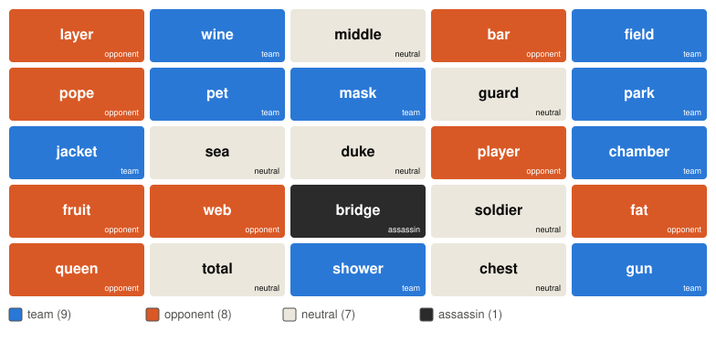
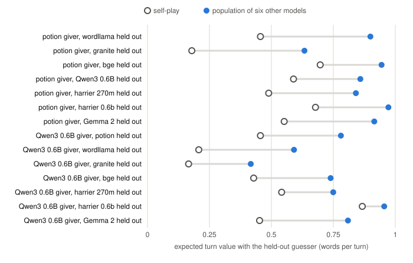

# Codenames

Which models guess the word that a person would pick? And do the clues of a giver built on one model work for a guesser built on another? EmbeddingGemma 2 and the small table potion-base-8M pick the person's word in about 55% of 551 held-out turns; potion with a trained linear map reaches 63%, and gpt-oss-120b, untrained, 65%. A clue keeps 57% to 73% of its value with a guesser built on another model. Of the ways tried to close that gap, only training the giver against a population of other models helped, by 0.31 words per turn (interval 0.26 to 0.36); language models as givers, choosers or listeners did not. The numbers are exact expected values or resampling intervals over held-out games and boards, mostly from plans written before the runs.



*A board dealt by `game.deal` from this folder's 400 WordNet nouns (seed 0). The giver sees the colors; the guesser sees only the words.*

## Findings in plain words

- **What predicts a person's guess.** A small static word table, potion, does as well as the newest embedding models: 54.4% against 54.8% for EmbeddingGemma 2 (difference 0.4 points, −3.8 to 4.6). Training on human turns helps more than a bigger model: a linear map on potion adds 8.8 points (6.3 to 11.4), and LoRA brings Qwen3-Embedding-0.6B from 43.4% to 62.6%. The hosted language model gpt-oss-120b, untrained, picks the person's word in 65.0% of the turns, and its labels on about 19,000 more turns raise the LoRA encoder by 3.3 points (0.9 to 5.9).
- **What a clue loses with a stranger.** A giver expects 1.8 to 2.1 of its words per clue from a guesser on its own model. A guesser on another model finds 57% to 73% of that, and one that follows human association counts finds 37% to 53%.
- **The one thing that helped the giver.** Training it by policy gradient against six other models adds 0.31 words per turn with a seventh it never met, in all 70 runs, at a cost of 0.50 with its own model.
- **What did not help.** Language models as givers lose 0.29 to 0.89 words per turn. Choosing among 120 legal actions, the selected one is 0.059 below the embedding giver's first choice. Trained by GRPO, a 2B model learns to name the first listed clue and is 0.107 below a seven-feature policy. As a listener inside the giver, gpt-oss-120b costs 0.151. A guesser fitted better to people did not make a better giver.


*The primary comparison of each experiment, read from `results/*.json`. Three of four guessing comparisons clear zero, and one of six giving comparisons.*

## Rules as modeled

The rules are those of the Codenames AI competition (Summerville et al. 2019) and of Kim et al. (2019). A board has 25 words: 9 belong to the team, 8 to the opponent, 7 are neutral and 1 is the assassin. Only the team plays. The giver names a clue and a count n, and the guesser picks up to n words, one at a time. The turn ends at the first pick that is not a team word. The team wins when it finds all 9 words and loses if it picks the assassin or the last opponent word. The printed game allows one extra pick beyond n; this model does not. A clue may not be a board word, contain one, or be contained in one. `game.py` holds the rules, and the tests settle the edge cases.

A **Luce guesser** picks a word with probability proportional to exp(similarity / τ) among the words still unpicked, with τ fitted to human guesses on training turns. The guesser built on association counts weights a word by its EAT count plus 0.1, and picks at random when the clue is not an EAT cue. The **value of a turn** is the number of team words found, minus 1 for an opponent word and minus the team words left for the assassin; `luce.py` computes it exactly.

## Results

| Question | Result (95% interval) | How it is known | Detail |
|---|---|---|---|
| Best untrained predictor of human guesses | EmbeddingGemma 2 0.548, potion 0.544; difference 0.004 (−0.038 to 0.046) | exact on 551 test turns in 68 games; 10,000 resamples of games; plan C1 | [c1](results/c1.md) |
| Linear map on potion's clue vectors | +0.088 (0.063 to 0.114), to 0.632 | same; five training seeds; plan C1 | [c1](results/c1.md) |
| LoRA on Qwen3-Embedding-0.6B, minus the potion map | −0.007 (−0.041 to 0.028) | same; three seeds; plan C2 | [c2](results/c2.md) |
| gpt-oss-120b as guesser, minus EmbeddingGemma 2 | 0.102 (0.071–0.135) | same; one reply per prompt; plan C4 | [c4](results/c4.md) |
| Teacher's labels added to the human turns | +0.033 (0.009 to 0.059), to 0.659 | same; three seeds per arm; plan C8 | [c8](results/c8.md) |
| Clue value kept with another model's guesser | 57% to 73% | exact expected values, 200 boards, eight models | [crossplay](results/crossplay.md) |
| Population training minus self-play, held-out guesser | 0.31 (0.26 to 0.36) | exact rewards, 200 boards, 70 runs; stratified bootstrap; plan C3 | [c3](results/c3.md) |
| Language-model giver minus the embedding giver | −0.304 (−0.460 to −0.166) | exact values under seven unseen guessers, 200 boards; plan C4 | [c4](results/c4.md) |
| Language model choosing among 120 actions, minus first choice | −0.059 (−0.116 to −0.005) | same, 200 boards; plan C6 | [c6](results/c6.md) |
| GRPO-trained Qwen3.5-2B minus the feature policy | −0.107 (−0.162 to −0.057) | exact values, 200 boards, three seed pairs; plan C7 | [c7](results/c7.md) |
| gpt-oss-120b as listener, minus first choice | −0.151 (−0.204 to −0.099) | exact values, 300 boards; Holm over four tests; plan C10 | [c10](results/c10.md) |
| A higher assassin cost never raises the largest best count | holds | proved | [mathematics](results/mathematics.md) |
| The value of asking for n words has a single peak in n | holds on 267,237 clues and 100,000 random weightings | checked by computer, not proved | [mathematics](results/mathematics.md) |

Differences are paired by turn or board. Guessing results are shares of turns where the guess is the person's word; giving results are words per turn.

## How the results are checked

- The tests check the exact turn odds of `luce.py` against a sum over every ordered sequence of picks and against 100,000 simulated turns. They check the bootstrap over games against an exact enumeration of every resample of three and four games (`stats.py`, and `c7.interval` for C7).
- `python -m codenames.split --check` rebuilds the split by game from the download and compares it with `splits.json`.
- One C3 run, repeated on this machine, chose the same actions on every board, with values within 1.4e-5 of the runner's. Vectors computed from an empty cache reproduce every best-template number of section 1.
- Summaries copied from the private run store are checked against SHA-256 digests. Experiments C1 to C10 follow plans in `experiments/plans/`, merged before their runs.
- Kim et al. (2019) found that a giver always wins with its own guesser and often loses with another; the pattern is reproduced here with current models.

CI runs the tests; runs that need models, GPUs or paid calls do not run in CI.

## Which models predict human guesses?

EmbeddingGemma 2 and potion tie at the top, and a linear map on potion adds about 9 points. The test turns come from Cultural Codes, split so that no game has turns on both sides (plan C1). The published split puts turns of 165 games in more than one file. The map's gain held at the same size on the new split. Instruction prefixes help the instruction-trained models a little and ruin the others. Detail: [guessers.md](results/guessers.md) and [c1.md](results/c1.md).

| Model | Split by game: same word (95% interval) | Published split |
|---|---|---|
| EmbeddingGemma 2 | 0.548 (0.501–0.595) | 0.607 |
| potion-base-8M | 0.544 (0.498–0.593) | 0.580 |
| Qwen3-Embedding-0.6B | 0.434 (0.391–0.475) | 0.495 |
| EAT counts | 0.309 (0.273–0.345) | 0.305 |
| potion + map | 0.632 (0.589–0.675) | 0.662 (one seed) |

## What is a clue worth to a guesser on another model?

Every giver loses 0.5 to 0.9 words per clue when the guesser is another model, and more with the association guesser. On each of 200 random boards, each giver picks the clue and count with the highest expected value under its own guesser. EmbeddingGemma 2 loses least: its clues keep 73% of their value with other models. In whole games, every model wins all 50 with its own guesser, as Kim et al. found, and mixed pairs win 10 to 42. Detail: [crossplay.md](results/crossplay.md).


*Expected team words found per clue. Along a row, the outlined cell is what the giver expects and the rest is what it gets.*

## Does training on human guesses help?

It makes a better guesser and not a better giver. LoRA on Qwen3-Embedding-0.6B matches the potion map but does not beat it at this data size (plan C2). Adding turns labeled by gpt-oss-120b raises the LoRA student to the level of its teacher (plan C8). As a giver, the tuned Qwen3 differs from the untrained one by −0.035 to 0.043 words per clue, every interval including 0. Detail: [c2.md](results/c2.md), [c8.md](results/c8.md).

| Arm | Training rows | Same word as the person (95% interval) |
|---|---|---|
| Qwen3 0.6B + LoRA, human only | 4,820 | 0.626 (0.585–0.666) |
| human plus teacher | 23,496 | 0.659 (0.615–0.702) |
| teacher only | 18,676 | 0.622 (0.578–0.665) |
| gpt-oss-120b, the teacher (C4) | | 0.650 (0.608–0.693) |

## Do language models guess or give better than embeddings?

They guess better and give worse (plan C4). Four open-weight models were asked with a fixed prompt at temperature 0. As givers, about half of two models' clues broke the clue rule, and on the boards where their clue was legal they trail by more. Language-model guessers, too, do best with the embedding giver's clues. Detail: [c4.md](results/c4.md).

| Giver | Turn value (95% interval) | Minus the embedding giver |
|---|---|---|
| EmbeddingGemma 2, expected value | 0.706 (0.636–0.774) | |
| DeepSeek-V3.2 (selected) | 0.402 (0.263–0.515) | −0.304 (−0.460 to −0.166) |
| gpt-oss-120b | 0.198 (0.102–0.287) | −0.508 (−0.616 to −0.401) |

## Does a giver trained against a population do better with strangers?

Yes, and it is the only change tried here that did (plan C3). `rl.py` trains a policy over 30 shortlisted clues times counts 1 to 4, with seven features from the giver's own model. Two givers each held out each other model in turn, five seeds each. Population play weights most the margin between team and other words, a cautious policy. Self-play trusts its own similarities. This mirrors other-play (Hu et al. 2020). Detail: [c3.md](results/c3.md).



*Held-out guesser's value per task, mean of five seeds and 200 boards. Every filled dot is right of its hollow one.*

| Measure | Value (95% interval) |
|---|---|
| Held-out guesser, population minus self-play | 0.31 (0.26 to 0.36) |
| EAT guesser, population minus self-play | 0.39 (0.31 to 0.46) |
| Own model, population minus self-play | −0.50 (−0.53 to −0.46) |

## Can a language model choose well among legal clues?

No (plans C6 and C7). The EmbeddingGemma 2 giver proposes 30 legal clues with counts 1 to 4, and six hosted models choose one of the 120 actions. The best action in each list is worth 0.444 more than the giver's first choice, yet no model beat the first choice. Qwen3.5-2B trained by GRPO learned to name the first listed clue for one word within about 20 steps, then stopped learning. Detail: [c6.md](results/c6.md), [c7.md](results/c7.md).

| Giver, with unseen guessers | Turn value | Minus the comparison |
|---|---|---|
| C6: Qwen3.8-27B (selected) | 0.640 (0.566–0.712) | −0.059 (−0.116 to −0.005) against the first choice |
| C7: Qwen3.5-2B after GRPO | 0.837 | −0.107 (−0.162 to −0.057) against the feature policy |

## Does a language model help as the listener inside the giver?

No (plan C10). gpt-oss-120b guesses on each of the giver's 10 best clues, and the giver gives the action worth most under those guesses. Mixed into a population of six embedding guessers, it adds nothing measurable. Detail: [c10.md](results/c10.md).

| Hypothesis | Difference (95% interval) | Holm |
|---|---|---|
| Listener minus first choice, strangers | −0.151 (−0.204 to −0.099) | rejects 0 |
| Listener and population minus population, strangers | −0.017 (−0.034 to 0.001) | does not reject |

## Does the population pick's lead hold with language-model guessers?

No (plan C11, part A, with its amendment of 2026-11-20). On 1,000 fresh boards (seed 11004), every arm chose among clues that are not forms of a board word (`legality.strict_legal`). The population pick P beats the first choice F by 0.22 words per turn under potion, the embedding stranger held out of P's population. Under gpt-oss-120b and Llama 3.3 70B, each answering once per clue, P − F is −0.023 (−0.101 to 0.054). With P, the models find about 0.21 fewer words per turn and hit the assassin less often, and the two effects cancel. The test could detect a lead of 0.12 with 80% power, so a lead of half the embedding lead is ruled out by the interval. The 0.24 of C10 is a result about embedding guessers. Part B, the pilot with people, has not been played. Detail: [c11.md](results/c11.md).

| Hypothesis (Holm over both) | Difference (95% interval) | Holm | Holds |
|---|---|---|---|
| H-A1: P − F, mean of the two language models | −0.023 (−0.101 to 0.054) | does not reject | no |
| H-A2: H-A1's difference minus P − F under potion | −0.245 (−0.329 to −0.161) | rejects 0 | yes, the lead shrinks |

Played-out turn values on 998 boards (two boards lacked a usable reply), bootstrap over boards. The language models are a proxy for people too. C10's original arms, which allow forms of board words, give −0.007 (−0.088 to 0.075) on the same boards.

## The best count

If the assassin's cost rises, the largest best count does not rise; the proof is the simplest case of Topkis's monotonicity theorem. In every case checked, the value of asking for n words rises and then falls in n, but that is not proved. Detail: [mathematics.md](results/mathematics.md).

## Data

The official word lists belong to Czech Games Edition and are not used. `words.txt` holds 400 WordNet nouns chosen by `make_words.py`, and clues come from the 12,000 most frequent words in wordfreq 3.1.1 ([results/README.md](results/README.md)).

| Source | What | License | Committed |
|---|---|---|---|
| Princeton WordNet 3.0 | board words, clue filter | Princeton license; its notice travels with copies | `words.txt` only |
| wordfreq 3.1.1 | word frequencies | code Apache 2.0, data CC BY-SA 4.0 | no; a package |
| Cultural Codes (Shaikh et al. 2023) | 6,088 Codenames Duet guesses with clue and board | none in the repository; the paper says CC BY-SA 4.0 is planned | no |
| Edinburgh Associative Thesaurus | first responses to 8,400 cues, 1968–1971 | UK Open Government Licence, as stated by the JSON port; not checked at the source | no |
| SWOW-EN18, USF norms | word associations | CC BY-NC-ND 3.0; no license stated | no; loaders only |
| Eight embedding models | potion, wordllama, granite, bge, Qwen3, two harrier, EmbeddingGemma 2 | MIT or Apache 2.0 | no |

Only Cultural Codes and EAT are used in the numbers above. Prompts, replies, adapters and the teacher's labels are in the private dataset `arclabs561/games-runs`.

## Related work

- Summerville et al. (2019) set up the Codenames AI competition. Kim et al. (2019) compared word2vec, GloVe and WordNet codemasters and guessers in it, and found that twin pairs always win; Jaramillo et al. (2020) found the same drop for mixed pairs.
- Koyyalagunta et al. (2021) generate clues from BabelNet and several embeddings and evaluate them with people. Archibald and Brosnahan (2024) build a giver that adapts to its teammate. Bills, Archibald and Blaylock (AAAI 2025) infer the partner's embedding by Bayesian updating; the ensemble giver here is the version without updating.
- Shaikh et al. (2023) collected Cultural Codes. White, Pandey and Pan (2024) trained a linear map on GloVe from it. They write that the players differ between training and test data; the published files do not have that property.
- Stephenson, Sidji and Ronval (2024) and Hakimov, Pfennigschmidt and Schlangen (2025) use Codenames to benchmark language models. Deshpande et al. (2026) train Qwen3 on Codenames with verifiable rewards; their clue reward scores no better than the untrained start with held-out guessers here.
- Hu et al. (2020) show that agents trained only with themselves form conventions that strangers do not share. Agarwal et al. (2021) recommend the stratified bootstrap that plan C3 uses.

## Open questions

- Does the single-peak property of the value of a turn hold for every weighting?
- Why does a guesser trained on people make a worse giver?
- Would five epochs on the human turns alone give part of the teacher's gain, and does the gain grow with more teacher turns?
- Would language-model givers do better with a prompt that states the whole clue rule and the cost of the assassin, or with a retry after an illegal clue?
- Do language-model clues fare better with people than with embedding guessers?
- Would GRPO with an entropy bonus, more replies per board, or several gradient steps per batch keep exploring past the first listed clue?
- Why does gpt-oss-120b return empty replies on many test calls and almost no validation calls?

[results/README.md](results/README.md) lists these and the other open questions in full.

## Usage

The `codenames` dependency group holds the third-party packages. Times are from a machine with two shared CPUs. [results/README.md](results/README.md) has the commands for every experiment, including the GPU and Inference Providers jobs.

```bash
uv run python -m codenames.fetch all              # models and data, about 100 MB (20 s)
uv run python -m codenames.study calibrate        # section 1 (1 min)
uv run python -m codenames.study crossplay        # section 2 (25 min)
uv run python -m codenames.c1                     # split by game, the plan's run (2 min)
uv run python -m codenames.figures                # the figures in figures/
```

## Files

| File | What |
|---|---|
| `game.py`, `luce.py`, `players.py` | rules and game loop; exact turn odds; givers and guessers |
| `words.py`, `make_words.py`, `words.txt` | board words, clue words, the clue rule |
| `embed.py`, `fetch.py`, `norms.py` | models and vectors; downloads pinned by SHA-256; human data |
| `evaluate.py`, `senses.py`, `study.py`, `train.py` | sections 1 to 4 |
| `split.py`, `splits.json`, `stats.py`, `c1.py`, `heldout.py` | splits by game and player; the bootstrap (C1) |
| `lora.py`, `c2.py`, `distill.py`, `c8.py` | LoRA and the teacher's labels (C2, C8) |
| `rl.py`, `c3.py` | the policy-gradient giver (C3) |
| `llm.py`, `hosted.py`, `c4.py`, `c4score.py` | language-model players (C4) |
| `actions.py`, `rerank.py`, `c6score.py`, `rlvr.py`, `c7.py` | choosing among legal actions (C6, C7) |
| `listen.py`, `c10score.py` | the listener inside the giver (C10) |
| `figures.py`, `figures/` | this README's figures; a test checks they are current |
| `results/` | every number in JSON, and the notes behind each section |
