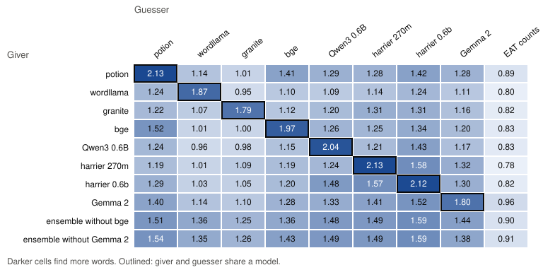

# Codenames

Which models guess the word a person would pick, and do clues chosen for one model work for a guesser built on another? On 551 held-out human turns, EmbeddingGemma 2 and the small table potion-base-8M pick the person's word about 55% of the time, with no detectable difference between them; a linear map trained on human turns lifts potion to 63%, and gpt-oss-120b, untrained, reaches 65%.

Every result about giving clues is scored by model guessers only, a proxy for people that no person has checked. With such guessers a clue keeps 57% to 73% of its value on another model. Training the giver against six other embedding models gains 0.31 words per turn (0.26 to 0.36) with a seventh. But a rule with no training that always asks for one word gets 97% of that gain (exploratory), the trained potion giver's clues break the printed clue rule on 17% of boards against 3.5% for self-play, and it does worse on the AI competition's own score. Under language-model guessers a population pick shows no detectable lead (−0.10 to 0.05), and language models as givers, choosers and listeners all did worse than the embedding giver.


*A board dealt by `game.deal` from this folder's 400 WordNet nouns (seed 0). The giver sees the colors; the guesser sees only the words.*

## Findings in plain words

**Guessing, scored against people's picks** (Cultural Codes, 551 test turns in 68 games):

- **No detectable difference at the top.** potion picks the person's word in 54.4% of turns and EmbeddingGemma 2 in 54.8%. The difference has the interval −3.8 to 4.6 points. Training on human turns helps more than a bigger model: a linear map on potion adds 8.8 points (6.3 to 11.4). LoRA lifts Qwen3-Embedding-0.6B from 43.4% to 62.6%, with no detectable difference from the potion map, for one untuned configuration.
- **A language model guesses best.** gpt-oss-120b, untrained, picks the person's word in 65.0% of turns, 10.2 points (7.1 to 13.5) above EmbeddingGemma 2. Its labels on about 19,000 more turns raise the LoRA encoder by 3.3 points (0.9 to 5.9).
- **How far these hold.** Every test game shares a player with the training games. C1, C2, C4 and C8 scored this one test set in turn, and C8's teacher was chosen from C4's score ([METHOD.md](../experiments/METHOD.md) lists the uses). Cultural Codes is public on GitHub, so gpt-oss-120b may have seen these turns; that was not measured.

**Giving, scored by model guessers only.** METHOD.md counts these as proxy results.

- **What a clue loses with a stranger.** A giver expects 1.8 to 2.1 of its words per clue from a guesser on its own model. A guesser on another model finds 57% to 73% of that, and one that follows human association counts finds 37% to 53%.
- **Population training, and what it amounts to.** Trained by policy gradient against six other embedding models, a giver gains 0.31 words per turn with a seventh, in all 70 runs, at a cost of 0.50 with its own model. Three checks qualify the gain:
  - A rule that always asks for one word gets 97% (89% to 105%) of the gain, and no difference between it and the trained policy is detectable (−0.016 to 0.034, 14 tasks; exploratory).
  - The trained potion giver's clues are a form of a board word, or share a compound part with one, on 16.6% of boards, against 3.5% for self-play. The rulebook forbids both; every experiment here filtered clues only by substrings.
  - On the AI competition's single-team score, it takes 1.24 turns (0.48 to 2.00) more than self-play when the framework's own guessers play (exploratory).

  No language model or person has scored C3's policies. C11 scored a related population pick (C10's, untrained) with two language models: no detectable lead (−0.023, interval −0.101 to 0.054), against a lead of 0.22 under potion.
- **What did not help.**
  - Language models as givers lose 0.29 to 0.89 words per turn, with a fixed prompt, little or no reasoning and no retry.
  - Choosing among 120 legal actions, Qwen3.8-27B is 0.059 words per turn below the embedding giver's first choice. The 64-token reply cap decided that result: on 58% of boards its action was the first choice, by fallback.
  - As a listener inside the giver, gpt-oss-120b costs 0.151 words per turn.
- **A training setup that collapsed.** GRPO on Qwen3.5-2B learned to name the first listed clue for one word, which needs nothing from the board, as the pilot had already shown. C7 is a record of that configuration, not a test of GRPO.


*The primary comparison of each experiment, read from `results/*.json`. Three of four guessing comparisons clear zero, and one of six giving comparisons. Every giving comparison uses model guessers, and C7's is a collapsed training run.*

## Rules as modeled

The rules are those of the Codenames AI competition (Summerville et al. 2019) and of Kim et al. (2019). A board has 25 words: 9 belong to the team, 8 to the opponent, 7 are neutral and 1 is the assassin. Only the team plays. The giver names a clue and a count n, and the guesser picks up to n words, one at a time. The turn ends at the first pick that is not a team word. The team wins when it finds all 9 words and loses if it picks the assassin or the last opponent word. `game.py` holds the rules, and the tests settle the edge cases.

Departures from the printed game (Czech Games Edition, rules of 2015):

- **The clue rule.** A clue may not be a board word, contain one, or be contained in one (`words.legal`). The rulebook instead forbids any form of a board word (broken for BREAK) and parts of compound words, and it allows land for ENGLAND. So the filter here is stricter than the rulebook in some cases and looser in others. `legality.py` holds a closer check, used by C11 and by the [legality diagnostics](results/diagnostics/legality.md).
- **The guesser never stops early.** It picks until n words or a miss. The extra pick beyond n, and clues of 0 or unlimited, are left out.
- **Score.** The value of a turn charges the assassin as the team words left, not as a lost game, so the right amount of risk does not depend on the score.
- **The human data come from Codenames Duet**, a two-player variant with its own key, while every simulated board is classic Codenames with one team.

A **Luce guesser** picks a word with probability proportional to exp(similarity / τ) among the words still unpicked, with τ fitted to human guesses on training turns. The **EAT guesser** uses counts from the Edinburgh Associative Thesaurus, people's first responses to a cue word: it weights a word by its count plus 0.1, and picks at random when the clue is not a cue. The **value of a turn** is the number of team words found, minus 1 for an opponent word and minus the team words left for the assassin; `luce.py` computes it exactly.

## Results

Guessing results are shares of turns where the guess is the person's word; giving results are words per turn. Differences are paired by turn or board. "Exact" means computed exactly for the modeled guessers, with no sampling of their picks.

| Question | Result (95% interval) | How it is known | Detail |
|---|---|---|---|
| Best untrained predictor of human guesses | EmbeddingGemma 2 0.548, potion 0.544; no detectable difference, 0.004 (−0.038 to 0.046) | computed exactly on 551 test turns in 68 games, 10,000 resamples of games; plan C1, use 1 of these turns | [c1](results/c1.md) |
| Linear map on potion's clue vectors | +0.088 (0.063 to 0.114), to 0.632 | same; five training seeds; plan C1 | [c1](results/c1.md) |
| LoRA on Qwen3-Embedding-0.6B, minus the potion map | −0.007 (−0.041 to 0.028), no detectable difference | same; three seeds; plan C2, use 2 | [c2](results/c2.md) |
| gpt-oss-120b as guesser, minus EmbeddingGemma 2 | +0.102 (0.071 to 0.135) | same; one reply per prompt; plan C4, use 3 | [c4](results/c4.md) |
| Teacher's labels added to the human turns | +0.033 (0.009 to 0.059), to 0.659; 0.005 to 0.062 with seeds resampled | same; three seeds per arm; plan C8, use 4 | [c8](results/c8.md) |
| Clue value kept with another model's guesser | 57% to 73% | exact, 200 boards, eight models; exploratory, no interval | [crossplay](results/crossplay.md) |
| Population training minus self-play, held-out embedding guesser | +0.31 (0.26 to 0.36) | exact, 200 boards, 70 runs; stratified bootstrap; plan C3 | [c3](results/c3.md) |
| Population training minus the count-1 rule | +0.009 (−0.016 to 0.034), no detectable difference | same boards and bootstrap, 14 tasks; exploratory | [c3](results/c3.md) |
| Population giver's clues that break the printed rule | potion 16.6% (11.6% to 21.9%), self-play 3.5% (1.0% to 6.0%) | checked by `legality.py`, intervals over boards; exploratory | [legality](results/diagnostics/legality.md) |
| Population minus self-play, competition score (turns, lower is better) | +1.24 (0.48 to 2.00) | simulated, 200 boards, one training seed; exploratory | [bench](results/bench.md) |
| Language-model giver minus the embedding giver | −0.304 (−0.460 to −0.166) | exact under seven unseen embedding guessers, 200 boards; plan C4 | [c4](results/c4.md) |
| Language model choosing among 120 actions, minus first choice | −0.059 (−0.116 to −0.005); first choice by fallback on 58% of boards | same, 200 boards; plan C6 | [c6](results/c6.md) |
| gpt-oss-120b as listener, minus first choice | −0.151 (−0.204 to −0.099) | exact, 300 boards; Holm over four tests; plan C10 | [c10](results/c10.md) |
| Population pick minus first choice, two language-model guessers | −0.023 (−0.101 to 0.054), no detectable difference | played out once per clue, 998 boards; Holm over two tests; plan C11 | [c11](results/c11.md) |
| GRPO-trained Qwen3.5-2B minus the feature policy | −0.107 (−0.162 to −0.057); a collapsed run | exact, 200 boards, three seed pairs; plan C7 | [c7](results/c7.md) |
| A higher assassin cost never raises the largest best count | holds | proved | [mathematics](results/mathematics.md) |
| The value of asking for n words has a single peak in n | holds on 267,237 clues and 100,000 random weightings | checked by computer, not proved | [mathematics](results/mathematics.md) |

## How the results are checked

- The tests check the exact turn odds of `luce.py` against a sum over every ordered sequence of picks and against 100,000 simulated turns. They check the bootstrap over games against an exact enumeration of every resample of three and four games (`stats.py`, and `c7.interval` for C7).
- `python -m codenames.split --check` rebuilds the split by game from the download and compares it with `splits.json`.
- One C3 run, repeated off the runner, chose the same actions on every board, with values within 1.4e-5 of the runner's. Vectors computed from an empty cache reproduce every best-template number of [guessers.md](results/guessers.md) and every number of C1. `calibrate.json` and `senses.json` were regenerated from such vectors on 2026-11-20, after five cells off the best templates had moved by 0.3 to 2.3 points. A test checks that `cautious.py` writes the committed `c3-cautious.json`.
- Summaries copied from the private run store are checked against SHA-256 digests. Experiments C1 to C11 follow plans in `experiments/plans/`, merged before their runs.
- Kim et al. (2019) found that a giver always wins with its own guesser and often loses with another. Here the first holds by construction of the threshold giver, so only the drop for mixed pairs is a comparison with their result, and it is reproduced with current models.

CI runs the tests; runs that need models, GPUs or paid calls do not run in CI.

## Which models predict human guesses?

The test turns come from Cultural Codes, split so that no game has turns on both sides (plan C1). The published split puts turns of 165 games in more than one file. The map's gain holds at the same size on the new split. Instruction prefixes help the instruction-trained models a little and ruin the others. The published-split column has no intervals here; [guessers.md](results/guessers.md) gives them. Detail: [c1.md](results/c1.md).

| Model | Split by game: same word (95% interval) | Published split |
|---|---|---|
| EmbeddingGemma 2 | 0.548 (0.501 to 0.595) | 0.607 |
| potion-base-8M | 0.544 (0.498 to 0.593) | 0.580 |
| Qwen3-Embedding-0.6B | 0.434 (0.391 to 0.475) | 0.495 |
| EAT counts | 0.309 (0.273 to 0.345) | 0.305 |
| potion + map | 0.632 (0.589 to 0.675) | 0.662 (one seed) |

## What is a clue worth to a guesser on another model?

On each of 200 random boards, each giver picks the clue and count with the highest expected value under its own guesser. With another model as guesser, every giver loses 0.5 to 0.9 words per clue. EmbeddingGemma 2 loses least, keeping 73%. In whole games, mixed pairs win 10 to 42 of 50. Detail: [crossplay.md](results/crossplay.md).



*Expected team words found per clue. Along a row, the outlined cell is what the giver expects and the rest is what it gets.*

## Does training on human guesses help?

It makes a better guesser; a better giver has not been detected. LoRA shows no detectable difference from the potion map (plan C2), for one configuration: a learning rate at the top of its grid, one epoch, and 7 negatives per item against the map's 24. The teacher's labels raise the LoRA student by 3.3 points, to no detectable difference from the teacher (plan C8). As a giver, the tuned Qwen3 differs from the untrained one by −0.035 to 0.043 words per clue, every interval including 0. Detail: [c2.md](results/c2.md), [c8.md](results/c8.md).

| Arm | Training rows | Same word as the person (95% interval) |
|---|---|---|
| Qwen3 0.6B + LoRA, human only | 4,820 | 0.626 (0.585 to 0.666) |
| human plus teacher | 23,496 | 0.659 (0.615 to 0.702) |
| teacher only | 18,676 | 0.622 (0.578 to 0.665) |
| gpt-oss-120b, the teacher (C4) | | 0.650 (0.608 to 0.693) |

## Do language models guess or give better than embeddings?

They guess better and, with this prompt, give worse (plan C4). Four open-weight models were asked once per board at temperature 0. The prompt states the clue rule only in part and gives no retry; Qwen3-32B runs with thinking off and gpt-oss-120b at low reasoning effort. About half of two models' clues broke the substring rule and fell back to the embedding giver's one-word clue; where their clue was legal, they trail by more. Language-model guessers, too, do best with the embedding giver's clues. Detail: [c4.md](results/c4.md).

| Giver | Turn value (95% interval) | Minus the embedding giver |
|---|---|---|
| EmbeddingGemma 2, expected value | 0.706 (0.636 to 0.774) | |
| DeepSeek-V3.2 (selected) | 0.402 (0.263 to 0.515) | −0.304 (−0.460 to −0.166) |
| gpt-oss-120b | 0.198 (0.102 to 0.287) | −0.508 (−0.616 to −0.401) |

## Does a giver trained against a population do better with strangers?

With embedding strangers it does, and a count of one accounts for nearly all of it (plan C3). `rl.py` trains a policy over 30 shortlisted clues times counts 1 to 4, with seven features from the giver's own model. Each of two givers, potion and Qwen3, was trained seven times, each time holding out another model, with five seeds: 70 runs. Population play weights most the margin between team and other words and asks for fewer words. A rule with no training that always asks for one word, added after a review, scores within 0.034 of the trained policy. [c3.md](results/c3.md) has the checks against the printed clue rule and the competition score.


*Held-out guesser's value per task, mean of five seeds and 200 boards. Every filled dot is right of its hollow one.*

| Measure | Value (95% interval) |
|---|---|
| Held-out guesser, population minus self-play | 0.31 (0.26 to 0.36) |
| Held-out guesser, count-1 rule minus self-play (exploratory) | 0.30 (0.24 to 0.36) |
| EAT guesser, population minus self-play | 0.39 (0.31 to 0.46) |
| Own model, population minus self-play | −0.50 (−0.53 to −0.46) |

## Can a language model choose well among legal clues?

Not in these runs (plans C6 and C7). The EmbeddingGemma 2 giver proposes 30 legal clues with counts 1 to 4, and six hosted models choose one of the 120 actions. The best action in each list is worth 0.444 more than the giver's first choice, yet no model scored above the first choice. With thinking off and a 64-token cap, the selected model's replies were cut off on 84 of 200 boards. Detail: [c6.md](results/c6.md).

| C6 chooser, scored by seven unseen embedding guessers | Turn value | Minus the first choice |
|---|---|---|
| Qwen3.8-27B (selected) | 0.640 (0.566 to 0.712) | −0.059 (−0.116 to −0.005) |

C7 trained Qwen3.5-2B by GRPO to choose. Within about 20 steps it settled on the first listed clue with count 1, the answer that the pilot had already shown, and from then on most steps had a gradient of 0. Detail: [c7.md](results/c7.md).

| C7 giver, scored by three guessers it did not train with | Turn value | Minus the feature policy |
|---|---|---|
| Qwen3.5-2B after GRPO | 0.837 | −0.107 (−0.162 to −0.057) |

## Does a language model help as the listener inside the giver?

No (plan C10). gpt-oss-120b guesses on each of the giver's 10 best clues, and the giver gives the action worth most under those guesses. Mixed into a population of six embedding guessers, it adds no detectable value. Detail: [c10.md](results/c10.md).

| Hypothesis | Difference (95% interval) | Holm |
|---|---|---|
| Listener minus first choice, strangers | −0.151 (−0.204 to −0.099) | rejects 0 |
| Listener and population minus population, strangers | −0.017 (−0.034 to 0.001) | does not reject |

## Does the population pick's lead hold with language-model guessers?

No lead is detectable (plan C11, part A). C10's population pick P leads the first choice F by 0.239 words per turn under the embedding strangers. On 1,000 fresh boards with strictly legal clues, P − F is 0.22 under potion and −0.023 (−0.101 to 0.054) under gpt-oss-120b and Llama 3.3 70B, each answering once per clue. With P the models find fewer words and hit the assassin less often, and the two effects cancel. The language models never stop early and potion's τ is fitted to people, so H-A2 compares this protocol with the fitted guesser more than one model family with another. Part B, the pilot with people, has not been played. Detail: [c11.md](results/c11.md).

| Hypothesis (Holm over both) | Difference (95% interval) | Holm |
|---|---|---|
| H-A1: P − F, mean of the two language models | −0.023 (−0.101 to 0.054) | does not reject |
| H-A2: H-A1's difference minus P − F under potion | −0.245 (−0.329 to −0.161) | rejects 0 |

## The best count

If the assassin's cost rises, the largest best count does not rise; the proof is the simplest case of Topkis's monotonicity theorem. In every case checked, the value of asking for n words rises and then falls in n, but that is not proved. Detail: [mathematics.md](results/mathematics.md).

## Data

The official word lists belong to Czech Games Edition and are not committed. `bench_data.py` downloads the AI competition framework's copy to rebuild that framework's published boards ([bench.md](results/bench.md)); no file here records those words, and no other result uses them. `words.txt` holds 400 WordNet nouns chosen by `make_words.py`, and clues come from the 12,000 most frequent words in wordfreq 3.1.1 ([results/README.md](results/README.md)).

| Source | What | License | Committed |
|---|---|---|---|
| Princeton WordNet 3.0 | board words, clue filter | Princeton license, in [WORDNET-LICENSE](WORDNET-LICENSE) | `words.txt` and the notice |
| wordfreq 3.1.1 | word frequencies | code Apache 2.0, data CC BY-SA 4.0 | no; a package |
| Cultural Codes (Shaikh et al. 2023) | 6,088 Codenames Duet guesses with clue and board | none in the repository; the paper says CC BY-SA 4.0 is planned | no |
| Edinburgh Associative Thesaurus | first responses to 8,400 cues, 1968 to 1971 | UK Open Government Licence, as stated by the JSON port; not checked at the source | no |
| SWOW-EN18, USF norms | word associations | CC BY-NC-ND 3.0; no license stated | no; loaders only |
| Eight embedding models | potion, wordllama, granite, bge, Qwen3, two harrier, EmbeddingGemma 2 | MIT or Apache 2.0 | no |

Only Cultural Codes and EAT are used in the numbers above. Prompts, replies, adapters and the teacher's labels are in the private dataset `arclabs561/games-runs`.

## Related work

- Summerville et al. (2019) set up the Codenames AI competition. Kim et al. (2019) compared word2vec and GloVe codemasters with word2vec, GloVe and WordNet guessers in it, and found that twin pairs always win; they left WordNet codemasters out of the tournament. Jaramillo et al. (2020) found the same drop for mixed pairs.
- Koyyalagunta et al. (2021) generate clues from BabelNet and several embeddings and evaluate them with people. Archibald and Brosnahan (2024) build a giver that adapts to its teammate. Bills, Archibald and Blaylock (AAAI 2025) infer the partner's embedding by Bayesian updating; the ensemble giver here is the version without updating.
- Shaikh et al. (2023) collected Cultural Codes. White, Pandey and Pan (2024) trained a linear map on GloVe from it. They write that the players differ between training and test data; the published files do not have that property, though they do keep each clue giver in one split, as Shaikh et al. describe.
- Stephenson, Sidji and Ronval (2024) and Hakimov, Pfennigschmidt and Schlangen (2025) use Codenames to benchmark language models. Stephenson et al. report that language-model agents work with a wider range of teammates than agents built on word vectors; their teammates were other language models, not embedding guessers as in C4. Deshpande et al. (2026) train Qwen3 on Codenames with verifiable rewards, in a game with no neutral words or assassin; their clue reward, carried over to this game, scores no better than the untrained start with held-out guessers.
- Hu et al. (2020) show that agents trained only with themselves form conventions that strangers do not share. Strouse et al. (2021, Fictitious Co-Play) train against a population and test with held-out partners, the design of C3. Agarwal et al. (2021) recommend the stratified bootstrap that plan C3 uses.

## Open questions

- Does the single-peak property of the value of a turn hold for every weighting?
- Why does a better model of human guesses not make a better giver? The linear maps gave fewer words per clue on 100 boards, without intervals, and the LoRA encoder shows no detectable difference.
- Does population training add anything over a count of one when the rule is a preregistered baseline, and do C3's policies or the count-1 rule do better than self-play with language-model guessers or with people?
- Did gpt-oss-120b see Cultural Codes in training? Its agreement with people could be rechecked on the test turns with the other board words swapped for words of the same frequency, against the same change for the embedding guessers.
- Would five epochs on the human turns alone give part of the teacher's gain, and does the gain grow with more teacher turns?
- Would language-model givers do better with a prompt that states the whole clue rule and the cost of the assassin, or with a retry after an illegal clue?
- Do language-model clues fare better with people than with embedding guessers?
- Would a chooser with room to reason, or with a cap that cuts off fewer than 5% of replies, choose better than the first choice?
- Would GRPO with the list shuffled for each sample, more replies per board, or an entropy bonus keep exploring past the first listed clue?
- Why does gpt-oss-120b return empty replies on many test calls and almost no validation calls?

[results/README.md](results/README.md) lists these and the other open questions in full.

## Usage

The `codenames` dependency group holds the third-party packages. The four Hugging Face models' vectors are computed on a runner that can reach the Hub and kept on the branch `compute/codenames-embed`. Without them `study calibrate` stops, rather than rewrite `calibrate.json` without their rows. Times are from a fresh clone on a machine with two CPUs at a load of about 2; at a load of 4 to 6 they can be twice as long. [results/README.md](results/README.md) has the commands for every experiment, including the GPU and Inference Providers jobs.

```bash
uv run python -m codenames.fetch all              # models and data, 184 MB on disk (10 to 20 s)
git fetch origin compute/codenames-embed          # the Hugging Face models' vectors, about 240 MB
git restore --source=FETCH_HEAD --worktree -- codenames/vectors/
uv run python -m codenames.study calibrate        # guessers.md (7 min from an empty cache, most of it encoding granite and bge)
uv run python -m codenames.c1                     # c1.md, split by game (2 min)
uv run python -m codenames.cautious run           # the count-1 rule against C3 (2 min)
uv run python -m codenames.study crossplay        # crossplay.md (about 25 min when last run)
uv run python -m codenames.figures                # the figures in figures/
```

`git restore --worktree` writes the vector files without adding them to the index, and git ignores `codenames/vectors/`.

## Files

Many modules are named after the plan they serve, because the plans in `experiments/plans/` name them and are not edited after their runs. This index says what each does.

| Modules | What | Plan or note |
|---|---|---|
| `game.py`, `luce.py`, `players.py` | rules and game loop; exact turn odds; givers and guessers | |
| `words.py`, `make_words.py`, `words.txt`, `legality.py` | board words, clue words, the substring clue rule; the stricter check of forms and compounds | |
| `embed.py`, `fetch.py`, `norms.py` | models and vectors; downloads pinned by SHA-256; human data | |
| `evaluate.py`, `senses.py`, `study.py`, `train.py` | guessers on the published split, cross-play, whole games, linear maps | [guessers](results/guessers.md), [crossplay](results/crossplay.md) |
| `split.py`, `splits.json`, `stats.py`, `c1.py`, `heldout.py` | splits by game and player; the bootstrap over games | C1 |
| `calibration.py` | calibration of the guessers and agreement between people | [guesser-calibration](results/guesser-calibration.md) |
| `lora.py`, `c2.py` | LoRA fine-tuning, its GPU job and its analysis | C2 |
| `rl.py`, `c3.py`, `cautious.py` | the policy-gradient giver; plan C3's runs and analysis; the count-1 rule | C3 |
| `llm.py`, `hosted.py`, `providers.py`, `c4.py`, `c4score.py` | language-model prompts and parsing; calls with a cost meter; provider pinning; C4's jobs and scoring | C4 |
| `actions.py`, `rerank.py`, `c6score.py` | the 120 legal actions; language models choosing among them; scoring | C6 |
| `rlvr.py`, `c7.py` | the GRPO job; its tables, the feature policy and the analysis | C7 |
| `distill.py`, `c8.py` | the teacher's labels on resampled boards; the analysis | C8 |
| `listen.py`, `c10score.py` | the listener inside the giver; scoring | C10 |
| `c11.py`, `human_pilot.py` | C11's lists, guesses and tests; the page for the pilot with people | C11 |
| `bench.py`, `bench_data.py`, `bench_play.py` | the AI competition framework's bots, replayed and played | [bench](results/bench.md) |
| `diagnose.py`, `diagnose_c3.py`, `diagnose_records.py` | per-board records, case files, slices and the legality check of every arm | [diagnostics](results/diagnostics/) |
| `figures.py`, `figures/` | this README's figures; a test checks they are current | |
| `results/` | every number in JSON, and the notes behind each section | [index](results/README.md) |
