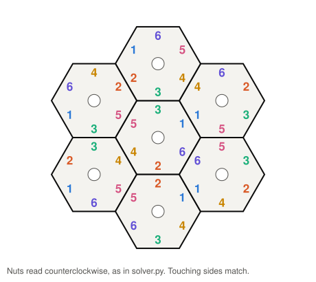
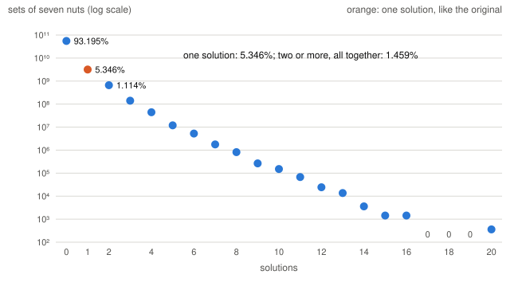

# Drive Ya Nuts

Do the seven nuts fit together in only one way, and was the designer lucky to get a set like that? The original nuts have exactly one solution. Of all 59,487,568,920 sets of seven distinct nuts, 6.805% can be solved, and 78.56% of those have exactly one solution, so a single solution is the usual case once a set can be solved at all. Up to renaming the numbers there are 82,628,379 different sets. If a nut may appear twice, 6,901,100 classes can be solved, as a comment on Mathematics Stack Exchange reports. Every count is exact, by counting every arrangement and by Burnside's lemma, and checked against brute force.



*The original nuts in their one solution, found by `figures.py` with its own search. Each touching pair of sides shows the same number.*

## Rules as modeled

- A **nut** is a hexagon with the numbers 1 to 6 on its sides, one each, in some order. Two nuts are the same if one is a rotation of the other, so there are 120 distinct nuts.
- A **solution** places one nut in the middle and six around it so that every pair of touching sides shows the same number. Solutions that differ by turning the whole puzzle are counted once.
- A **set** is seven distinct nuts. Sets in which a nut appears twice are not counted. The original nuts come from the Cube Lovers post by Stan Isaacs (see Sources).
- Two sets are **equivalent** when renaming the numbers 1 to 6 turns one into the other. Equivalent sets have the same number of solutions. A **class** is a group of equivalent sets.

## Results

All results are exact.

| Result | Value | How it is known |
|---|---|---|
| Solutions of the original nuts | 1 | exhaustive search (`solver.py`), and a second search in `figures.py` |
| Sets of seven distinct nuts | C(120, 7) = 59,487,568,920 | counted |
| Sets that can be solved | 4,048,011,480 (6.805%), about 1 in 15 | exact count of every arrangement (`exact.py`) |
| Sets with exactly one solution | 3,180,020,160 (5.346%), about 1 in 18.7 | same |
| Share of solvable sets with one solution | 78.56% | same |
| Most solutions of any set | 20, for 360 sets | same |
| Mean solutions per set | 2,558,824 / 29,160,573 = 0.0877 | same |
| Classes of sets up to renaming | 82,628,379 | Burnside's lemma (`classes.py`) |
| Classes with exactly one solution | 4,417,343 of the 5,623,238 solvable (78.56%) | Burnside's lemma, per number of solutions |
| Solvable multisets of seven nuts, a nut allowed more than once | 4,967,864,520, of which 919,853,040 repeat a nut | exact (`multisets.py`) |
| Classes of those up to renaming | 6,901,100, as the Stack Exchange comment reports | two methods that agree: a direct listing and Burnside's lemma |
| Search size of the original: calls of a fixed solver, one complete search from each side of the center, added up | 573 with the solver's look-ahead, 855 without | counted; two implementations agree |
| One-solution sets that need a smaller search than the original | 42.64% with the look-ahead, 54.25% without | exact, by listing all 3,180,020,160 (`difficulty.c`); sampled, 200,000 sets, seeds 1 to 10: 42.67% (95% interval 42.46% to 42.89%) |

## How the results are checked

- **Smaller nuts.** The construction of `exact.py` works for nuts with n sides. For four and five sides, the tests compare it with a direct count of every ring around every center, with no renaming, and with brute force on each set (all 6 sets for four sides, 300 random sets of the 134,596 for five sides).
- **Totals.** For six sides, the total number of solutions, 5,220,000,960, equals 120 × 43,500,008, and every count of sets that contain C0 is divisible by 7, as step 4 of the method requires. The tests check the first.
- **Set by set.** With `--check 3000`, 3,000 sets that contain C0 were solved one at a time with `solver.py`. Half were drawn uniformly and half from the solvable sets. All 3,000 counts matched. The tests run the same check for five sides.
- **Sampling.** The exact shares fall inside the 95% Wilson intervals of random samples. With `--distribution --trials 5000 --seed 0`, 6.84% of sets were solvable (interval 6.17% to 7.57%) and 5.42% had one solution (4.83% to 6.08%). An earlier sample of 5,000 sets gave 7.5% and 5.8%, whose intervals are 6.80% to 8.26% and 5.19% to 6.48%. With `--trials 100000 --seed 0`, the shares were 6.825% solvable (interval 6.670% to 6.983%), 5.393% with one solution (5.255% to 5.535%) and 1.081% with two (1.019% to 1.147%). The exact shares, 6.805%, 5.346% and 1.114%, fall inside all three.
- **Classes.** For four and five sides, the tests list every class directly by renaming each set in all n! ways. They compare three things with `classes.py`: the number of classes (1 and 1,176), the classes with each number of solutions, and the classes of each size. For six sides, 720 divides each weighted count, as Burnside's lemma requires. With `--direct 4`, the 89,853 classes with four or more solutions were also found directly, by taking the least renaming of each set from the exact table, and agreed in every row.
- **Multisets.** The two methods of `multisets.py` agree for six sides (6,901,100) and for five (276). For four and five sides, the tests compare them with a brute force over every multiset. For five sides, 3,000 random multisets are each solved and looked up among the listed classes, and every one is found exactly when it can be solved. The direct listing also finds 5,623,238 classes with seven different nuts, the count of `classes.py`.
- **The figures.** A test checks that the committed SVGs are what `figures.py` draws. Its search for the original solution shares no code with `solver.py` and also finds exactly one.

CI runs the tests. The full counts take minutes and 2 GB, so CI checks them through the smaller cases and the committed tables.

## How lucky was the designer?

Not very, once the set can be solved: among the sets that can be solved, 78.56% have exactly one solution, as the original does. The rarer property is solvability, which about one random set in 15 has. This assumes the designer drew seven distinct nuts at random. Nothing is known here about how the nuts were in fact chosen.



*How many solutions a set of seven distinct nuts has (`exact_counts.csv`). Note the log scale: sets with one solution, like the original, outnumber all the sets with more.*

| Solutions | Sets | Share |
|---:|---:|---:|
| 0 | 55,439,557,440 | 93.195% |
| 1 | 3,180,020,160 | 5.346% |
| 2 | 662,739,120 | 1.114% |
| 3 | 140,663,280 | 0.236% |
| 4 | 44,263,560 | 0.074% |
| 5 to 9 | 20,061,600 | 0.034% |
| 10 to 20 | 263,760 | 0.0004% |

The full table is in [`exact_counts.csv`](exact_counts.csv). No set has more than 20 solutions, and 360 sets have exactly 20.

**Method.** Counting set by set is out of reach, so `exact.py` counts arrangements and groups them by set. Call a **ring** a center nut with six outer nuts whose touching edges all match. A set's solution count is the number of rings that its seven nuts make.

1. Any permutation of the numbers 1 to 6 renames rings to rings and keeps the count of every set. Any nut can be renamed to C0 = (1, 2, 3, 4, 5, 6), so it is enough to list the rings around C0.
2. Let e_i be the number on the edge shared by outer nuts i and i + 1. The outer nut in direction i then reads, in order:
   - i + 1, the number it shares with the center;
   - e_{i-1};
   - three other numbers, in any of 3! orders;
   - and e_i.

   Each e_i must differ from i + 1, from i + 2 and from e_{i-1}, and 1,144 of the 6^6 sequences do. That gives 1,144 × 6^6 = 53,374,464 candidate rings around C0, of which 43,500,008 have seven distinct nuts.
3. A ring with another center C and C0 among its outer nuts is a renamed ring around C0. For each C, the code renames the rings around C0 that contain the nut that becomes C0. This lists every ring whose set contains C0, 7 × 43,500,008 in all.
4. Sorting those rings by set gives the count of every set that contains C0. Each nut is in the same number of sets with k solutions, so the number of all such sets is 120 / 7 times the number that contain C0.

## How hard is the original set?

About average among the sets with one solution. A fixed solver needs 573 steps for the original. Of the 3,180,020,160 sets with exactly one solution, 42.64% need fewer steps, 0.31% the same number and 57.05% more; the median is 597. Exact, by listing every such set.


*Search sizes of all one-solution sets, with the look-ahead (`difficulty.json`). The original sits just right of the peak and left of the median.*

The measure is the size of the search tree of the solver in `solver.py`. It puts each nut in the center and then fills the outer places in order around it. A nut fits a place when it matches the nut placed before it. The solver also skips a nut when its far side would show the number that the next nut must turn toward the center (the **look-ahead**). A **step** is one partial placement that passes these checks, dead ends included; the search finds every solution, so the order in which nuts are tried does not change the count. The count does depend on which side of the center the search starts from, so the **search size** adds the six complete searches, one from each side. It is then the same for every set of a class, and for mirror images.

A plain search without the look-ahead needs 855 steps for the original, and 54.25% of one-solution sets need fewer (median 838). By both measures the original is near the middle of the range, which runs from 274 to 1,864 steps with the look-ahead. The measures differ only on which side of the median it falls.

Each set with one solution has one ring, and renaming the numbers gives every center the same distribution of sizes. So `difficulty.c` lists the rings around C0 as in step 2 of the method above and keeps the 43,500,008 with seven different nuts. It solves the set of each and measures the 26,500,168 sets with one solution; 120 times that is the count of one-solution sets in `exact_counts.csv`. The number of rings in sets with k solutions, times 120 / k, also gives that table's count for every k. A separate Python search (`difficulty.py`) counts the same steps as `solver.recur`, call for call, and agrees with the C program on 61 sets. It drew 200,000 one-solution sets through random rings (seeds 1 to 10, 20,000 each, on GitHub Actions); their shares fall within the 95% intervals around the exact ones. The outputs are on the branches `compute/dyn-difficulty-exact-44790595008` and `compute/dyn-difficulty-sample-44790600897`.

## How many essentially different sets are there?

There are 82,628,379 classes, and 4,417,343 of them have one solution. Nuts are already counted up to rotation, so a class is a set of nuts up to rotating each nut and renaming the numbers.

By Burnside's lemma, the number of classes is the average over the 720 renamings of the number of sets that each one leaves unchanged. A renaming leaves a set unchanged when the set is made of whole cycles of the renaming acting on the 120 nuts. A renaming keeps a nut only if it turns the nut's numbers around the nut, so only renamings of cycle types (6), (3, 3) and (2, 2, 2) keep any nut. Renamings of every other type move all nuts in cycles of one length, 2 to 6, and seven is not a multiple of any of these. Counting the unions of cycles gives the following:

| Renamings | Cycle type | Sets each leaves unchanged |
|---:|---|---:|
| 1 | identity | 59,487,568,920 |
| 120 | (6) | 44 |
| 40 | (3, 3) | 4,788 |
| 15 | (2, 2, 2) | 311,144 |
| 544 | any other | 0 |

The number of classes is the weighted sum of the last column divided by 720:

- 59,487,568,920 for the identity;
- plus 120 · 44, 40 · 4,788 and 15 · 311,144 for the three other types;
- which comes to 82,628,379 classes.

Counting only the sets with k solutions gives the classes with k solutions. The identity's share is the exact table above; for the other renamings, `classes.py` lists the sets that each one leaves unchanged and solves them, one renaming of each type. Every class count is exact:

| Solutions | Classes | Share |
|---:|---:|---:|
| 0 | 77,005,141 | 93.195% |
| 1 | 4,417,343 | 5.346% |
| 2 | 920,648 | 1.114% |
| 3 | 195,394 | 0.236% |
| 4 | 61,572 | 0.074% |
| 5 to 9 | 27,908 | 0.034% |
| 10 to 20 | 373 | 0.0005% |

The full table is in [`class_counts.csv`](class_counts.csv). Of the 5,623,238 classes that can be solved, 4,417,343 (78.56%) have exactly one solution. The shares match those for sets to three decimals because nearly every class holds 720 sets. Only 13,365 classes have a set that some renaming other than the identity leaves unchanged: 12,953 classes of 360 sets, 386 of 240 and 26 of 120. The original nuts are not among them, so their class holds 720 sets. The one class with 20 solutions holds 360 sets.

This answers the Mathematics Stack Exchange question [How many essentially different Drive Ya Nuts puzzles exist?](https://math.stackexchange.com/questions/3306917/how-many-essentially-different-drive-ya-nuts-puzzles-exist) (2019), which had no answer when checked in November 2026. It asks for the number of sets of seven different nuts up to renaming, and for how many of them have a unique solution. It reads nuts clockwise, which turns every set into its mirror image, with the same number of solutions, so the counts are the same. The question expects only renamings that are 6-cycles or 5-cycles to keep a set, and its edit proves that 5-cycles keep none. The counts above show that 6-cycles and renamings of types (3, 3) and (2, 2, 2) do. A comment there reports 6,901,100 classes of solvable sets in which a nut may appear twice; the next section defines that count and confirms it.

## When a nut may appear twice

There are 6,901,100 classes of solvable multisets, the number the Stack Exchange comment reports. Exact, by two methods that agree.

- A **multiset** is seven nuts, where a nut may appear more than once. It is **solvable** when some ring is made of exactly those seven nuts.
- Two multisets are equivalent when renaming the numbers turns one into the other, as for sets.
- The comment's method is to take every ring around C0 (1,144 · 6<sup>6</sup> = 53,374,464 of them, repeated nuts included) and rename it each of the 42 ways that turn one of its nuts into C0. The least result, sorted, is the same for every multiset of a class, so distinct least results are classes.

Two methods count them. The **direct listing** follows the comment and finds 6,901,100 least results. The comment also says that four classes have one ring around C0 and two have 120, with an example of each, and the listing agrees on all four. **Burnside's lemma** averages, over the 720 renamings, the number of solvable multisets each one fixes:

| Renamings | Cycle type | Solvable multisets each fixes |
|---:|---|---:|
| 1 | identity | 4,967,864,520 |
| 15 | (2, 2, 2) | 57,192 |
| 40 | (3, 3) | 1,650 |
| 120 | (6) | 30 |
| 544 | any other | 0 |

The identity's count is the 4,048,011,480 solvable sets of distinct nuts plus 919,853,040 multisets with a repeated nut. The second number comes from every ring whose multiset contains C0, weighted by the number of different nuts, as in step 4 of the method above. A multiset fixed by another renaming has the same number of copies of every nut in a cycle, and each one is solved by search. The weighted sum is 4,968,792,000, which is 720 × 6,901,100.

| Different nuts in the multiset | Classes |
|---:|---:|
| 7 | 5,623,238 |
| 6 | 1,181,281 |
| 5 | 93,345 |
| 4 | 3,170 |
| 3 | 64 |
| 2 | 2 |

The 5,623,238 classes of seven different nuts are the solvable classes of the section above. The two classes with only two different nuts each hold three copies of one nut and four of the other. The counts are in [`multiset_counts.json`](multiset_counts.json).

## Data

| Source | What | License | Committed |
|---|---|---|---|
| Stan Isaacs, Cube Lovers | the numbers on the seven original nuts | unknown; a mailing-list post | yes, as seven tuples of numbers in `solver.py` |
| `exact_counts.csv`, `class_counts.csv` | the exact tables above | written by `exact.py` and `classes.py` | yes |

## Sources

- Jaap Scherphuis, [Circus Seven / Drive Ya Nuts](http://www.jaapsch.net/puzzles/circus.htm): the puzzle and its relatives.
- Stan Isaacs, [drive ya nuts](http://www.math.rwth-aachen.de/~Martin.Schoenert/Cube-Lovers/Stan_Isaacs__drive_ya_nuts.html), Cube Lovers: the numbers on the original nuts.
- M. Zarecky and A. Parker, [Describing a combinatorics problem with a system of polynomial equations](http://www.wittenberg.edu/sites/default/files/media/computer_science/forms/sumInSMC.pdf).
- J. Sawada, [A fast algorithm to generate necklaces with fixed content](http://www.cis.uoguelph.ca/~sawada/papers/alph.pdf), *Theoretical Computer Science* 301 (2003).

## Open questions

- How many solutions do the 6,901,100 classes of multisets have? The listing counts rings around C0 for each class, which is not the number of solutions of one multiset. Counting those would need the listing of every ring that contains C0, as `exact.py` does for sets.
- How were the original nuts chosen? A designer who kept drawing until a set had one solution would find one after about 18.7 draws on average.

## Usage

Run from the repository root. `numpy` is in the `drive_ya_nuts` dependency group.

```bash
uv run python -m drive_ya_nuts.solver               # solves the original puzzle
uv run python -m drive_ya_nuts.solver --no-original --distribution --trials 5000 --seed 0   # sampled shares
uv run python -m drive_ya_nuts.solver --no-original --find-k 1 --seed 0 --max-tries 100000 --print-found 1   # a set with one solution
uv run --group drive_ya_nuts python -m drive_ya_nuts.exact     # every set exactly: about 3 min of CPU and 2 GB
uv run --group drive_ya_nuts python -m drive_ya_nuts.classes   # classes up to renaming: about 30 s
uv run --group drive_ya_nuts python -m drive_ya_nuts.multisets # multisets, both methods: about 15 min and 3 GB
uv run python -m drive_ya_nuts.figures              # the figures in figures/
uv run python -m drive_ya_nuts.difficulty sample --samples 20000 --seed 1 --out DIR   # under a minute on Actions
uv run python -m drive_ya_nuts.difficulty exact --part 0 --parts 8 --out DIR          # one eighth of every set; about 2 min
uv run python -m drive_ya_nuts.difficulty report --runs DIR   # difficulty.json and figures/difficulty.svg
```

`exact` takes `--write` to rewrite `exact_counts.csv` and `--check 3000` to solve 3,000 random sets one at a time and compare. `classes` takes `--direct 4` to list the classes with four or more solutions one by one, which takes about 6 minutes and 2 GB.

## Files

| File | Contents |
|---|---|
| `solver.py` | The original nuts, a solver, and sampling of random sets |
| `exact.py`, `exact_counts.csv` | The exact count of solutions for every set |
| `classes.py`, `class_counts.csv` | Burnside's lemma and the classes up to renaming |
| `multisets.py`, `multiset_counts.json` | Classes of solvable multisets, by the direct listing and by Burnside's lemma |
| `figures.py`, `figures/` | This README's figures, as SVG; a test checks they are current |
| `difficulty.py`, `difficulty.c`, `difficulty.json` | Search sizes of the fixed solver: the Python search and sampling, the C listing of every one-solution set, and their combined results |
