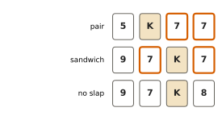

# Egyptian Ratscrew

How likely is a challenge to be answered, how long does a game last, does it always end, and how much does slapping speed matter?

- With no slaps, a challenge is answered 29% of the time after a jack and 76% after an ace. Following the whole exchange, the player who laid a jack keeps the pile 81% of the time, and the player who laid an ace half the time. Exact, by recursion on the unseen cards.
- Two players who slap equally fast take a median of 289 cards per game, and four take 1,051. After 300 cards, 27% to 28% of the remaining two-player games end within each further 100 cards, a steady rate, as for a geometric tail rather than a power law. Simulated, 10,000 games each.
- Random slaps do not make every game end. With the six cards 2 2 3 3 J J, 16 of the 720 orders of the deck loop forever without a single slappable pile. A game ends with probability 1 exactly when it cannot reach such a trapped position, and then the chance that it lasts more than t cards is at most a constant times ρ^t for an explicit ρ < 1, so the tail decays at least geometrically. Proved by hand, and exact for eight small decks by searching every position. For the full deck it is not known whether a trapped position exists. Every loop of Beggar-my-neighbour checked here (the three of Casella et al. and 103,992 from their template) lays a royal pair or sandwich, which can always be slapped; the loops of Andorno et al. (2026) were not checked. A slap is not always a way out, though: the deal J 2 4 6 7 against 2 3 5 J never ends, although a sandwich is slapped about once every 45 cards, whoever wins it. Exact, by listing all 745 positions it can reach. See [Does every game end?](#does-every-game-end).
- Winning 55% of the slaps wins 64% of the games, and winning 70% wins 90%. On the logit scale the win chance is close to a straight line, 5.50 times the difference in shares. Simulated, 20,000 games at each of nine shares.
- Laying the first card is a small disadvantage. With equal shares the first of two players wins 49.77% of games (95% interval 49.67% to 49.86%, 1,000,000 games), about one game in 435 below half. With four players the seats win 24.91%, 24.89%, 24.99% and 25.21% of 200,000 games, each ± 0.19 points, and a chi-squared test of equal seats gives p = 0.15; an effect as small as the two-player one could not be resolved with that many games. With slaps off, the game is Beggar-my-neighbour, and on random deals the first player wins 49.87% (49.77% to 49.97%, 1,000,000 deals). That is the direction [Andorno et al. (2026)](https://arxiv.org/abs/2602.23406) report for smaller decks. The same deals match [Truman Collins's](http://tkcs-collins.com/truman/byn/byn.shtml) figures from 369.4 billion deals: 2.695% end after 11 tricks against his 2.70150%, and 51.95% after 6 to 28 tricks against his "just over 50%".
- Misslaps, with a one-card penalty (the [Bicycle rules](https://bicyclecards.com/how-to-play/egyptian-rat-screw) say one or two cards), shift the win curve to the right; its slope on the logit scale falls only from 5.5 to 5.0. A fast player who misslaps after 1% of the cards that cannot be slapped needs 51.2% of the slaps to win half the games against a careful one; at 5% they need 56.1%, and at 10%, 61.7%. Simulated, 20,000 games per point; the break-even shares are read off fitted lines and carry no interval.
- For three and four players, give each player the strength exp(2.75 n s), where s is their slap share and n the number of players, and a player's chance of winning is their share of the total strength. The constant comes from the two-player games alone. It predicts win chances on 60 random share vectors for each number of players with a root mean square error of 0.017 (three players) and 0.022 (four), against 0.005 from sampling alone. A power law refitted to the same vectors for each number of players does better in sample (0.010 and 0.009); it was not tested on other vectors. The entropy and the sum of squares of the shares rank the favorite's chances poorly. Simulated, 4,000 games per vector.



*Piles that can and cannot be slapped, drawn by `figures.py`. Royals are shaded; the matching cards of a pair or sandwich are outlined.*

## Rules as modeled

The rules follow the [Bicycle rules](https://bicyclecards.com/how-to-play/egyptian-rat-screw), with one slap rule set:

- The deck is dealt out evenly, face down. In turn, players lay their top card face up on a central pile. Suits never matter.
- A **royal** (J, Q, K or A) is a **challenge**: the next player must lay a royal within 1, 2, 3 or 4 cards. If they do, the challenge is **answered** and passes to the next player; if not, the **challenger**, who laid the last royal, takes the pile and leads the next trick.
- A pile is **slappable** when its top two cards are a **pair** (the same rank) or its top three are a **sandwich** (the same rank with one card between). The first to slap takes the pile and leads. Who wins a slap is modeled by fixed **shares**: player i wins with chance s_i, and reaction times are not modeled. Bicycle lists five more slap rules (top and bottom, tens, jokers, four in a row, marriage); they are not modeled, so piles here are slappable less often than at a table that plays them, and every simulated number depends on this choice.
- A **misslap**, a slap at a pile that cannot be slapped, costs one card, put face down under the pile (Bicycle allows one or two). A player out of cards may still slap back in; one who misslaps with no cards is out.
- The game ends when one player holds every card not on the pile and no challenge is open.

## Results

| Result | How it is known |
|---|---|
| The challenger keeps the pile with chance 0.811 after a jack, 0.674 after a queen, 0.574 after a king and 0.503 after an ace. | Exact, by recursion on counts of unseen cards; checked by brute force on small decks and by simulation (20,000 exchanges per royal, seed 1) |
| Counting only the first answer, as simple arithmetic does, gives a chance from 0.706 after a jack to 0.236 after an ace: 13% below the exact answer for a jack and under half of it for an ace. | Exact |
| Two players with equal shares take a median of 289 cards, four take 1,051. Long two-player games end at a steady 0.0031 per card (0.0030 to 0.0032 after 300 cards). | Simulated, 10,000 games each, seeds 2 and 4 |
| Six cards, 2 2 3 3 J J, can loop forever with no slappable pile: 16 of the 720 orders deal into such a trap. | Exact, every position |
| Among all decks of up to eight cards, for two and three players, traps occur only in three six-card and three eight-card deck types, and none offers a slap. Of the 1,349 nine-card deck types, 31 have a trap for two players. | Exact, every position of every deck type |
| The nine-card deal J 2 4 6 7 against 2 3 5 J never ends, whoever wins its slaps: a trap with slaps in it. | Exact: all 745 reachable positions listed by the rules alone, and the chain's closed classes; 1,000 games of the rules engine (seed 3) run 20,000 cards without ending |
| Without a reachable trap the tail is geometric. On 2 2 3 3 J Q the exact rate is 0.891 per card and the mean 7.78 cards; 20,000 simulated games give 7.69 to 7.80. | Proved by hand; exact for small decks; simulated check, seed 5 |
| Whether some deal of the full deck reaches a trap. | Not known |
| Winning 55% of the slaps wins 64% of the games, 70% wins 90%; the scaled logistic strength predicts three- and four-player win chances with root mean square errors of 0.017 and 0.022. | Simulated, with seeds and intervals in `runs.json` |
| The first of two players wins 49.77% (49.67% to 49.86%); with slaps off, 49.87%, in the direction Andorno et al. (2026) report; trick counts agree with Collins's. | Simulated, 1,000,000 games each |

The notebook works through these in the order of Peter Norvig's [War notebook](https://github.com/norvig/pytudes/blob/main/ipynb/war.ipynb): simple arithmetic, brute force, simulation, and an exact method on an abstract deck, and it ends with a comparison of the two games. In War the arithmetic estimate of a sweep is within 1.7% of the exact answer; in Ratscrew the arithmetic misses the counter-challenges, which matter most after an ace. A game of War, in Norvig's simulation, has a median of 224 plays of at least two cards each, so at least 448 cards, longer than a two-player game of Ratscrew (289).

`game.py` holds the rules and the exact recursion, `termination.py` the game as a Markov chain on positions, `traps.py` the census of small decks (written to `traps.json`; a test recomputes the rows for four to six cards), and `egyptian_ratscrew.ipynb` works through the questions. `study.py` plays the large runs in seeded chunks and records them in `runs.json`; the notebook reads that record, and the tests replay parts of it. Reaction times are not modeled: each slap goes to a player with a fixed chance. With slapping turned off the game is Beggar-my-neighbour, so the tests check the rules against record deals from [Richard Mann's list](https://richardpmann.com/beggar-my-neighbour-records.html), which end after exactly the published 8,344 and 7,225 cards, and against the first deal known never to end (Casella et al., 2025). For two older records, the tricks of one (712) and the cards of the other (6,913) counted here agree with the BeggarMyPython checker that Mann's list links to, and each differs by one from the list itself.

```bash
uv run python -m egyptian_ratscrew.game
uv run --group egyptian_ratscrew python -m egyptian_ratscrew.figures  # the SVGs in figures/
uv run --group egyptian_ratscrew --with jupyter jupyter lab egyptian_ratscrew/egyptian_ratscrew.ipynb
uv run python -m egyptian_ratscrew.study  # plays any run missing from runs.json; under an hour on two cores
uv run python -m egyptian_ratscrew.termination  # small decks, loops and tail rates; about five minutes
uv run python -m egyptian_ratscrew.termination --template  # adds the template search; ten more minutes
uv run python -m egyptian_ratscrew.traps 2 3 4 5 6 7  # every deck type of 2 to 7 cards, two and three players; about two minutes
uv run python -m egyptian_ratscrew.traps 9 --players 2 --slice 0 --slices 16 --out DIR  # one slice of the nine-card census
```

## Does every game end?

Not always. Slaps bring chance into the game only when a pile can be slapped, so a deal whose play never offers a slap behaves as Beggar-my-neighbour and can loop forever. The smallest such deck has six cards, 2 2 3 3 J J. When no such trapped position can be reached, the game ends with probability 1 and the chance of lasting more than t cards decays at least geometrically, with an explicit rate (Theorem 1, proved by hand). Small decks are settled position by position: no deck of five or fewer cards has a trap, and the first trap whose loop offers slaps has nine cards. For the full deck it is not known whether a trap can be reached. [results/termination.md](results/termination.md) has the theorems and proofs, the tables for small decks, the census of every deck type up to nine cards, the loops of the full deck that were checked, and how each claim is known.

## Data and sources

| Source | What | License | Committed |
|---|---|---|---|
| [Bicycle rules](https://bicyclecards.com/how-to-play/egyptian-rat-screw) | the rules, and the slap rules not modeled | publisher's copyright | no; paraphrased |
| [Richard Mann's list of records](https://richardpmann.com/beggar-my-neighbour-records.html) | record deals of Beggar-my-neighbour, used in the tests | no terms stated; deals are facts | the deals, in the tests |
| B. Casella et al., "A Non-Terminating Game of Beggar-My-Neighbor", *The American Mathematical Monthly* 132(10), 2025, 978–994 ([doi](https://doi.org/10.1080/00029890.2025.2558484); [arXiv:2403.13855](https://arxiv.org/abs/2403.13855)) | the looping deals and the pieces of their construction (Appendix C) | arXiv preprint; the deals are facts | the deals, in the tests and `termination.py` |
| [Truman Collins's Beggar-my-neighbour page](http://tkcs-collins.com/truman/byn/byn.shtml) | his counts over 369.4 billion deals, and four one-trick deals | no terms stated | the four deals, in the tests |
| G. Andorno et al., [arXiv:2602.23406](https://arxiv.org/abs/2602.23406) (2026) | the first player's share in Beggar-my-neighbour, and further loops | arXiv | no |
| P. Norvig, [War notebook](https://github.com/norvig/pytudes/blob/main/ipynb/war.ipynb) | the order of the notebook, and War's median length | MIT | no |

Other sources, cited in [results/termination.md](results/termination.md): Paulhus (1999), Lakshtanov and Roshchina (2012), Aleksenko and Lakshtanov (2013), Kemeny and Snell (1960) and Seneta (1981).

## Open questions

- Can a deal of the full deck reach a trapped position? A trap with slaps in it, as in the nine-card deck, would not show up as a slap-free loop of Beggar-my-neighbour, so searching those loops is not enough.
- Which nine-card deck types have a trap with three players? The census was run for two players only.
- What is the smallest deck with a trap with slaps in it for three players? For two players it has nine cards, and the census finds one such deck type among the 1,349.
- Is the seat effect with four players zero, or too small to see in 200,000 games? Each seat's share is known to ± 0.19 points, about the size of the two-player effect.
