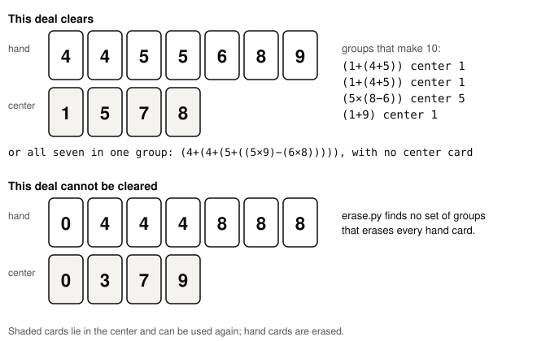

# Erase

<!-- shared:summary -->

Your score in Erase is the number of cards you have left. Could everyone always score zero? Under the printed rules you erase pairs that add to 10. Even with perfect play, 96.02% of deals leave cards behind. Let a player add as many cards as they like and the share drops to 71.10%.

Now allow subtraction and multiplication too. A zero can take any spare cards with it: multiply them by zero and add the result to your 10. Counting every deal under these rules leaves only 12,362,536 stuck deals out of 2,530,881,913,560, about one in 204,722. Every other deal can be cleared in one group.

<!-- /shared -->



*Two deals and what `erase.py` finds for them. The center cards (shaded) can be used again; the hand cards are erased.*

Erase is a make-ten card game for classrooms. It is Game 9 in *Math Fact Fluency* by Jennifer Bay-Williams and Gina Kling.

Start with the classroom deal in the [print paper](paper/erase.pdf) or the [phone edition](paper/erase-phone.pdf). “Playing it for real” shows a solvable deal that defeats pairs-first play. “Big hands always make 10” proves the classification from two finite bases. “Is 10 special?” follows the target experiment to all forty cards. The [shared page](https://docs.google.com/document/d/1VdsI4VDYDi-eOqQqQE0bXnzDgYPOyanYno4YNuDiPMU) keeps earlier editions and their changelog.

## Rules as modeled

<!-- shared:rules -->

- **Deck.** The sheet asks for a "0-10 deck of cards": four of each value from 0 to 10, 44 cards. Some classrooms use cards 1 to 10 instead.<!--raw-typst  @prop-oneten covers that deck.-->
- **Players.** Two to four.
- **Deal.** Each player gets seven cards. Four more go face up in the middle as *center cards*, shared by everyone.
- **Erase.** Two of your own cards that make 10 are both erased. One of your cards and a center card that make 10 erase only your card. The center card stays, and anyone may use it again.
- **Score.** The number of cards you have left. All cards are reshuffled and dealt again each round, and after five rounds the lowest total wins.

<!-- /shared -->

<!-- shared:reading -->

The sheet lists a variation: "Players may use more than 2 cards to make a 10." It does not say which operations are allowed. The sheet files Erase under addition and subtraction facts, and the authors' teacher page calls it a strategy game for addition, so adding (and perhaps subtracting) is the likely intent. The results here are mainly for a more generous reading that allows +, − and ×.<!--raw-typst  @tab-readings compares the others.--> A move is then: choose some of your cards, with or without one center card, that make 10 when combined with +, − and ×, each card used once. Your cards in it are erased, and the center card stays. Such a set of cards is called a *group*.

<!-- /shared -->

## Results

All results are exact. A row that names no reading of the rules is for the generous one, with +, − and ×.

<!-- shared:results -->

| Result | Value | How it is known |
|---|---|---|
| Deals stuck under the printed rules (pairs that sum to 10) | 96.02% | proved by hand<!--raw-typst  (@prop-pairs)-->, then counted over every deal (`count.py --pairs`) |
| Deals stuck with addition only | 71.10% | exact count (`count.py --addition`) |
| **Deals stuck with +, − and ×** | **12,362,536 of 2,530,881,913,560, about 1 in 204,722** | brute-force count (`count.py`); the classification<!--raw-typst  (@thm-class)--> is proved using the theorem on big hands, by induction from two checked base sizes |
| Groups needed to clear a deal | one: the whole hand plus at most one center card | proved<!--raw-typst  (@thm-single)--> using the theorem on big hands<!--raw-typst  (@thm-big)-->, with 32,939 certified base cases |
| Stuck hands without a 0 | caught by a remainder argument, mod 3 or mod 4 | proved<!--raw-typst  (@thm-class)--> using the theorem on big hands |
| Cards 1 to 10 only (40 cards) | 51,840 of 762,894,475,200 deals stuck, about 1 in 14.7 million | brute-force count (`count.py --no-zero`), and proved<!--raw-typst  (@prop-oneten)--> using the theorem on big hands |
| With the four kings as wild cards | 12,362,536 of 7,456,416,121,440 deals stuck, about 1 in 603,146 | proved by hand: a deal with a wild card clears in one group<!--raw-typst  (@prop-wild)--> |
| Deals stuck with addition and subtraction | 101,040,164,560 of 2,530,881,913,560 | exact over all hand partitions and centers |
| Solvable deals lost by taking hand pairs, then center pairs, then playing optimally | 606,004,356,804 of 2,530,869,551,024 | exact policy evaluation |
| Solvable deals that need brackets | 17,592 with zeros, 0 without | full arithmetic compared with running totals on every deal |
| Targets 1 to 30: the hand size from which every hand that cannot make t is blocked by a remainder | 7, 8 or 9; 8 for 20 of the targets | verified through 40 cards, with independent base counts and expression certificates through 11<!--raw-typst  (@sec-targets)--> |
| First target with whole-hand threshold ten | 131 | exhaustive check from target 1 through 131; one nine-card exception |
| Countdown problems with an exact solution | 10,858,746 of 11,905,457 (91.21%) | recomputed; agrees with Alliot (2015)<!--raw-typst  (@sec-relatives)--> |
| 24 game hands that make 24 | 1,362 of 1,820 | exact, checked against a brute-force listing; agrees with published counts<!--raw-typst  (@sec-relatives)--> |

<!-- /shared -->

## How the results are checked

<!-- shared:checks -->

- The remainder arguments, zero trick and induction on hand size have hand proofs. The induction reduces the big-hands theorem<!--raw-typst  (@thm-big)--> to seven and eight cards. `make_certs.py` emits 32,939 base witnesses. A separate parser in `verify_certs.py` checks their values, cards and coverage. `smt/statespace.py` checks the exceptional hand cannot make ten with all seven cards.
- `count.py` and `exact_play.py` independently count stuck deals under the printed rules, with addition, and with full arithmetic. The latter also scores running totals, capped group sizes and the pairs-first policy on every legal hand and center. It checks the physical deal weights against the deck totals. `simulate.py` preserves five seeded comparisons.
- `exact_variants.py` counts the hand-size and division rows, checks the congruence shapes against their residue tests, and produces the list of missed hands. `smt/z3_lemmas.py` checks the induction steps for the hand proofs. `smt/z3_programs.py` checks the ten impossible six-card hands.
- For targets 1–30, `verify_targets.py` independently evaluates the original expression certificates through eleven cards. The C++20 counter in `deck_targets.cpp` reproduces those rows, then checks targets 1–131 through all 40 cards. Every larger hand either inherits a construction or has a modular obstruction.
- `report.py` writes the computed tables to `results.json`. CI regenerates the base witnesses and new table sections, runs the tests and lemma checks, and rebuilds the print and phone PDFs. The original 30-target expression archive can be generated and checked separately with the commands in the README.

<!-- /shared -->

## Data

The code uses no data files, and no third-party data is committed. The published counts it is compared with are listed under Sources. The one third-party file in the folder is a font subset for the paper.

| Source | What | License | Committed |
|---|---|---|---|
| Noto Serif CJK JP, katakana only | one word in the paper's sources | SIL Open Font License (`paper/fonts/OFL.txt`) | yes |

## Sources

- J. Bay-Williams and G. Kling, *Math Fact Fluency* (ASCD, 2019): the game, Game 9.
- J.-M. Alliot, ["The (Final) Countdown"](https://arxiv.org/abs/1502.05450) (2015), Section 4.1.1, Table 2: the Countdown counts reproduced in the paper.
- [4nums.com](https://www.4nums.com/24_game/facts/), [gottfriedville.net](https://gottfriedville.net/games/24/index.shtml) and [puzzletip.com](https://puzzletip.com/24-game-solver/): the 24-game counts for cards 1 to 13 reproduced in the paper. [boergens.de](http://www.boergens.de/make24/trivia/) and [monkeywrench](https://www.wheels.org/monkeywrench/?p=636): the counts for cards 1 to 9 and 1 to 10.
- The impossible Make 10 puzzles are listed on the Japanese Wikipedia page [テンパズル](https://ja.wikipedia.org/wiki/%E3%83%86%E3%83%B3%E3%83%91%E3%82%BA%E3%83%AB).

The paper gives the full references.

## Open questions

<!-- shared:open -->

Can the seven-card base of the big-hands theorem<!--raw-typst  (@thm-big)--> be proved by hand? Find a short reason why seven nonzero cards outside the two families make 10 using all their cards, apart from 1 6 6 7 7 7 7. The induction handles sizes nine through forty once the seven- and eight-card bases are known.

<!-- /shared -->

## Usage

The counters use the Python standard library. The whole-deck study also needs a C++20 compiler named `c++`. The z3 checks and paper build declare their dependencies inline (PEP 723) and run with `uv run`. Their lock files (`*.py.lock`) pin the versions that produced the paper: z3-solver 5.4.1.0 and typst 0.15.2. Times are from one run on one machine.

```bash
python3 erase/erase.py 4 4 6 9 5 8 5 --center 7 5 1 8   # prints one group per line
python3 erase/erase.py 0 4 4 4 8 8 8 --center 0 3 7 9   # prints "cannot be cleared"
python3 erase/count.py          # 12362536 2530881913560 1 in 204,722 (about 35 s)
python3 erase/count.py --pairs  # 2430260556960 2530881913560 96.02% (a second)
python3 erase/count.py --addition   # 1799426861128 2530881913560 71.10% (about 2 min)
python3 erase/count.py --alone  # 42060 38320568 1 in 911: hands with no center cards (about 10 s)
python3 erase/make_certs.py     # writes seven- and eight-card base certificates
python3 -O erase/verify_certs.py  # all 32,939 base cases certified
python3 erase/simulate.py       # seeded comparison runs, 30,000 deals each (about 4 min)
python3 erase/report.py exact_play variants make_ten hand_features  # rule variants and source tables
python3 erase/report.py whole_deck  # targets 1–131, all 40 cards
python3 erase/targets.py --max 11 --certs   # targets 1 to 30 (about an hour)
python3 -O erase/verify_targets.py  # 7,682,542 expressions and 23,648 blocked hands across 30 targets
python3 erase/countdown.py      # Alliot's Countdown counts (about 3 min)
python3 erase/twenty_four.py    # 24-game counts for three division rules (about 10 s)
python3 erase/twenty_four.py 3 3 8 8   # one expression per rule, or "none"
python3 erase/twenty_four.py --check   # adds a brute-force check of every hand (about 2 min)
python3 erase/figures.py        # the figure in figures/ (under a second)
python3 erase/report.py deals countdown   # rewrites these sections of results.json; no names: all (over an hour)
uv run tools/sync_docs.py erase # fills the README's shared sections from docs/ and results.json

uv run erase/smt/z3_lemmas.py       # a few seconds
uv run erase/smt/z3_programs.py     # about 2.5 min
python3 erase/smt/statespace.py
```

Build the paper with `typst compile --root . --ignore-system-fonts --font-path erase/paper/fonts erase/paper/erase.typ`; add `--input edition=phone` for the phone edition, or `--features html --format html` for a web page. `paper/fonts/` holds the katakana of Noto Serif CJK JP (SIL Open Font License, `OFL.txt`), for one word in the sources. If the Typst package registry is unreachable, `uv run tools/typst_vendor.py erase/paper/erase.typ` fetches the same packages from the registry's GitHub repository and compiles with the `typst` Python package (`--all` builds all three editions).

## Files

| File | Contents |
|---|---|
| `erase.py` | Solver: target-directed search for an expression, and the hand-clearing search |
| `count.py` | Brute-force count of stuck deals; also the counts under the printed rules, with addition only, and with no center cards |
| `make_certs.py` | Writes the certificates for the theorem on big hands (`certificates.jsonl.gz`, generated locally) |
| `verify_certs.py` | Independent checker for the certificates |
| `exact_play.py`, `exact_variants.py` | Count legal moves and partitions, division, hand sizes and congruence shapes, with physical deal weights |
| `deck_study.py`, `deck_targets.cpp` | Verify thresholds through forty cards and compare the base with the published target table |
| `simulate.py` | Seeded simulations: addition only, + and −, pairs first, small groups, no brackets |
| `targets.py` | Thresholds for the targets 1 to 30, and certificates for them (`targets_certs.jsonl.gz`, not committed) |
| `verify_targets.py` | Independent checker for those certificates |
| `countdown.py` | Countdown numbers round: Alliot's counts of solvable problems, with a second method |
| `twenty_four.py` | The 24 game: exact counts under three division rules, with a brute-force check |
| `report.py`, `results.json` | Computed tables used by the paper and README; `results.json` is what `report.py` writes |
| `docs/` | The sections the README and the paper share, with placeholders for the numbers in `results.json` |
| `smt/` | z3 checks of the lemmas and of the impossible cases, plus a state-space search |
| `paper/` | Typst source, print and phone PDFs, and build script |
| `figures.py`, `figures/` | This README's figure, as SVG; a test checks it is current |
