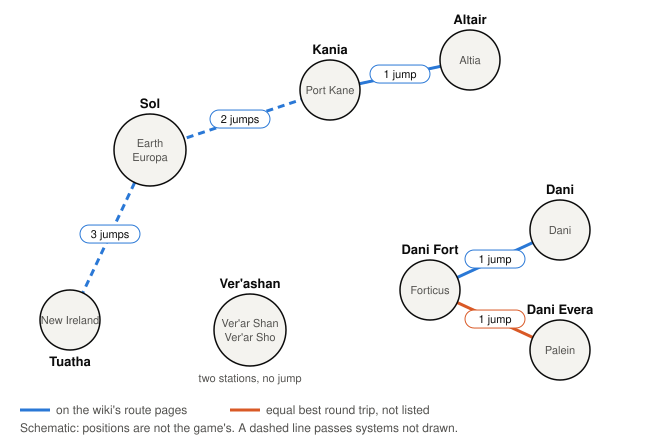

# Escape Velocity Nova

Buy Equipment at Port Kane, jump to Altia and sell it for 247 credits more per ton. Bring Medical Supplies back for another 187. That pays 217 credits per ton per jump. Two other round trips tie it. At the start of EV Nova 1.1.1, no loop with the six standard commodities earns more if you land once per system visit.



*The EV Nova routes that are best for some cost of a landing, on a schematic map; positions are not the game's, because EV Nova's data are Ambrosia Software's copyright and are not in the repository (see Data). Blue legs are on the wiki's route pages, and the orange one is an equal best round trip that they do not list.*

## Rules as modeled

- A **stop** is a planet or station with a commodity exchange. Each commodity it trades has one price there. The price is the same whether the player buys or sells.
- A **leg** goes from one stop to the next by the fewest jumps. It carries the one commodity whose price gains the most between the two stops, or nothing if none gains. Profit is linear in the load, so a full hold of the best commodity is optimal unless credits run short.
- A **route** is a cycle of stops, flown over and over. Its **rate** is the gain per ton of one pass divided by its **cost**: the jumps, plus a fixed cost for each landing, counted in jumps.

For the fuel calculation, a ship may refuel on a trade landing in any system with a fuel seller. Elsewhere it leaves with the fuel it had on arrival. A stop made solely to refuel costs another landing.

The cost of a landing matters. Ver’ar Shan and Ver’ar Sho are two stops in one system with a price gap, so with free landings the gain per jump has no upper bound. Two ways around this are used below. One counts jumps only, but lets the ship land once per visit to a system. The other charges each landing a cost x, and follows the best route as x changes.

The best route is a cycle with the largest ratio of gain to cost. `routes.py` finds it with Howard's policy iteration (Cochet-Terrasson et al., 1998), first in floating point and then exactly with fractions. It returns a potential for each stop. For every leg from a to b within a strongly connected component, the potential of a is at least the leg's gain minus the rate times its cost, plus the potential of b. Adding these up around any cycle shows that no cycle has a higher rate. `check_certificate` checks those inequalities leg by leg.

## EV Nova: what is the best route?

EV Nova's data are not in this repository (see Data). These results come from a ConText export of EV Nova 1.1.1, read at the start of a game, when 398 of the 545 system records are visible.

- The map has 398 systems, 582 links and one connected part. Its diameter is 24 jumps, and the center is Kania. There are 141 stops with a commodity exchange. Of these, 128 trade between one and six of the six standard commodities, and 13 trade none.
- Sol has the highest betweenness, 52.8% of the largest possible total, and Tichel the next, 39.9%. Both are chokepoints, as are 58 other systems.
- The best round trip is 217 per jump. Three round trips reach it: Port Kane (Kania) and Altia (Altair), Forticus (Dani Fort) and Dani (Dani), and Forticus and Palein (Dani Evera). Each carries Equipment from low to high (+247) and Medical Supplies from medium to high (+187), one jump each way.
- Counting jumps only, with one landing per visit, no route beats 217.
- With a landing cost x, the best route is Ver'ar Shan and Ver'ar Sho, two stations in Ver'ashan, up to x = 167/77. It gains 334 per pass with no jumps. From there to x = 943/304, the best route is Earth, then Port Kane, then Europa: 809 per pass in four jumps. Above that it is Earth and New Ireland (Tuatha), 742 per pass in six jumps.
- At x = 1 the best route stays within a single system, so it uses no jump fuel. Special commodities leave the optimum at the same rate, if they cost 80% of their base price where sold and fetch 125% where bought (an assumption; see below).
- A new player has a 10-ton Shuttle and 25,000 credits, which fill the hold; the best rate at x = 1 is 1,670 credits per unit of cost. A 125-ton Terrapin with the same credits can fill only part of its hold. The best route is the same, but its rate is 10,004.5, against 20,875 with 100,000 credits.

## Do the published EV Nova routes hold up?

The EV Nova wiki lists recommended routes on its [Trade Routes](https://evnova.miraheze.org/wiki/Trade_Routes) and [Making Money](https://evnova.miraheze.org/wiki/Nova:Making_Money) pages. `guides.py` holds the 33 that use only standard commodities and no hypergate. `study.py` checks the price levels and jump counts the pages give, and scores each route.

- At every landing cost tested, at least one published route is optimal. Kania/Altair and Dani/Dani Fort are best per jump. Ver'ashan is best for landing costs up to 167/77. The Kania/Sol triangle and Sol/Tuatha are best for higher costs. No better route was found, though one equal round trip is not listed: Forticus and Palein.
- Every price level on the pages matches the data except two, both on the Tekel Kymon/Eguit route. At the start of a game Kymonthia trades no Medical Supplies and Eguit no Industrial. That route gains 15 per ton per pass in the data. The page may describe a later state of the galaxy; this was not checked.
- The jump counts agree, except Aria to Dani Fort, which the page gives as five jumps and the data as four.
- The wiki's commodity table gives Polaris equipment as 600, 750 and 825, and some Auroran prices that do not follow the 80% and 125% rule. The data have one base price per commodity (STR# 4004). Ranks carry a price modifier (`PriceMod` in the rank resources), which might explain the difference; this was not checked.

## How the results are checked

A single jump can pay more than 217. Buy Medical Supplies at Joccika for 600 and sell at Vella for 937. The best load back is Industrial, from 350 to 437. That gives (337 + 87) / 2 = 212 per jump. Port Kane and Altia pay better because of the return cargo.

Could a longer loop beat both? The [test on the original export](../tests/test_ev_nova.py) assigns a number to each port. For all 19,740 directed trade legs, the gain is at most 217 times the jump count plus the destination’s number minus the starting port’s number. Those numbers cancel when you come home. Port Kane and Altia reach the bound exactly.

- Howard's method is compared with brute force, which lists every simple cycle, on 400 random galaxies, each at four landing costs. The best route is always a simple cycle: a cycle that visits a stop twice splits into two shorter cycles, and its rate lies between theirs.
- Karp's algorithm (1978) finds a maximum-mean cycle in a graph where every edge costs one unit. It runs on a second model of the same problem, with one node for each system and cargo held. Its answer matches Howard's on the random galaxies, and on EV Nova when counting jumps only and when a landing costs one jump. Karp's method is also compared with brute force on 300 random graphs.
- Every best route on the EV Nova map passes `check_certificate`.
- The sweep over landing costs rests on one fact: whether one route beats another at a landing cost x is a linear inequality in x. A random test compares its answer with brute force at up to 1,000 costs.
- Betweenness (Brandes, 2001, in exact fractions) and chokepoints are compared with brute force on 200 random graphs each.
- The EV Nova reader is tested on a small hand-written ConText file. Earth's flags decode to the levels the wiki lists, and the 80% and 125% rule reproduces the wiki's table for the Federation.

## Data

The game's data files are Ambrosia Software's copyright and are not committed. `evnova.py` reads a ConText export, a tab-separated dump of the game's resources made by the ConText/ResStore tool. Its docstring gives the sections and fields it uses. [vasi/evnova-utils](https://github.com/vasi/evnova-utils) publishes such an export of EV Nova 1.1.1 (`Context/NovaConText.txt`). Its license states that the file was generated from Ambrosia's data, which remain Ambrosia's copyright. The numbers above were reproduced from [this copy of the export](https://github.com/vasi/evnova-utils/blob/134baed0706c360c9100a1efa622b331fd233538/Context/NovaConText.txt). Field meanings come from the Nova Bible, Ambrosia's resource documentation, as transcribed on the [EV Nova wiki](https://evnova.miraheze.org/wiki/Sp%C3%B6b). The base prices (75, 350, 750, 900, 200 and 550) are in the data. The rule that low is 80% and high is 125% of base, rounded down, comes from the wiki's [commodity table](https://evnova.miraheze.org/wiki/Commodities); the Nova Bible does not state it.

The tests use a small made-up galaxy. Set `EV_NOVA_CONTEXT` to the path of an export to run the test that reads the real data too.

## Sources

- J. Cochet-Terrasson, G. Cohen, S. Gaubert, M. McGettrick and J.-P. Quadrat, Numerical computation of spectral elements in max-plus algebra (1998): Howard's policy iteration for the best ratio of gain to cost.
- R. M. Karp, A characterization of the minimum cycle mean in a digraph, *Discrete Mathematics* 23 (1978).
- U. Brandes, A faster algorithm for betweenness centrality, *Journal of Mathematical Sociology* 25 (2001).
- The EV Nova wiki's [Trade Routes](https://evnova.miraheze.org/wiki/Trade_Routes), [Making Money](https://evnova.miraheze.org/wiki/Nova:Making_Money) and [Commodities](https://evnova.miraheze.org/wiki/Commodities) pages, read 2026-11-18.

## Open questions

- Which routes change as the story opens new systems? The export uses the starting control bits. Disasters, hypergates and wormholes could change prices or distances.
- Do special commodity prices and rank discounts change which route pays best? Check them in a running copy of EV Nova.

## Run the study

Supply your EV Nova 1.1.1 ConText export. The script reads the map, scores the guide routes and checks the best route's certificate.

```bash
uv run --group ev_nova python -m ev_nova.study --evnova path/to/NovaConText.txt
uv run pytest tests/test_ev_nova.py
```

`evnova.py` reads the export, `guides.py` lists the published routes and `routes.py` solves the trade graph. The optional data test uses `EV_NOVA_CONTEXT` to find an export. [Archived comparison](naev-notes.md).
