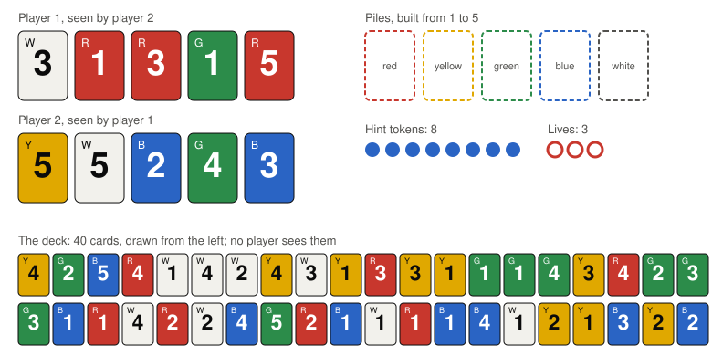
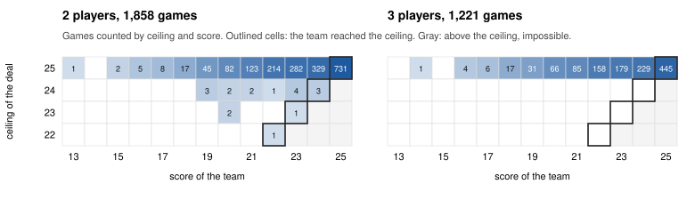

# Hanabi

How often can a deal of five-suit Hanabi reach 25, and how much of a team's shortfall did the deal rule out? With every card in view, the deck included, a share of 0.9862 of two-player deals can reach 25 (276 of 20,000 seeded deals are lost), and 0.9988 or more with three to five players. So no strategy averages more than about 24.986 points with two players (the upper end of a 95% interval). In 1,858 two-player games from hanab.live, teams fell 1.63 points short of 25 on average, and the deal ruled out 0.013 of those points even with every card in view. That 0.013 is a lower bound on what the cards cost, not an estimate of it: a deal that can reach 25 with every card in view can still be lost to hidden information, and these games cannot separate that cost from the cost of play. The games are a released subset in which no team lost its third life. The hat-guessing strategy of Cox et al. (2015) is reproduced game by game. The ceilings come from exact search of each deal by two independent solvers; shares of sampled deals carry 95% intervals.



*Two-player deal 161 of plan H1, before the first turn, drawn by `figures.py`. Each player sees the other hand but not their own, and no one sees the deck. Even with every card in view this deal reaches at most 24 (exact): it is one of the 276 lost two-player deals.*

## Rules as modeled

`rules.py` follows the official rule sheet and the Hanabi Learning Environment (Bard et al., 2020):

- Five colors; each has three 1s, two 2s, two 3s, two 4s and one 5. Hands hold five cards with two or three players and four with four or five.
- The team starts with 8 hint tokens and 3 lives. A hint names a color or a rank to another player and must touch at least one of their cards. It costs a token.
- A discard returns a token and is not allowed while all 8 tokens are on the table. A played 5 also returns a token.
- A card that does not fit its pile costs a life. Losing the third life ends the game with score 0.
- The game also ends at 25, or one round after the last card is drawn, so that every player, including the one who drew it, has one more turn.

Not modeled: the box's variants with a sixth, multicolor suit. Editions and players differ on whether a hint may touch no card (Bouzy, 2017, discusses the readings); here it may not, as in Cox et al.

`Rules` has switches for other readings: discards with all tokens on the table (as HanSim allows), keeping the board when the last life is lost, and smaller decks with fewer colors or ranks. A deal is reproducible: `seeded_deck(rules, seed)` shuffles with `random.Random(seed)`. HanSim's reading of discards changes the information strategy's score by nothing measurable ([information.md](results/information.md)).

## Results

Intervals are 95% intervals. The last column links the note in [`results/`](results/README.md) with the detail.

| Result | How it is known | Detail |
|---|---|---|
| The information strategy scores 24.680 ± 0.004 with five players, 76.31% ± 0.26% perfect; the paper gives 24.68 and "more than 75 percent" (76% in its Figure 8) | Simulated, 100,000 games on HanSim's decks; game by game equal to HanSim on its first 10,000 | [information](results/information.md) |
| With three and four players, under the official hint rule, it scores 22.254 ± 0.032 and 24.564 ± 0.016. Others extended the strategy earlier and score more: Bouzy (2017), with hints that may touch no card, and Wu's WTFWThat (2016), 24.7946 and 24.9356 | Simulated, 10,000 seeded deals each; the others' numbers are taken from the cited sources | [information](results/information.md) |
| Winnable orderings of small decks, such as 5,934 of 75,600 for one color, one player and a hand of one card | Exact, every deal; matches van den Bergh's Appendix A to all four digits | [open-game](results/open-game.md) |
| Two-player deals that can reach 25: 0.9862 (0.9845 to 0.9877); 276 of 20,000 lost | Two solvers on seeded deals 0 to 19,999 (plan H1), with certificates added after the plan; Wilson interval | [h1](results/h1.md) |
| Three, four and five players: 0.9988 to 0.9992, 0.99965 to 0.99985 and 0.99935 to 0.99995; 23 deals still undecided | Same | [h1](results/h1.md) |
| The best mean score any strategy can reach is at most 24.9838 with two players, estimated from the sample (± 0.0021), so at most about 24.986; 24.9990, 24.9998 and 24.9999 with three to five | Same | [h1](results/h1.md) |
| Human two-player games: with every card in view, the deal ruled out 0.013 (0.007 to 0.019) of 1.63 points below 25, a lower bound on what the cards cost; 19 of 1,858 deals stop below 25, and none of 1,221 three-player deals | Exact search of each deal; bootstrap over games, 10,000 resamples, seed 0 | [humans](results/humans.md) |
| gpt-oss-120b in self-play plays 18.63 (16.70 to 20.57) points below the ceiling, with 24% of its turns cut off by the token cap; DeepSeek-V3.2 loses every game | Plan H2: 30 seeded deals, one game each; bootstrap over deals | [h2](results/h2.md) |
| Listing what each own card can still be changes gpt-oss-120b's gap by −0.79 (−3.71 to 2.25) | Plan H2, paired on 24 deals | [h2](results/h2.md) |
| A larger entropy bonus raises cross-play of independent PPO by 1.12 (0.83 to 1.41) points in a two-color game, but policies still score 0.34 (0.22 to 0.45) more with their own seed than with another | Plan H4: 8 seeds an arm, 2,000 deals; bootstrap over deals and seeds | [h4](results/h4.md) |

## How the results are checked

- **The rules.** The rules engine has tests for each rule above. The information strategy matches HanSim, compiled from its repository, game by game on 10,000 decks, which checks the rules from outside.
- **Two solvers.** Solver A (`solver.py`) and Solver B (`dfs_solver.py`) share no code except the rules engine. On every deal of four small decks both agree with brute force, and each certificate is checked against it: no deal with a certificate is won. On the full game they agree on every one of the 79,396 deals both decide. Every win of either solver is replayed by the rules engine.
- **Published counts.** The one-player rows of the small decks match van den Bergh's Appendix A. Quuxplusone's [CheatBot](https://github.com/Quuxplusone/Hanabi), which sees its own cards but not the deck, wins fewer games than the winnable shares, as it must.
- **Human games.** Every one of the 3,079 games replays in `rules.py` with every action legal and ends on its recorded score; the mean scores, 23.37 and 23.25, match the challenge paper's Table 1. No game scores above its deal's ceiling.
- **Two engines for H4.** JaxMARL's two-color game and `rules.py` agree on legal moves, game length and score in 4,000 random games, and on the score of each of the 1,024,000 games of plan H4's evaluation.
- **The README.** A test checks that the picture is what `figures.py` draws, and that every number of this README before its detail moved to `results/` is still in the README or a note.

CI runs the tests; the runs on GitHub Actions and Hugging Face Jobs do not. Every check is listed in [checks.md](results/checks.md).

## Can the information strategy's numbers be reproduced?

Yes. A hint is read as a number from 0 to 7, and each player learns which of eight sets holds a targeted card of their own: the hat-guessing trick. `information.py` follows HanSim's code, quirks included, and plays the same decks: on the first 10,000 it scores exactly what HanSim scores, game by game. Detail: [information.md](results/information.md).

| Five players | Mean score | Perfect games | How it is known |
|---|---:|---:|---|
| Cox et al. (2015), Figure 8 | 24.68 | 76% | their simulation, 10⁶ games |
| HanSim, compiled from their repository | 24.668 | 75.44% | its first 10,000 games |
| This implementation, the same decks | 24.680 ± 0.004 | 76.31% ± 0.26% | 100,000 games |

## Which deals can reach 25?

With every card in view, a hint carries no information; it only passes the turn and costs a token. Van den Bergh (2015) calls this the open game and shows that a deal can be won in the real game only if it can be won in the open game. Baffier et al. (2017) prove NP-completeness for a one-player version with every card known, no hints and no final round, as decks grow, even with hands of two cards. That is a relative of the open game, not the same game, and a result about growing decks says nothing about one deck of 50 cards. The answers here come from search. A lost deal comes with a certificate: too few turns to play the cards in time, too few hand slots to store them, a pooled game in which one player holds every hand, or the free-order game, which drops tokens and lives but keeps the hands apart. A won deal comes with a line of play that the rules engine replays to 25. The solvers, the certificates and the exact counts on small decks are in [open-game.md](results/open-game.md).

Plan H1 ([plan](../experiments/plans/H1.md)) fixed the full-game measurement before it was run: seeded deals 0 to 19,999 for each number of players, the official rules, and two solvers. The table includes the certificates and third search added after the plan, which settle every two-player deal; the plan's own table, the departures from it and the 23 undecided deals are in [h1.md](results/h1.md).

| Players | Lost | Undecided | Winnable share | 95% interval | Mean score at most |
|---:|---:|---:|---|---|---|
| 2 | 276 | 0 | 0.9862 | 0.9845 to 0.9877 | 24.9838 ± 0.0021 |
| 3 | 17 | 7 | 0.9988 to 0.9992 | 0.9982 to 0.9995 | 24.9990 ± 0.0005 |
| 4 | 3 | 4 | 0.99965 to 0.99985 | 0.9993 to 0.9999 | 24.9998 ± 0.0002 |
| 5 | 1 | 12 | 0.99935 to 0.99995 | 0.9989 to 1 | 24.9999 ± 0.0001 |

The bound is optimistic, since real players do not see the deck. Still, it says how much of each agent's gap to 25 is out of reach for anyone: 1.8% for SAD with an auxiliary task (Hu and Foerster, 2020) and 4.2% for SAD with SPARTA search (Lerer et al., 2020), whose gaps are 0.92 and 0.39 points. Cox et al. end by asking for a good estimate of the game's expected value. These bounds give one from above, for the open game.

## Human games: the deal or the table?

*"We finished on 23. Could any team have made 25 with these cards?"* Almost always, if it could have seen every card. Of the 1,858 two-player games from hanab.live that the AH2AC2 challenge released (Dizdarević et al., 2025), 19 were dealt a deck whose best possible score is below 25; of its 1,221 three-player games, none. Two-player teams averaged 1.63 points below 25. The deal ruled out 0.013 of those points (0.007 to 0.019), even with every card in view; that is a lower bound on what the cards cost. The other 1.62 (1.54 to 1.70) were lost to hidden information or to play, and these games cannot say how much to each. The released games are a subset of over 100,000 two-player games (the challenge's announcement), and none of them loses its third life, so the 1.63 is for games that kept a life. In two-player games, 30% of the traced points below the ceiling went on discards of a card whose other copies were gone. Detail, with where in the game the ceiling fell: [humans.md](results/humans.md).



*Games counted by their deal's ceiling and their score. Few games lie below the top row: nearly all of the spread in scores is the team's distance from 25.*

`ceiling.py` prints a deck's ceiling with its certificates, or replays a hanab.live export:

```
$ uv run python -m hanabi.ceiling --players 5 --seed 18105
Best possible score: 24 (exact).
  time: the turns that draw the first 16 cards of the deck can play only cards dealt or drawn before the 16th draw (R1), and those allow 5 plays; then come 14 more draws and 5 final turns, so at most 5 + 14 + 5 = 24 cards are played.
  pooled game: even one player holding every hand at once, with no turn order and no hint tokens, cannot reach 25 with these draws.
```

## Language-model players

Plan H2 ([plan](../experiments/plans/H2.md), with two dated amendments) seats the same hosted model in both chairs of a two-player game on seeded deals 0 to 29, all with ceiling 25. `llm.py` writes everything one player may know as text; with deduction on, it also lists what each own card can still be. With deduction on, 24% of gpt-oss-120b's turns reached the 4,096-token cap before writing a move and fell back to a default move. DeepSeek-V3.2 wrote a legal move in 1,545 of its 1,546 replies and lost its lives to misplays. A later note, [h2-harness.md](results/h2-harness.md), finds that the cap limits gpt-oss-120b's numbers. The ten runs, pilot included, cost $3.60 by the providers' listed prices, against a cap of $4. Detail: [h2.md](results/h2.md).

| Two players | Deals | Gap to the ceiling | Mean score | Lost all lives |
|---|---:|---|---:|---:|
| gpt-oss-120b, deduction on | 30 | 18.63 (16.70 to 20.57) | 6.37 | 12 |
| gpt-oss-120b, deduction off | 24 | 18.46 (16.58 to 20.46) | 6.54 | 8 |
| DeepSeek-V3.2, deduction on | 30 | 25 | 0 | 30 |
| DeepSeek-V3.2, deduction off | 30 | 25 | 0 | 30 |

## Independent PPO in a two-color game

Plan H4 ([plan](../experiments/plans/H4.md), with two dated amendments) asks whether a larger entropy bonus makes policies trained apart play well together, as Forkel et al. (2025) report for the full game. H4 makes the same comparison on a game of two colors, top score 10, in JaxMARL, with 8 seeds an arm trained for 1.999 × 10⁸ steps each. Of the 2,000 test deals, 1,957 reach 10 with every card in view. The larger bonus raises cross-play, and also self-play, but with entropy coefficient 0.05 self-play still beats cross-play by 0.34 points. The training curves had not flattened, and the higher-entropy arm also learns faster, so part of the gain may be speed of learning rather than compatibility. With two colors, the color permutations that Forkel et al.'s argument turns on form a group of two elements, a weak version of the full game's symmetry. The four GPU jobs cost $2.21 against a cap of $6.40. Detail, with behavior per seed: [h4.md](results/h4.md).

α is the entropy coefficient, not a significance level.

| Greedy play, 2,000 deals | α = 0.01 | α = 0.05 | α = 0.05 minus α = 0.01 |
|---|---:|---:|---:|
| Cross-play: seeds of one arm, paired with each other | 7.74 (7.52 to 7.96) | 8.86 (8.66 to 9.06) | **1.12 (0.83 to 1.41)** |
| Self-play: each seed with itself | 8.43 (8.22 to 8.62) | 9.20 (9.07 to 9.33) | 0.77 (0.53 to 1.01) |
| Self-play minus cross-play | 0.69 (0.48 to 0.95) | 0.34 (0.22 to 0.45) | |

## Data

| Source | What it is | License | Committed here |
|---|---|---|---|
| [`ah2ac2/datasets`](https://huggingface.co/datasets/ah2ac2/datasets) on Hugging Face (Dizdarević et al., 2025) | 1,858 two-player and 1,221 three-player games from hanab.live: deck, actions, score | The dataset card's metadata reads `license: apache-2.0`; the card has no other text. The games were played on hanab.live, which publishes no terms for its game records (its code is under the GPL 3.0). | No. Only numbers derived from each game (`results/humans-games.jsonl`): no deck and no action list. |
| hanab.live `/export/<id>` pages | Two games used to test `ceiling.py`'s reader | No terms published | No |

Because the dataset's license comes from a metadata tag alone and the site states no terms, this folder keeps derived numbers only.

## Sources

- C. Cox, J. De Silva, P. DeOrsey, F. H. J. Kenter, T. Retter, J. Tobin, "How to Make the Perfect Fireworks Display: Two Strategies for Hanabi", *Mathematics Magazine* 88(5), 2015. Code: github.com/rjtobin/HanSim (GPL; not copied here).
- M. van den Bergh, "Hanabi, a co-operative game of fireworks", bachelor thesis, Leiden University, 2015.
- J.-F. Baffier, M.-K. Chiu, Y. Diez, M. Korman, V. Mitsou, A. van Renssen, M. Roeloffzen, Y. Uno, "Hanabi is NP-hard, even for cheaters who look at their cards", *Theoretical Computer Science* 675, 2017.
- B. Bouzy, "Playing Hanabi Near-Optimally", *Advances in Computer Games*, 2017. He relaxes the hint rule (a hint may touch no card), extends the hat strategy to other numbers of players and hand sizes, and reports 24.74 for his "hat information" player with five players and 81.30% perfect games, and 92% perfect games with a depth-one search (his Table 4, 100 games).
- J. Wu, [hanabi.rs](https://github.com/WuTheFWasThat/hanabi.rs) (WTFWThat), 2016: an information strategy for two to five players, with scores on 20,000 seeds.
- N. Bard et al., "The Hanabi Challenge: A New Frontier for AI Research", *Artificial Intelligence* 280, 2020 (arXiv:1902.00506).
- H. Hu, J. Foerster, "Simplified Action Decoder for Deep Multi-Agent Reinforcement Learning", ICLR 2020; A. Lerer, H. Hu, J. Foerster, N. Brown, "Improving Policies via Search in Cooperative Partially Observable Games", AAAI 2020; H. Hu et al., "Off-Belief Learning", ICML 2021.
- J. Forkel, C. Ruhdorfer, M. Beukman, A. Bulling, J. Foerster, "High entropy leads to symmetry-equivariant policies in Dec-POMDPs", arXiv:2511.22581 (v5, 2026-06-04): Table 1, and Appendix F for their settings.
- M. Ramesh et al., "Sparks of Cooperative Reasoning: LLMs as Strategic Hanabi Agents", arXiv:2601.18077; F. Liang et al., "LLM-Hanabi", arXiv:2510.04980; T. Dizdarević et al., "Ad-Hoc Human-AI Coordination Challenge", ICML 2025, arXiv:2506.21490, with its open dataset and documentation (docs.ah2ac2.com).
- hanab.live: the game format's description and the changelog of github.com/Hanabi-Live/hanabi-live, for the deal order and the starting player.
- W. D. Harvey, M. L. Ginsberg, "Limited Discrepancy Search", IJCAI 1995.
- A. Rutherford et al., "JaxMARL: Multi-Agent RL Environments and Algorithms in JAX", NeurIPS 2024 Datasets and Benchmarks; `jaxmarl` 0.2.0 (Apache 2.0), whose IPPO baseline builds on PureJaxRL (C. Lu et al., "Discovered Policy Optimisation", NeurIPS 2022).

## Open questions

- Of the points between a team's score and its deal's ceiling, how many does hidden information cost and how many does play? That needs an agent that plays the real game well, scored on the same 3,079 decks.
- Are the 23 undecided deals ([h1.md](results/h1.md) lists them) won or lost? No certificate proves any of them lost, and 13 are won in the free-order game.
- What is each deal's best score in the real game, where players do not see their own cards?
- Does the gap between self-play and cross-play with entropy coefficient 0.05 close with more training, as in Forkel et al.?

[open-questions.md](results/open-questions.md) has the full list, with tokens, endgames and the clusters of low-entropy seeds.

## Usage

The solvers and the information strategy use only the standard library; the human games, the hosted models and plan H4 need dependency groups, and [usage.md](results/usage.md) has every command, with the groups and times.

```bash
uv run python -m hanabi.information -n 2000               # five players, about 1 min
uv run python -m hanabi.upper_bound --exact --check 200   # small decks (about 5 min)
uv run python -m hanabi.upper_bound --sample 2 2000       # about 1 min; 4 or 5 players take 2
uv run python -m hanabi.ceiling --players 2 --seed 161    # one deck's ceiling, under a second
uv run python -m hanabi.figures                           # the picture of a deal
```

## Files

| File | Contents |
|---|---|
| `rules.py` | Cards, decks, the rules as small functions, seeded deals, HanSim's shuffle |
| `information.py`, `hansim_check.py` | The information strategy of Cox et al.; the game-by-game comparison with HanSim |
| `solver.py`, `dfs_solver.py`, `solver_cp.py` | Solver A, Solver B with the last-card and free-order certificates, and a constraint model for small decks |
| `upper_bound.py`, `h1.py` | Exact counts on small decks, sampled verdicts on the full game, plan H1's summary |
| `humans_data.py`, `humans.py`, `ceiling.py` | The human games, their ceilings and the command line |
| `llm.py`, `hosted.py`, `h2.py` | Plan H2: text observations, hosted models with a cost meter, the games and the report |
| `jax_bridge.py`, `ippo.py`, `h4.py` | Plan H4: JaxMARL beside `rules.py`, recurrent IPPO, and the evaluation |
| `figures.py`, `figures/` | The picture of a deal; a test checks it is current |
| `results/` | Each experiment's results files, and notes with the detail behind each section ([index](results/README.md)) |
