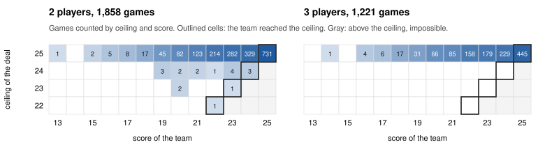

# Human games: the deal or the table?

The 3,079 human games of the AH2AC2 dataset: their ceilings, where the ceiling fell, and the command line. The [Hanabi README](../README.md) gives the short answers.


*"We finished on 23. Could any team have made 25 with these cards?"* Almost always, if it could have seen every card. Of 1,858 two-player games played by people on hanab.live, 19 were dealt a deck whose best possible score is below 25, and of 1,221 three-player games, none. Two-player teams averaged 1.63 points below 25. The deal ruled out 0.013 of those points (95% interval 0.007 to 0.019), under 1% of the gap. The other 1.62 (1.54 to 1.70) lie between the score and the deal's ceiling. They were lost to hidden information or to play, and these games cannot say how much to each.



The grid counts games by their deal's ceiling and their score. Look at how few games lie below the top row: the ceiling is 25 for 1,839 of 1,858 two-player deals and for every three-player deal, so nearly all of the spread in scores is the team's distance from 25.

**The ceiling.** As in [open-game.md](open-game.md), the ceiling of a deal is the best score of the open game: every card in view, the deck included, and a hint only a pass that costs a token. No team scores above it. No team that cannot see its own cards can be expected to reach it either: the strongest published two-player agents average 24.08 to 24.61 in self-play (the table above), on deals almost all of whose ceilings are 25. So the gap between a team's score and its ceiling has two causes mixed together: what the players could not know, and what they chose. Separating them needs a reference agent that plays the real game well on the same decks. This section does not have one and does not split that part.

**The data.** The AH2AC2 challenge (Dizdarević et al., 2025) released 1,858 two-player and 1,221 three-player games from hanab.live, played with the H-group conventions, each with its deck and every action. `humans_data.py` reads the files with the standard library. The challenge's documentation says the deck is listed from the top. The actions are numbered as in JaxMARL's Hanabi, which deals the hands in blocks from the top and puts a drawn card at the end of the hand, as `rules.py` does; plan H4's agreement test checked these conventions against JaxMARL itself. With them, every one of the 3,079 games replays in `rules.py` with every action legal and ends on its recorded score. The mean scores, 23.37 and 23.25, match the challenge paper's Table 1. The game numbers in the files are the challenge's own, not hanab.live's, so the games cannot be matched with the site's records.

Two things about the sample:

- No game in it loses its third life. Every game has at most two strikes, and the lowest scores are 13 and 14, as the paper's Table 1 also gives. The challenge's announcement (blog.foersterlab.com/ah2ac2) says the released games are a subset of a much larger set of over 100,000 two-player games, and its statistics give a lowest score of 13, so no game that lost its third life is among them. The 1.63 points are for games that kept a life; with such games included the shortfall would be larger and the deal's share smaller.
- 341 two-player and 321 three-player records stop before the rules' end of the game. For each of them, a search of the open game from the last position proves that no further point could be scored. This fits hanab.live's ending a game once no further point can be scored. These records are treated as finished, with their recorded score.

**Results.** Exact unless marked; intervals are 95% intervals over games, by percentile bootstrap (10,000 resamples, seed 0) for means and by Wilson's method for shares.

| | Two players | Three players | How it is known |
|---|---:|---:|---|
| Games | 1,858 | 1,221 | the dataset |
| Deals whose ceiling is below 25 | 19 (1.02%; 0.66% to 1.59%) | 0 (0 to 0.31%) | exact search of each deal |
| Mean ceiling | 24.987 | 25 | exact search |
| Mean score | 23.37 (23.28 to 23.45) | 23.25 (23.14 to 23.36) | the records, replayed |
| Points below 25 ruled out by the deal | 0.013 (0.007 to 0.019) | 0 | exact search |
| Points between the score and the ceiling | 1.62 (1.54 to 1.70) | 1.75 (1.64 to 1.86) | exact search |
| Share of the gap ruled out by the deal | 0.79% (0.43% to 1.20%) | 0 | exact search |
| Perfect games, of deals that allow 25 | 731 of 1,839 (39.7%; 37.5% to 42.0%) | 445 of 1,221 (36.4%; 33.8% to 39.2%) | the records |
| Reference: the information strategy on the same decks | 15.06 (14.95 to 15.17) | 22.22 (22.13 to 22.31) | simulated, one game per deck |
| Teams minus the reference, same decks | 8.31 (8.18 to 8.44) | 1.04 (0.90 to 1.17) | as above |

- **The deals.** The 19 two-player deals below 25 allow 24 (15 deals), 23 (3) and 22 (1); each fails at least one certificate of `solver.py` (the pooled game for all 19, time for 10, storage for 2). Five of their teams reached the ceiling. The share of such deals, 1.02% (0.66% to 1.59%), is close to plan H1's 1.38% (1.23% to 1.55%) on 20,000 seeded deals, and the intervals overlap, as they should if hanab.live shuffles uniformly. With three players H1 found 17 to 24 such deals in 20,000, so about one was expected here and none was found.
- **The reference.** The information strategy of `information.py`, with the official discard rule, played each deck once. It is one fixed convention, built for five players. With two players a hint carries one of only two values, and it scores 15.1. It marks what a simple fixed convention reaches on these decks; it is not an estimate of what hidden information costs. With three players the teams beat it by 1.04 points on the same decks, and it beat the team on 279 of the 1,221 decks.

**Where the ceiling falls.** The ceiling can only fall during a game, since the moves made are one of the open game's lines. For each point between a team's score and its ceiling, a binary search over the turns finds the turn after which that point was out of reach, and charges it to that turn's action. A charged action is not judged a mistake: a player who cannot see their own hand may have had no better move. Of 3,079 games, 3,012 were traced this way; in the other 67 (42 two-player, 25 three-player, holding 197 of the points) a search ran out of its budget, and they are left out of the table below.

| Points below the ceiling, charged to | Two players | Three players |
|---|---:|---:|
| Discard of a card whose other copies were gone ("critical") | 876 (30%) | 568 (28%) |
| Other discard | 1,130 (39%) | 524 (25%) |
| Misplay (a strike) | 375 (13%) | 391 (19%) |
| Hint | 310 (11%) | 347 (17%) |
| Play | 188 (7%) | 233 (11%) |
| When: 20 or more cards left in the deck | 1,139 (40%) | 354 (17%) |
| When: 10 to 19 cards left | 537 (19%) | 541 (26%) |
| When: 1 to 9 cards left | 888 (31%) | 968 (47%) |
| When: the final round | 315 (11%) | 200 (10%) |
| All points traced | 2,879 in 1,816 games | 2,063 in 1,196 games |

- In two-player games, 40% of the points went while 20 or more cards were left in the deck, nearly half of them on discards of a card whose other copies were gone (533 of the 1,139). With three players more of the loss comes late: 47% with 1 to 9 cards left.
- A discard that is not of a critical card can still lower the ceiling. It may throw away a card that is needed sooner than its other copy arrives, or spend a turn that the end of the game needed. Late in the game, plays and hints lower the ceiling for the same reason: there are not enough turns left for the plays still needed.
- Strikes were common, 0.80 a game with two players, but in the traced two-player games only 240 of 1,458 strikes lowered the ceiling. A strike can cost more than one point, so those 240 account for 375 points. Discards of critical cards lowered it 498 times out of 576.

**The command line.** `ceiling.py` prints a deck's ceiling, with the certificates that rule out 25 when it is below 25. The deck is given as 50 cards from the top, as a seed of this package, or as a hanab.live JSON export. For an export it also replays the game and prints each turn after which the ceiling fell. It reads both the clue fields of the format's description and those of the site's `/export/<id>` pages; two exports fetched from the site replay to their recorded scores. Variants, detrimental characters and other rule options are refused.

```
$ uv run python -m hanabi.ceiling --players 2 --deck "W3 R1 R3 G1 R5 Y5 W5 B2 G4 B3 Y4 G2 B5 R4 W1 W4 W2 Y4 W3 Y1 R3 Y3 Y1 G1 G1 G4 Y3 R4 G2 G3 G3 B1 R1 W4 R2 W2 B4 G5 R2 B1 W1 R1 B1 B4 W1 Y2 Y1 B3 Y2 B2"
Best possible score: 24 (exact).
  pooled game: even one player holding every hand at once, with no turn order and no hint tokens, cannot reach 25 with these draws.
$ uv run python -m hanabi.ceiling --players 5 --seed 18105
Best possible score: 24 (exact).
  time: the turns that draw the first 16 cards of the deck can play only cards dealt or drawn before the 16th draw (R1), and those allow 5 plays; then come 14 more draws and 5 final turns, so at most 5 + 14 + 5 = 24 cards are played.
  pooled game: even one player holding every hand at once, with no turn order and no hint tokens, cannot reach 25 with these draws.
```

The first deck is two-player seed 161 of plan H1. The first command takes under a second and the second about 30 seconds on a shared two-core machine; `--line` adds a line of play that reaches the ceiling, and `--json game.json` reads an export.

**Compute.** `humans.py run` analyzed the games on GitHub Actions in 60 jobs at commit cdc99e3, 6.8 runner-hours in all, at no cost. Half the games took under 0.02 seconds; the slowest took 512 seconds. A second run at an earlier commit, without the free-order test, found the same ceiling for every game. It also found the same turns wherever both runs settled them. `results/humans-games.jsonl` holds one record per game: numbers derived from the game, not its deck or its actions. `results/humans.json` and the picture are computed from it, and a test checks that they match.
