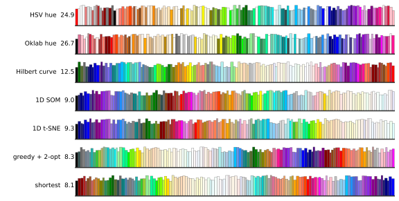
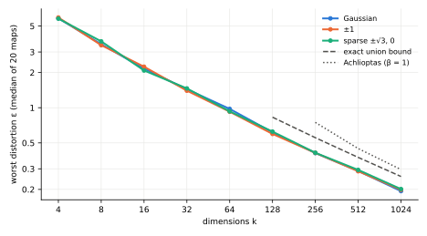
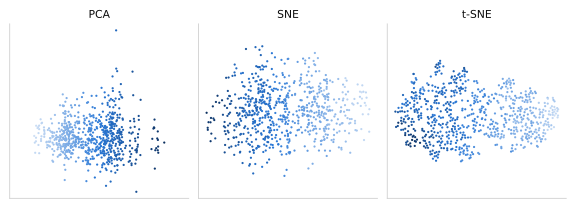
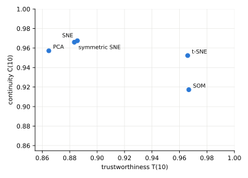
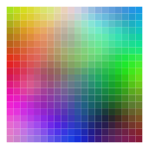
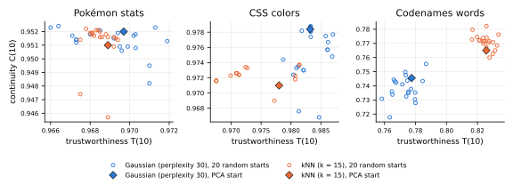
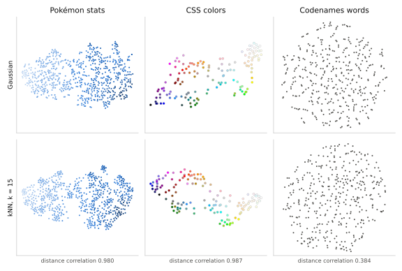
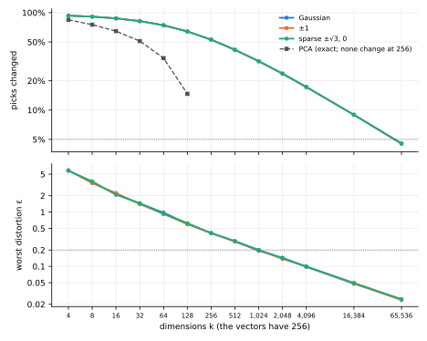
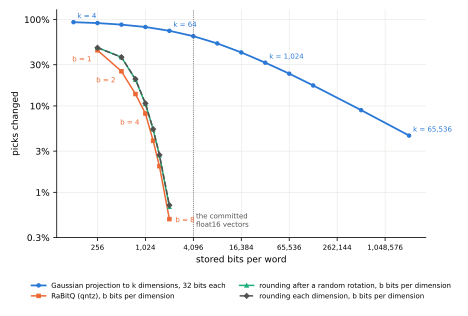

# Maps

How would you arrange books by color? Sorting by hue puts the grays together at the red end of the shelf. On a shelf of 139 CSS colors, the jumps between neighboring books add up to 3.1 times the smallest possible total. The drawing uses twelve books so you can see where the two orders differ.


*Twelve books in four orders, with each order's total color jump. The hue sorts put the four grays in one block at the red end, and light pink beside crimson.*

## What else do the maps keep?

- **Random projections.** Random maps of 400 word vectors need about 1,000 dimensions to keep every squared distance within 20%. The worst distortion runs about a third below the exact union bound.
- **Who ends up next to whom?** Pick a Pokémon and find its nearest neighbor on the t-SNE map. In 98% of cases that neighbor is among its 20 closest in the original stats. With SNE the share is under half. If you search farther out on the map, SNE recovers more of the original neighbors. The two tests ask different questions.
- **Self-organizing maps** keep the Pokémon's neighbors about as trustworthily as t-SNE but lose more of them, as Venna and Kaski (2001) found on other data.
- **t-SNE from neighbor ranks alone** (kNN affinities, k = 15) matches Gaussian t-SNE's T(10) and C(10) on the Pokémon: over 20 paired seeds, both 95% intervals for the difference lie within ±0.0014. Its layouts match too, as Böhm, Berens and Kobak (2022) found on MNIST. It keeps fewer 5-neighborhoods, and on the word vectors it does better than Gaussian t-SNE.
- **A random projection changes the guesser's pick** for 53% of Codenames boards and clues at k = 256 and 32% at k = 1,024, where the worst distortion is already about 0.2. Of the k tried, only 65,536 changes fewer than 5%.
- **Five bits per coordinate keep the original pick on 96% of boards.** RaBitQ, from the qntz library (arclabs561/qntz), changes 8.2% of picks at 4 bits per dimension and 4.0% at 5 bits. Rounding each dimension changes 10.7% and 5.4%, and a random rotation before rounding does not help it.

## The questions as modeled

- A **color** is a point in Oklab (Ottosson 2020), a perceptual color space, and the **jump** between two books standing side by side is the Euclidean distance between their colors. An **ordering's total jump** is the sum of its jumps. The best ordering is a shortest Hamiltonian path with free ends. Other color distances (CIEDE2000) were not tried.
- **Neighbor preservation** is scored by Venna and Kaski's trustworthiness T(k) and continuity C(k), which compare each point's k nearest neighbors in the data and on the map. Both are 1 for a map that keeps every k-neighborhood. Maps with ties (a shelf; a SOM, where points share a unit) are scored as Venna and Kaski did, by averaging the best and the worst order of the tied points.
- **Distortion** of a random map is the smallest ε with (1 − ε)|u − v|² ≤ |f(u) − f(v)|² ≤ (1 + ε)|u − v|² for every pair: squared distances, as in the lemma's statements.
- **Point sets.** The 139 distinct CSS named colors. The raw base stats of the 721 Pokémon species of Generations 1 to 6, in six dimensions. Some species have the same stats (Charmander and Cyndaquil, for one), so there are 705 distinct points. The 400 Codenames words of `codenames/words.txt` as unit vectors from the wordllama static table, in 256 dimensions.

## Results

| Result | Value | How it is known |
|---|---|---|
| Shortest total jump, 12-book shelf | 1.710; HSV hue sort 3.674 (2.15 times) | exact (Held-Karp), checked by brute force on 9 of the books |
| Shortest total jump, 139 CSS colors | 8.133 | exact (integer program with subtour cuts, HiGHS at zero gap) |
| Same shelf, other methods | greedy + 2-opt 8.342, 1D SOM 8.975, 1D t-SNE 9.262, Hilbert curve 12.51, HSV hue 24.89, Oklab hue 25.65 | computed (seed 0 for the SOM and t-SNE) |
| Continuity C(5) on that shelf | 1D t-SNE 0.964, 1D SOM 0.948, shortest 0.908, greedy 0.890 | computed |
| 100 random 10-book shelves, mean excess over shortest | greedy + 2-opt 0.1% (solves 91%), 1D SOM 2.5%, 1D t-SNE 22.5% (17.6% to 22.5% over t-SNE seeds 0 to 9), Hilbert 32.7%, hue 57% | exact optimum per shelf; methods computed; shelf seeds 0 to 99 |
| Worst distortion, 400 words, k = 256 | 0.409 (Gaussian), 0.410 (±1), 0.412 (sparse) | simulated, median of 20 maps (seeds 0 to 19) |
| Same, k = 1,024 | 0.193, 0.198, 0.201; exact union bound 0.258; Achlioptas's bound 0.296 | simulated (20 maps); bounds exact |
| Variance of one pair's ratio, Shuckle and Blissey, k = 16 | ±1 map 0.0764 (formula 0.0768), Gaussian 0.127 (formula 0.125) | simulated, 20,000 maps, standard error 0.0015 or less; formula exact |
| t-SNE cost on the Pokémon map | 0.932; scikit-learn's exact t-SNE reaches 0.93 | computed (seed 0; scikit-learn random_state 0) |
| Pokémon, T(10) / C(10) | t-SNE 0.966 / 0.952, SNE 0.886 / 0.968, PCA 0.865 / 0.957, SOM 0.967 / 0.917 | computed (seed 0) |
| Same, t-SNE over 20 random starts | T(10) 0.969 (0.968 to 0.970), range 0.966 to 0.972; C(10) 0.951 (0.951 to 0.952) | simulated, seeds 0 to 19; mean with 95% t interval |
| Pokémon, kNN (k = 15) minus Gaussian t-SNE, same start | T(10) −0.0006 (−0.0014 to 0.0002), C(10) −0.0001 (−0.0006 to 0.0004); T(5) −0.011 (−0.011 to −0.010) | simulated, 20 paired seeds; t interval |
| Same, CSS colors | T(10) −0.009 (−0.012 to −0.007), C(10) −0.003 (−0.005 to −0.001) | simulated, 20 paired seeds |
| Same, words | T(10) +0.053 (0.048 to 0.057), C(10) +0.033 (0.028 to 0.038) | simulated, 20 paired seeds |
| Layout match, kNN against Gaussian, PCA start: distance correlation | Pokémon 0.980, colors 0.987, words 0.384 | computed (deterministic runs) |
| Guesser's pick changed by a random map, 400 words, 25-word boards | k = 256: 52.9%; k = 1,024: 31.7%; k = 65,536: 4.5% (Gaussian) | exact over all clue-board pairs for each map; mean of 20 maps, interval under ±0.3 points |
| Same, PCA to k dimensions | k = 64: 34.1%; k = 128: 14.7%; k = 256: 0 | exact |
| Same, word vectors stored in 4 bits per dimension | RaBitQ (qntz) 8.17% (8.13% to 8.20%); rounding 10.72%; rounding after a rotation 10.55% (10.40% to 10.69%) | exact for each quantizer; RaBitQ and rotation over seeds 0 to 9, t interval; rounding has no seed |
| Words, T(10) / C(10) | t-SNE 0.766 / 0.744, SNE 0.677 / 0.787, PCA 0.630 / 0.680 | computed |
| SOM on random colors, 20 × 20 | quantization error 0.083, topographic error 0.091 | computed (seeds 0 and 1) |

## How the results are checked

- **Shortest orderings.** Held-Karp agrees with brute force on every shelf of 5 to 9 books in the tests, and the integer program gives the same lengths.
- **Oklab** reproduces all four rows of Ottosson's published table of test values.
- **The Hilbert index** visits every cell once, by unit steps, in the 8 × 8 square and the 4 × 4 × 4 and 8 × 8 × 8 cubes.
- **Rank scores.** Trustworthiness equals scikit-learn's `trustworthiness` on random data; continuity equals trustworthiness with the two spaces swapped; for a shelf of 8 books, the best and worst tie orders match the extremes found by enumerating every order of the tied books.
- **SNE and t-SNE.** The perplexity search hits its target to 10⁻⁶. All three gradients (SNE, symmetric SNE, t-SNE) match finite differences. P matches scikit-learn's to 10⁻⁶, and the t-SNE cost and gradient match its `_kl_divergence` to 10⁻¹⁴.
- **Random projections.** For Gaussian maps one pair's ratio follows χ²ₖ/k exactly; the notebook compares a histogram of 20,000 maps with that density. The variance formula (2 + (m₄ − 3) Σ aᵢ⁴/|a|⁴)/k is checked by hand on a single coordinate and by simulation on two pairs.
- **kNN affinities** match a loop over their definition, and an increasing change of the distances leaves them unchanged. A Gaussian run given its P directly has the same bits as the folder's t-SNE run, and seed 0 reproduces the t-SNE scores in the table. Distance correlation matches Székely, Rizzo and Bakirov's sums on a small case.
- **The guesser's pick.** The counting formula matches every clue and every board on four small sets of 8 to 11 points. On the words, 20,000 random clues with random boards (seed 1) give 87.78% changed, with Wilson interval 87.31% to 88.22%, against the exact 87.74% for the same map. The exact margin distribution matches every board on a small set. The worst distortions of these maps equal the distortion study's, since they are the same maps.
- **Quantizers.** Rounding by hand on one column, and its error stays within half a cell. At 8 bits, RaBitQ's distance estimates are within 0.01 of the exact squared distances. Exact distances in float32 change no picks.
- **Results file.** `python -m maps.study` writes `results/maps.json` and `results/maps.npz`. A test recomputes the quick sections (12-book shelf, projections, SOMs) and compares them with the file. Each notebook's last cell compares the slow sections it computes. Another test redraws every figure from the results and compares the SVG bytes. CI reruns the notebooks and compares their text and figures.
- **Reproducible bits.** SNE and t-SNE magnify last-bit differences. numpy picks a different exp and log for each CPU, and the SVD and matrix products of OpenBLAS differ the same way. Before `portable.py`, the 1D t-SNE's mean excess on the 100 shelves came out anywhere from 18.3% to 21.4%, depending on the machine. `portable.py` now computes these functions and the principal axes from IEEE basic operations, which give the same bits on every machine. The SNE, t-SNE and SOM code writes its matrix products as elementwise sums. A test pins the bits of these functions and of short SNE, t-SNE and SOM runs. Every computation behind the table gave the same bits on 20 GitHub runner jobs, which had seven CPU models from AMD, Intel, Apple and Arm, some with AVX-512 and some without. It gave the same bits on a Hugging Face Jobs CPU and on the machine that wrote the results. The random projections still use BLAS; CI reruns them with one BLAS thread.

## Ordering books by color ([`shelf.ipynb`](shelf.ipynb))

Hue sorts fail for three reasons, all visible in the picture above. Grays have no hue, and HSV reports 0°, the hue of red. Browns are dark oranges. Pastels share their hue with strong colors. On 139 CSS colors, the shortest ordering has total jump 8.133, found by an integer program. It uses a dummy book at distance 0 from every book and adds subtour cuts until one loop remains (about a minute).



*The 139 CSS colors in seven orders. The hue sorts scatter grays and whites across the shelf. The SOM and t-SNE run dark to light in long smooth stretches.*

The two scores disagree. The shortest shelf has the least total jump and the best T(2) (0.993). But its C(5) is 0.908, against 0.964 for the 1D t-SNE and 0.948 for the 1D SOM. A shortest path visits each region of color once and leaves by its cheapest exit, so two close colors visited at different times end up far apart. Its largest single jump (0.407) is also larger than the SOM's (0.322) and t-SNE's (0.330).

For the 139 colors, greedy + 2-opt comes within 2.6% of the shortest ordering. On 100 random shelves of 10 books it finds the shortest ordering 91 times, and is never more than 4.2% longer. The 1D t-SNE is worse on 10 books (22.5% over) than on 139 (13.9%): on a line, points cannot pass each other, so an early wrong order can stay. The 10-book number depends on the random start; over t-SNE seeds 0 to 9 it runs from 17.6% to 22.5%. With the paper's learning rate of 100, ten books fly hundreds of units apart; the package uses 10.

## Random projections ([`jl.ipynb`](jl.ipynb))



*Median worst distortion of 20 maps for each k, on log scales. The three kinds of map overlap. Both bounds hold with probability at least 1 − 1/n and say nothing below about k = 128.*

- The three kinds of random matrix (Gaussian; ±1; Achlioptas's sparse √3 · {+1, 0, −1}, which reads a third of the coordinates) give the same worst distortion on the words at every k.
- The exact union bound comes from the χ² tail of one pair, times the number of pairs. It sits 31% to 35% above the median worst distortion, and Achlioptas's closed form is another 15% to 35% above that.
- The lemma's k does not depend on the starting dimension, and it is not small. For ε = 1/2, Dasgupta and Gupta's formula asks for 288 dimensions for 400 points. For the six Pokémon stats it asks for 315, and PCA keeps every distance at k = 6.
- The ratio's variance is (2 + (m₄ − 3) Σ aᵢ⁴/|a|⁴)/k, where m₄ is the fourth moment of an entry. Sparse entries have m₄ = 3, as Gaussian ones do, so the same variance on every pair. ±1 entries have m₄ = 1 and a smaller variance on lopsided pairs: 39% smaller for Shuckle against Blissey.

The notebook also gives the proof in plain words: a Chernoff bound for one pair, then a union bound over pairs.

## SNE and t-SNE ([`sne.ipynb`](sne.ipynb))



*705 Pokémon stat lines, colored by stat total (light is low). SNE fills a disk evenly, the crowding problem; t-SNE leaves gaps between groups.*

The package implements SNE, symmetric SNE and t-SNE with the optimizer of van der Maaten and Hinton (2008, section 3.4). On 11 clusters at the corners of a regular simplex in ten dimensions, the Gaussian maps leave the clusters wide with narrow gaps. t-SNE's separation (distance between cluster centers over the spread within a cluster) is 20, against about 8 for SNE. The Student-t tail stops moderately distant points from attracting each other, which is the crowding problem's fix.



*Each map of the Pokémon stats as one point. Up is continuity (true neighbors kept), right is trustworthiness (shown neighbors true).*

The Gaussian maps are the more continuous and t-SNE the more trustworthy, on the Pokémon and on the words. Venna and Kaski (2006) report the same trade-off, and Venna et al. (2010) explain it: SNE's cost is a smoothed recall. On the Pokémon, take a point's 20 nearest in the data as its true neighbors. t-SNE's nearest point on the map is one of them 98% of the time, against under half for SNE. Retrieving 70 or more points from the map, SNE recovers more of them. scikit-learn's exact t-SNE, with the same settings, reaches a cost of 0.93 against 0.932 here.

## Self-organizing maps ([`som.ipynb`](som.ipynb))



*Kohonen's color map after 20,000 steps. Neighboring units hold similar colors, and the edges hold the strong ones.*

A 16 × 16 map of the Pokémon stats uses 240 of its 256 units, so about three Pokémon share a unit. Its trustworthiness at k = 10 is 0.967, between 0.953 and 0.981 depending on how ties are ordered. That matches t-SNE (0.966) and is above PCA and SNE. Its continuity, 0.917, is the lowest of the five maps. Venna and Kaski (2001) found the same pattern for SOMs against multidimensional scaling on three other data sets. The notebook shows each stat's component plane and the U-matrix.

## t-SNE from neighbor ranks ([`ranktsne.py`](ranktsne.py))



*Each circle is one random start; each diamond is the PCA start. On the Pokémon the two clouds overlap. On the words the kNN maps sit up and to the right.*

**Question.** t-SNE can be read as matching each point's ranking of its neighbors in the data with its ranking on the map. Does it need more than the ranks? The Gaussian affinities of perplexity 30 weight a point's near neighbors by distance. The **kNN affinities** of Böhm, Berens and Kobak (2022) give weight 1 to a pair when either point is among the other's 15 nearest, and 0 otherwise. Only ranks enter, so any increasing change of the distances gives the same map. Both go through the same optimizer, from 20 random starts (seeds 0 to 19, the same start for both) and from the **PCA start**: the first two principal components, scaled so the first has the spread of the random start (Kobak and Berens 2019). The PCA start leaves nothing to chance, so it is one run.

**Answer.** On the Pokémon, ranks alone are enough at k = 10 and 20:

| Pokémon, 20 seeds | Gaussian | kNN, k = 15 | kNN minus Gaussian |
|---|---|---|---|
| T(5) | 0.9836 | 0.9732 | −0.0105 (−0.0110 to −0.0099) |
| T(10) | 0.9691 | 0.9685 | −0.0006 (−0.0014 to 0.0002) |
| T(20) | 0.9502 | 0.9554 | +0.0052 (0.0044 to 0.0060) |
| C(5) | 0.9647 | 0.9571 | −0.0076 (−0.0080 to −0.0072) |
| C(10) | 0.9513 | 0.9512 | −0.0001 (−0.0006 to 0.0004) |
| C(20) | 0.9361 | 0.9371 | +0.0010 (0.0006 to 0.0014) |

*Means over seeds 0 to 19; the differences are paired by seed, with 95% t intervals.*

- **Smallest neighborhoods.** The kNN affinities keep fewer 5-neighborhoods. A likely reason, not tested here: all 15 neighbors get the same weight, so nothing holds the nearest few closer than the 15th. On the CSS colors the same holds and reaches k = 10: T(10) is 0.009 lower (0.007 to 0.012).
- **Words.** On the 400 word vectors the kNN maps score higher: T(10) by 0.053 (0.048 to 0.057), C(10) by 0.033 (0.028 to 0.038). A likely reason, also not tested: in 256 dimensions the distances bunch together, so a Gaussian of perplexity 30 spreads its weight thinly over many words, while the kNN weights stop at the 15th.
- **Choice of k.** From the PCA start on the Pokémon, k = 10 gives T(10) 0.9719 and C(10) 0.9515, against 0.9697 and 0.9520 for Gaussian t-SNE. k = 45 gives T(10) 0.940. Böhm et al.'s k = 15 is close to the best of k = 5, 10, 15, 30 and 45 here.
- **Ties.** Base stats are integers, and 39 of the 705 stat lines have their 15th and 16th neighbors at the same distance. Those ties are ordered by index, as in the rank scores.

**Layouts.** Böhm et al. report that kNN affinities give embeddings of MNIST "almost identical" to Gaussian ones (their Figure 4, judged by eye). The same holds here on the Pokémon and the colors, and not on the words:

| Similarity of two maps | Pokémon | colors | words |
|---|---|---|---|
| Distance correlation, kNN against Gaussian, PCA start | 0.980 | 0.987 | 0.384 |
| Same, from the same random start (mean of 20) | 0.979 | 0.985 | 0.458 |
| Gaussian against Gaussian from the next seed (mean of 19) | 0.988 | 0.985 | 0.503 |
| Share of 10 nearest on the map in common, kNN against Gaussian, PCA start | 0.585 | 0.755 | 0.239 |
| Same, Gaussian against Gaussian from the next seed (mean of 19) | 0.820 | 0.871 | 0.445 |

On the Pokémon and the colors the two affinities give the same overall layout, about as close as two random starts of one method. Up close they differ more than a change of seed does: the two maps from the PCA start share 58.5% of each Pokémon's 10 nearest neighbors, against 82.0% for two seeds of Gaussian t-SNE. On the words the layout changes from seed to seed even within one method (distance correlation about 0.5), so there is no stable layout to match. These data are small (139 to 705 points against MNIST's 70,000), and the optimizer is the 2008 paper's, not openTSNE's, so the comparison is in kind only.



*Maps from the PCA start, Gaussian above and kNN below; the Pokémon are shaded by stat total and the colors drawn in their own color. The words fill a disk under both.*

**Seeds and starts.** The seed-0 t-SNE map in the results table, T(10) = 0.966, is the lowest of the 20 seeds; the range is 0.966 to 0.972. The SOM's 0.967 lies inside it. The PCA start falls inside the random starts' range on the Pokémon: it beats 60% of them on T(10). On the colors it gives Gaussian t-SNE a C(5) of 0.986, above all 20 random starts.

**Why the cost has this shape.** Take a point that gives its nearest neighbor p = 0.1 of its probability. If the map shows that neighbor far away, at q = 0.001, the term p log(p/q) adds 0.1 × ln 100 = 0.46 to the cost. Now take a far point with p = 0.001, shown nearby at q = 0.1. Its term is 0.001 × ln 0.01 = −0.005, about nothing. The mistake costs only through the other q's, which must shrink to make room, since the q's sum to 1. In general KL(P‖Q) = Σ p log(p/q) is an average over pairs drawn from P. Pairs that P calls likely are checked, and a small q for one of them costs up to log(1/q), without bound. Pairs that P calls unlikely are rarely drawn, so placing them close is cheap. Venna et al. (2010) read this as recall: KL(P‖Q) punishes true neighbors that the map misses, and the reverse divergence KL(Q‖P) punishes false neighbors, the precision side. With kNN affinities the asymmetry is total. A pair outside both neighbor lists has p = 0 and no term at all. Such pairs are kept apart only by Q's normalization, which acts as a repulsion between all points (Böhm et al., equation 1). So rank-only t-SNE fixes who is near whom and says only "apart" about the rest.

## Random projections and the guesser's pick ([`guesses.py`](guesses.py))

Try **bay** as the clue on a board made from the first 25 words in this deck. The word vectors put **ball** just ahead of **bag** (cosines 0.151 and 0.142). Map those same vectors to 256 dimensions with the seed-0 Gaussian projection. Now **bag** edges ahead, 0.226 to 0.225. That counts as one changed pick.



*Above, the share of picks changed; below, the median worst distortion of the same 20 maps. The range over 20 maps is narrower than the lines. The dotted lines mark 5% and ε = 0.2.*

**Question.** The embedding guesser of the Codenames folder ranks a board's 25 words by cosine with the clue and picks the top one. Here a clue is one of the 400 deck words and a board is any 25 of the other 399. After a random map to k dimensions, how often does the pick change? The distortion study bounds distances; this asks about the decision.

**Method.** For one map the share is exact, over all 400 clues and all C(399, 25) boards for each, by counting. Fix a clue and a word w. Both guessers pick w exactly when w is on the board and none of the m_w words that beat w in either ranking is. That is C(398 − m_w, 24) of the C(399, 25) boards. The maps are the distortion study's: seeds 0 to 19 for each kind and k.

**Answer.** Random maps change most picks long after the distances look fine:

| k | 64 | 256 | 1,024 | 4,096 | 16,384 | 65,536 |
|---|---|---|---|---|---|---|
| Picks changed, Gaussian projection (mean of 20) | 74.1% | 52.9% | 31.7% | 17.25% | 8.9% | 4.5% |
| Median worst distortion ε | 0.98 | 0.41 | 0.19 | 0.098 | 0.048 | 0.025 |
| Picks changed, PCA | 34.1% | 0 | | | | |

*Exact for each map. The ±1 and sparse projections give the Gaussian share within 0.3 points at every k. Each mean's 95% t interval over the 20 maps is under ±0.3 points.*

- **Distortion is a weak guide.** At k = 1,024 the median Gaussian projection keeps every squared distance within 19%, and a third of the picks change. Of the k tried, only 65,536 changes fewer than 5% of picks: 256 times the vectors' own dimension. A random map to 256 dimensions is not a rotation, and it changes 53% of picks.
- **Why.** The pick's lead over the runner-up is small. Over all clues and boards, its median is 0.033 in cosine, and 5% of them have a lead under 0.0024 (exact). A random map moves each cosine by noise that shrinks like 1/√k. The share changed then falls like 1/√k: from k = 4,096 on, each fourfold k halves the share.
- **PCA** keeps more picks at every k: 14.7% change at k = 128, against 64.1% for a random map. At k = 256 it is a rotation and changes none.

## Bits per dimension and the guesser's pick ([`quantize.py`](quantize.py))



*The x-axis counts coordinate bits. Each projection uses k 32-bit coordinates. Each quantizer uses 256 codes of b bits. The dotted line marks 256 float16 coordinates per word.*

**Question.** The word table could be stored in fewer bits instead of fewer dimensions. How many bits per dimension keep the pick? Here the guesser keeps the clue's own vector and ranks the other words by their approximate squared distance to it. For unit vectors that ranking is the cosine ranking. The clues and boards are those above, and the share is again exact for each quantizer.

**Quantizers.**
- **RaBitQ** (Gao and Long 2024 give the 1-bit version), as implemented in qntz, the Rust library with a Python binding at arclabs561/qntz (version 0.1.3 from PyPI). It applies a seeded random rotation, then codes each dimension in b bits. A few correction factors per word let it estimate the distance from an uncoded query.
- **Rounding** splits each dimension into 2^b equal cells between its smallest and largest value over the 400 words, and stores each value as the midpoint of its cell.
- **Rounding after a rotation** applies a seeded random rotation first, to test whether RaBitQ's rotation explains its lead.

**Answer.**

| Bits per dimension | 1 | 2 | 3 | 4 | 5 | 6 | 8 |
|---|---|---|---|---|---|---|---|
| RaBitQ (qntz), mean of 10 seeds | 44.1% | 25.2% | 13.7% | 8.2% | 4.0% | 2.0% | 0.49% |
| Rounding | 47.2% | 36.7% | 20.5% | 10.7% | 5.4% | 2.7% | 0.71% |
| Rounding after a rotation, mean of 10 seeds | 47.4% | 36.6% | 20.2% | 10.55% | 5.4% | 2.7% | 0.68% |

*Exact for each quantizer and seed. Seeds 0 to 9; each mean's 95% t interval is within ±0.3 points.*

- **RaBitQ leads at every bit count**, by 2.5 to 11.5 points from 1 to 4 bits. Rotation alone does not account for it: rounding after a rotation matches plain rounding within 0.3 points. What remains is RaBitQ's per-word correction and its estimator. Which of the two matters was not tested.
- **What is counted.** At five bits, the 256 codes take 1,280 bits per word and 4% of picks change. A working RaBitQ index also needs correction factors for each word, shared quantizer settings and an uncoded vector for the clue. The plot leaves those out.
- **Not the same guesser.** The quantized guesser keeps the clue's own vector; the projected guesser has only projected vectors on both sides.

## Data

| Source | What it is | License | Committed |
|---|---|---|---|
| CSS Color Module Level 4 named colors, as `matplotlib.colors.CSS4_COLORS` | 148 names, 139 colors | part of matplotlib (PSF-based license) and the W3C specification | no; read from matplotlib |
| `pokemon/Pokemon.csv` | base stats of 800 Pokémon and forms | CC0 1.0 (see `pokemon/README.md`) | already in the repository |
| `data/codenames-wordllama.npz` | 400 × 256 float16 unit vectors for the words of `codenames/words.txt` | wordllama's l2_supercat table is under the MIT license (wordllama 0.4.0.post1 on PyPI, pinned by SHA-256 in `codenames/fetch.py`) | yes, 191 KB |

`python -m maps.data` rebuilds the word vectors with `codenames.embed`; it needs the codenames group and network access to PyPI.

## Sources

- Ottosson, B. (2020). A perceptual color space for image processing. bottosson.github.io/posts/oklab. The Oklab matrices and test values.
- Held, M., and Karp, R. M. (1962). A dynamic programming approach to sequencing problems. *J. SIAM* 10(1), 196–210.
- Skilling, J. (2004). Programming the Hilbert curve. *AIP Conference Proceedings* 707, 381–387.
- Johnson, W. B., and Lindenstrauss, J. (1984). Extensions of Lipschitz mappings into a Hilbert space. *Contemporary Mathematics* 26, 189–206.
- Dasgupta, S., and Gupta, A. (2003). An elementary proof of a theorem of Johnson and Lindenstrauss. *Random Structures and Algorithms* 22(1), 60–65. Theorem 2.1's bound is `jl.k_needed` with β = 0.
- Achlioptas, D. (2003). Database-friendly random projections: Johnson-Lindenstrauss with binary coins. *JCSS* 66(4), 671–687. Theorem 1.1's bound and both matrices.
- Hinton, G., and Roweis, S. (2002). Stochastic neighbor embedding. *NIPS* 15.
- van der Maaten, L., and Hinton, G. (2008). Visualizing data using t-SNE. *JMLR* 9, 2579–2605. Cost, gradients, and the optimizer of section 3.4.
- Venna, J., and Kaski, S. (2001). Neighborhood preservation in nonlinear projection methods: an experimental study. *ICANN 2001*, LNCS 2130, 485–491. Trustworthiness, and SOMs found more trustworthy than MDS-based maps; reproduced in kind on the Pokémon.
- Venna, J., and Kaski, S. (2006). Local multidimensional scaling. *Neural Networks* 19, 889–899. The formulas for T(k) and C(k), and the handling of ties.
- Venna, J., Peltonen, J., Nybo, K., Aidos, H., and Kaski, S. (2010). Information retrieval perspective to nonlinear dimensionality reduction for data visualization. *JMLR* 11, 451–490. Precision and recall of neighbor retrieval; SNE as smoothed recall.
- Gao, J., and Long, C. (2024). RaBitQ: quantizing high-dimensional vectors with a theoretical error bound for approximate nearest neighbor search. *Proc. ACM on Management of Data* 2(3), 167. The method behind qntz's quantizer.
- qntz 0.1.3 (github.com/arclabs561/qntz; PyPI `qntz`), MIT or Apache-2.0. RaBitQ codes and distance estimates.
- Böhm, J. N., Berens, P., and Kobak, D. (2022). Attraction-repulsion spectrum in neighbor embeddings. *JMLR* 23(95), 1–32. The kNN affinities (section 3.1), their Figure 4 on MNIST, and the t-SNE loss as attraction plus repulsion (equation 1).
- Kobak, D., and Berens, P. (2019). The art of using t-SNE for single-cell transcriptomics. *Nature Communications* 10, 5416. The scaling of the PCA start.
- Kobak, D., and Linderman, G. C. (2021). Initialization is critical for preserving global data structure in both t-SNE and UMAP. *Nature Biotechnology* 39, 156–157. The case for the PCA start.
- Székely, G. J., Rizzo, M. L., and Bakirov, N. K. (2007). Measuring and testing dependence by correlation of distances. *Annals of Statistics* 35(6), 2769–2794. Distance correlation.
- Kohonen, T. (1982). Self-organized formation of topologically correct feature maps. *Biological Cybernetics* 43, 59–69.
- Kiviluoto, K. (1996). Topology preservation in self-organizing maps. *Proc. ICNN 1996*, 294–299. Topographic error.

## Open questions

- Does CIEDE2000 instead of Oklab distance change which shelf method wins?
- A NeRV sweep (λ KL(P‖Q) + (1 − λ) KL(Q‖P)) would trace the whole frontier between precision and recall on these data; λ = 1 is SNE, already implemented.
- How far apart are t-SNE's local minima on the Pokémon in cost? Over 20 seeds, T(10) runs from 0.966 to 0.972; the costs were not compared.
- Do kNN affinities match Gaussian ones on the Pokémon under openTSNE's optimizer (exaggeration 12 for 250 steps, learning rate n/12), as Böhm et al. ran them?
- How do T and C of a SOM move with grid size, and does Kohonen's batch algorithm reach the same scores?
- With clues from a larger vocabulary than the deck, and a giver who picks clues for a margin, do fewer picks change?

## Usage

```bash
uv run python -m maps.shelf     # every shelf method on the 139 CSS colors (about a minute)
uv run python -m maps.study     # results/maps.json and the .npz files (about an hour)
uv run python -m maps.study ranktsne guesses quantize   # the three newest sections (about 35 minutes)
uv run python -m maps.figures   # figures/*.svg from the results (seconds)
uv run --group maps --with jupyter jupyter lab maps/shelf.ipynb
```

```text
$ uv run python -m maps.shelf
HSV hue         jump 24.894  max_jump 0.940  T2 0.759  C2 0.833  T5 0.747  C5 0.815  (0.0 s)
Oklab hue       jump 25.655  max_jump 0.578  T2 0.744  C2 0.836  T5 0.736  C5 0.830  (0.0 s)
Hilbert curve   jump 12.510  max_jump 0.461  T2 0.944  C2 0.885  T5 0.914  C5 0.849  (0.0 s)
```

## Files

| File | What it does |
|---|---|
| `colors.py` | sRGB to Oklab, HSV hue, the CSS colors, distance matrices |
| `paths.py` | total jump, brute force, Held-Karp, the integer program, nearest neighbor, 2-opt, the Hilbert index |
| `shelf.py` | the seven shelf methods and their scores |
| `ranks.py` | trustworthiness, continuity (with ties), precision and recall |
| `sne.py` | perplexity search, SNE, symmetric SNE and t-SNE costs and gradients, the optimizer |
| `jl.py` | random matrices, distortion, the bounds, the exact χ² tail, the variance formula |
| `som.py` | Kohonen's online SOM, quantization and topographic error, U-matrix |
| `ranktsne.py` | t-SNE with kNN and Gaussian affinities, random and PCA starts, distance correlation |
| `guesses.py` | the guesser's pick before and after a map: the exact count, brute force, sampling |
| `quantize.py` | the same pick with quantized words: RaBitQ through qntz, rounding, rounding after a rotation |
| `portable.py` | exp, log, cube root, power, atan2 and principal axes that give the same bits on every machine |
| `data.py` | the three point sets |
| `study.py`, `results/` | every quoted number, cached for the notebooks; `ranktsne.npz` holds the PCA-start maps |
| `draw.py`, `figures.py`, `figures/` | shelves of spines and the README's figures |
| `shelf.ipynb`, `jl.ipynb`, `sne.ipynb`, `som.ipynb` | the four notebooks |
