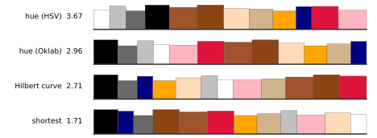

# Maps

Four questions about drawing data so that neighbors stay neighbors.

- **Books by color.** Sorting a shelf by hue costs 3.1 times the total color jump of the shortest ordering of the 139 CSS colors. The shortest ordering, computed exactly, is not the one that keeps similar colors closest. Greedy search plus 2-opt comes within 2.6% of it.
- **Random projections.** Random maps of 400 word vectors need about 1,000 dimensions to keep every squared distance within 20%. The worst distortion runs about a third below the exact union bound.
- **SNE and t-SNE**, written from their papers and checked against scikit-learn, show the trade-off Venna and Kaski describe: t-SNE's maps are the more trustworthy, SNE's the more continuous.
- **Self-organizing maps** keep the Pokémon's neighbors about as trustworthily as t-SNE but lose more of them, as Venna and Kaski (2001) found on other data.



*Twelve books in four orders, with each order's total color jump. The hue sorts put the four grays in one block at the red end, and light pink beside crimson.*

## The questions as modeled

- A **color** is a point in Oklab (Ottosson 2020), a perceptual color space, and the **jump** between two books standing side by side is the Euclidean distance between their colors. An **ordering's total jump** is the sum of its jumps. The best ordering is a shortest Hamiltonian path with free ends. Other color distances (CIEDE2000) were not tried.
- **Neighbor preservation** is scored by Venna and Kaski's trustworthiness T(k) and continuity C(k), which compare each point's k nearest neighbors in the data and on the map. Both are 1 for a map that keeps every k-neighborhood. Maps with ties (a shelf; a SOM, where points share a unit) are scored as Venna and Kaski did, by averaging the best and the worst order of the tied points.
- **Distortion** of a random map is the smallest ε with (1 − ε)|u − v|² ≤ |f(u) − f(v)|² ≤ (1 + ε)|u − v|² for every pair: squared distances, as in the lemma's statements.
- **Point sets.** The 139 distinct CSS named colors. The raw base stats of the 721 Pokémon species of Generations 1 to 6, in six dimensions. Some species have the same stats (Charmander and Cyndaquil, for one), so there are 705 distinct points. The 400 Codenames words of `codenames/words.txt` as unit vectors from the wordllama static table, in 256 dimensions.

## Results

| Result | Value | How it is known |
|---|---|---|
| Shortest total jump, 12-book shelf | 1.710; HSV hue sort 3.674 (2.15 times) | exact (Held-Karp), checked by brute force on 9 of the books |
| Shortest total jump, 139 CSS colors | 8.133 | exact (integer program with subtour cuts, HiGHS at zero gap) |
| Same shelf, other methods | greedy + 2-opt 8.342, 1D SOM 8.975, 1D t-SNE 9.262, Hilbert curve 12.51, HSV hue 24.89, Oklab hue 25.65 | computed (seed 0 for the SOM and t-SNE) |
| Continuity C(5) on that shelf | 1D t-SNE 0.964, 1D SOM 0.948, shortest 0.908, greedy 0.890 | computed |
| 100 random 10-book shelves, mean excess over shortest | greedy + 2-opt 0.1% (solves 91%), 1D SOM 2.5%, 1D t-SNE 18.3%, Hilbert 32.7%, hue 57% | exact optimum per shelf; methods computed; seeds 0 to 99 |
| Worst distortion, 400 words, k = 256 | 0.409 (Gaussian), 0.410 (±1), 0.412 (sparse) | simulated, median of 20 maps (seeds 0 to 19) |
| Same, k = 1,024 | 0.193, 0.198, 0.201; exact union bound 0.258; Achlioptas's bound 0.296 | simulated (20 maps); bounds exact |
| Variance of one pair's ratio, Shuckle and Blissey, k = 16 | ±1 map 0.0764 (formula 0.0768), Gaussian 0.127 (formula 0.125) | simulated, 20,000 maps, standard error 0.0015 or less; formula exact |
| t-SNE cost on the Pokémon map | 0.932; scikit-learn's exact t-SNE reaches 0.93 | computed (seed 0; scikit-learn random_state 0) |
| Pokémon, T(10) / C(10) | t-SNE 0.966 / 0.952, SNE 0.886 / 0.968, PCA 0.865 / 0.957, SOM 0.967 / 0.917 | computed |
| Words, T(10) / C(10) | t-SNE 0.767 / 0.745, SNE 0.677 / 0.787, PCA 0.630 / 0.680 | computed |
| SOM on random colors, 20 × 20 | quantization error 0.083, topographic error 0.091 | computed (seeds 0 and 1) |

## How the results are checked

- **Shortest orderings.** Held-Karp agrees with brute force on every shelf of 5 to 9 books in the tests, and the integer program gives the same lengths.
- **Oklab** reproduces all four rows of Ottosson's published table of test values.
- **The Hilbert index** visits every cell once, by unit steps, in the 8 × 8 square and the 4 × 4 × 4 and 8 × 8 × 8 cubes.
- **Rank scores.** Trustworthiness equals scikit-learn's `trustworthiness` on random data; continuity equals trustworthiness with the two spaces swapped; for a shelf of 8 books, the best and worst tie orders match the extremes found by enumerating every order of the tied books.
- **SNE and t-SNE.** The perplexity search hits its target to 10⁻⁶. All three gradients (SNE, symmetric SNE, t-SNE) match finite differences. P matches scikit-learn's to 10⁻⁶, and the t-SNE cost and gradient match its `_kl_divergence` to 10⁻¹⁴.
- **Random projections.** For Gaussian maps one pair's ratio follows χ²ₖ/k exactly; the notebook compares a histogram of 20,000 maps with that density. The variance formula (2 + (m₄ − 3) Σ aᵢ⁴/|a|⁴)/k is checked by hand on a single coordinate and by simulation on two pairs.
- **Results file.** `python -m maps.study` writes `results/maps.json` and `results/maps.npz`. A test recomputes the quick sections (12-book shelf, projections, SOMs) and compares them with the file. Each notebook's last cell compares the slow sections it computes. Another test redraws every figure from the results and compares the SVG bytes. CI reruns the notebooks and compares their text and figures.
- **Reproducible bits.** The SNE, t-SNE and SOM loops use elementwise numpy operations only, without BLAS. Test runs gave identical bits with numpy's AVX-512 and AVX2 code paths turned off and on.

## Ordering books by color ([`shelf.ipynb`](shelf.ipynb))

Hue sorts fail for three reasons, all visible in the picture above. Grays have no hue, and HSV reports 0°, the hue of red. Browns are dark oranges. Pastels share their hue with strong colors. On 139 CSS colors, the shortest ordering has total jump 8.133, found by an integer program. It uses a dummy book at distance 0 from every book and adds subtour cuts until one loop remains (about a minute).


*The 139 CSS colors in seven orders. The hue sorts scatter grays and whites across the shelf. The SOM and t-SNE run dark to light in long smooth stretches.*

The two scores disagree. The shortest shelf has the least total jump and the best T(2) (0.993). But its C(5) is 0.908, against 0.964 for the 1D t-SNE and 0.948 for the 1D SOM. A shortest path visits each region of color once and leaves by its cheapest exit, so two close colors visited at different times end up far apart. Its largest single jump (0.407) is also larger than the SOM's (0.322) and t-SNE's (0.330).

On 100 random shelves of 10 books, greedy + 2-opt finds the shortest ordering 91 times, and is never more than 4.2% longer. The 1D t-SNE is worse on 10 books (18.3% over) than on 139 (13.9%): on a line, points cannot pass each other, so an early wrong order can stay. With the paper's learning rate of 100, ten books fly hundreds of units apart; the package uses 10.

## Random projections ([`jl.ipynb`](jl.ipynb))


*Median worst distortion of 20 maps for each k, on log scales. The three kinds of map overlap. Both bounds hold with probability at least 1 − 1/n and say nothing below about k = 128.*

- The three kinds of random matrix (Gaussian; ±1; Achlioptas's sparse √3 · {+1, 0, −1}, which reads a third of the coordinates) give the same worst distortion on the words at every k.
- The exact union bound comes from the χ² tail of one pair, times the number of pairs. It sits 31% to 35% above the median worst distortion, and Achlioptas's closed form is another 15% to 35% above that.
- The lemma's k does not depend on the starting dimension, and it is not small. For ε = 1/2, Dasgupta and Gupta's formula asks for 288 dimensions for 400 points. For the six Pokémon stats it asks for 315, and PCA keeps every distance at k = 6.
- The ratio's variance is (2 + (m₄ − 3) Σ aᵢ⁴/|a|⁴)/k, where m₄ is the fourth moment of an entry. Sparse entries have m₄ = 3, as Gaussian ones do, so the same variance on every pair. ±1 entries have m₄ = 1 and a smaller variance on lopsided pairs: 39% smaller for Shuckle against Blissey.

The notebook also gives the proof in plain words: a Chernoff bound for one pair, then a union bound over pairs.

## SNE and t-SNE ([`sne.ipynb`](sne.ipynb))


*705 Pokémon stat lines, colored by stat total (light is low). SNE fills a disk evenly, the crowding problem; t-SNE leaves gaps between groups.*

The package implements SNE, symmetric SNE and t-SNE with the optimizer of van der Maaten and Hinton (2008, section 3.4). On 11 clusters at the corners of a regular simplex in ten dimensions, the Gaussian maps leave the clusters wide with narrow gaps. t-SNE's separation (distance between cluster centers over the spread within a cluster) is 20, against about 8 for SNE. The Student-t tail stops moderately distant points from attracting each other, which is the crowding problem's fix.


*Each map of the Pokémon stats as one point. Up is continuity (true neighbors kept), right is trustworthiness (shown neighbors true).*

The Gaussian maps are the more continuous and t-SNE the more trustworthy, on the Pokémon and on the words. Venna and Kaski (2006) report the same trade-off, and Venna et al. (2010) explain it: SNE's cost is a smoothed recall. On the Pokémon, take a point's 20 nearest in the data as its true neighbors. t-SNE's nearest point on the map is one of them 98% of the time, against under half for SNE. Retrieving 70 or more points from the map, SNE recovers more of them. scikit-learn's exact t-SNE, with the same settings, reaches a cost of 0.93 against 0.932 here.

## Self-organizing maps ([`som.ipynb`](som.ipynb))


*Kohonen's color map after 20,000 steps. Neighboring units hold similar colors, and the edges hold the strong ones.*

A 16 × 16 map of the Pokémon stats uses 240 of its 256 units, so about three Pokémon share a unit. Its trustworthiness at k = 10 is 0.967, between 0.953 and 0.981 depending on how ties are ordered. That matches t-SNE (0.966) and is above PCA and SNE. Its continuity, 0.917, is the lowest of the five maps. Venna and Kaski (2001) found the same pattern for SOMs against multidimensional scaling on three other data sets. The notebook shows each stat's component plane and the U-matrix.

## Data

| Source | What it is | License | Committed |
|---|---|---|---|
| CSS Color Module Level 4 named colors, as `matplotlib.colors.CSS4_COLORS` | 148 names, 139 colors | part of matplotlib (PSF-based license) and the W3C specification | no; read from matplotlib |
| `pokemon/Pokemon.csv` | base stats of 800 Pokémon and forms | CC0 1.0 (see `pokemon/README.md`) | already in the repository |
| `data/codenames-wordllama.npz` | 400 × 256 float16 unit vectors for the words of `codenames/words.txt` | wordllama's l2_supercat table is under the MIT license (wordllama 0.4.0.post1 on PyPI, pinned by SHA-256 in `codenames/fetch.py`) | yes, 191 KB |

`python -m maps.data` rebuilds the word vectors with `codenames.embed`; it needs the codenames group and network access to PyPI.

## Sources

- Ottosson, B. (2020). A perceptual color space for image processing. bottosson.github.io/posts/oklab. The Oklab matrices and test values.
- Held, M., and Karp, R. M. (1962). A dynamic programming approach to sequencing problems. *J. SIAM* 10(1), 196–210.
- Skilling, J. (2004). Programming the Hilbert curve. *AIP Conference Proceedings* 707, 381–387.
- Johnson, W. B., and Lindenstrauss, J. (1984). Extensions of Lipschitz mappings into a Hilbert space. *Contemporary Mathematics* 26, 189–206.
- Dasgupta, S., and Gupta, A. (2003). An elementary proof of a theorem of Johnson and Lindenstrauss. *Random Structures and Algorithms* 22(1), 60–65. Theorem 2.1's bound is `jl.k_needed` with β = 0.
- Achlioptas, D. (2003). Database-friendly random projections: Johnson-Lindenstrauss with binary coins. *JCSS* 66(4), 671–687. Theorem 1.1's bound and both matrices.
- Hinton, G., and Roweis, S. (2002). Stochastic neighbor embedding. *NIPS* 15.
- van der Maaten, L., and Hinton, G. (2008). Visualizing data using t-SNE. *JMLR* 9, 2579–2605. Cost, gradients, and the optimizer of section 3.4.
- Venna, J., and Kaski, S. (2001). Neighborhood preservation in nonlinear projection methods: an experimental study. *ICANN 2001*, LNCS 2130, 485–491. Trustworthiness, and SOMs found more trustworthy than MDS-based maps; reproduced in kind on the Pokémon.
- Venna, J., and Kaski, S. (2006). Local multidimensional scaling. *Neural Networks* 19, 889–899. The formulas for T(k) and C(k), and the handling of ties.
- Venna, J., Peltonen, J., Nybo, K., Aidos, H., and Kaski, S. (2010). Information retrieval perspective to nonlinear dimensionality reduction for data visualization. *JMLR* 11, 451–490. Precision and recall of neighbor retrieval; SNE as smoothed recall.
- Kohonen, T. (1982). Self-organized formation of topologically correct feature maps. *Biological Cybernetics* 43, 59–69.
- Kiviluoto, K. (1996). Topology preservation in self-organizing maps. *Proc. ICNN 1996*, 294–299. Topographic error.

## Open questions

- Does CIEDE2000 instead of Oklab distance change which shelf method wins?
- A NeRV sweep (λ KL(P‖Q) + (1 − λ) KL(Q‖P)) would trace the whole frontier between precision and recall on these data; λ = 1 is SNE, already implemented.
- How far apart are t-SNE's local minima on the Pokémon, over 20 seeds, in cost and in T and C?
- How do T and C of a SOM move with grid size, and does Kohonen's batch algorithm reach the same scores?
- How often does a random projection change which word a Codenames guesser picks? That asks about cosine rankings, a sharper test than distortion.

## Usage

```bash
uv run python -m maps.shelf     # every shelf method on the 139 CSS colors (about a minute)
uv run python -m maps.study     # results/maps.json and maps.npz (about four minutes)
uv run python -m maps.figures   # figures/*.svg from the results (seconds)
uv run --group maps --with jupyter jupyter lab maps/shelf.ipynb
```

```text
$ uv run python -m maps.shelf
HSV hue         jump 24.894  max_jump 0.940  T2 0.759  C2 0.833  T5 0.747  C5 0.815  (0.0 s)
Oklab hue       jump 26.678  max_jump 0.692  T2 0.727  C2 0.840  T5 0.725  C5 0.834  (0.0 s)
Hilbert curve   jump 12.510  max_jump 0.461  T2 0.944  C2 0.885  T5 0.914  C5 0.849  (0.0 s)
```

## Files

| File | What it does |
|---|---|
| `colors.py` | sRGB to Oklab, HSV hue, the CSS colors, distance matrices |
| `paths.py` | total jump, brute force, Held-Karp, the integer program, nearest neighbor, 2-opt, the Hilbert index |
| `shelf.py` | the seven shelf methods and their scores |
| `ranks.py` | trustworthiness, continuity (with ties), precision and recall |
| `sne.py` | perplexity search, SNE, symmetric SNE and t-SNE costs and gradients, the optimizer |
| `jl.py` | random matrices, distortion, the bounds, the exact χ² tail, the variance formula |
| `som.py` | Kohonen's online SOM, quantization and topographic error, U-matrix |
| `data.py` | the three point sets |
| `study.py`, `results/` | every quoted number, cached for the notebooks |
| `draw.py`, `figures.py`, `figures/` | shelves of spines and the README's figures |
| `shelf.ipynb`, `jl.ipynb`, `sne.ipynb`, `som.ipynb` | the four notebooks |
