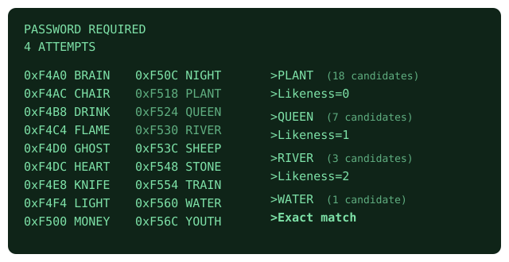

# Mastermind

What is the fewest guesses that cracks every Mastermind code, and do the same strategies crack Fallout 3's terminals? The best strategy averages 5,625 / 1,296 ≈ 4.340 guesses, and the best that never needs a sixth guess 5,626 / 1,296. Koyama and Lai (1993) found both; they are recomputed here by exhaustive search, exact. On Fallout 3 terminals of 20 short words, the best play cracks 92.5% of passwords within four attempts and random guessing among the candidates 67.8%; simulated on 1,000 screens drawn from a word list, with exact results on each screen. The game's manual says that leaving a terminal and coming back resets the password and the tries, so a player who backs out after three wrong guesses is never locked out; within three attempts the best play cracks 57.4% of passwords on such screens, so a visit succeeds a little more often than not.



*A terminal screen and the helper's guesses on it, the same session as the transcript below. Grayed words have been tried.*

`fallout3.py` plays the terminal for you. Give it the words on the screen, type the likeness that the terminal shows after each guess, and it names the next guess:

```
$ uv run python -m mastermind.fallout3 brain chair drink flame ghost heart knife light money night plant queen river sheep stone train water youth
18 candidates; guess PLANT (cracks 18 of 18 for certain)
Likeness? 0
7 candidates; guess QUEEN (cracks 7 of 7 for certain)
Likeness? 1
3 candidates; guess RIVER (cracks 3 of 3 for certain)
Likeness? 2
The password is WATER
```

On this screen it is sure to crack the password within four attempts, whichever word it is. A test replays this transcript.

## Rules as modeled

- **Mastermind.** A code is four pegs in six colors, 1,296 codes in all. The codemaker replies to each guess with the number of pegs right in color and place, and the number right in color only. A guess may be any code, including one already ruled out.
- **Strategies.** Each heuristic scores every possible guess by how it would split the codes still possible (the **candidates**) into classes by reply, and picks the best score:
  - **minimax** (Knuth, 1976): the guess whose largest class is smallest;
  - **expected size** (Irving, 1978–79): the guess whose classes have the smallest expected size;
  - **entropy** (Neuwirth, 1982): the guess whose split has the largest entropy;
  - **most parts** (Kooi, 2005): the guess with the most classes;
  - **first consistent**: the first candidate in code order.
  
  On Fallout screens, **common** is a hand rule: guess the candidate that shares the most letters in place with the others, summed over them (the "closest word" of Math Goes Pop). **Random** guesses a candidate uniformly at random. **Best possible** cracks the most passwords any strategy can within the attempts, found by exhaustive search on each screen.
- **Ties.** The totals of the heuristic strategies depend on how ties are broken. As in Knuth (1976), each strategy prefers a guess that could be the secret, then the lowest-numbered code, and guesses the first candidate when two or fewer remain.
- **Fallout 3 terminals.** A locked terminal shows a screen of words of one length, and one of them is the password. Each guess must be a word on the screen. The terminal replies with the likeness: how many letters are right and in the right place. Four wrong guesses lock the terminal ([Fallout wiki, Hacking](https://fallout.fandom.com/wiki/Hacking)). The game's manual adds that a player may leave at any time, and that on coming back the password resets, as do the tries ([Fallout 3 manual](https://images.fallout.wiki/b/b3/Fallout_3_Manual.pdf), "Hacking"). Players use this to back out before the fourth guess, so the results are given for four attempts and for three. This is Mastermind with a short list of possible codes, so the strategies apply unchanged. A guess may be any word on the screen, including one already ruled out, since it can still split the remaining candidates.
- **Not modeled.** Brackets in the screen's filler text, which remove a dud or restore the attempts, and the Computer Whiz perk, which allows a second try at a locked terminal.

## Results

| Result | Value | How it is known |
|---|---|---|
| Least total over all 1,296 codes | 5,625 (average 4.340) | exact, by exhaustive search (`optimal.py`); agrees with Koyama and Lai (1993) |
| Least total with at most five guesses for every code | 5,626 (average 4.341) | same |
| Every code within four guesses | impossible | same search |
| Best of five published heuristics (most parts) | 5,668 (average 4.373) | exact, every code played; matches Kooi (2005), Table 7 |
| Fallout 3, 20-word Very Easy screens: best possible within four attempts | 92.5% ± 0.4 | simulated, 1,000 screens (seed 3), exact on each screen; normal 95% interval |
| Same, expected size | 88.1% ± 0.5 | same |
| Same, random guessing among the candidates | 67.8% ± 0.4 | same |
| Same screens, best possible within three attempts, before backing out | 57.4% ± 0.4 | same |
| From Average level up: minimax and expected size against the best possible | within 0.05 points | same |
| Three published Fallout 4 screens | expected size and "closest word" reproduce Math Goes Pop's table exactly | exact |

## How the results are checked

- **The search.** The tests compare `optimal.py` with the plain recursion (every guess, every set, no bounds or symmetry) on six smaller games, from 2 colors and 2 pegs to 3 colors and 3 pegs, with and without depth limits.
- **Published small games.** On 17 small games, from 2 colors and 2 pegs to 7 colors and 2 pegs and 3 colors and 5 pegs, the least average agrees with the table of W. Goddard, "Mastermind revisited", *J. Combin. Math. Combin. Comput.* 51 (2004), to its three decimals. The least worst case agrees with his table except in its two-peg column at 3, 5 and 7 colors, where the table is one higher than his own Theorem 1, ⌊k/2⌋ + 2 for k colors; the search agrees with the theorem. The tests check all 17.
- **The trees.** The trees read back from the search are committed in `results/optimal.json`. A test plays each against every code with `score` alone and gets 5,625 and 5,626, the totals the search reports. The replay shows that 5,625 and 5,626 are reachable. That nothing lower is reachable rests on the search, on its agreement with Koyama and Lai, and on the small games above.
- **The heuristics.** The tests check every total against Kooi's Table 7.
- **Fallout screens.** The tests compare the exhaustive search with a brute force without memoization or shortcuts. They do this on all 126 five-word screens drawn from nine words, at one to four attempts, and on 40 sampled screens. On the same 126 screens, the exact chance of random guessing matches an enumeration of every sequence of choices.
- **Published Fallout 4 screens.** On the three screens of [Math Goes Pop (2016)](https://www.mathgoespop.com/2016/04/fallout-4-math-part-2.html), expected size and common reproduce their table exactly:
  - expected size ("most expected eliminations") wins 100% on each screen, with 2.75, 2.58 and 2.58 guesses on average;
  - common ("closest word") wins 91.67%, 100% and 100%, with 2.92, 2.58 and 2.58 guesses on average. Their simulated random guessing, 1.2 million games per screen, won 92.79%, 96.21% and 97.93%. The exact values here are 92.78%, 96.19% and 97.96%.
- **Their random screens.** They also scored random twelve-word screens of 5, 6 and 7 letters, from a word list they do not name. On 1,000 ENABLE screens of each length, the results here are within about half a point of theirs:
  - expected size cracks 98.0%, 99.3% and 99.8%, where they report 97.50%, 98.94% and 99.57%;
  - common cracks 96.2%, 97.4% and 98.1%, where they report 96.04%, 97.42% and 98.18%;
  - random guessing cracks 86.4%, 90.7% and 93.7%, where they report 85.92%, 90.64% and 93.67%.
- **This README.** A test replays the transcript above, and another checks that the committed figures are what `figures.py` draws.

CI runs the tests. The ten-minute search and the four-minute study do not run in CI; the smaller cases do, and so does the replay of the committed optimal trees.

## How good are the published heuristics?

Each strategy below is played against every code, so the numbers are exact:

| Strategy | Total guesses | Average | Worst case |
|---|---:|---:|---:|
| most parts | 5,668 | 4.373 | 6 |
| expected size | 5,696 | 4.395 | 6 |
| entropy | 5,722 | 4.415 | 6 |
| minimax | 5,801 | 4.476 | 5 |
| first consistent | 7,471 | 5.765 | 9 |

The totals match Table 7 of B. Kooi, "Yet another Mastermind strategy", *ICGA Journal* 28(1), 2005, who also introduced most parts. The others are older: minimax is from D. E. Knuth, "The computer as Master Mind", *J. Recreational Mathematics* 9(1), 1976–77; expected size from R. W. Irving, "Towards an optimum Mastermind strategy", *J. Recreational Mathematics* 11(2), 1978–79; and entropy from E. Neuwirth, "Some strategies for Mastermind", *Zeitschrift für Operations Research* 26 (1982). These three are cited here as Kooi credits them; their papers were not read. Among these five, most parts has the lowest average and minimax is the only one that never needs a sixth guess, so those two are the Pareto frontier of average and worst case within the table.


*Two heuristics and the two optimal trees, over all 1,296 codes. Minimax gives up 102 codes solved in four guesses to avoid the 7 codes that need six. The tree that never needs a sixth guess gives up only 3 codes in four, for one guess more in all.*

## What is the best strategy?

The best totals are 5,625 guesses with any worst case and 5,626 with at most five guesses for every code. K. Koyama and T. W. Lai, "An optimal Mastermind strategy", *J. Recreational Mathematics* 25 (1993), found both by exhaustive search. The second has a lower average than every row of the table above and a worst case no higher than any of them. `optimal.py` repeats that search and gets the same two numbers:

| Best strategy | Total guesses | Average | Worst case | Codes solved in 1, 2, 3, 4, 5, 6 guesses |
|---|---:|---:|---:|---|
| any worst case | 5,625 | 4.340 | 6 | 1, 8, 83, 663, 539, 2 |
| at most five guesses | 5,626 | 4.341 | 5 | 1, 8, 83, 660, 544 |

These are exact. Both trees are committed in [`results/optimal.json`](results/optimal.json), written by `optimal.py --out` on a GitHub runner in 7 minutes (CPU time 185 s for the bound and 200 s for the two trees). CI reads them back and plays each against every code with `score` alone, so the totals and distributions above are checked on every run without the search. The search also shows that no strategy solves every code within four guesses. The totals are the optimal values; the distributions belong to the particular optimal trees the program reads back, and other optimal trees can spread the guesses differently. Both trees open with 1123 (a color twice, then two others), as Koyama and Lai's does.

The search tries every code as a guess, including codes ruled out by the replies so far. Permuting colors and permuting positions keep every reply. So the search stores each set of candidates once, under the smallest set that such a permutation can turn it into, and of the guesses that a permutation fixing the set carries onto each other, it tries only one. It skips a guess when a lower bound on its cost already reaches the best found, and it remembers each set's cost. It takes about ten minutes on a two-core computer.

**Larger games.** How the number of guesses grows with the number of pegs n and colors k is a different question, studied with asymptotic bounds. Each reply is one of at most (n + 1)<sup>2</sup> pairs, so any strategy needs at least about n log k / (2 log(n + 1)) guesses. V. Chvátal, "Mastermind", *Combinatorica* 3 (1983), showed that for k up to n<sup>1−ε</sup>, with ε > 0 fixed, random guesses determine the code within a constant factor of that bound, and that n colors need at most of order n log n guesses. B. Doerr, C. Doerr, R. Spöhel and H. Thomas, ["Playing Mastermind with many colors"](https://doi.org/10.1145/2987372), *J. ACM* 63 (2016), lowered that to order n log log n for k = n, using black pegs only. They also showed that any strategy fixed in advance needs order n log n. The known lower bound for k = n is of order n. These bounds hide constants and say nothing about four pegs and six colors; there only the exact search answers. (Chvátal's statements are given here as Doerr et al. summarize them; his paper was not read.)

## How well do these strategies crack Fallout 3 terminals?

On large screens of short words, the best play cracks 92.5% within four attempts; minimax and expected size fall 5.0 and 4.4 points short of it. From Average level up they come within 0.05 points. A player who backs out after three wrong guesses has three attempts a visit: the best play then cracks 57.4% on 20-word Very Easy screens and 84.4% on 20-word Average screens.

What the sources say about the screens:

- Word length depends on the terminal's level: 4–5 letters for Very Easy, 6–8 for Easy, 9–10 for Average, 11–12 for Hard and 13–15 for Very Hard (Fallout wiki).
- The number of words depends on the player's Science skill. The [GECK wiki's formula](https://geckwiki.com/index.php?title=Hacking_Word_Count) gives 20 words when Science equals the lock's level (0, 25, 50 or 75 from Very Easy to Hard) and 5 at Science 100. The Fallout wiki lists 15 as the Science needed for Very Easy, where the formula gives 17.75. At Very Hard it gives 12.5 words whatever the Science. The wiki does not say how 12.5 is rounded.
- None of the sources consulted say how the words are chosen, or whether duds are chosen to share letters with the password. The three Fallout 4 screens published by Math Goes Pop are somewhat more alike than random ENABLE screens of the same size. Their mean likeness is 0.49, 0.85 and 0.79, against 0.44, 0.54 and 0.64 for ENABLE, and 32%, 2.5% and 18% of 1,000 ENABLE screens are as alike. Three screens from a later game settle nothing.

Word lists from the game are not available. The study therefore draws each screen from the ENABLE list in `boggle/enable1.txt`, with a seeded generator, at a length chosen uniformly from the level's lengths. The password is uniform over the screen. On each screen, every strategy is played against every password, so each screen's numbers are exact. Across screens they are simulated: 1,000 screens per row, seed 3, with a normal 95% interval. "Best possible" is the most passwords that any strategy can crack within four attempts, found by exhaustive search on each screen. "Random" guesses a candidate uniformly at random; its chance is computed exactly, not simulated. "Common" is the hand rule of guessing the candidate with the most letters in place, summed over the other candidates (the "closest word" of Math Goes Pop).

Percent of passwords cracked within four attempts, at the fewest and most words. The full output, with the rows for 10 and 15 words, is committed in [`results/study-4.txt`](results/study-4.txt), and the same table for three attempts in [`results/study-3.txt`](results/study-3.txt):

| Level | Words | Most parts | Expected size | Entropy | Minimax | Common | Random | Best possible |
|---|---:|---:|---:|---:|---:|---:|---:|---:|
| Very Easy | 5 | 99.7 ± 0.1 | 99.7 ± 0.1 | 99.7 ± 0.1 | 99.7 ± 0.1 | 99.6 ± 0.2 | 99.3 ± 0.1 | 99.7 ± 0.1 |
| Very Easy | 20 | 79.5 ± 0.6 | 88.1 ± 0.5 | 86.9 ± 0.5 | 87.6 ± 0.5 | 85.1 ± 0.5 | 67.8 ± 0.4 | 92.5 ± 0.4 |
| Easy | 20 | 93.7 ± 0.4 | 98.1 ± 0.2 | 97.7 ± 0.2 | 98.4 ± 0.2 | 93.5 ± 0.3 | 82.9 ± 0.3 | 99.78 ± 0.07 |
| Average | 20 | 98.5 ± 0.2 | 99.95 | 99.85 | 99.95 | 96.8 ± 0.2 | 91.2 ± 0.2 | 100 |
| Hard | 20 | 99.64 | 99.99 | 99.98 | 100.00 | 97.9 ± 0.2 | 94.7 ± 0.1 | 100 |
| Very Hard | 13 | 100 | 100 | 100 | 100 | 99.6 ± 0.1 | 99.13 | 100 |

Intervals under 0.1 points are left out. "100" means every password on every sampled screen was cracked; "100.00" is a rounded figure. The rows for 10 and 15 words, and for 12 words at Very Hard, are in `results/study-4.txt`; their figures fall between the ones shown.

- Short words make the game hard. On 72% of 20-word Very Easy screens, no strategy cracks every possible password. The hardest screen found was PUSH WHIT YUPS FRAG MEWL BOTS AMPS JAUK GONE KILN. Forty of its 45 pairs have likeness 0, and the best play cracks 7 of its 10 passwords. Even five words can defeat every strategy, as on 1.3% of five-word Very Easy screens. One way is for every pair to have the same likeness, so that each guess rules out only itself.
- From Average up, minimax and expected size come within 0.05 points of the best possible. They miss some password on at most 1.1% of the sampled screens, and the best possible misses none. On 20-word Very Easy screens they fall 5.0 and 4.4 points short.
- Minimax is ahead of expected size by up to 0.6 points on most rows, and behind by 0.6 on 20-word Very Easy screens. Most parts, the best of the four for Mastermind, is the worst of the four here. It cracks 8.6 points fewer passwords than expected size on 20-word Very Easy screens.
- With no attempt limit, minimax and expected size never needed more than 7 guesses on any sampled screen. Most parts needed up to 9.
- Random guessing among the candidates does far worse on large screens. It cracks 67.8% on 20-word Very Easy screens, against 88.1% for expected size.

**The first guess matters less than the later ones.** Take a player who uses a rule for the first guess and then makes the best guess every time. On the screens with the most words at each level (5,000 screens), the minimax rule keeps 99.41% ± 0.05 of the best possible chance on average, and its first guess is an optimal one on 90.5% of screens. Expected size keeps 99.31% and common keeps 99.11%. A uniformly random first word keeps 96.91%.

## Related work

A Fallout terminal is black-peg Mastermind over a short word list with a limit on guesses, the same kind of game as Wordle. D. Bertsimas and A. Paskov, "An Exact and Interpretable Solution to Wordle" (2022, submitted to *Operations Research*), solve Wordle by exact dynamic programming over sets of candidates, the recursion that `fallout3.py` runs on each screen; M. Cunanan and M. Thielscher, "On Optimal Strategies for Wordle and General Guessing Games", IJCAI 2023, prove strategies optimal for guessing games of this form without a full search. The question of the best first guess here is the Fallout form of Wordle's question of the best opening word.

## Data

| Source | What | License | Committed |
|---|---|---|---|
| ENABLE (`boggle/enable1.txt`) | the word list the screens are drawn from | public domain | yes, in `boggle/` |
| Math Goes Pop (2016) | three Fallout 4 screens and their results | not stated | the screens' words, in `fallout3.py` (`FALLOUT4_SCREENS`) |
| Fallout wiki and GECK wiki | word lengths, word counts, the four-attempt rule | read, not copied | no |
| Fallout 3 manual | that leaving resets the password and the tries | publisher's copyright; read, not copied | no |

## Open questions

- How does the game choose a screen's words, and are duds chosen to share letters with the password? A list of real screens would settle whether the ENABLE screens here are easier or harder than the game's.
- ENABLE has many words that a game would not use, such as JAUK and WHIT. Would screens of common words change the table?
- Is there a rule for the first guess that keeps more of the best possible chance than minimax's 99.41%?
- With backing out allowed, what play minimizes the expected number of guesses or visits to crack a terminal? That depends on whether a new visit shows new words, which the manual does not say.

## Usage

```bash
uv run python -m mastermind.strategies          # the five heuristics, about half a minute
uv run python -m mastermind.optimal --out mastermind/results   # the best strategies, about ten minutes; writes optimal.json
uv run python -m mastermind.optimal 4 3         # 4 colors, 3 pegs, under a second
uv run python -m mastermind.fallout3 doctrines batteries scorpions generated occasions   # asks for each likeness
uv run python -m mastermind.fallout3 --best doctrines=3 batteries scorpions generated occasions # next guess after DOCTRINES got 3
uv run python -m mastermind.fallout3 --study > mastermind/results/study-4.txt               # the Fallout table, about 4 minutes
uv run python -m mastermind.fallout3 --study --attempts 3 > mastermind/results/study-3.txt  # the same, three attempts
uv run python -m mastermind.fallout3 --published   # the Fallout 4 screens, about half a minute
uv run python -m mastermind.figures                # the figures in figures/
```

## Files

| File | Contents |
|---|---|
| `mastermind.py` | The codemaker's reply, `score`, which everything else uses |
| `strategies.py` | Compiles each strategy into a guess tree and plays it against every code |
| `optimal.py` | The best strategies, by exhaustive search |
| `results/optimal.json` | The two optimal trees and their totals, as `optimal.py` writes them |
| `results/study-4.txt`, `results/study-3.txt` | The Fallout study's output, with four and three attempts |
| `fallout3.py` | The same strategies on Fallout 3 terminals, the helper, and the study |
| `figures.py`, `figures/` | This README's figures, as SVG; a test checks they are current |
