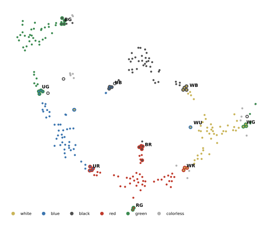
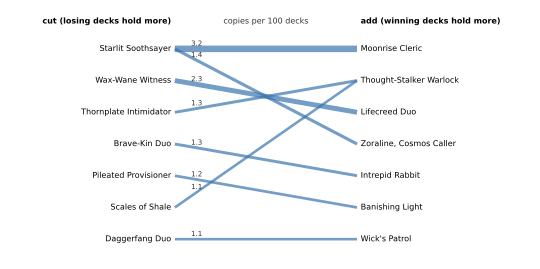
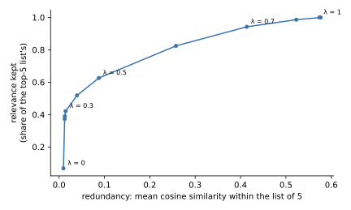

# Magic draft decks: which cards go together, and how decks that win differ

Card embeddings learned only from which cards share a deck recover a set's archetypes. In 80,079 Bloomburrow draft decks from 17Lands, a card's 10 nearest neighbors share its most-played color pair 80.9% of the time, against 15.4% when the same decks are shuffled and 40.3% when neighbors are random cards of the card's own color. For one-color creatures of an archetype's creature type, the colors of the nearest off-color cards name the archetype's other color 78.0% of the time, against 25% by chance. Two methods agree: PPMI with eigenvectors (exact, no seed) and skip-gram (five seeds).

Deck edits are a weaker story. Read as optimal transport from a deck to the average winning deck of its color pair, they pair each cut with a more similar add than a ranked list does: the same card type 46.1% of the time against 41.1%. But as a score for which held-out decks win, transport does worse than plain card-frequency differences (stratified AUC 0.534 against 0.541, difference −0.0073), and neither comes close to the player's own skill bucket (0.578). Winning and losing decks of one color pair differ by about half a card in 24. These results are exploratory; a plan to test them on fresh data is [D1](../experiments/plans/D1.md).



*Each dot is a card, colored by its color; two-color cards have a ring of the second color. The positions come from co-occurrence alone. The map is t-SNE (perplexity 20, seed 0) of the PPMI embedding, by the code in `maps/sne.py`.*

## Rules as modeled

- **Decks.** 17Lands' public game file for Bloomburrow Premier Draft (BLB) lists the main deck of every game that its users played. A **deck** is one build of one draft, with its games and wins. For co-occurrence each draft counts once, through the build with most games. Basic lands are left out, and so are the 6 nonbasic cards held by fewer than 100 fit decks (0.012% of nonbasic copies); 265 cards remain.
- **Splits.** Drafts are split by a hash of their id: half to **fit** (counts, embeddings and targets), a quarter to **dev** (every held-out number below), and a quarter to **test**, which is counted and nothing else, for [D1](../experiments/plans/D1.md).
- **Archetype.** A deck's archetype is its main color pair, as 17Lands records it. A card's **pair** is the color pair it is played in most, among fit decks holding it.
- **Winning decks.** For a color pair, the **average winning deck** is the average of the decks of every fit game won, each deck as shares of its cards; the **average losing deck** is the same over games lost. A deck that went 7–2 counts seven times in one and twice in the other.
- **Skill.** 17Lands gives each game the player's overall game win rate in the format, rounded into buckets. It is the only measure of the drafter, and it includes the games being scored.

## Results

Exploratory throughout: the measures were chosen while looking at these data, and one (marked) after seeing another.

| Question | Answer | How it is known |
|---|---|---|
| Share of a card's 10 nearest neighbors in its color pair (PPMI) | 80.9% (77.7% to 84.1%) | computed exactly; interval by bootstrap over 265 cards |
| The same, skip-gram | 79.7% (79.2% to 80.2% over seeds) | learned, seeds 1 to 5 |
| The same, shuffled decks; random neighbors; random neighbors of the card's color | 15.4%; 14.7%; 40.3% | null: 5 seeds; chance: exact |
| One-color cards: neighbors that include its color (PPMI; random) | 97.8%; 22.0% | computed exactly |
| Archetype's other color named by the nearest off-color cards (91 cards; marked) | 78.0% (PPMI), 77.1% (skip-gram), 25.9% (null), 25% (chance) | as above; defined after the next row was seen |
| The same vote over all 10 neighbors | 46.2% (PPMI), 41.5% (skip-gram), 24.7% (null) | as above |
| Dev decks: chance a won game's deck scores above a lost game's, same pair and skill bucket | frequency difference 0.541, transport 0.534, total variation 0.542 | 37,528 dev drafts, 218,061 games; exact given the targets |
| Transport minus frequency difference | −0.0073 (−0.0094 to −0.0051) | bootstrap over drafts, 2,000 resamples, seed 0 |
| The player's skill bucket alone, same pair | 0.578 | as above |
| Swaps that replace a card by one of the same type (dev decks) | transport 46.1%, ranked lists 41.1%, random pairing 40.7% | 3,000 dev decks, seed 0 |
| MMR at λ = 0.7 against the top-5 list (dev decks) | keeps 98.0% of relevance; redundancy 0.48 against 0.56 | 3,000 dev decks |

## How the results are checked

- **By hand.** PMI, co-occurrence, the stratified AUC, the baseline swaps and MMR each have a small case worked in `tests/test_mtg_decks*.py`.
- **Two solvers for transport.** POT's network simplex agrees with a linear program (HiGHS) and with brute force over every matching of small decks. A test checks the kept-mass lemma below on random cases.
- **Two implementations of MMR.** The selection here agrees with `rankops.mmr_similarity` (Rust, on PyPI) on every list of every pair and of the 3,000 dev decks, at every λ. Greedy MMR is checked against the best subset of the same objective on 30 small cases: the greedy list was the best in 11, and short by at most 0.065.
- **Planted structure.** On synthetic decks with two planted archetypes, both embeddings recover them exactly and the null does not. Skip-gram's dot products track PMI − log k on a small case, as Levy and Goldberg (2014) proved for its optimum.
- **The null keeps the margins.** Shuffled decks keep every deck's size and every card's deck count exactly (curveball algorithm), which a test checks.
- **Same bits everywhere.** Logarithms, eigenvectors and dot products come from `maps/portable.py`, so the committed results and figures are compared byte for byte in CI.
- **CI** reruns everything that uses the committed aggregates: the PPMI rows, seed 1 of skip-gram and of the null, the transport and MMR tables, and the figures. The dev numbers need the 17Lands file, so they come from one Actions run (below) and are not rerun.

## Which cards go together?


*What a card's nearest neighbors share with it. Error bars span the five seeds.*

The **embedding** of a card is a short vector built from the decks it shares with other cards; cards close in the embedding are **neighbors**.

- **PPMI with eigenvectors.** Positive pointwise mutual information compares how often two cards share a deck with how often they would if decks were random: max(0, log(C·N / (nᵢ nⱼ))), with C the decks holding both, nᵢ and nⱼ the decks holding each, and N the decks. Its 32 leading eigenvectors, scaled by the square roots of their eigenvalues, are the embedding. This is the symmetric form of the truncated SVD that Levy, Goldberg and Dagan (2015) use. It is exact and has no seed.
- **Skip-gram.** Word2vec with negative sampling, with each deck a sentence and the whole deck the window. Every pair of cards in a deck is then a positive pair, so pairs are drawn straight from the co-occurrence counts. The vectors are word plus context, 32 dimensions, five negatives, seeds 1 to 5.
- **The null** shuffles cards among the fit decks and keeps each deck's size and each card's count. It has no color structure, and its neighbor scores sit at chance.

Color explains much but not all of the pair result: a random neighbor of the card's own color shares its pair 40.3% of the time, against 80.9% for the embedding's neighbors. Bloomburrow gives a second test. Each color pair is an archetype built around one creature type, as the set's designer listed them (Rosewater 2024): white-black Bats, black-red Lizards and so on. For a one-color creature of such a type, say a black Bat, the archetype's other color (white) is a fact of the set's design that the embedding never sees. Among the 10 nearest cards that do not share the card's color, that color leads 78.0% of the time (69.8% to 85.7%, bootstrap over the 91 cards); four colors compete, so chance is 25%. The first version of this test voted over all 10 neighbors, which are 98% the card's own color; it left few votes and named the partner 46.2% of the time (36.3% to 56.0%).

## How should a deck change to look like the winning decks?



*White-black: the largest moves from the average losing deck to the average winning deck, in copies per 100 decks.*

A deck is a **measure** on cards: each copy has mass 1/n in a deck of n cards. **Optimal transport** moves one measure onto another at the least total cost, and here a unit of mass costs the distance between the two cards' embeddings (Euclidean, between unit vectors). The **plan** says how much mass goes from which card to which; mass from card i to card j reads "cut i, add j". The **baseline** lists the cards the winning decks hold more of and fewer of (the frequency difference), each ranked by amount, and pairs them in rank order.

**Lemma (kept mass).** With a cost that is a metric, some optimal plan keeps min(μᵢ, νᵢ) on every card. If mass moves from i to j while card k sends mass to i, sending k's mass to j and keeping i's costs no more, since d(k, j) ≤ d(k, i) + d(i, j). So transport cuts and adds the same cards in the same amounts as the baseline; what it adds is the pairing. (The cost 1 − cos is not a metric, which is why the Euclidean form is used.)

Black-red shows the difference. Both methods cut the same cards and add the same cards; they differ in which add goes with which cut (copies per 100 decks, average losing deck to average winning deck):

| Transport: cut | add | copies | Ranked lists: cut | add | copies |
|---|---|---:|---|---|---:|
| Kindlespark Duo | Fireglass Mentor | 2.5 | Kindlespark Duo | Scales of Shale | 5.3 |
| Kindlespark Duo | Ravine Raider | 2.4 | Whiskerquill Scribe | Thought-Stalker Warlock | 2.4 |
| Frilled Sparkshooter | Gev, Scaled Scorch | 1.9 | Sazacap's Brew | Gev, Scaled Scorch | 2.2 |
| Sazacap's Brew | Rabid Gnaw | 1.8 | Frilled Sparkshooter | Ravine Raider | 2.1 |
| Daggerfang Duo | Savor | 1.7 | Might of the Meek | Fireglass Mentor | 1.9 |

Over the ten pairs' average decks, transport pairs cards of the same type 48.6% of the time (by mass), ranked lists 38.0% and random pairing 39.5%.

On held-out dev decks:

- **Pairing.** Transport pairs a cut with an add of the same card type 46.1% of the time (45.8% to 46.4%), against 41.1% for ranked lists and 40.7% for random pairing of the same cuts and adds. The mana-value gap is 1.46 against 1.51 and 1.52. Card type and mana value are never shown to the embedding, so this is not circular, but it is a small gain.
- **Which decks win.** Each dev deck gets four scores: the frequency-difference score Σ μᵢ (won − lost)ᵢ, its distance to the average losing deck minus its distance to the average winning deck by transport, the same by total variation (transport with every move costing 1), and the transport distance to the winning deck alone. Within each color pair and skill bucket, the frequency-difference score puts a won game's deck above a lost game's with chance 0.541 (0.539 to 0.544). Total variation ties it, transport is lower by 0.0073 (0.0051 to 0.0094), and distance to the winning deck alone is near a coin flip (0.507).

What the win data can show, and what it cannot:

- **Skill.** The skill bucket alone ranks games better (0.578) than any deck score. Without the skill strata the frequency score rises from 0.541 to 0.553, and its Spearman correlation with skill is 0.16: part of what looks like "this deck wins" is "this drafter wins".
- **Skill is measured with the outcome.** The bucket includes the games being scored, so stratifying by it removes too much in some places and too little in others. There is no separate measure of the drafter.
- **No intervention.** A drafter can only play cards they were passed; a card that winning decks hold more of may stand in for a strong draft, a good seat or a rare that came with it. The scores say which decks win more often, not that a swap would make a given deck win.
- **Small differences.** The average winning and losing decks of one pair differ by 0.44 to 0.75 copies of 24 (half the L1 distance). Any edit list built from them is a list of small tendencies.

## A diverse list of suggestions



*MMR on the ten pairs' lists of cards to add, mean over pairs.*

**Maximal marginal relevance** (Carbonell and Goldstein 1998) picks suggestions one at a time, trading a candidate's relevance against its similarity to those already picked: λ·r − (1 − λ)·max sim, with relevance min-max scaled as in `rankops`. The candidates are the cards the average winning deck holds more of than the deck, with that excess as relevance; similarity is the cosine in the embedding.

The top-5 list (λ = 1) is redundant: its cards have a mean cosine similarity of 0.57, often several cards of one role. At λ = 0.7 the list keeps 94.2% of the relevance with redundancy 0.41 on the ten average decks, and 98.0% with 0.48 against 0.56 on 3,000 dev decks. Below λ = 0.5 relevance falls fast. Variety measured outside the embedding barely moves: a list of five holds 3.9 to 4.6 distinct (type, mana value) roles at every λ.

## Data

| Source | What | License | Committed |
|---|---|---|---|
| [17Lands public datasets](https://www.17lands.com/public_datasets): `game_data_public.BLB.PremierDraft.csv.gz` (69 MB, SHA-256 in `data/BLB/source.json`) | one row per game: deck, result, colors, the player's win-rate bucket | CC BY 4.0, stated on the page: "Unless otherwise noted, these data sets are licensed under" CC BY 4.0 | no; only aggregates |
| 17Lands card list, `cards.csv` | name, colors, mana value, type line, rarity | as above | names and facts of the 265 cards, in `data/BLB/cards.csv` |
| Rosewater, "The Bloom of the Burrow, Part 1", Making Magic, 2024 | the ten creature types of the color pairs | quoted as facts | the list, in `cards.py` |

Data from 17Lands. The aggregates in `data/BLB/` are derived from 17Lands' public data under [CC BY 4.0](https://creativecommons.org/licenses/by/4.0/), with changes (only counts and averages are kept): co-occurrence counts over fit decks (`pairs.csv`, in the column format NAME_1, NAME_2, COUNT_SET, COUNT_MULTISET of the companion project [decksage](https://github.com/arclabs561/decksage)), the vocabulary, the deck-size histogram and the average decks won and lost. No deck list, draft id or per-player row is committed. Card names are used as identifiers; no card text or art is used.

## Related work

- The companion project [decksage](https://github.com/arclabs561/decksage) serves card similarity and deck completion for Magic, Pokémon and Yu-Gi-Oh, with co-occurrence embeddings, MMR and entropic optimal transport. This folder uses the same pair format and asks narrower questions with exact transport and measured checks. A Yu-Gi-Oh deck file could replace the 17Lands reader: `decks.read_long` and `decks.from_long` take any deck list with deck, card and count columns, and everything after them is game-agnostic.
- Levy and Goldberg (2014) showed that skip-gram with negative sampling factorizes shifted PMI; Levy, Goldberg and Dagan (2015) compared PPMI with SVD and skip-gram and found them close when tuned alike, as here.
- Bertram, Fürnkranz and Müller learn high-dimensional card embeddings from draft data to choose picks (IEEE Transactions on Games, 2025); only the title and abstract were read, and nothing was reproduced.
- Optimal transport between documents with an embedding ground cost is the Word Mover's Distance (Kusner et al. 2015).
- 17Lands publishes game-in-hand win rates per card, with the same skill confounding discussed above.

## Open questions

- Do the neighbor results and the transport-versus-frequency comparison hold on a newer set and on the untouched test quarter? Plan [D1](../experiments/plans/D1.md) fixes how this will be checked.
- A measure of the drafter separate from the games scored (for example, win rate in other formats or earlier sets) would let the deck scores be adjusted for skill without the leak noted above.
- Transport with a cost from card facts (mana value, type) as well as the embedding, against the same held-out scores.
- The same methods on Yu-Gi-Oh tournament decks, if a source with clear terms is found.
- Draft picks instead of final decks: 17Lands' draft files record what each drafter took and passed, which would separate what was available from what was chosen.

## Usage

```bash
uv run --group mtg_decks python -m mtg_decks.study      # results/BLB.json from data/BLB, about 12 minutes
uv run --group mtg_decks python -m mtg_decks.figures    # figures/*.svg, about 15 seconds
uv run --group mtg_decks python -m mtg_decks.build --set BLB --out OUT   # needs the 17Lands bucket; about 2 minutes on Actions
```

The build ran on GitHub Actions (`experiment.yml`, run 44790718317, commit 9005c6e); its outputs are on the branch `compute/mtg-build-BLB-44790718317`, and `data/BLB/` and `results/BLB-dev.json` are copies.

## Files

| File | What |
|---|---|
| `decks.py` | decks as card counts, the split, co-occurrence, the pair file and a generic deck reader |
| `seventeen_lands.py` | download and read 17Lands files |
| `cards.py` | card facts and the Bloomburrow creature types |
| `embed.py` | PPMI, eigenvectors, skip-gram, the shuffled-deck null, neighbors |
| `transport.py` | deck measures, exact transport by two solvers and brute force, swaps |
| `mmr.py` | MMR, the `rankops` check and the exhaustive best subset |
| `build.py` | the Actions job: aggregates and dev scores |
| `study.py` | the three questions from the aggregates |
| `figures.py` | the figures |
| `data/BLB/` | committed aggregates |
| `results/BLB.json`, `results/BLB-dev.json` | every number above |

## Sources

- J. Carbonell and J. Goldstein, "The Use of MMR, Diversity-Based Reranking for Reordering Documents and Producing Summaries", SIGIR 1998.
- O. Levy and Y. Goldberg, "Neural Word Embedding as Implicit Matrix Factorization", NeurIPS 2014.
- O. Levy, Y. Goldberg and I. Dagan, "Improving Distributional Similarity with Lessons Learned from Word Embeddings", TACL 3, 2015.
- M. Kusner, Y. Sun, N. Kolkin and K. Weinberger, "From Word Embeddings to Document Distances", ICML 2015.
- G. Strona, D. Nappo, F. Boccacci, S. Fattorini and J. San-Miguel-Ayanz, "A fast and unbiased procedure to randomize ecological binary matrices with fixed row and column totals", Nature Communications 5, 2014.
- T. Bertram, J. Fürnkranz and M. Müller, "Drafting 'Magic: The Gathering' with High-Dimensional Card Embeddings", IEEE Transactions on Games, 2025.
- M. Rosewater, "The Bloom of the Burrow, Part 1", Making Magic, magic.wizards.com, 2024.
