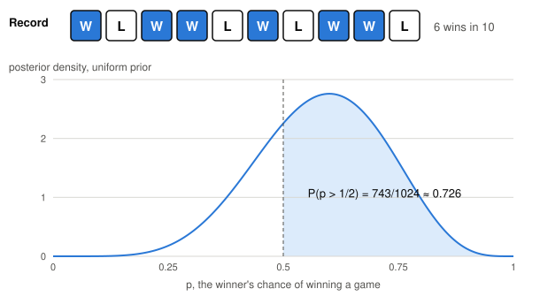

# Peggle: who is the better player?

<!-- shared:summary -->

Two friends play a game with no draws, such as a Peggle duel, and one wins k of n games: what is the chance that this player is the better one? With a uniform prior it equals the chance of at most k heads in n + 1 fair coin flips, so six wins in ten give 743/1024, about 0.726. Playing on until the posterior gives one player a 95% chance of being better declares one of two equal players better with chance 0.528 within 100 games; playing until the Bayes factor reaches 20 keeps that under 0.05 however long they play. Exact, by Bayes's billiard-table argument and a dynamic program over (wins, games).

<!-- /shared -->



*Six wins in ten games, and what they say about the winner's chance p of winning a game. The shaded area is the chance that the winner is the better player.*

The analysis is written up in [`peggle.pdf`](peggle.pdf), with a narrow edition for phones in [`peggle-phone.pdf`](peggle-phone.pdf). It has a reading guide, puzzles and a glossary. Its sections "The Bayesian answer" and "Why coin flips: Bayes's billiard table" give and prove the coin-flip answer, and "Which prior?" compares the three priors. "Playing until someone is sure", "A verdict that is safe for equal players" and "Wald's test" cover stopping rules; "Match formats", "Ratings" and "When the chances are not constant" cover best-of-n matches, Elo gaps, the first shooter's edge and players who improve.

## Rules as modeled

<!-- shared:rules -->

- Every game is won by one of the two players, and the first player wins each game with the same chance p, independently of the others. Chances that change from game to game are treated separately<!--raw-typst  in @sec-model-->.
- "The better player" means p > 1/2. The prior on p is uniform unless stated; the Jeffreys prior Beta(1/2, 1/2) and a skeptical prior Beta(12, 12) are compared.
- A **stopping rule** says, after each game, whether to stop and declare someone better. A **cap** N is the most games that the friends will play.
- The duel rules come from the Peggle Deluxe readme (PopCap, 2008, archived), which does not say who shoots first. The first-shooter edges are assumed values, not measurements.

<!-- /shared -->

## Results

All results are exact unless marked.

<!-- shared:results -->

| Result | Value | How it is known |
|---|---|---|
| Chance the winner of six games in ten is better (uniform prior) | 743/1024 ≈ 0.726 | proved<!--raw-typst  (@prop-coins)-->: the chance of at most 6 heads in 11 fair flips |
| Wins needed to be 95% sure | 8 in 10, 59 in 100, 527 in 1,000 | exact<!--raw-typst  (@tab-wins)--> |
| Equal players, play until 95% sure, cap 100 | someone declared better with chance 0.528 | dynamic program over (wins, games)<!--raw-typst  (@tab-stop)--> |
| Equal players, play until the Bayes factor reaches 20 | 0.0276 (N = 100); never more than 0.05 for any cap | dynamic program; Ville's inequality<!--raw-typst  (@prop-ville)--> |
| Stricter posterior threshold that keeps it at 5% | 0.99704 (N = 100), 0.9987003 (N = 1,000) | bisection with the same dynamic program<!--raw-typst  (@tab-rules)--> |
| Better player (p = 0.55) wins a best-of-seven match | 0.608 | exact<!--raw-typst  (@tab-formats)--> |
| "Play until one leads by 15", p = 0.55 | the worse player is declared better with chance 0.0470 | gambler's ruin<!--raw-typst  (@prop-ruin)--> |
| Repeated binomial tests | 31 of 34 entries of Armitage, McPherson and Rowe (1969) agree to five decimals, the other three within 2·10<sup>−5</sup> | comparison with a published table<!--raw-typst  (@sec-check)--> |

<!-- /shared -->


*Equal players, exact chances. Only the Bayes factor rule stays under the dashed 5% line however many games they allow.*

## How the results are checked

<!-- shared:checks -->

- The dynamic program is compared with brute force over all 2<sup>N</sup> sequences: for every cap up to 12 with the 95% rule, and for caps up to 10 with the other rules, priors and ways of choosing who shoots first.
- The coin-flip identities are compared with the Beta integral, expanded exactly, and the Jeffreys chances with Simpson's rule to 12 decimal places.
- The gambler's-ruin formulas are compared with an exact solution of the chain's equations and with the capped dynamic program. The best-of-n formulas are compared with the dynamic program, and Hoeffding's theorem for one look is checked on alternating and drifting chances for several caps.
- With a two-sided binomial test after each game in place of the posterior, the dynamic program reproduces Table 1 of Armitage, McPherson and Rowe (1969). Of its 34 entries for 2α = 0.01 and 0.05, 31 agree to the five printed decimals, and the other three agree within 2·10<sup>−5</sup>.
- `python -m peggle.stopping` simulates 200,000 duels in each of four cases, with seed 1, for N = 100: p = 0.5, 0.55, 0.7, and p drawn from the uniform prior. All eight exact values it reports fall inside the 95% intervals of the simulation.
- `report.py` writes every number quoted in the README and the paper to `results.json`. The tests recompute it and check that the README's shared sections are what `tools/sync_docs.py` writes from `docs/` and `results.json`, and that the committed CSV files and figures are what the scripts write. CI runs them.

<!-- /shared -->

## Sources

- T. Bayes (1763), the billiard-table argument, as presented in `peggle.pdf`.
- P. Armitage, C. K. McPherson and B. C. Rowe, Repeated significance tests on accumulating data, *Journal of the Royal Statistical Society A* 132 (1969), Table 1.
- J. Ville, *Étude critique de la notion de collectif* (1939), for the bound on a test martingale.
- A. Wald, Sequential tests of statistical hypotheses (1945), for the test that stops at a fixed lead.
- W. Hoeffding, On the distribution of the number of successes in independent trials (1956), for the theorem on alternating starts.
- PopCap, Peggle Deluxe readme (2008, archived), for the duel rules.

`peggle.pdf` gives the full references.

## Open questions

<!-- shared:open -->

- **The first-shooter edge in Peggle.** Who shoots first in a Peggle duel, and how large is that edge? The first-shooter edges here are assumed values, not measurements. Their size in actual duels, and whether it depends on the board, would need recorded duels.
- **Drift and stopping.** A player whose chance rises from 0.45 to 0.55 halfway through 1,000 games is usually declared the worse player by the 95% rule. Does some rule that looks only at wins and games avoid this, or does it need the order of the games? For skill that changes smoothly, is there a stopping rule whose verdict keeps a clear meaning, such as "better over the last 100 games", with a guarantee like Ville's inequality?
- **Other boundaries.** A threshold that changes with n could keep the 5% for equal players and declare the better player better more often at p = 0.55 than one fixed threshold does. Which boundary does this best for a given cap is not worked out here.
- **The Kiefer–Weiss test for 0.45 against 0.55.** Weiss gives a scheme for the test that minimizes the largest mean length over all p. Computing it with the dynamic program here, and comparing its length at p = 1/2 with the 225 games of Wald's test, is left undone.

<!-- /shared -->

## Usage

```bash
uv run python -m peggle.report                         # writes results.json, every number quoted here (about a minute)
uv run tools/sync_docs.py peggle                       # fills this README's shared sections from docs/ and results.json
uv run python -m peggle.peggle
uv run python -m peggle.stopping                       # about 10 seconds
uv run python -m peggle.variations                     # about 13 seconds
uv run tools/typst_vendor.py peggle/peggle.typ --all   # the PDF, the phone PDF and the HTML page
uv run python -m peggle.figures                        # the figures in figures/
```

## Files

- `peggle.pdf`, from `peggle.typ`, explains and proves this, with a reading guide, puzzles and a glossary. `peggle-phone.pdf` is the same text on a narrow page for reading on a phone. The HTML page that `--all` also writes is not committed.
- `peggle.py` checks the coin-flip identity against the Beta integral with exact fractions, computes the tables, and writes `better.csv` for the figure.
- `stopping.py` computes the optional-stopping chances exactly.
- `variations.py` computes the other priors, the match formats, the ratings, and the chances that change from game to game, and writes `priors.csv`, `walk.csv` and `formats.csv` for the figures.
- `report.py` writes `results.json`, every number that the README and `peggle.typ` quote.
- `docs/`: the sections that the README and the write-up share, with placeholders for the numbers in `results.json`.
- `figures.py` draws the figures in `figures/`.
