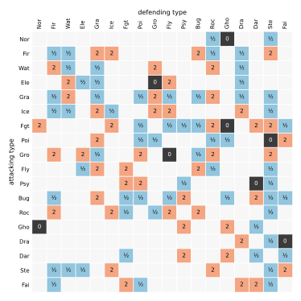
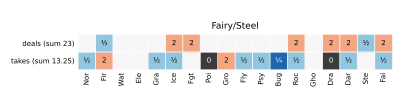
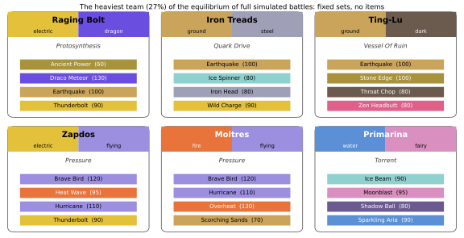

# Pokémon

Which attacking types cover the type chart, which typings take the least damage, and what is the chart's equilibrium as a game? No six attacking types are super-effective against all 18; ten sets of seven are. Steel/Fairy takes the least. Played as a duel, the chart has a unique equilibrium on 11 types that matches every weight Schmitz (2021) published, and only 4.7% to 5.2% of the chart is a ranking. All exact. The equilibrium does not predict what people play on the Showdown ladder (bootstrap interval). No team of six is best: over 40 popular Pokémon, five models of a battle each have a mixed equilibrium of 3 to 15 teams.



*The Generation 6 chart, written by `figures.py`. Each row is an attacking type. Only 120 of the 324 cells are not neutral, and the table is not symmetric.*

## Rules as modeled

- **The chart.** `pokemon_types.py` holds the Generation 6 chart: 18 types, and the multiplier when each attacks each. `chart(g)` gives the chart of any generation (below). A move against a Pokémon with two types gets the product of the two multipliers, so it can be 4, 2, 1, 1/2, 1/4 or 0.
- **Typings.** A typing is one type or a pair, 171 in all. The analyses use either all 171, or those that some Pokémon or form has in a given generation (146 as of Generation 7, 162 as of Generation 9).
- **What is left out.** Base stats, abilities, moves, items, the bonus for a move of the user's own type and Terastallization are not modeled, except that the notebook's Pokémon scores use the total of the base stats. A typing is assumed to attack with moves of its own types.
- **Arbitrary scores.** The notebook's coverage score and its attack and defense scores are sums chosen for simplicity; its rankings of Pokémon depend on them, and are not facts about the games.

## Results

The last column links the note in [`results/`](results/README.md) with the detail.

| Result | How it is known | Detail |
|---|---|---|
| No set of six attacking types is super-effective against every type; ten sets of seven are, and Fighting and Ground are in all ten. | Exact: every set, checked a second time against the chart directly | [chart](results/chart.md) |
| Among existing typings, Steel/Fairy takes the least damage summed over the 18 attacking types: 53/4, against 18 for a type with no weaknesses or resistances. It holds from Generation 6 to 9. In Generations 2 to 5 the least is Flying/Steel's 12 of 17; in Generation 1, 14 of 15, shared by Psychic and Electric/Flying. | Exact | [chart](results/chart.md) |
| Attack game: the attacker can guarantee an average multiplier of 4158/3979 ≈ 1.045, with a unique equilibrium led by Ground (attacker) and Normal (defender). Over all 171 defending typings the value is 13207/13501 ≈ 0.978. | Exact: LP support, then fractions and a uniqueness certificate | [games](results/games.md) |
| Duel game: unique equilibrium on 11 types, led by Steel 627/2653 ≈ 0.236; the 7 types left out and every weight match Schmitz (2021) to three decimals. | Exact; agrees with a cited source | [games](results/games.md) |
| Duel over all 171 typings: unique, on 23 typings led by Electric/Flying (12.9%). Schmitz (2023) reports 27 typings led by Water/Flying; both of his leaders lose against this equilibrium. | Exact; disagrees with a cited source, cause unknown | [games](results/games.md) |
| Log-ratio game: unique at k = 1; for k = 2, 3, 4, 6 and 10 the optimal strategies form a segment, along which Ghost's weight runs from 0 to a bound such as 5/79. | Exact, with the segment proved | [games](results/games.md) |
| 16 rock-paper-scissors triangles of super-effective types, 5 of them with each type also resisting the one it hits. | Exact, by two methods | [games](results/games.md) |
| The ranking part of the chart carries 14/297 (4.7%) of its squared norm with k = 1 and 89/1701 (5.2%) with k = 2; Steel ranks first. | Exact, checked against least squares | [ranking](results/ranking.md) |
| Equilibrium weight against usage on `gen9ou`: Spearman's ρ is 0.08, against 0.40 for the number of Pokémon with each typing. The difference, Δρ, is −0.32, with interval −0.56 to −0.08, so the equilibrium does not predict use beyond availability. | Bootstrap over typings, 10,000 resamples, seed 0, 95% interval (plan P1) | [usage-test](results/usage-test.md) |
| Fighting/Ice has the most conflicting types; Ground/Ice and Fighting/Ice attack best; Ice/Rock defends worst. | Exact, given the notebook's sums | `pokemon.ipynb` |
| With the notebook's mix of base stats and typing, Empoleon is the best final starter of Generations 1 to 7, and Celesteela the best Pokémon new in Generation 7 that is not legendary. | Exact, given an arbitrary score | `pokemon.ipynb` |
| Teams of six from the 40 most used Pokémon of `gen9ou`, under perfect switching: the team game over all 3,838,380 teams has an equilibrium on 3, 11, 11, 15 and 11 teams at levels 1 to 5 (types, moves, abilities, stats, simulator). No team scores above 0 against it. | Exact: double oracle, then every team checked in rationals; level 5's matchups are simulated (50 battles per pair, seed 0) | [team-study](results/team-study.md) |
| The share of the Pokémon matchups that one ranking explains rises from 12.7% (types) to 22.4% (stats) and 22.0% (simulator, 21.5% to 22.3%). Rankings: τ = 0.01 between types and stats, 0.86 (0.84 to 0.86) between stats and the simulator. | Exact for levels 1 to 4; bootstrap over battles for level 5 | [team-study](results/team-study.md) |
| In full simulated battles among 63 teams, the equilibrium is unique, on 15 teams; the heaviest weighs 26.8% (20.4% to 32.2%). The six most used Pokémon, as one team, weigh 13.7%, though the perfect-switching models rank that team 55th to 62nd. | Simulated: 20 battles per pair, 39,060 battles, seed 0; bootstrap over battles | [team-study](results/team-study.md) |
| With both sides switching by poke-env's rule (plan P2), that equilibrium is easier to exploit: the best team against it scores 0.43 net wins per battle, against 0.20 in a fresh replicate without switching, a gain of 0.23 (0.10 to 0.35). The switching equilibrium has 11 teams, shares 7 of its teams with the published one, and gives the six most used Pokémon no weight. | Simulated: two new round robins of 40 battles per pair (78,120 battles each, seeds `p2-switch` and `p2-replicate`); bootstrap over battles within pairs | [team-study](results/team-study.md) |
| No level's ranking of Pokémon predicts their use: Spearman's ρ is between 0.02 and 0.08, every interval spanning 0. | Bootstrap over Pokémon, 1,000 resamples, seed 0 (exploratory) | [team-study](results/team-study.md) |
| Emerald Kaizo: a nature chosen in advance turns up 4% of the time, so 74 catches give a 95% chance of at least one. | Exact under the independent uniform IV model | below |

## How the results are checked

- **Covers.** `covers(k)` is compared in the tests with a search that reads the chart directly.
- **Equilibria.** The floating-point LP only finds the support. The weights are then solved exactly with fractions on that support, every equilibrium inequality is checked exactly, and uniqueness, unused types and weight ranges are proved exactly ([games.md](results/games.md)).
- **Charts by generation.** The charts agree pair by pair with PokeAPI's `type_efficacy.csv` and `type_efficacy_past.csv` and with Pokémon Showdown's per-generation chart files, for every generation from 1 to 9 (`sources.py`).
- **Usage statistics.** `scipy.stats.spearmanr` gives the same Δρ to 15 decimal places. The bootstrap code agrees with an exact enumeration of all 256 resamples on four typings.
- **Ranking part.** The scores are compared with numpy's least squares, and the absence of a harmonic part is checked exactly, not assumed.
- **Team study.** The integer program that finds a best team is compared with brute force over all teams, and the double oracle with the full game of 210 teams. In the simulator, 144,594 hits were checked against the 16 damage rolls of level 4, with no disagreement. The 39,060 full battles ran twice, on one machine and in eight slices on GitHub Actions (run 44677805668), and every result was the same.
- **Notebook and README.** CI reruns `pokemon.ipynb` and compares its text and figures, and checks that the SVGs here are what the figure scripts write. A test checks the numbers this README and the team note quote against `results/teams.json`, and that every number of this README before its detail moved to `results/` is still in the README or a note.

## The type chart and its typings

`pokemon.ipynb` asks the questions a player would ask of the chart, in order: the smallest cover, typings that take the least, typings whose two types disagree, attack and defense scores of typings, Pokémon and random teams, and the best starter. Fighting is the only type super-effective against Normal, and only Ground hits Electric hard, so both are in every cover of seven. Nine of the ten typings that take the least include Steel. The notebook's scores are sums chosen for simplicity, so its rankings of Pokémon are not facts about the games. Detail: [chart.md](results/chart.md).



*Steel/Fairy, the typing that takes the least. The top row is what it deals with moves of its own types; the bottom row is what moves of each type deal it, with two immunities (Poison and Dragon) and one 1/4 (Bug).*

## The chart as a game

`equilibrium.py` treats the chart as a two-player zero-sum game, solves it with linear programming, and then proves the result exactly in fractions. In the **duel** of Schmitz (2021), two Pokémon that differ only in type each attack with a move of their own type. Its equilibrium is unique and matches every weight he published, and the same seven types get no weight: Normal, Fire, Poison, Psychic, Bug, Rock and Ice. His follow-up (2023) plays the duel between typings and reports 27 typings led by Water/Flying. With the model as his text describes it, the equilibrium here is unique, on 23 typings, and Water/Flying loses against it by 0.062. Where his game or solver differs is not known. Detail, with the attack game, the log-ratio game and the charts of earlier generations: [games.md](results/games.md) and [generations.md](results/generations.md).

## Does the equilibrium predict what people play?

No. Plan P1 (`experiments/plans/P1.md`, with its amendments) compares two Spearman correlations with usage share on Smogon's `gen9ou` statistics, twelve months pooled, over 147 typings. The plan counts the equilibrium as predicting use beyond availability only if the interval for Δρ lies above 0. It lies below: 126 of the 147 typings get weight 0, among them the most used, Fighting/Ground. Detail: [usage-test.md](results/usage-test.md) and [p1.md](results/p1.md).

| Correlation with usage share, over 147 typings | ρ | 95% interval |
|---|---|---|
| Duel equilibrium weight | 0.08 | −0.10 to 0.25 |
| Number of Pokémon available | 0.40 | 0.25 to 0.53 |
| Highest base-stat total among them (secondary) | 0.59 | 0.46 to 0.69 |
| **Δρ, equilibrium minus availability (primary)** | **−0.32** | **−0.56 to −0.08** |

## How much of the chart is a ranking

`hodge.py` splits the chart into a ranking part, one score per type, and a cyclic part, following Jiang, Lim, Yao and Ye (2011). The ranking part carries 4.7% to 5.2% of the chart; the other 91–95% is cyclic. It ranks Steel first on every chart since Generation 2, for its defense. Detail: [ranking.md](results/ranking.md).

## The best team of six

No single team is best at any level of detail. The pool is the 40 most used Pokémon of `gen9ou`, each with one fixed set of one ability and four damaging moves. Five levels compute a one-on-one matchup from types alone up to the Showdown simulator, and a team scores against another by perfect switching. Each level's team game has a mixed equilibrium, and what it mixes changes as the model gets more detailed. Primarina survives every level; the Pokémon players use most do not appear until full battles. Detail, with every figure: [team-study.md](results/team-study.md) and [teams.md](results/teams.md).

| Level | Ranking share of M | Teams in the equilibrium | The six most used, against it |
|---|---:|---:|---:|
| 1. Types | 12.7% | 3 | −0.240 |
| 2. Moves | 14.3% | 11 | −0.228 |
| 3. Abilities | 14.2% | 11 | −0.235 |
| 4. Stats | 22.4% | 15 | −0.251 |
| 5. Simulator | 22.0% | 11 | −0.340 |



*The heaviest team (26.8%) of the full-battle equilibrium, drawn by `teams_figures.py`. Each card shows the set that every model uses.*

## Emerald Kaizo

Emerald Kaizo is a ROM hack of Pokémon Emerald. Its question: how many wild Pokémon of a species are worth catching to get one that fits a role? With six IVs uniform on 0 to 31 and 25 uniform natures, one chosen nature turns up with chance 1/25 = 4%, so a player expects 25 catches, and 74 give a 95% chance of at least one. Two IVs of 16 or more, with one of two acceptable natures, have chance 2%: 50 catches expected, 149 for 95%. Exact under the model; the game's generator is deterministic, so the model is a marginal approximation. `emerald_kaizo/iv_analysis.md` has the table and a simulation as a check.

## Data

| Source | What it is | License | Committed |
|---|---|---|---|
| [PokeAPI](https://github.com/PokeAPI/pokeapi) CSV files, commit `e98f2ad8` | forms, typings, base stats, moves and abilities | BSD-style for the code; no license grants the data | yes, facts only |
| Kaggle, [Pokemon with stats](https://www.kaggle.com/datasets/abcsds/pokemon) (version 2) | `Pokemon.csv`, 800 forms through Generation 6 | CC0 1.0 | yes |
| Smogon [usage statistics](https://www.smogon.com/stats/) | monthly "chaos" files for `gen9ou` and `gen1ou`, 2025-11 to 2026-10 | unknown | no; only derived shares |
| Pokémon Showdown, at a pinned commit | chart files, names, moves, learnsets, and the simulator | MIT | no |
| [poke-env](https://github.com/hsahovic/poke-env) 0.17.0, `SimpleHeuristicsPlayer` | the switching rule of policy S, ported into `teams_showdown.py` (plan P2) | MIT, notice kept in the module | the ported rule only |

[data.md](results/data.md) quotes each license and says what was verified.

## Related work

- Schmitz, ["The Objectively Best Pokemon Type, According to Game Theory"](https://quantimschmitzcom.wordpress.com/2021/07/30/the-objectively-best-pokemon-type-according-to-game-theory/) (2021) and ["The best Pokemon type combinations according to game theory"](https://quantimschmitzcom.wordpress.com/2023/08/12/the-best-pokemon-type-combinations-according-to-game-theory/) (2023): the duel over single types is reproduced exactly; the duel over typings is not, and the cause is open.
- Jiang, Lim, Yao and Ye, ["Statistical ranking and combinatorial Hodge theory"](https://doi.org/10.1007/s10107-010-0419-x), *Mathematical Programming* 127 (2011) 203–244, give the ranking split used by `hodge.py`; Candogan, Menache, Ozdaglar and Parrilo, ["Flows and decompositions of games: harmonic and potential games"](https://doi.org/10.1287/moor.1110.0500), *Mathematics of Operations Research* 36 (2011) 474–503, give a related split of whole games.
- H. B. McMahan, G. J. Gordon and A. Blum, "Planning in the presence of cost functions controlled by an adversary", ICML 2003: the double oracle method used by `teams.py`.
- Pokémon Showdown (smogon/pokemon-showdown) is the simulator of level 5; its damage agrees with level 4's formula on every hit checked.

## Questions left open

- **Schmitz's typing duel.** His matchup table is an image; reading it would settle whether his game or his solver differs from the one here.
- **Weighted scores.** Weighting the notebook's sums by Showdown usage would change which typings and Pokémon rank first.
- **Sets beyond damage.** Setup moves, recovery, hazards, items and Terastallization. A policy that switches by choice moves the full-battle equilibrium (plan P2); a stronger policy than poke-env's rule may move it more. The six most used Pokémon do far better in full battles than under perfect switching.
- **Beyond 63 teams.** A double oracle whose best response is searched in the simulator would say whether some other team beats the full-battle equilibrium.
- **Level 4 played out**, through six-against-six battles with the level-5 policy, to separate perfect switching from Showdown's mechanics; and **a larger pool** of 60 or 80 Pokémon.
- **Emerald Kaizo encounters.** How often each species appears, and the generator's timing.

## Usage

```bash
uv run --group pokemon --with jupyter jupyter lab pokemon/pokemon.ipynb
uv run --group pokemon python -m pokemon.figures       # the SVGs in figures/
uv run python -m pokemon.graph                         # writes display/graph.json, serves the page on port 8000
uv run --group pokemon python -m pokemon.graph_analysis
uv run --group pokemon python -m pokemon.equilibrium   # the games above, in about a minute
uv run --group pokemon python -m pokemon.hodge         # the ranking and cyclic parts, in seconds
uv run --group pokemon python -m pokemon.sources       # rebuilds the data files from PokeAPI
uv run python -m pokemon.usage build                   # downloads Smogon's files, writes results/usage-typings.json
uv run --group pokemon python -m pokemon.p1            # plan P1 from that table, in about 30 seconds
uv run python -m pokemon.emerald_kaizo.iv_analysis     # regenerates emerald_kaizo/iv_analysis.md
uv run --group pokemon python -m pokemon.teams_usage    # Smogon's files to results/usage-pokemon.json (on Actions)
uv run --group pokemon python -m pokemon.teams_data     # PokeAPI and Showdown to teams_moves.csv and teams_pokemon.csv
uv run --group pokemon python -m pokemon.teams_showdown play --duels 40 --games 50 --showdown /tmp/sd --out runs/
uv run --group pokemon python -m pokemon.teams summarize runs/ --out pokemon/results/teams-duels.json
uv run --group pokemon python -m pokemon.teams          # levels 1 to 5 and the tournament, in about 2 minutes
uv run --group pokemon python -m pokemon.teams_figures  # the three teams-*.svg
```

The one-on-one battles (39,000) took 132 seconds on one core, and the 39,060 full battles 981 seconds; on GitHub Actions, in eight slices of four processes, the full battles took 35 to 71 seconds per slice. The full battles take `--teams pokemon/results/teams-pool.json --games 20` in place of `--duels 40 --games 50`, with their summary in `teams-battles.json`. A run on GitHub Actions splits them with `--slice` and `--slices`.

## Files

| File | Contents |
|---|---|
| `pokemon_types.py` | the Generation 6 chart, and `chart(g)` for every generation |
| `scoring.py`, `figures.py` | covers, attack and defense scores, and the pictures; used by `pokemon.ipynb` |
| `pokedex.py`, `sources.py` | reading and building the PokeAPI files |
| `equilibrium.py`, `hodge.py` | the chart as a game, and its ranking split |
| `usage.py`, `p1.py` | plan P1 |
| `graph.py`, `graph_analysis.py`, `display/` | the chart as a directed graph, with PageRank and betweenness |
| `teams_usage.py`, `teams_data.py`, `teams_model.py` | per-Pokémon use, the moves and abilities, sets and matchups at levels 1 to 4 |
| `teams.py` | the team game, double oracle, the cross-level tournament; writes `results/teams.json` and `results/teams.md` |
| `teams_showdown.py`, `teams_showdown.js`, `teams_figures.py` | level 5 in Pokémon Showdown, with the damage and switching policies; the team pictures |
| `p2.py`, `results/p2.json`, `results/teams-battles-p2-*.json` | Plan P2: exploitability of the full-battle equilibrium under the switching policy |
| `emerald_kaizo/` | IV and catch odds for Emerald Kaizo |
| `results/` | results files, and notes with the detail behind each section ([index](results/README.md)) |
