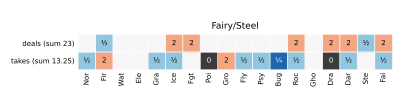

# The type chart and its typings

Covers, the typings that take the least, scores of typings and Pokémon, as `pokemon.ipynb` computes them. Moved unchanged from the [Pokémon README](../README.md), which keeps the short answers.

`pokemon.ipynb` asks the questions a player would ask of the chart, in order: how many types there are, the smallest cover, a score for coverage, typings that take the least, typings whose two types disagree, attack and defense scores of typings, Pokémon and random teams, and the best starter.

- **Covering.** No six types cover the chart. Of the ten covers of seven, Fighting and Ground are in all of them: Fighting is the only type super-effective against Normal, and only Ground hits Electric hard. The notebook also scores a set of attacking types: two points per type hit hard, minus one per type that resists, minus two per immune type. The score reaches at most 18, first with four sets of six types, and all 16 best sets include Ground and Fairy.
- **Defense.** The ten typings that take the least are led by Steel/Fairy (53/4), Flying/Steel (27/2) and Dragon/Steel and Ghost/Steel (57/4 each); nine of the ten include Steel.
- **Scores.** Over the 146 typings that exist as of Generation 7, attack and defense rescaled to run from 0 to 1 have correlation −0.20. Normal is at percentile 2.1 of their sum. Averaging over a random team of six typings (10,000 teams, seed 42) narrows the spread by a factor of about 2.5, close to √6.
- **Pokémon.** The total of Blissey's base stats is at percentile 83.2 among the 955 forms. Toxapex's typing is at percentile 81.2 among typings, and its combined score at 90.2. Celesteela and Blacephalon, Ultra Beasts that the data does not mark as legendary, lead the forms that are neither legendary nor Mega.

*Steel/Fairy, the typing that takes the least. The top row is what it deals with moves of its own types; the bottom row is what moves of each type deal it, with two immunities (Poison and Dragon) and one 1/4 (Bug).*
