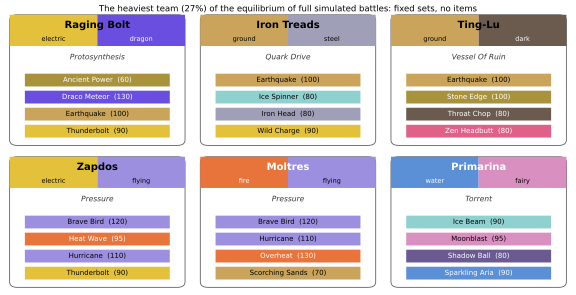
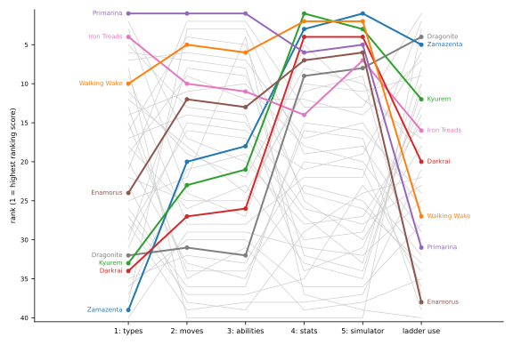
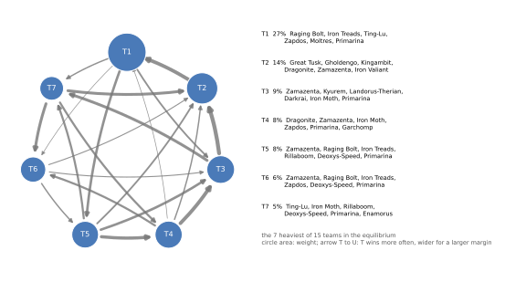

# The best team of six

The pool, the sets, the five levels, the team game, full battles and the comparison with ladder use. [teams.md](teams.md), written by `teams.py`, has every table of the study. Moved unchanged from the [Pokémon README](../README.md), which keeps the short answers.

No single team is best at any level of detail. Each model's team game has a mixed equilibrium, and what it mixes changes as the model gets more detailed. Primarina survives every level; the Pokémon players use most do not appear until the last.

*The heaviest team (26.8%) of the full-battle equilibrium, drawn by `teams_figures.py`. Each card shows the set that every model uses: one ability and four damaging moves.*

**The pool and the sets.** The pool is the 40 most used Pokémon of `gen9ou` at rating 1500, from November 2025 to October 2026 (`teams_usage.py`). Two Ogerpon masks are left out, because Showdown keeps their forme only while they hold their mask. Each Pokémon gets one fixed set (`teams_model.py`):
- Level 100, every IV 31, 84 EVs in each stat, a neutral nature, no item, no Terastallization.
- Its ability is the first in slot order that the models represent.
- Its four moves are those that take the largest share of each opponent's HP per hit, summed over the pool and capped at a KO.
- Only moves with a fixed power count. Knock Off, Sucker Punch, U-turn, Freeze-Dry and Body Press are among those left out; `teams_moves.csv` gives each reason.

The ability is the one players use most for 24 of the 40. Of the four moves, 1.25 on average are among the four players use most. These sets only deal damage; nothing else a Pokémon can do is modeled.

**Five levels.** A **matchup** M(p, q) is the share of HP that the winner of a one-on-one fight keeps, positive when p wins. The levels differ only in how the fight is computed:

| Level | What the fight sees |
|---|---|
| 1. Types | Each attacks with its better own type; damage is the type multiplier, as in Schmitz's duel above |
| 2. Moves | Damage is power × hits × accuracy × 1.5 for the user's own type × multiplier, for the best of the four moves |
| 3. Abilities | Level 2 with immunities (Levitate, Flash Fire, ...), resistances (Thick Fat, Filter, ...) and boosts (Adaptability, Technician, ...) |
| 4. Stats | The game's damage formula averaged over its 16 rolls, turns in speed and priority order, recoil, drain and self stat drops; plus Intimidate, Multiscale and the Ruin abilities |
| 5. Simulator | Pokémon Showdown itself: 50 seeded battles per pair, each side using its most damaging move every turn |

**The team game.** A team scores against another team by perfect switching: each opposing Pokémon is met by the team's best answer to it, and each of the team's own Pokémon by the opponent's best answer. The score is the mean of the first minus the mean of the second. The game is symmetric, with value 0. It is solved by double oracle (McMahan, Gordon and Blum 2003). Finding the best team against a mix is a facility location problem, solved as an integer program. All 3,838,380 teams are then checked against the final mix, exactly.

| Level | Ranking share of M | Teams in the equilibrium | Heaviest team | The six most used, against it |
|---|---:|---:|---|---:|
| 1. Types | 12.7% | 3 | Kingambit, Dragonite, Iron Treads, Zapdos, Primarina, Tyranitar (50%) | −0.240 |
| 2. Moves | 14.3% | 11 | Great Tusk, Gholdengo, Raging Bolt, Slowking-Galar, Deoxys-Speed, Primarina (47%) | −0.228 |
| 3. Abilities | 14.2% | 11 | the same (36%) | −0.235 |
| 4. Stats | 22.4% | 15 | Zamazenta, Kyurem, Ting-Lu, Rillaboom, Deoxys-Speed, Primarina (25%) | −0.251 |
| 5. Simulator | 22.0% | 11 | Zamazenta, Raging Bolt, Ting-Lu, Iron Moth, Deoxys-Speed, Primarina (23%) | −0.340 |

*The ranking share is the Hodge split of the previous section, applied to M: the part that one score per Pokémon explains. The last column is the score of the team of the six most used Pokémon against the equilibrium; 0 would tie.*

**What survives and what flips.**
- *Survives:* Primarina is on the equilibrium team with chance 100%, 47%, 36%, 99% and 100% at levels 1 to 5. Mixing survives too, at every level and in full battles.
- *Mostly cyclic at every level:* one ranking explains 13% to 22% of the matchups, more than the 5% it explains of the type chart.
- *Flips between types and stats:* Kendall's τ between the rankings of levels 1 and 4 is 0.01. Zamazenta goes from 39th by types to 3rd by stats.
- *Small steps:* abilities change 39 of the 780 matchups (τ = 0.89 between levels 2 and 3). Level 5's ranking stays close to level 4's (τ = 0.86, interval 0.84 to 0.86).
- *Flips with the battle format:* under perfect switching, the six most used Pokémon are among the worst teams of the 63 in the cross-level tournament. In full battles they hold the second-largest weight.

*Rankings across levels. Lines cross most between levels 3 and 4, where stats enter; the last column, ladder use, follows none of them.*

**Full battles.** A team game built on one-on-one matchups is still a model. So 63 teams play a round robin of whole six-against-six battles in Showdown, 20 battles per pair with sides alternating. The 63 are each level's equilibrium and best teams, the six most used Pokémon, and eight random teams. Both sides use the same policy:
- Lead with the Pokémon that matches up best, at level 4, against the opposing six.
- Each turn, use the most damaging move; never switch by choice.
- After a faint, send in the best level-4 answer to the opposing Pokémon.

The equilibrium of the 63-team matrix is unique, on 15 teams. The heaviest team (26.8%, interval 20.4% to 32.2%) is the one on the cards above. The six most used Pokémon weigh 13.7%, though the perfect-switching models rank that team 55th to 62nd of 63. One ranking explains 28.2% of the full-battle matrix. Levels 4 and 5 rank the 63 teams with τ = 0.51 against the full battles; levels 1 to 3 with τ between −0.08 and 0.07.

*The three heaviest teams form a cycle: T1 loses to the six most used (T2), which lose to T3, which loses to T1.*

**Against real use.** No level ranks the 40 Pokémon the way the ladder uses them. Spearman's ρ between use and ranking score is between 0.02 and 0.08 at every level. Between use and the chance of being on the equilibrium team, it is −0.20 to 0.30. Every interval spans 0. The models and players agree on a few names. Zamazenta, 5th by use, is on 77% and 79% of equilibrium teams at levels 4 and 5 and on 51% in full battles. Raging Bolt, 7th by use, is on 46% to 74% at levels 1, 2, 3 and 5 and in full battles. They disagree on the two most used, Great Tusk and Gholdengo. Both are on most equilibrium teams at levels 2 and 3 and on none at the other levels. In full battles they appear only as part of the six-most-used team. Walls and setup Pokémon are what damage-only sets cannot represent, so this gap is expected.

[`results/teams.md`](teams.md) has every table of the study.

**Simulator and license.** Pokémon Showdown is MIT-licensed (its `LICENSE` at the pinned commit). poke-env is also MIT (its `LICENSE` on GitHub and on PyPI, version 0.17.0), but it plays through a server, which picks each battle's random seed. The battles here use Showdown's own battle stream instead (`teams_showdown.js`), which takes a seed per battle, so every battle can be rerun.
