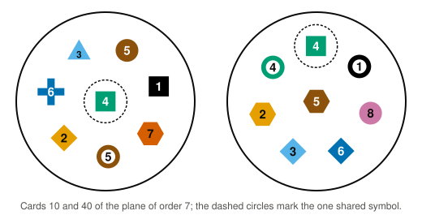

# Spot It

Which two cards does the 55-card box leave out, and could a deck like this be made any other way? Any 55 cards of 8 symbols drawn from 57, every two sharing exactly one symbol, complete in exactly one way to the 57-card projective plane of order 7. So one symbol is on 6 cards and fourteen on 7, and these counts give the two missing cards. Proved, and checked on all 1,596 ways to remove two cards. Any nine cards hold three with a common symbol, and three cards drawn share one with chance exactly 6/55.



*Two cards of the plane of order 7, with generic symbols: one of eight shapes in one of eight colors. Every two cards share exactly one symbol.*

## Rules as modeled

Spot It, sold as Dobble in Europe, has 55 round cards with 8 symbols on each. The rules say that "between any 2 cards, there is always 1—and only 1—matching symbol" ([rules](https://cdn.svc.asmodee.net/production-asmodeeaccess/uploads/2026/10/DobbleClassic_EN_Rules.pdf)).

- A **deck** is a list of **cards**, and a card is a set of **symbols**. A deck has the **Spot It property** if every two of its cards share exactly one symbol.
- A **projective plane of order n** is a deck of n² + n + 1 cards with n + 1 symbols each, using n² + n + 1 symbols, in which every two symbols also appear together on exactly one card. For n = 7 that is 57 cards of 8 symbols on 57 symbols.
- The box has 55 cards. People who counted the symbols found 57 ([a list of the 57](https://www.markporthouse.net/spot-it-dobble-symbol-list); [Tangente](https://tangente-mag.com/en/articles/the-geometry-behind-dobble)). Asked about the two missing cards, the publisher answered on the Tric Trac forum that practical production reasons led them to print 55 cards, not 57, and that every box holds the same 55 ([forum, 2011](https://forum.trictrac.net/t/dobble-et-la-geometrie-finie/95005)).

Below, the 55-card deck is the plane of order 7 with two cards removed. The section "Does every such deck extend to the plane?" shows that no other deck is possible: any 55 cards of 8 symbols from 57 symbols with the Spot It property arise in this way.

## Results

Exact unless marked. The last column links the note in [`results/`](results/README.md) that holds the detail.

| Result | How it is known | Detail |
|---|---|---|
| Fields of 4, 8, 9 and 16 elements | Exact: every field axiom checked on all pairs and triples | [constructions](results/constructions.md) |
| Planes of orders 2 to 13 (prime powers) | Exact: every pair of cards and of symbols checked, two constructions | [constructions](results/constructions.md) |
| The slope construction mod n fails for composite n | Exact, by checking every pair | [constructions](results/constructions.md) |
| The missing cards and their uniqueness | Proof (Lemmas 2 and 3); checked on all 1,596 removals for order 7 by two methods | below; [proofs](results/proofs.md) |
| Every family of n² or more cards on n² + n + 1 symbols extends uniquely | Proof (Theorem 4), agreeing with Vanstone and Fowler; identities checked on random subfamilies; exhaustive for orders 2 and 3 | [proofs](results/proofs.md) |
| 55 cards of 8 symbols need at least 57 symbols | Proof (Lemma 2) | [proofs](results/proofs.md) |
| Maximal families of order 3 | Exhaustive search | [extension](results/extension.md) |
| Large maximal families of orders 4, 5 and 7 | Seeded random search; lower bounds only | [extension](results/extension.md) |
| Uniqueness of the planes of orders 2, 3 and 4 | Exhaustive count of completions against the automorphism counts | [extension](results/extension.md) |
| Orders 6, 10 and 12, uniqueness for 7 and 8 | Cited (Bruck–Ryser; Lam et al.; Hall; Hall, Swift and Walker) | [extension](results/extension.md) |
| Chances in the table | Exact, by counting; two of them also by listing pairs and triples | [chances](results/chances.md) |
| Nine cards always hold a triplet | Proof (Bose's parity argument), and exhaustive count | [chances](results/chances.md) |
| The sets of eight cards with no triplet are the conics | Exhaustive comparison with every quadratic form, as Segre's theorem predicts | [chances](results/chances.md) |
| The real deck's card list | Not checked: the only list found has an unknown license and describes 57 cards | below |

## How the results are checked

- **Two constructions.** `plane.py` builds every plane of prime-power order up to 13 in coordinates and by slopes, and checks each from the definition: every pair of cards shares one symbol and every pair of symbols lies on one card. The field axioms behind the slopes are checked on every pair and triple of elements (`field.py`).
- **Two methods for the missing cards.** Counting symbols and an exact-cover search that shares no code with it agree on every one of the 1,596 ways to remove two cards from the plane of order 7, and on every pair for the orders 2, 3, 4, 5, 8 and 9.
- **Proofs against counts.** The identities of Lemma 2 are checked on random subfamilies, and Theorem 4 exhaustively for orders 2 and 3. The planes of orders 2, 3 and 4 are counted by exhaustive search and agree with the counts that their automorphism groups predict.
- **Chances.** Two of the chances are also computed by listing pairs and triples, and the Triplet counts are checked against a count by hand and the number of conics.
- **The figures.** A test checks that the committed SVGs are what `figures.py` draws. The figure of the missing cards recovers them by counting and asserts that they are the cards removed.
- **The notes.** A test checks that every number of this README before its detail moved to `results/` is still in the README or a note.

CI runs the tests in `tests/test_spot_it.py`, `tests/test_spot_it_figures.py` and `tests/test_spot_it_readme.py`.

## Which decks have the Spot It property?

The projective planes of every prime-power order q up to 13, built in two ways. One uses coordinates over the field with q elements; the other is the slope construction that most deck generators use. For q = 4, 8 and 9 the arithmetic is that of a finite field built from polynomials (`field.py`). With plain arithmetic mod n, the slope construction works only for prime n. For n = 6, for instance, 180 of the pairs of its 43 cards share no symbol and 144 share two or more. The table for n = 4 to 12 is in [constructions.md](results/constructions.md).

## Which two cards are missing?

Count how many cards show each symbol. In a 55-card deck one symbol is on 6 cards, fourteen are on 7 and the other 42 are on 8. The symbol on 6 cards is on both missing cards. Each missing card holds it and seven of the fourteen symbols seen 7 times. Two of the fourteen belong to the same missing card exactly when no card in the deck shows both. So the rule "never together" sorts them into two groups of seven.

The answer is unique: no other card of 8 symbols from the 57 shares exactly one symbol with each of the 55 cards. Lemmas 2 and 3 ([proofs.md](results/proofs.md)) prove both claims. `missing.py` checks them on every one of the C(57, 2) = 1,596 ways to remove two cards from the plane of order 7, and on every pair for the orders 2, 3, 4, 5, 8 and 9. A second method, an exact-cover search that shares no code with the counting, lists every set of n + 1 symbols that meets each remaining card once. In every case it returns the two removed cards and nothing else.


*Two cards removed at random (seed 0) from the plane of order 7. The counts alone give them back: the symbol on 6 cards is on both, and "never together on a card" splits the fourteen on 7 cards into two groups of seven.*

## Does every such deck extend to the plane?

Yes. Any 55 cards of 8 symbols, drawn from 57 symbols, with the Spot It property, complete to a projective plane of order 7 on the same 57 symbols in exactly one way (Theorem 4). No card list is needed: the symbol counts 6, 7 and 8 above are forced. More generally, on n² + n + 1 symbols every such family of at least n² cards completes, uniquely, and for odd n so does every family of n² − 1 cards: for order 7, any 48 or more cards. The bound n² is Vanstone's, in dual form, and Fowler proves n² − 1 for every n.

The count of Lemma 2 also shows that 55 cards of 8 symbols need at least 57 symbols. Unless all 55 share one symbol, exactly 57 are used. A maximal family other than a plane has at most n² − 1 cards, or n² − 2 when n is odd. For order 7 there is one of nine cards on 36 symbols, built from the complete graph on 9 vertices. Seeded random searches found maximal families of 13, 19 and 37 cards for orders 4, 5 and 7, lower bounds only. `extend.py` confirms by counting that the planes of orders 2, 3 and 4 are unique. Order 12, a deck of 157 cards, is the smallest order still open. Detail, with the cited results on which orders exist: [extension.md](results/extension.md).

## What does the real deck look like?

A dataset of card photos [on Kaggle](https://www.kaggle.com/datasets/grouby/dobble-card-images) includes a list of which symbols are on which card. Its license is listed as unknown, so the list is not committed here. It describes 57 cards taken from a 2012 MathsJam talk, not the 55 cards of a box, and it does not say which two cards a box leaves out. A check run once outside the repository found that its 57 cards form a projective plane of order 7. That is a check of the list, not of a box.

The symbol counts of an actual box are therefore not checked against a card list. They follow from Theorem 4 once the box has 55 cards of 8 symbols, the Spot It property, and 57 symbols: one symbol on 6 cards, fourteen on 7 and 42 on 8.

## What are the chances in the game?

All of these are exact, from counting cards of the plane of order 7 (`chance.py`). Removing up to two cards leaves the three-card chance at exactly 6/55. Nine cards always contain a triplet, by the dual of Bose's 1947 parity argument, so the table of the mini-game Triplet never stalls while nine cards are out. The 16,758 sets of eight with no triplet are exactly the conics, as Segre's theorem says they must be. The full table, the counts for every number of cards and the arguments are in [chances.md](results/chances.md).

| Question | 57 cards | 55 cards |
|---|---:|---:|
| Chance that three cards drawn show a common symbol | 6/55 = 0.1091 | 6/55 = 0.1091 |
| Chance that 8 cards drawn have no symbol on three of them | 16,758/1,652,411,475 ≈ 0.00001 | 98/9,663,225 ≈ 0.00001 |
| Chance that 9 cards drawn have no symbol on three of them | 0 | 0 |

## Data

| Source | What | License | Committed |
|---|---|---|---|
| [Kaggle dataset of card photos](https://www.kaggle.com/datasets/grouby/dobble-card-images) | a list of which symbols are on which of 57 cards, from a 2012 MathsJam talk | listed as unknown | no |
| [Rules of Dobble](https://cdn.svc.asmodee.net/production-asmodeeaccess/uploads/2026/10/DobbleClassic_EN_Rules.pdf) (Asmodee) | the Spot It property and the mini-games | publisher's copyright | no; quoted only |

No card art is used. The figures draw generic symbols, and the decks here are built from the planes.

## Sources

- R. C. Bose, Mathematical theory of the symmetrical factorial design, *Sankhyā* 8 (1947) 107–166: a set of points of the plane of odd order q with no three on a line has at most q + 1 points.
- R. H. Bruck and H. J. Ryser, The nonexistence of certain finite projective planes, *Canadian Journal of Mathematics* 1 (1949) 88–93.
- N. G. de Bruijn and P. Erdős, On a combinatorial problem, *Indagationes Mathematicae* 10 (1948) 421–423: on v points there are at most v sets every two of which share exactly one point. In card terms, a deck with the Spot It property has no more cards than symbols.
- K. N. Majumdar, On some theorems in combinatorics relating to incomplete block designs, *Annals of Mathematical Statistics* 24 (1953) 377–389, and J. R. Isbell, An inequality for incidence matrices, *Proceedings of the AMS* 10 (1959) 216–218: the same bound when every two sets share the same number of points, the nonuniform Fisher inequality.
- M. Deza, Solution d'un problème de Erdős–Lovász, *Journal of Combinatorial Theory B* 16 (1974) 166–167: more than k² − k + 1 sets of size k every two of which meet in exactly one point all share that point.
- M. Hall, Uniqueness of the projective plane with 57 points, *Proceedings of the AMS* 4 (1953) 912–916, and its correction, 5 (1954) 994–997; M. Hall, J. D. Swift and R. J. Walker, [Uniqueness of the projective plane of order eight](https://www.ams.org/journals/mcom/1956-10-056/S0025-5718-1956-0084142-0/S0025-5718-1956-0084142-0.pdf), *Mathematical Tables and Other Aids to Computation* 10 (1956) 186–194, which credits order 7 to the combined results of W. A. Pierce and of Hall.
- B. Segre, Ovals in a finite projective plane, *Canadian Journal of Mathematics* 7 (1955) 414–416: for odd q every set of q + 1 points with no three on a line is a conic.
- S. A. Vanstone, The extendability of (r, 1)-designs, *Proceedings of the Third Manitoba Conference on Numerical Mathematics* (1973) 409–418, as stated in P. Erdős, R. C. Mullin, V. T. Sós and D. R. Stinson, [Finite linear spaces and projective planes](https://renyi.hu/~p_erdos/1983-05.pdf), *Discrete Mathematics* 47 (1983) 49–62, Lemma 2.1: in dual form, a family of at least n² cards on at most n² + n + 1 symbols extends to a plane of order n.
- J. C. Fowler, [Topics in Linear Spaces and Projective Planes](https://doi.org/10.7907/d8gp-ka37), PhD thesis, Caltech (1984), Theorem 1.1: in dual form, n² − 1 cards suffice for every n; one case rests on results of Bose and Shrikhande and of de Witte. The thesis also summarizes later bounds, by D. M. McCarthy and S. A. Vanstone (Embedding (r, 1)-designs in finite projective planes, *Discrete Mathematics* 19 (1977) 67–76) and by S. Dow, that are lower for large n.
- C. W. H. Lam, L. Thiel and S. Swiercz, The non-existence of finite projective planes of order 10, *Canadian Journal of Mathematics* 41 (1989) 1117–1123.
- M. Bourrigan, [Dobble et la géométrie finie](https://images.math.cnrs.fr/freeze/Dobble-et-la-geometrie-finie.html), *Images des Mathématiques* (2011): the game as a plane of order 7 with two cards removed.
- C. Hummert and B. Krause, [Spotted It! Strategies to Win Dobble](https://www.gathering4gardner.org/g4g15gift/ExchangeArchive-SpottedIt-G15-013-1.pdf), Gathering 4 Gardner 15 (2024): 6/55 for the chance that the symbol called at one card is called again at the next, for a full deck; the box gives the same value.
- The [rules of Dobble](https://cdn.svc.asmodee.net/production-asmodeeaccess/uploads/2026/10/DobbleClassic_EN_Rules.pdf) (Asmodee), for the mini-games The Tower, The Well and Triplet.

## Open questions

- What is the largest maximal family of order 7 that is not a plane? Random searches found 37 cards, and Theorem 4 allows at most 47.
- Does a plane of order 12, a deck of 157 cards, exist? It is the smallest order still open.
- Which two cards does a real box leave out? A card list of an actual box, with a license that allows checking it here, would settle it.

## Usage

The code uses only the standard library. Times are from one run on a shared machine.

```bash
uv run python -m spot_it.field     # field axioms for 2 to 16 elements (under a second)
uv run python -m spot_it.plane     # both constructions, orders 2 to 13 (under a second)
uv run python -m spot_it.missing   # the missing cards, every pair, orders 2 to 9 (about 6 s)
uv run python -m spot_it.extend    # identities, maximal families, uniqueness, searches (about 35 s)
uv run python -m spot_it.chance    # the chances and the Triplet counts (about 12 s)
uv run pytest tests/test_spot_it.py
uv run python -m spot_it.figures   # the figures in figures/ (under a second)
```

## Files

| File | Contents |
|---|---|
| `field.py` | Finite fields from irreducible polynomials, and a check of the field axioms |
| `plane.py` | Projective planes in coordinates and by slopes, and checks of the Spot It property |
| `missing.py` | The two missing cards, by counting and by an exact-cover search |
| `extend.py` | Deficits, forced cards, maximal families, uniqueness counts and random searches |
| `chance.py` | Shared-symbol chances, symbol counts, and sets of cards with no symbol on three |
| `figures.py`, `figures/` | This README's figures, as SVG; a test checks they are current |
| `results/` | Notes with the detail behind each section, and [an index](results/README.md) |
