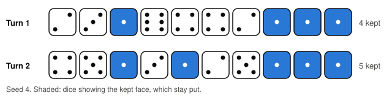

# Tenzi

<!-- shared:summary -->

How many turns does a game of Tenzi take, and what is the best way to play? Keeping the face that is most common after the first roll, a game takes 15.35 turns on average; switching faces when another group grows larger lowers that to 15.29. No strategy does better on average, and none is more likely to be done by any turn up to 163, after which no strategy can gain more than 10<sup>−12</sup>. So in a race at equal pace against players who do not react to our dice, switching wins most often, to within 10<sup>−12</sup>. Exact, by a Markov chain and a Markov decision process, and checked by simulation. That keeping the most common face is best on average was found before for one to seven dice (Puzzling Stack Exchange, 2020); the proof for ten dice, the deadlines and the race are added here.

<!-- /shared -->



*The first two turns of a seeded game. Shaded dice show the kept face and stay put; the rest are rolled again.*

The analysis is written up in [`tenzi.pdf`](tenzi.pdf), with a narrow edition for phones in [`tenzi-phone.pdf`](tenzi-phone.pdf). Its section "A formula good to nine decimals" explains why H₁₀ / ln(6/5) + 1/2 is so close to the mean with the face named first, and compares the distribution with the MathFest slides of Bacinski and Pennings. "The race" has the race of 2 to 30 players against the slides, "The best strategy" the decision process, and "Is switching also best in a race?" the programs over deadlines.

## Rules as modeled

<!-- shared:rules -->

- Each player rolls ten dice, keeps the dice that show one face, and rerolls the rest until all ten match. A **turn** is one roll, and every turn count includes the first roll.
- **Fixed face:** keep the face that is most common after the first roll, and never change it. If two faces tie, either will do.
- **Switching:** switch faces whenever the rerolled dice show more of another face than are kept.
- **Face named first:** name the face before the first roll, as some players do.
- **A race:** players roll in lockstep, at the same pace, and play independently, and the game ends on the first turn on which someone finishes. If two or more finish on that turn, they tie.

The [official rules](https://www.ilovetenzi.com/rules) say to decide after the first roll which number to go for, and are silent on changing it later, so switching is a reading they leave open. They also have everyone roll together only on the first roll and then each at their own pace, with the first to finish winning. The lockstep race is a model of equal-speed players, and its ties belong to the model, not to the game.

<!-- /shared -->

## Results

All results are exact unless marked.

<!-- shared:results -->

| Result | Value | How it is known |
|---|---|---|
| Mean turns, fixed face | 15.35 (median 14, most likely 12) | Markov chain on the number of matched dice<!--raw-typst  (@fig-turns)--> |
| Mean turns, switching | 15.29 (15.2944) | the same<!--raw-typst  (@sec-switch)--> |
| Best mean over all strategies | 15.29, switching's own | policy iteration with exact fractions, over every choice of dice to keep<!--raw-typst  (@sec-best)--> |
| Largest chance of being done by turn t | switching's, for every t up to 163 | dynamic program over deadlines, in whole numbers<!--raw-typst  (@sec-deadline)--> |
| Mean turns, face named first | 16.56 (16.5648), standard deviation 6.83 | Markov chain, and in closed form<!--raw-typst  (@sec-named)--> |
| The same mean, from a formula | H₁₀ / ln(6/5) + 1/2, within 4.18·10<sup>−10</sup> | proved, with a Fourier series for the difference; checked in 60-digit arithmetic<!--raw-typst  (@sec-harmonic)--> |
| Games longer than 30 turns, fixed face | 3.3% | Markov chain |
| Mean winning turn in a race of four, face named first | 10.54 | exact, from the chain's distribution; sums stop at 200 turns<!--raw-typst  (@tab-race)--> |
| The means above | inside the 95% intervals of 100,000 simulated games each | simulated, seeds 1 to 5<!--raw-typst  (@tab-checks)--> |

<!-- /shared -->


*The exact distribution of the number of turns. Switching (dashed) and the fixed face differ by less than 0.001 on every turn; naming the face first moves the curve about a turn later.*

## How the results are checked

<!-- shared:checks -->

- Each exact mean lies inside the 95% interval of a seeded simulation of 100,000 games, and the race of four players inside that of 20,000 simulated races<!--raw-typst  (@tab-checks)-->. Each simulation draws its games from its own generator, with seeds 1 to 5 in `tenzi.SEEDS`, so the simulations share no random numbers and are independent checks.
- The decision process agrees with value iteration over every ordered roll and every subset of dice to keep, on small games up to four dice on three faces. The deadline programs agree with brute force on small games.
- `maximum.py` checks the harmonic-number formula and its Fourier remainder in 60-digit arithmetic.
- Bacinski and Pennings report the same distribution with the first roll left out<!--raw-typst  (@sec-named)-->.
- `report.py` writes every number quoted in the README and the paper to `results.json`. The tests recompute its exact parts and its simulations, and check that the README's shared sections are what `tools/sync_docs.py` writes from `docs/` and `results.json`, and that the committed figures are what `figures.py` draws. CI runs them.

<!-- /shared -->

## Sources

- S. Bacinski and T. Pennings, [How to win at Tenzi](http://sigmaa.maa.org/mcst/documents/TenziforMathfest.pdf), MathFest slides: the face named first, the race, and the tables compared in the write-up. Their article of the same title, *The College Mathematics Journal* 51(4), 2020, 242–253 ([doi](https://doi.org/10.1080/07468342.2020.1774296)), was not read.
- [How many rolls on average to get N dice to all show the same value?](https://puzzling.stackexchange.com/questions/99181), Puzzling Stack Exchange, 2020: one answer solves the decision process by linear programming for one to seven dice and finds keeping the most common face optimal; another gives that strategy's mean for up to 100 dice, 15.29440 for ten. Both agree with `optimal.py` (a test checks two to seven dice).
- [Rules for Tenzi](https://www.ilovetenzi.com/rules), the publisher's page.
- B. Eisenberg, [On the expectation of the maximum of IID geometric random variables](https://doi.org/10.1016/j.spl.2007.05.011), *Statistics and Probability Letters* (2008): the Fourier analysis of the remainder, and the periodic term of Szpankowski and Rego.

## Open questions

<!-- shared:open -->

- **A proof for every deadline.** Is switching best for every deadline? It is up to turn 163, by computation; an argument that covers every deadline, and every number of dice and faces, is still missing.
- **Speed.** The slides ask how much a faster player gains; in a lockstep race every player rolls at the same pace. Their chart of a player who rolls faster gives a jump of 0.0235 at equal speeds, about half the exact chance of a tie between two players, 0.048. Where does 0.0235 come from?
- **Players who react.** What is the best strategy in a race against players who watch our dice and react to them? The argument that switching is best assumes that the others' choices do not depend on our dice.
- **Other sizes.** Is switching best for every deadline with other numbers of dice and faces? The same chain and decision process work for any size, but every deadline has been checked only for ten dice on six faces and for two to six dice on two to six faces.
- **A real race.** In the game each player rolls at their own pace. Does switching cost time, since kept dice must be set aside again, and is it still worth it then?

<!-- /shared -->

## Usage

```bash
uv run python -m tenzi.report    # writes results.json, every number quoted here (about 20 seconds)
uv run tools/sync_docs.py tenzi   # fills this README's shared sections from docs/ and results.json
uv run python -m tenzi.tenzi
uv run python -m tenzi.optimal
uv run python -m tenzi.maximum
uv run --group tenzi python -m tenzi.tenzi --plot   # also a histogram with a fitted gamma density
uv run tools/typst_vendor.py tenzi/tenzi.typ --all   # the PDF, the phone PDF and the HTML page
uv run python -m tenzi.figures   # the figures in figures/
```

## Files

- `tenzi.py` computes the distributions and the race, runs the simulations, and writes `turns.csv` for the figure in `tenzi.pdf`.
- `optimal.py` solves the decision process and the deadline programs, and checks both against brute force on small games.
- `maximum.py` checks the harmonic-number formula and its Fourier remainder.
- `monte_carlo.py` simulates a million games while keeping the shortest and longest ones, and checks the Gumbel-max trick for sampling a die whose faces are not equally likely.
- `report.py` writes `results.json`, every number that the README and `tenzi.typ` quote.
- `docs/`: the sections that the README and the write-up share, with placeholders for the numbers in `results.json`.
- `figures.py` draws the figures in `figures/`; a test checks they are current.
- `tenzi.typ` is the write-up; `tenzi.pdf` and `tenzi-phone.pdf`, a narrow page for reading on a phone, are built from it. The HTML page that `--all` also writes is not committed.
