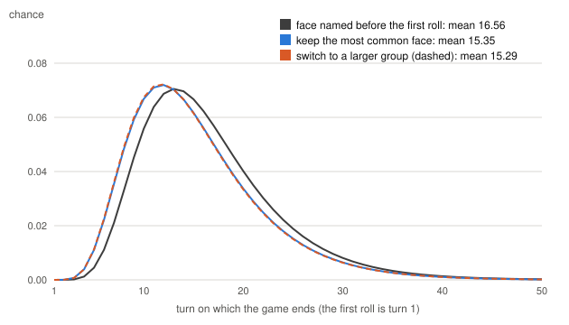

# Tenzi

How many turns does a game of Tenzi take, and what is the best way to play? Keeping the face that is most common after the first roll, a game takes 15.35 turns on average; switching faces when another group grows larger lowers that to 15.29. No strategy does better, either on average or in the chance of being done by any given turn, so switching also wins races most often. Exact, by a Markov chain and a Markov decision process, and checked by simulation.


*The first two turns of a seeded game. Shaded dice show the kept face and stay put; the rest are rolled again.*

## Rules as modeled

- Each player rolls ten dice, keeps the dice that show one face, and rerolls the rest until all ten match. Every turn count includes the first roll.
- **Fixed face:** keep the face that is most common after the first roll, and never change it.
- **Switching:** switch faces whenever the rerolled dice show more of another face than are kept.
- **Face named first:** name the face before the first roll, as some players do.
- **A race:** players roll together and play independently, and the game ends on the first turn on which someone finishes. Two or more players tie on that turn unless exactly one finishes.

## Results

All results are exact unless marked.

| Result | Value | How it is known |
|---|---|---|
| Mean turns, fixed face | 15.35 (median 14, most likely 12) | Markov chain on the number of matched dice |
| Mean turns, switching | 15.29 (15.2944) | same |
| Best mean over all strategies | 15.29, switching's own | policy iteration with exact fractions, over every choice of dice to keep |
| Largest chance of being done by turn t | switching's, for every t up to 163 | dynamic program over deadlines, in whole numbers |
| Mean turns, face named first | 16.56 (16.5648), standard deviation 6.83 | Markov chain, and in closed form |
| Games longer than 30 turns, fixed face | 3.3% | Markov chain |
| Mean winning turn in a race of four, face named first | 10.54 | exact, from the chain's distribution; sums stop at 200 turns |
| The means above | inside the 95% intervals of 100,000 simulated games each | simulated, seeds 1 to 5 |

## How the results are checked

Each exact mean lies inside the 95% interval of a seeded simulation of 100,000 games: 16.556 ± 0.042 with the face named first (exact 16.565), 15.363 ± 0.042 with the fixed face (15.349) and 15.278 ± 0.042 with switching (15.294). A simulation of 20,000 races of four players with the face named first agrees too: 10.506 ± 0.041 for the winning turn (10.542), 0.107 ± 0.004 for a tie (0.103) and 1.214 ± 0.013 for players with one die left (1.216). Each simulation draws its games from its own generator, with seeds 1 to 5 in `tenzi.SEEDS`, so the simulations share no random numbers and are independent checks.

- The decision process agrees with value iteration over every ordered roll and every subset of dice to keep, on small games up to four dice on three faces. The deadline programs agree with brute force on small games.
- `maximum.py` checks the harmonic-number formula and its Fourier remainder in 60-digit arithmetic.
- Bacinski and Pennings report the same distribution with the first roll left out; the comparison is under "Choosing the face before the first roll".
- The tests check that the numbers this README and `tenzi.typ` quote from the scripts are current, and that the committed figures are what `figures.py` draws. CI runs them.

## How many turns does a game take?

- Keeping the face that is most common after the first roll, a game takes 15.35 turns on average. The median is 14, and the most likely length is 12.
- Switching faces whenever the rerolled dice show more of another face than are kept lowers the mean to 15.29 (15.2944).
- Naming the face before the first roll raises the mean to 16.56 (16.5648), with standard deviation 6.83. The game then lasts as long as the slowest of ten dice, each of which needs a geometric number of rolls.
- A game takes more than 30 turns 3.3% of the time with the fixed face.



*The exact distribution of the number of turns. Switching (dashed) and the fixed face differ by less than 0.001 on every turn; naming the face first moves the curve about a turn later.*

## Choosing the face before the first roll

The turns are the largest of ten independent Geometric(1/6) waits, so P(T > k) = 1 − (1 − (5/6)^k)^10. Expanding the power and summing over k gives the mean and variance in closed form. They agree exactly with the Markov chain started from zero matched dice.

The mean is also H₁₀ / ln(6/5) + 1/2 = 16.564848860842, where H₁₀ = 1 + 1/2 + ... + 1/10, to within 4.18·10⁻¹⁰ of the exact 16.564848861259. A geometric wait is an exponential time rounded up, so the game lasts as long as the largest of ten exponential times, rounded up. That largest time averages H₁₀ / ln(6/5), and rounding up adds 1/2 plus a remainder: a sum of Fourier terms that measure how far the fractional part of the largest time is from even. The terms for frequency ±1 give 4.175·10⁻¹⁰ of the remainder. As the number of dice grows, these terms settle into a wobble in log n with amplitude 1.45·10⁻²³, the periodic term of Szpankowski and Rego. They come within a factor of 2 of that size only from 856 dice on. Eisenberg ([2008](https://doi.org/10.1016/j.spl.2007.05.011)) makes the same point with the same Fourier analysis: for moderate n the remainder is far larger than the wobble. `maximum.py` checks the identity in 60-digit arithmetic; for 10, 20 and 50 dice it holds to 30 digits or more.

Bacinski and Pennings, in the MathFest slides [How to win at Tenzi](http://sigmaa.maa.org/mcst/documents/TenziforMathfest.pdf), use this rule and report a mean of 15.565 turns with standard deviation 6.834. Their mean is the exact 16.565 less one. Their table of finishing times leaves out the first roll: beside each roll k it puts the exact chance of finishing on roll k + 1, to within 0.0006. Their state vectors do count it: S₄ gives 0.0014 for ten matched dice, which is P(T ≤ 4), and S₂₀ − S₁₉ gives 0.0401, which is P(T = 20). Shifting by one changes the mean but not the standard deviation, which is why their 6.834 matches.

## The race

With n players who roll together and play independently, the game ends on the first turn on which someone finishes. If one player is still playing after turn t with chance S(t), the first finish comes on turn t with chance S(t − 1)ⁿ − S(t)ⁿ. Two or more players tie on that turn unless exactly one finishes. The players with one die left at the end are those with nine dice matched on that turn; their expected number follows from the chain's distribution of matched dice after each turn.

| players | mean winning turn, face named first | slides | P(tie) | players with one die left | slides | mean winning turn, switching |
|---:|---:|---:|---:|---:|---:|---:|
| 2 | 12.90 | 13.0 | 0.048 | 0.52 | 0.53 | 11.68 |
| 3 | 11.41 | 11.4 | 0.080 | 0.91 | 0.91 | 10.23 |
| 4 | 10.54 | 10.6 | 0.103 | 1.22 | 1.21 | 9.39 |
| 6 | 9.52 | 9.6 | 0.137 | 1.70 | 1.71 | 8.41 |
| 10 | 8.48 | 8.5 | 0.181 | 2.41 | 2.37 | 7.42 |
| 20 | 7.37 | 7.4 | 0.241 | 3.57 | 3.58 | 6.38 |
| 30 | 6.84 | 6.8 | 0.276 | 4.38 | 4.36 | 5.89 |

The columns without a source are exact; the sums stop at 200 turns, where the chance of a longer game is below 10⁻¹⁴. The slides' columns are labeled with one player fewer than the rows here: they count the other players, not everyone. Their race means count the first roll, unlike their single-player mean. They differ from the exact values by up to 0.1 turns, and their one-die-left column by up to 0.05 players, as a simulation would. Their share of players with one die left divides by everyone, winner included. Their chart of a player who rolls faster gives a jump of 0.0235 at equal speeds, about half the exact chance of a tie between two players, 0.048. We could not reconcile that figure.

## The best strategy

After a roll, all that matters is how many dice show each face. The player then keeps some dice and rerolls the rest. Policy iteration with exact fractions starts from switching and finds no keep that improves on it, both when the kept dice must share one face and when any dice may be kept. Keeping one die is exactly as good as rerolling it; every other choice of dice is worse than switching by at least 0.05 turns. The expected turns still to come after keeping k dice of one face are:

| k | 0 or 1 | 2 | 3 | 4 | 5 | 6 | 7 | 8 | 9 |
|---|---:|---:|---:|---:|---:|---:|---:|---:|---:|
| turns | 15.29 | 15.11 | 14.66 | 13.93 | 13.02 | 11.93 | 10.56 | 8.73 | 6.00 |

These fall as k grows, so keeping more dice of one face is always better. That is the switching strategy. On small games, up to four dice on three faces, the same method agrees with value iteration over every ordered roll and every subset of dice to keep.

A race rewards finishing by the turn the others finish, which a lower mean does not guarantee. For each deadline t, a dynamic program that looks t turns ahead gives the largest chance of being done by turn t. It runs in whole numbers, so it is exact. At every deadline up to turn 163 and after every kind of roll, keeping every die of the most common face is among the best keeps, under both rule sets. After turn 163 no strategy can gain more than 10⁻¹². The best chances of being done by turns 5, 10, 14, 20 and 30 are 0.0159, 0.2505, 0.5310, 0.8142 and 0.9678, switching's own. The same holds for every game of two to six dice on two to six faces, and brute force on small games gives the same values. If the other players' choices do not depend on our dice, fixing their play fixes the turn we must beat, so switching gives the largest chance of winning, or of winning or tying, even for a player who watches the others.

## Sources

- D. Bacinski and T. Pennings, [How to win at Tenzi](http://sigmaa.maa.org/mcst/documents/TenziforMathfest.pdf), MathFest slides: the face named first, the race, and the tables compared above.
- B. Eisenberg, [On the expectation of the maximum of IID geometric random variables](https://doi.org/10.1016/j.spl.2007.05.011), *Statistics and Probability Letters* (2008): the Fourier analysis of the remainder, and the periodic term of Szpankowski and Rego.

## Open questions

- The slides' chart of a player who rolls faster gives a jump of 0.0235 at equal speeds, about half the exact chance of a tie between two players, 0.048. Where does 0.0235 come from?
- What is the best strategy in a race against players who watch our dice and react to them?

## Usage

```bash
uv run python -m tenzi.tenzi
uv run python -m tenzi.optimal
uv run python -m tenzi.maximum
uv run --group tenzi python -m tenzi.tenzi --plot   # also a histogram with a fitted gamma density
uv run tools/typst_vendor.py tenzi/tenzi.typ --all   # the PDF, the phone PDF and the HTML page
uv run python -m tenzi.figures   # the figures in figures/
```

## Files

- `tenzi.py` computes the distributions and the race, runs the simulations, and writes `turns.csv` for the figure in `tenzi.pdf`.
- `optimal.py` solves the decision process and the deadline programs, and checks both against brute force on small games.
- `maximum.py` checks the harmonic-number formula and its Fourier remainder.
- `monte_carlo.py` simulates a million games while keeping the shortest and longest ones, and checks the Gumbel-max trick for sampling a die whose faces are not equally likely.
- `figures.py` draws the figures in `figures/`; a test checks they are current.
- `tenzi.typ` is the write-up; `tenzi.pdf` and `tenzi-phone.pdf`, a narrow page for reading on a phone, are built from it. The HTML page that `--all` also writes is not committed.
