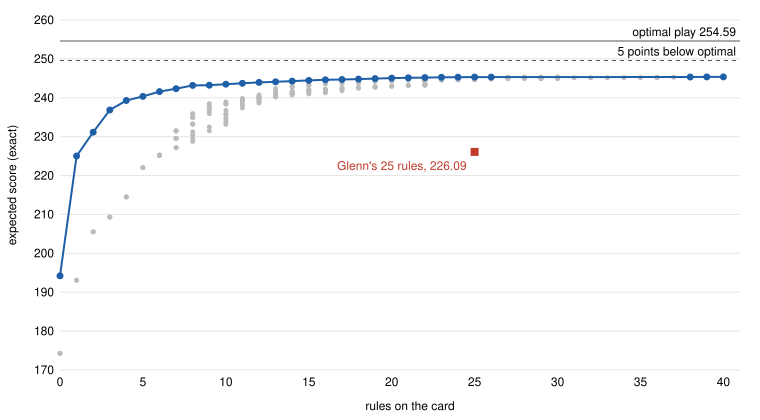

# Yahtzee

In solitaire Yahtzee one player plays the thirteen turns alone for the highest average score; play against others, where the aim is to win, is not treated here. Optimal play scores 254.5896 on average, as Verhoeff (1999) found and Glenn (2006) confirmed to two decimals; repeated here and checked against brute force. A printable [cheat sheet](#the-cheat-sheet) of 8 rules scores 243.18, 11.41 below optimal, and no card the search found came within 9 points. Glenn's rule lists for people score 226.09 here against his reported 218.18. Of 17 pieces of common advice, 9 cost under half a point each and three cost more than 9 points. All exact unless marked.


*The average points in each box, for the cheat sheet and for optimal play, both exact. The sheet earns the upper bonus in 54.46% of games against 68.12%, which is 4.78 points of its 11.41-point loss; Large Straight accounts for 3.14 more. The sheet makes slightly more Yahtzees than optimal play does. Each row is rounded to two decimals, so the sheet's rows add to 243.17 against its total of 243.18.*

## Rules as modeled

The [Hasbro rules](https://www.hasbro.com/common/instruct/40958.pdf), as Verhoeff reads them on his [rules page](https://www-set.win.tue.nl/~wstomv/misc/yahtzee/rules.html):

- Each turn has up to three rolls of five dice. Before each reroll the player keeps any dice, not necessarily the ones kept before. The roll then goes in one open box, possibly for zero.
- The upper boxes score the dice of their face. Three and Four of a Kind and Chance score the sum of the dice, Full House 25, Small Straight 30, Large Straight 40 and Yahtzee 50. A Yahtzee is not a full house.
- The **upper bonus**: 35 points if the six upper boxes total 63 or more.
- 100 points for each further Yahtzee once the Yahtzee box holds 50 (the **Yahtzee bonus**). It does not count toward the 63.
- The **Joker**: once the Yahtzee box is filled (with 50 or 0) and the upper box of the Yahtzee's face is filled, a Yahtzee scores 25, 30 and 40 in Full House and the straights.

Verhoeff and Glenn let the player put a Yahtzee in any open box (**free choice**). The Hasbro text instead forces the upper box of its face if that box is open, and otherwise a lower box. That **forced** reading is solved too.

## Results

"Exact" here means computed by the dynamic program over every state and roll, with no sampling, in double precision. Changing the order of the sums moves the mean by about 10⁻¹³, so these are exact to about twelve significant digits, not exact fractions. "Simulated" numbers give the number of games and a 95% interval. The last column links the note in [`results/`](results/README.md) with the detail.

| Result | How it is known | Detail |
|---|---|---|
| Optimal play scores 254.5896094820 on average; 245.8707745141 without the Yahtzee bonus and the Joker | Exact; agrees with Verhoeff (254.5896, 245.87) and Glenn (254.59), and with thirteen positions of Verhoeff's slides to two decimals | [optimal](results/optimal.md) |
| A 139-digit fraction on Verhoeff's trivia page, credited there to Kelly and Liese (2017, "publication to appear"), equals 254.5893738837, 0.000236 below that and below the 254.5896 printed on the same page | Exact arithmetic on the quoted fraction. Their 2022 paper was not read (paywalled), so this is a disagreement with the page's transcription, not with the paper | [optimal](results/optimal.md) |
| The score has standard deviation 59.6117 and median 248; it is 300 or more in 14.33% of games | Exact distribution; agrees with Verhoeff | [optimal](results/optimal.md) |
| The Yahtzee box holds 50 in 33.74% of games; a Yahtzee bonus is earned in 8.245% | Exact | [optimal](results/optimal.md) |
| The upper bonus is worth 16.75 points, the Yahtzee bonus 8.50 and the Joker 0.62; forced placement costs 0.0019 | Exact, one solve per variant | [variants](results/variants.md) |
| Greedy play scores 217.31 to 219.05, 35.54 to 37.28 below optimal, depending on how ties between boxes are broken; Glenn's 218.54 lies inside that range | Exact for each of three tie rules | [variants](results/variants.md) |
| After the first roll, every die of the most common face is the best keep for 6,156 of the 7,056 ordered rolls that hold a pair or more (7,776 rolls in all) | Exact | [openings](results/openings.md) |
| The cheat sheet (8 rules) scores 243.18; the best card found with 40 rules, 245.37 | Exact for each card; the search is seeded, so "best found" | [card-search](results/card-search.md) |
| Glenn's rule lists for people score 226.09 under the readings here; he reports 218.18 | Exact (20,000 seeded games, seed 1: 226.01 ± 0.92); gap of 7.9 not resolved | [card-search](results/card-search.md) |
| Of 17 pieces of advice, 9 cost under half a point; "stop rolling on three of a kind" costs 36.18 | Exact, one solve per piece | [advice](results/advice.md) |
| Optimal play averages 254.80 ± 0.83 and greedy 217.42 ± 0.68 in seeded games | Simulated, 20,000 games, seed 1, 95% interval; contains the exact values | [variants](results/variants.md) |

## How the results are checked

- **Brute force.** `brute.py` solves small games by plain recursion, with exact fractions, ordered dice and the whole score card as the state. It shares nothing with the solver except the scoring rules. On seven small games, three of which differ only in their Joker reading, the two methods differ by less than 10⁻¹³.
- **Closed forms and published values.** One-box games have closed forms. The full solve matches Verhoeff's and Glenn's values and visits 536,448 states between turns, as Verhoeff gives.
- **Three ways to the mean.** The solver's value, the mean of the computed distribution and the sum of the per-box means differ by less than 10⁻¹³. Seeded simulations of small games match their exact distributions.
- **Cards scored twice.** A strategy card is scored by two programs that share only the card: the solver told to follow it, and the card's own forward and backward passes in `human.py`. They agree to 10⁻⁹ on every state the tests compare. Seeded games played by the card agree with the exact means.
- **Committed numbers.** The tests recompute the committed scores of the cheat sheet, Glenn's lists, the shortest cards on the frontier and one piece of advice. They check that this README holds the cheat sheet as `cards.py` writes it, and that every number of the README before its detail moved to `results/` is still in the README or a note.

Not done: exact rational arithmetic for the full game. That would test whether any decision is a near-tie that rounding gets wrong, and settle the comparison with Kelly and Liese's fraction. The full list of checks is in [method.md](results/method.md).

## The cheat sheet

This is the best card found with at most 8 rules. Print this section to play from it. Read each list from the top and follow the first rule that applies.

The most common face is the face on the most dice, the higher one on a tie.

Before each reroll, keep the dice of the first rule that applies.

1. If the roll has four or more in a row and Large Straight is open: keep one die of each face in the longest run.
2. If the roll has four or more in a row and Small Straight is open: keep all five.
3. If the most common face is 4 or more and the most common face's upper box is open: keep every die of the most common face.
4. If the roll has a pair or more, one roll is left and Full House is open: keep every die whose face shows two or more times.
5. If three or fewer boxes are open, Small Straight is open and Three of a Kind is filled: keep one die of each face in the longest run.
6. If Three of a Kind is filled, Four of a Kind is filled and the roll has three or more of a kind: keep every die of the most common face among those whose upper box is open (the most common face if none is).
7. If the roll has three or more of a kind: keep every die of the most common face.
8. If the most common face is 5 or more, Three of a Kind is open and the roll has a pair or more: keep every die of the most common face.
9. Otherwise keep every die of the most common face among those whose upper box is open (the most common face if none is).

After the last roll, score in the open box whose points minus par are largest.

Par: Aces 4, Twos 6, Threes 9, Fours 11, Fives 14, Sixes 17, Three of a Kind 23, Four of a Kind 15, Full House 15, Small Straight 29, Large Straight 15, Yahtzee 11, Chance 27.
Until the bonus is made, count an upper box's points minus par 2.75 times.

Its expected score is 243.18 (exact), with standard deviation 61.78 and median 236. In 20,000 seeded games (seed 1) it averaged 242.61 ± 0.85, which contains the exact value. The keeps lose more than the boxes. Played with the sheet's boxes and optimal keeps, the score would be 252.23. With the sheet's keeps and optimal boxes, it would be 245.56.

## What does optimal play score?

254.5896094820 on average, with standard deviation 59.6117 and median 248. The long right tail comes from Yahtzee bonuses: the score is 400 or more in 3.84% of games. `distribution.csv` lists the chance of every score; [optimal.md](results/optimal.md) has the quantiles, the per-box statistics and the comparison with Verhoeff's and Glenn's numbers.

Verhoeff's trivia page prints a fraction that it credits to Kelly and Liese (computed in 2017, "publication to appear"). It equals 254.5893738837, 0.000236 lower than the 254.5896 on the same page. None of the readings of the Joker tried here gives it. Their 2022 paper, which reports exact rational values, was not read, so the comparison is with the page's transcription only.

## What is each rule worth?

The value of a rule is the optimal score with it minus the optimal score without it. Each row is exact; the table with every combination is in [variants.md](results/variants.md).

| Rules | Optimal score | Change |
|---|---:|---:|
| official (upper bonus, Yahtzee bonus, Joker) | 254.5896 | |
| no Joker | 253.9702 | −0.6194 |
| no Yahtzee bonus | 246.0873 | −8.5023 |
| no upper bonus | 237.8425 | −16.7471 |
| none of the three | 229.6385 | −24.9511 |
| forced Joker instead of free choice | 254.5877 | −0.0019 |

Optimal play earns the upper bonus's 35 points in 68.12% of games, 23.84 points on average, but the rule is worth only 16.75: chasing the bonus costs 7.09 points elsewhere.

## What should a player keep after the first roll?

Of the 7,776 equally likely ordered rolls, 7,056 hold a pair or more. In 6,156 of them the best keep is every die of the most common face, full houses included. In the other 900 the pair is given up for a straight draw or a single high die. `openings.csv` gives the best keep for each of the 252 first rolls; [openings.md](results/openings.md) has the examples and the closest decision.

## How far behind is greedy play?

35.54 to 37.28 points, depending on how ties are broken. Glenn's **greedy** strategy plays each turn for the most points that turn and ignores the upper bonus. With ties going to the first box on the card it scores 217.3074 (exact) and earns the upper bonus in only 2.62% of games; with ties broken in Glenn's fallback order of boxes it scores 219.05. Glenn reports 218.54 and does not say how he breaks ties, so his value lies inside the range and need not disagree. Detail: [variants.md](results/variants.md).

## How close can a short card get?

Within about 9 points of optimal, and no closer in this search. A **card** is two ordered lists of short rules, for keeps and for boxes, with 13 par values. A card fixes every choice, so its expected score is exact. Five seeded searches grew cards one rule at a time (`learn.py`), and the best 30-rule card was pruned one rule at a time; 220 cards were scored. The frontier is the best found, not proved best. Detail, with Glenn's lists and other published strategies for people: [card-search.md](results/card-search.md).



*Gray dots are the cards along each search and each pruning; the blue line is the best found for each size. Past 8 rules each rule adds little, and the gains stop near 245.*

| Rules | 0 | 1 | 2 | 4 | 8 | 12 | 16 | 20 | 26 | 40 |
|---|---:|---:|---:|---:|---:|---:|---:|---:|---:|---:|
| Best score found | 194.21 | 225.02 | 231.16 | 239.30 | 243.18 | 243.95 | 244.62 | 245.05 | 245.31 | 245.37 |

## What does common advice cost?

Each piece was taken from a strategy page, forum or rule booklet and made precise. A player follows it wherever it applies and plays optimally elsewhere. Its **cost** is 254.5896 minus that player's exact expected score. [advice.md](results/advice.md) has each source and quote, and how often each piece applies and is obeyed.

| Advice, as tested | Cost |
|---|---:|
| A full house goes in Full House, not Three of a Kind | 0.05 |
| With two pair before the last six turns, do not keep both pairs | 0.09 |
| Four 4s, 5s or 6s go in their upper box | 0.10 |
| Four of a kind goes in its upper box while the bonus is open | 0.11 |
| With a lone pair of 1s or 2s early on, do not keep the pair | 0.22 |
| With three or four of a kind and its upper box open, go for the Yahtzee | 0.33 |
| With three of a kind, keep them, except in the last three turns | 0.40 |
| Chance takes 21 or more, except in the last three turns | 0.44 |
| With a small straight after the first roll, chase the large straight | 0.50 |
| A forced zero goes in the upper section | 1.10 |
| Three or four 1s, 2s or 3s go in their upper box | 1.55 |
| Chance stays open for the first six turns | 2.08 |
| With two pair and Full House open, keep both pairs | 3.82 |
| The Yahtzee box is not scratched before the last turn | 4.69 |
| A roll that fits a lower box goes there, not in the upper section | 9.74 |
| Upper boxes take three or more of their face, or a zero | 9.79 |
| With three of a kind and the bonus not made, stop rolling | 36.18 |

## Data

| Source | What | License | Committed |
|---|---|---|---|
| Strategy pages, forums and rule booklets ([advice.md](results/advice.md) links each) | 17 pieces of advice | unknown | only short quotes, each under 15 words, with links |
| Glenn (2007) | his rule lists for keeps and boxes | publisher's copyright | paraphrased in `glenn.py` |
| [Hasbro rules](https://www.hasbro.com/common/instruct/40958.pdf) | the rules | publisher's copyright | no |

Every other file here is computed by the code in this folder.

## Sources

- T. Verhoeff, optimal solitaire Yahtzee: [trivia page](https://www-set.win.tue.nl/~wstomv/misc/yahtzee/trivia.html) (which also prints the 2017 fraction credited to Kelly and Liese), [rules page](https://www-set.win.tue.nl/~wstomv/misc/yahtzee/rules.html), [slides](http://www.yahtzee.org.uk/optimal_yahtzee_TV.pdf) and [Proficiency Test](https://www-set.win.tue.nl/~wstomv/misc/yahtzee/instr-pt.html). Every value compared here agrees, except the share of games with no Yahtzee rolled (63.24% against 63.27%; he may count five of a kind after any roll).
- J. Glenn, [technical report](https://www.cs.loyola.edu/~jglenn/research/optimal_yahtzee.pdf) (2006) and [CIG 2007](https://doi.org/10.1109/CIG.2007.368089): the optimal value agrees to his two decimals, and his greedy value lies inside the range set by tie rules; his rule lists' score and his count of impossible upper states do not agree, for reasons not found.
- K. Kelly and J. Liese, ["Let's Get Rolling! Exact Optimal Solitaire Yahtzee"](https://doi.org/10.1080/0025570X.2022.2055334), *Mathematics Magazine* 95(3), 2022, 205–219; only its summary was read. The fraction compared here is the one Verhoeff's page prints, not a number from the paper.
- P. Woodward, "Yahtzee: The Solution", *Chance* 16(1), 2003, also solved the solitaire game; not read.
- J. Pawlewicz, ["Nearly Optimal Computer Play in Multi-player Yahtzee"](https://doi.org/10.1007/978-3-642-17928-0_23), *Computers and Games* 2010, treats the game for several players, where the aim is to win. His [slides](https://mimuw.edu.pl/~pan/papers/yahtzee-cg2010.pdf) estimate 12.7 trillion stored values for an optimal two-player strategy, and report that a nearly optimal player wins about 4 more games in 100 than the best human players of an online site.
- Student reports at KTH give 221.68 ([Felldin and Sood 2012](https://www.csc.kth.se/utbildning/kth/kurser/DD143X/dkand12/Group5Mikael/report/MarkusFelldin_VinitSood.pdf)) and 211.04 ([Dahlbom Norgren and Svensson 2013](https://www.csc.kth.se/utbildning/kth/kurser/DD143X/dkand13/Group1Vahid/report/Optimal_Yahtzee_Nils_DN_&_Philip_S.pdf)) for heuristic programs without the Yahtzee bonus; not rescored here.

## Open questions

- Why do Glenn's rule lists score 7.9 points more here than he reports? His tables leave open what a keep rule such as "Small straight" keeps, and whether a "tripleton" may be four of a kind.
- Which rules did Kelly and Liese use, what does their paper print, and does exact rational arithmetic for the full game reproduce the fraction on Verhoeff's page?
- Can a card get closer than 9 points? The split of the sheet's loss suggests where to look: keeps that depend on more than the most common face, the longest run and the pairs.
- Why does Glenn count 1,260 impossible pairs of upper boxes and totals, where this solver counts 1,302 with totals capped at 63 and a count without the cap gives 1,304? The state count matches Verhoeff's.
- How should play change against an opponent, where the aim is to win? Maximizing the chance of scoring at least a target T, with the score so far added to the state, is a one-dimensional extension of the solver and a first step.

## Usage

```bash
uv run python -m yahtzee.solver            # the optimal value; about a minute
uv run python -m yahtzee.study optimal     # checks, distribution, per box; about 6 minutes
uv run python -m yahtzee.study rules       # the table of rule values; about 6 minutes
uv run python -m yahtzee.study openings    # writes openings.csv
uv run python -m yahtzee.study greedy      # greedy play under three tie rules; about 5 minutes
uv run python -m yahtzee.study simulate    # 20,000 seeded games of each strategy; about 3 minutes
uv run python -m yahtzee.glenn             # Glenn's rule lists, exactly; half a minute
uv run python -m yahtzee.cards             # frontier, cheat sheet, figures; about 15 minutes
uv run python -m yahtzee.advice all        # every piece of advice; about 40 minutes
uv run python -m yahtzee.learn learn --start base --seed 1 --out yahtzee/results   # hours; run on GitHub Actions
```

## Files

| File | Contents |
|---|---|
| `rules.py`, `solver.py` | The scoring rules and variants; the dynamic program, with greedy play as a variant |
| `policy.py`, `simulate.py` | The states a strategy reaches, its exact distribution and per-box statistics; seeded games |
| `brute.py` | The brute-force check on small games |
| `study.py` | Every number of the optimal-play notes; writes `openings.csv` and `distribution.csv` |
| `human.py`, `learn.py`, `cards.py` | Strategy cards and their exact scores; the search; `results/cards.json` and both figures |
| `glenn.py`, `advice.py` | Glenn's rule lists; the advice, written to `results/advice.json` |
| `results/` | Every card the searches recorded, and notes with the detail behind each section ([index](results/README.md)) |
