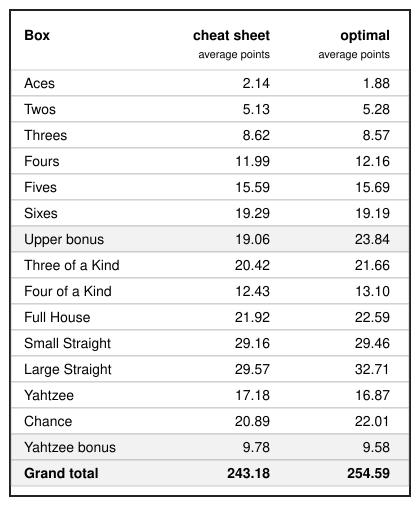

# Yahtzee

In solitaire Yahtzee one player plays the thirteen turns of a game alone and tries to score as much as possible on average. The game is small enough to solve exactly by dynamic programming, as Verhoeff (1999), Woodward (2003) and Glenn (2006) did. This folder repeats that computation and checks it against brute force and the published values. It then asks what the mean leaves out: the distribution of the score, what each bonus rule is worth, what to keep after the first roll, how often optimal play makes a Yahtzee, and how far a greedy player falls behind. Last, it asks what a player at the table can use: a short list of rules to memorize, and what common advice costs.

- Optimal play scores 254.5896 on average (exact).
- The [cheat sheet](#the-cheat-sheet) below has 8 rules and a table of par values. It scores 243.18 on average, 11.41 below optimal (exact). The best card found with 12 rules scores 243.95. No card the search found came within 9 points of optimal: 30 rules reach 245.31 and 40 rules 245.37.
- Glenn's published rule lists for a human player score 226.09 under the readings taken here; he reports 218.18.
- Of 17 pieces of common advice, 9 cost less than half a point each. Three cost more than 9 points: always prefer a lower box, never put fewer than three dice in an upper box, and stop rolling on three of a kind.

"Exact" below means computed by the dynamic program in double precision. Changing the order of the sums moves the mean by about 10⁻¹³. "Simulated" numbers give the number of games and a 95% interval.



*The average points in each box, for the cheat sheet and for optimal play, both exact. The sheet earns the upper bonus in 54.46% of games against 68.12%, which is 4.78 points of its 11.41-point loss; Large Straight accounts for 3.14 more. The sheet makes slightly more Yahtzees than optimal play does.*

## The cheat sheet

This is the best card found with at most 8 rules. Print this section to play from it. Read each list from the top and follow the first rule that applies.

Before each reroll, keep the dice of the first rule that applies.

1. If the roll has four or more in a row and Large Straight is open: keep one die of each face in the longest run.
2. If the roll has four or more in a row and Small Straight is open: keep all five.
3. If the most common face is 4 or more and the most common face's upper box is open: keep every die of the most common face.
4. If the roll has a pair or more, one roll is left and Full House is open: keep every die whose face shows two or more times.
5. If three or fewer boxes are open, Small Straight is open and Three of a Kind is filled: keep one die of each face in the longest run.
6. If Three of a Kind is filled, Four of a Kind is filled and the roll has three or more of a kind: keep every die of the most common face among those whose upper box is open (the most common face if none is).
7. If the roll has three or more of a kind: keep every die of the most common face.
8. If the most common face is 5 or more, Three of a Kind is open and the roll has a pair or more: keep every die of the most common face.
9. Otherwise keep every die of the most common face among those whose upper box is open (the most common face if none is).

After the last roll, score in the box of the first rule that applies.

1. Otherwise the open box whose points minus par are largest.

Par: Aces 4, Twos 6, Threes 9, Fours 11, Fives 14, Sixes 17, Three of a Kind 23, Four of a Kind 15, Full House 15, Small Straight 29, Large Straight 15, Yahtzee 11, Chance 27.
Until the bonus is made, count an upper box's points minus par 2.75 times.

The most common face is the face on the most dice, the higher one on a tie.

Its expected score is 243.18 (exact), with standard deviation 61.78 and median 236. In 20,000 seeded games (seed 1) it averaged 242.61 ± 0.85, which contains the exact value. The keeps lose more than the boxes. Played with the sheet's boxes and optimal keeps, the score would be 252.23. With the sheet's keeps and optimal boxes, it would be 245.56.

## Rules as modeled

The [Hasbro rules](https://www.hasbro.com/common/instruct/40958.pdf), as Verhoeff reads them on his [rules page](https://www-set.win.tue.nl/~wstomv/misc/yahtzee/rules.html):

- Each turn has up to three rolls of five dice. Before each reroll the player keeps any dice, not necessarily the ones kept before. The roll then goes in one open box, possibly for zero.
- The upper boxes score the dice of their face. Three and Four of a Kind and Chance score the sum of the dice, Full House 25, Small Straight 30, Large Straight 40 and Yahtzee 50. A Yahtzee is not a full house.
- 35 points if the six upper boxes total 63 or more.
- 100 points for each further Yahtzee once the Yahtzee box holds 50 (the **Yahtzee bonus**). It does not count toward the 63.
- The **Joker**: once the Yahtzee box is filled (with 50 or 0) and the upper box of the Yahtzee's face is filled, a Yahtzee scores 25, 30 and 40 in Full House and the straights.

Verhoeff and Glenn let the player put a Yahtzee in any open box (**free choice**). The Hasbro text instead forces the upper box of its face if that box is open, and otherwise a lower box. That **forced** reading is solved too.

## Results

### The expected score

Optimal play scores 254.5896094820 on average. Verhoeff's [trivia page](https://www-set.win.tue.nl/~wstomv/misc/yahtzee/trivia.html) gives 254.5896, and Glenn's [technical report](https://www.cs.loyola.edu/~jglenn/research/optimal_yahtzee.pdf) gives 254.59. Verhoeff's [slides](http://www.yahtzee.org.uk/optimal_yahtzee_TV.pdf) also give the values of thirteen positions, and all thirteen agree to the two decimals given. Two of them, as expected final scores:

- After a first roll of 1 1 6 6 6, keeping 6 6 6 is worth 265.12, and taking the full house at once 253.91.
- After a second roll of 1 1 3 4 6, keeping 3 4 is worth 245.17 and keeping 1 1 is worth 245.14.

The solver visits 536,448 states between turns, the number that Verhoeff gives for the states that need computing. Without the Yahtzee bonus and the Joker the value is 245.8707745141, which Verhoeff and Glenn give as 245.87.

Verhoeff's trivia page also quotes an exact fraction for the optimal score, found by K. Kelly and J. Liese (["Let's Get Rolling! Exact Optimal Solitaire Yahtzee"](https://doi.org/10.1080/0025570X.2022.2055334), *Mathematics Magazine* 95, 2022). Its denominator is 2¹⁶⁹ · 3¹⁷⁹. The fraction equals 254.5893738837. That is 0.000236 below the value here and below Verhoeff's own 254.5896. None of the readings of the Joker tried here gives their number. The forced reading gives 254.5877 and no Joker gives 253.9702. Four other readings were tried and then dropped from the code; none came within 0.0002 of the fraction. Their paper was not read, so the rules they used are unknown here.

### The distribution of the score

Under optimal play the final score has standard deviation 59.6117, as Verhoeff gives. Its median is 248: P(score ≥ 248) = 0.5018, and P(score ≤ 248) = 0.5074. Verhoeff found the same median in a million simulated games. All the numbers in this section are exact.

| Quantile | 1% | 5% | 10% | 25% | 50% | 75% | 90% | 95% | 99% |
|---|---:|---:|---:|---:|---:|---:|---:|---:|---:|
| Score | 151 | 180 | 194 | 217 | 248 | 272 | 318 | 388 | 474 |

- The most likely single score is 266, with chance 0.0126.
- The score is 300 or more in 14.33% of games and 400 or more in 3.84%. It is 500 or more in 0.72%. The long right tail comes from Yahtzee bonuses.
- The least score optimal play can end with is 12, which Verhoeff also gives. Its chance is 2.9 · 10⁻⁴⁴. The most is 1,575, the largest score that the rules allow.
- Without the Yahtzee bonus and the Joker, the standard deviation drops to 39.8208 (Verhoeff: 39.82). The median is 247, and the score never exceeds 375.

`distribution.csv` lists the chance of every score.

The mean, standard deviation and share of zeros of each box also match Verhoeff's table to two decimals, for all thirteen boxes. The upper bonus is earned in 68.12% of games.

### How often optimal play makes a Yahtzee

- The Yahtzee box holds 50 at the end in 33.74% of games, and 0 in the rest.
- At least one turn ends with five of a kind in 36.73% of games, and 0.4640 turns do on average. Exactly one does in 28.40%, two in 7.13% and three in 1.09%.
- A Yahtzee bonus is earned in 8.245% of games, worth 9.58 points on average. A Joker is used 0.0373 times per game.

Verhoeff gives 63.24% for games with no Yahtzee rolled, where the figure here is 63.27%. He may count five of a kind after any roll, not only the last one, but this was not checked.

### What each rule is worth

The value of a rule is the optimal score with it minus the optimal score without it. Each row is exact.

| Rules | Optimal score | Change |
|---|---:|---:|
| official (upper bonus, Yahtzee bonus, Joker) | 254.5896 | |
| no Joker | 253.9702 | −0.6194 |
| no Yahtzee bonus | 246.0873 | −8.5023 |
| no Yahtzee bonus, no Joker | 245.8708 | −8.7188 |
| no upper bonus | 237.8425 | −16.7471 |
| no upper bonus, no Joker | 237.3669 | −17.2227 |
| no upper bonus, no Yahtzee bonus | 229.7389 | −24.8507 |
| none of the three | 229.6385 | −24.9511 |
| forced Joker instead of free choice | 254.5877 | −0.0019 |

- Optimal play earns the upper bonus's 35 points in 68.12% of games, 23.84 points on average. The rule is worth only 16.75. Without the bonus, the best play scores 237.84 in the other boxes. Chasing the bonus lowers that to 230.75, so it costs 7.09 points elsewhere.
- In the same way, the Yahtzee bonus pays 9.58 points on average but is worth 8.50.
- The Joker is worth 0.62 points with the Yahtzee bonus and 0.22 without it.
- The rules interact only a little. The upper bonus is worth 16.75 with the Yahtzee rules and 16.23 without them.
- Forced placement of a Yahtzee costs 0.0019 points on average against free choice.

### The best keep after the first roll

`openings.csv` gives, for each of the 252 first rolls of the game, the best keep and its expected final score, with the second-best keep. Counting the 7,776 equally likely ordered rolls:

- Only Yahtzees and large straights are kept whole, 246 of the 7,776 rolls. Some dice are always kept.
- 6,156 rolls hold a pair or more, and the best keep is every die of the most common face. That includes full houses: with 5 5 6 6 6, keep 6 6 6 (265.12) rather than the full house.
- In the other 900 rolls with a pair, the pair is given up:
  - for a straight draw. With 1 1 3 4 5, keep 3 4 5; with 2 3 4 5 5, keep 2 3 4 5.
  - for a single die of 4 or more, when the pair is of 1s. With 1 1 2 3 6, keep the 6; with 1 1 2 4 5, keep the 5.
- The closest decision is 1 1 3 4 6. Keeping the 4 is worth 249.8811 and keeping 3 4 is worth 249.8763. After the second roll the order flips, as in Verhoeff's example above.
- The worst first roll is 1 1 2 3 6, worth 249.83 when the 6 is kept (Verhoeff: 249.83).

### Optimal against greedy

Glenn's ([2007](https://doi.org/10.1109/CIG.2007.368089)) **greedy** strategy plays each turn for the most points that turn, Yahtzee bonus included, and ignores the upper bonus. It also chooses its keeps to maximize that turn's expected points. When several boxes tie, for example when every open box scores zero, it takes the first one on the score card. Its expected score is 217.3074 (exact), 37.28 points below optimal. Its standard deviation is 48.91 and its median 208. It earns the upper bonus in only 2.62% of games.

Glenn reports 218.54 for greedy play. He does not say how ties are broken, and the rule for ties matters. With ties going to the last box on the card the value is 217.44. Glenn's rule-based strategy has a fallback order of boxes that begins with Aces and Chance. With ties broken in that order, greedy play scores 219.05.

In 20,000 seeded games (seed 1), both strategies play the same dice wherever they reroll the same number of dice. Optimal play averages 254.80 ± 0.83 and greedy 217.42 ± 0.68. The difference is 37.38 ± 0.76 points. All three intervals contain the exact values. Optimal play scores more than greedy in 79% of these games and less in 20%.

### Rules a person can follow

A **card** is two ordered lists of short rules. The keep list says which dice to keep before a reroll, and the box list says where to score the final roll. Each rule tests a few facts a player sees at a glance: the shape of the roll, which boxes are open, how many rolls are left, and whether the upper total is on pace for the bonus. When no box rule applies, the roll goes where its points minus a **par** value are largest, with par a table of 13 round numbers. A card fixes every choice of the game, so its expected score is computed exactly, in about 10 seconds, by following it forward from the empty score card.

Cards were grown one rule at a time (`learn.py`). Each step sampled the card's own decisions, estimated which new rule or par change would gain most, scored the best few candidates exactly, and kept the first that raised the exact score. Five searches ran on GitHub Actions: three from a six-rule starting card and two from the empty card. The two from the empty card were stopped after 45 minutes. Then the best 30-rule card was **pruned**: rules were removed one at a time, each time the one whose removal cost least, and each shorter card was scored exactly. The pruned cards beat the searches' own short cards at every size below 26 rules. In all, 220 cards were scored. The frontier below is the best card for each number of rules; every point on it is exact.


*Gray dots are the cards along each search and each pruning; the blue line is the best found for each size. Past 8 rules each rule adds little, and the gains stop near 245.*

| Rules | Best score found | Below optimal |
|---:|---:|---:|
| 0 | 194.21 | 60.37 |
| 1 | 225.02 | 29.57 |
| 2 | 231.16 | 23.43 |
| 4 | 239.30 | 15.29 |
| 8 | 243.18 | 11.41 |
| 12 | 243.95 | 10.64 |
| 16 | 244.62 | 9.97 |
| 20 | 245.05 | 9.54 |
| 26 | 245.31 | 9.28 |
| 40 | 245.37 | 9.22 |

So short lists of this kind get within about 9 points of optimal and no closer. The split of the sheet's loss above suggests where to look: keeps that depend on more than the most common face, the longest run and the pairs.

**Published strategies for people.** Glenn ([2007](https://doi.org/10.1109/CIG.2007.368089)) gives a rule list for keeps (12 rules) and one for boxes (13 rules), with a fallback order of boxes, and reports an average of 218.18. `glenn.py` follows his words, with the readings stated in its docstring, and scores 226.09 (exact; 20,000 seeded games gave 226.01 ± 0.92). The gap of 7.9 points was not resolved. His tables leave open what a keep rule such as "Small straight" keeps, and whether a "tripleton" may be four of a kind. Glenn also reports 170.45 for a novice who keeps the most common face and plays for Yahtzee bonuses, and up to 250.41 for strategies that a computer, not a person, can follow. Student reports at KTH give 221.68 ([Felldin and Sood 2012](https://www.csc.kth.se/utbildning/kth/kurser/DD143X/dkand12/Group5Mikael/report/MarkusFelldin_VinitSood.pdf), a million simulated games) and 211.04 ([Dahlbom Norgren and Svensson 2013](https://www.csc.kth.se/utbildning/kth/kurser/DD143X/dkand13/Group1Vahid/report/Optimal_Yahtzee_Nils_DN_&_Philip_S.pdf), 100,000 games) for heuristic programs. Both play without the Yahtzee bonus, so they compare with 245.87, not 254.59. Verhoeff's [Proficiency Test](https://www-set.win.tue.nl/~wstomv/misc/yahtzee/instr-pt.html) scores a person's game choice by choice and asks for a mean loss below 0.2 points per choice. None of these was rescored here except Glenn's lists.

### Common advice, priced

Each piece of advice below was taken from a strategy page, forum or rule booklet and made precise. A player follows it wherever it applies and plays optimally everywhere else, so the rest of the game adapts to it. Its **cost** is 254.5896 minus that player's exact expected score. The last two columns say how often per game the advice applies under optimal play, and how often optimal play does what it says anyway. Both come from the exact chances of reaching each decision. Quotes are short excerpts; "Advice, as tested" is the reading that was priced.

| Advice, as tested | Source and words | Cost | Optimal play obeys | Applies per game |
|---|---|---:|---:|---:|
| A full house goes in Full House, not Three of a Kind | [Straight Dope message board, 2020](https://boards.straightdope.com/t/is-there-an-optimum-strategy-to-yahtzee/855164): “Take the full house over a high scoring 3-of-a-kind.” | 0.05 | 98% | 0.91 |
| With two pair before the last six turns, do not keep both pairs | [Board Game Arena forum, 2026](https://forum.boardgamearena.com/viewtopic.php?t=50222): “Don't chase full houses unless we are late in the game” | 0.09 | 94% | 2.90 |
| Four 4s, 5s or 6s go in their upper box | [Cornell math department, Yahtzee strategy page](https://pi.math.cornell.edu/~mec/2006-2007/Probability/Yahtzee.htm): “take the points in the upper section if they are available” | 0.10 | 97% | 0.96 |
| Four of a kind goes in its upper box while the bonus is open | [Board Game Arena forum, 2026](https://forum.boardgamearena.com/viewtopic.php?t=50222): “Always score 4 of a kind on the top if we need it there” | 0.11 | 97% | 1.53 |
| With a lone pair of 1s or 2s early on, do not keep the pair | [Cornell math department, Yahtzee strategy page](https://pi.math.cornell.edu/~mec/2006-2007/Probability/Yahtzee.htm): “will not get you many points” | 0.22 | 64% | 0.77 |
| With three or four of a kind and its upper box open, go for the Yahtzee | [Cornell math department, Yahtzee strategy page](https://pi.math.cornell.edu/~mec/2006-2007/Probability/Yahtzee.htm): “you should definitely go for the Yahtzee” | 0.33 | 96% | 3.79 |
| With three of a kind, keep them, except in the last three turns | [Board Game Arena forum, 2026](https://forum.boardgamearena.com/viewtopic.php?t=50222): “If we throw 3 of something, always continue with it” | 0.40 | 97% | 5.39 |
| Chance takes 21 or more, except in the last three turns | [Yahtzee Manifesto, strategy cheat sheet](https://www.yahtzeemanifesto.com/yahtzee-strategy.php): “Save it for rolls of 21+ points” | 0.44 | 96% | 6.11 |
| With a small straight after the first roll, chase the large straight | [Yahtzee Manifesto, strategy cheat sheet](https://www.yahtzeemanifesto.com/yahtzee-strategy.php): “Use your remaining rolls to chase a Large Straight instead.” | 0.50 | 65% | 0.94 |
| A forced zero goes in the upper section | [Yahtzee Manifesto, strategy cheat sheet](https://www.yahtzeemanifesto.com/yahtzee-strategy.php): “Scratch it in the Upper Section (e.g. Ones)” | 1.10 | 36% | 0.23 |
| Three or four 1s, 2s or 3s go in their upper box | [1967 rule booklet, as quoted by the Yahtzee Manifesto](https://www.yahtzeemanifesto.com/yahtzee-strategy.php): “it is better to score them in the UPPER SECTION” | 1.55 | 83% | 1.76 |
| Chance stays open for the first six turns | [Hasbro rule booklet, tips and tactics](https://www.hasbro.com/common/documents/dad2af551c4311ddbd0b0800200c9a66/8302f43150569047f57eb8d746ba9d86.pdf): “Leave your CHANCE roll until later in the game” | 2.08 | 92% | 6.00 |
| With two pair and Full House open, keep both pairs | [yahtzee.org.uk strategy page](http://yahtzee.org.uk/strategy.html): “hold the two's and sixes” | 3.82 | 18% | 2.67 |
| The Yahtzee box is not scratched before the last turn | [Yahtzee Manifesto, strategy cheat sheet](https://www.yahtzeemanifesto.com/yahtzee-strategy.php): “Keep it open as long as possible” | 4.69 | 93% | 8.40 |
| A roll that fits a lower box goes there, not in the upper section | [Straight Dope message board, 2024](https://boards.straightdope.com/t/whats-the-best-yahtzee-strategy/1006177): “I generally choose the bottom” | 9.74 | 61% | 7.68 |
| Upper boxes take three or more of their face, or a zero | [Yahtzee Manifesto, strategy cheat sheet](https://www.yahtzeemanifesto.com/yahtzee-strategy.php): “Aim for at least 3-of-a-kind in every Upper box.” | 9.79 | 86% | 11.17 |
| With three of a kind and the bonus not made, stop rolling | [dice-war.com strategy page](https://dice-war.com/yahtzee/strategy.html): “bank the sure points in Four of a Kind or Three of a Kind” | 36.18 | 6% | 5.95 |

- Most advice that names one situation is cheap: nine pieces cost under half a point, and optimal play already follows them over 90% of the time.
- The upper-section rules cost the most when read strictly. Never writing fewer than three of a face in an upper box, except as a zero, costs 9.79; optimal play writes fewer about 1.6 times per game. Always preferring a lower box that scores (Chance aside) costs 9.74.
- Keeping two pair for the full house costs 3.82; optimal play keeps both pairs only 18% of the time. The opposite advice, from the Board Game Arena forum, costs 0.09.
- "Bank the sure points" on three of a kind, read as stopping the roll, costs 36.18, about as much as playing greedily (37.28).

## How it works

The state between turns is Glenn's triple: the set of filled boxes, the upper total capped at 63, and whether the Yahtzee box holds 50. A higher total earns no more, so 63 stands for 63 or more. There are 2¹³ · 64 · 2 = 1,048,576 triples, and 536,448 of them can occur. A total can be impossible for the filled upper boxes; for example, a total of 1 cannot come from the Twos box alone. And the Yahtzee box cannot hold 50 while it is open. Glenn says 1,260 of the 4,096 pairs of upper boxes and totals are impossible; the count here is 1,302. That gap was not resolved, but the state count matches Verhoeff's.

Within a turn, a roll is a sorted multiset of dice (252 of them) and a keep is a multiset of zero to five dice (462). `solver.py` solves each turn backwards:

1. For each final roll, it takes the best open box: its points plus the value of the state it leads to.
2. For each keep, it averages over the rerolls, as a product with the 462 × 252 matrix of reroll chances.
3. For each roll, it takes the best keep inside it. That maximum is built up one die at a time, from the keeps of four dice down to the empty keep.

It does this for 2,048 states at once with numpy, layer by layer from full score cards down to the empty one. It takes about 50 seconds on one core.

`policy.py` then follows the optimal choices forward from the empty card. It records, for each of the 284,312 states that optimal play reaches, every way the turn can end: the next state, the points and the chance. Summing over those edges backwards gives the exact distribution of the final score. Each state's distribution is a mixture of the next states' distributions, shifted by the points earned. The per-box statistics are sums of each state's chance of being reached times what its turn earns.

## Checks

- `brute.py` solves small games by plain recursion, with exact fractions. Its dice are ordered, a keep is any subset of their positions, and the state is the whole score card. It shares nothing with the solver except the scoring rules. The tests compare the two on seven games with two to five dice, two to four faces and three to five boxes, each with an upper bonus at a lower threshold. Three of those games differ only in their Joker reading and have three different values. The values from the two methods differ by less than 10⁻¹³.
- One-box games have closed forms. Chance alone is worth 70/3, and its distribution is that of five independent dice. Yahtzee alone matches an independent chain over the largest group kept. With only Aces open and an upper total of 62, the value is 5 · 91/216 + 35 · (1 − (5/6)¹⁵).
- Three numbers differ by less than 10⁻¹³: the solver's value, the mean of the computed distribution and the sum of the per-box means. Seeded simulations of small games match their exact distributions.
- The tests check the published values above against the full solve, and check `openings.csv` and `distribution.csv` against it.

- A strategy card is scored by two programs that share only the card: the solver told to follow it (`solver.solve(rule=card)`), and the card's own forward and backward passes in `human.py`. They agree to 10⁻⁹ on every state the tests compare. Seeded games played by the card and scored by `rules.py` agree with the exact means: the cheat sheet, Glenn's lists and a test card that uses most of the rule vocabulary. The card's moves are worked out once per combination of open boxes, 50 in the Yahtzee box and bonus pace; a test checks that this gives the same moves as working them out state by state.
- The tests recompute the committed scores of the cheat sheet, Glenn's lists, the shortest cards on the frontier and one piece of advice, and check that the README holds the cheat sheet as `cards.py` writes it.

Not done: exact rational arithmetic for the full game. That would test whether any decision is a near-tie that rounding gets wrong. It would also settle the comparison with Kelly and Liese's fraction.

## Other sources

Pawlewicz, ["Nearly Optimal Computer Play in Multi-player Yahtzee"](https://doi.org/10.1007/978-3-642-17928-0_23), *Computers and Games* 2010, treats the game for several players, where the aim is to win rather than to score. His [slides](https://mimuw.edu.pl/~pan/papers/yahtzee-cg2010.pdf) estimate that an optimal two-player strategy would need 12.7 trillion stored values. They also report that a nearly optimal player wins about 4 more games in 100 than the best human players of an online site. P. Woodward, "Yahtzee: The Solution", *Chance* 16(1), 2003, also solved the solitaire game; that article was not read.

The advice comes from web pages and rule booklets whose licenses are unknown. Only the short quotes in the table above, each under 15 words, are committed, with links to the sources. Glenn's rule lists are paraphrased in `glenn.py` from his paper.

## Files

- `rules.py` holds the scoring rules and `Rules`, which describes one variant of the game.
- `solver.py` holds the dynamic program, plus Glenn's greedy strategy as a variant with every state valued at zero.
- `policy.py` holds the states a strategy reaches, its exact score distribution and its per-box statistics.
- `brute.py` is the brute-force check on small games.
- `simulate.py` plays seeded games, many at once.
- `study.py` prints every number above and writes `openings.csv` and `distribution.csv`.
- `human.py` holds strategy cards: the rule vocabulary, the cards' moves and their exact scores.
- `learn.py` grows a card one rule at a time and prunes long cards; `results/learn-*.jsonl` and `results/prune-*.jsonl` hold every card the searches recorded.
- `cards.py` writes `results/cards.json` (the frontier, the cheat sheet and its statistics), `frontier.svg` and `scorecard.svg`.
- `glenn.py` holds Glenn's rule lists; `advice.py` holds the advice and writes `results/advice.json`.

```bash
uv run python -m yahtzee.solver            # the optimal value; about a minute
uv run python -m yahtzee.study optimal     # checks, distribution, per box; about 6 minutes
uv run python -m yahtzee.study rules       # the table of rule values; about 6 minutes
uv run python -m yahtzee.study openings    # writes openings.csv
uv run python -m yahtzee.study greedy      # greedy play under three tie rules; about 5 minutes
uv run python -m yahtzee.study simulate    # 20,000 seeded games of each strategy; about 3 minutes
uv run python -m yahtzee.glenn             # Glenn's rule lists, exactly; half a minute
uv run python -m yahtzee.cards             # frontier, cheat sheet, figures; about 15 minutes
uv run python -m yahtzee.advice all        # every piece of advice; about 40 minutes
uv run python -m yahtzee.learn learn --start base --seed 1 --out yahtzee/results   # hours; run on GitHub Actions
```
