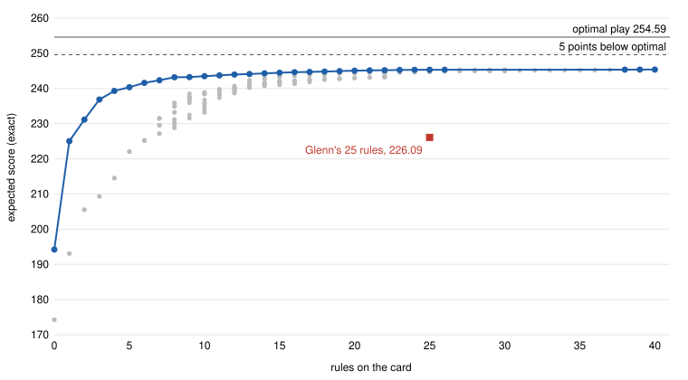

# Rules a person can follow

How the strategy cards were searched and pruned, the frontier, and published strategies for people. Moved unchanged from the [Yahtzee README](../README.md), which keeps the short answers. "Exact" means computed by the dynamic program in double precision.

A **card** is two ordered lists of short rules. The keep list says which dice to keep before a reroll, and the box list says where to score the final roll. Each rule tests a few facts a player sees at a glance: the shape of the roll, which boxes are open, how many rolls are left, and whether the upper total is on pace for the bonus. When no box rule applies, the roll goes where its points minus a **par** value are largest, with par a table of 13 round numbers. A card fixes every choice of the game, so its expected score is computed exactly, in about 10 seconds, by following it forward from the empty score card.

Cards were grown one rule at a time (`learn.py`). Each step sampled the card's own decisions, estimated which new rule or par change would gain most, scored the best few candidates exactly, and kept the first that raised the exact score. Five searches ran on GitHub Actions: three from a six-rule starting card and two from the empty card. The two from the empty card were stopped after 45 minutes. Then the best 30-rule card was **pruned**: rules were removed one at a time, each time the one whose removal cost least, and each shorter card was scored exactly. The pruned cards beat the searches' own short cards at every size below 26 rules. In all, 220 cards were scored. The frontier below is the best card for each number of rules; every point on it is exact.

*Gray dots are the cards along each search and each pruning; the blue line is the best found for each size. Past 8 rules each rule adds little, and the gains stop near 245.*

| Rules | Best score found | Below optimal |
|---:|---:|---:|
| 0 | 194.21 | 60.37 |
| 1 | 225.02 | 29.57 |
| 2 | 231.16 | 23.43 |
| 4 | 239.30 | 15.29 |
| 8 | 243.18 | 11.41 |
| 12 | 243.95 | 10.64 |
| 16 | 244.62 | 9.97 |
| 20 | 245.05 | 9.54 |
| 26 | 245.31 | 9.28 |
| 40 | 245.37 | 9.22 |

So short lists of this kind get within about 9 points of optimal and no closer. The split of the sheet's loss above suggests where to look: keeps that depend on more than the most common face, the longest run and the pairs.

**Published strategies for people.** Glenn ([2007](https://doi.org/10.1109/CIG.2007.368089)) gives a rule list for keeps (12 rules) and one for boxes (13 rules), with a fallback order of boxes, and reports an average of 218.18. `glenn.py` follows his words, with the readings stated in its docstring, and scores 226.09 (exact; 20,000 seeded games gave 226.01 ± 0.92). The gap of 7.9 points was not resolved. His tables leave open what a keep rule such as "Small straight" keeps, and whether a "tripleton" may be four of a kind. Glenn also reports 170.45 for a novice who keeps the most common face and plays for Yahtzee bonuses, and up to 250.41 for strategies that a computer, not a person, can follow. Student reports at KTH give 221.68 ([Felldin and Sood 2012](https://www.csc.kth.se/utbildning/kth/kurser/DD143X/dkand12/Group5Mikael/report/MarkusFelldin_VinitSood.pdf), a million simulated games) and 211.04 ([Dahlbom Norgren and Svensson 2013](https://www.csc.kth.se/utbildning/kth/kurser/DD143X/dkand13/Group1Vahid/report/Optimal_Yahtzee_Nils_DN_&_Philip_S.pdf), 100,000 games) for heuristic programs. Both play without the Yahtzee bonus, so they compare with 245.87, not 254.59. Verhoeff's [Proficiency Test](https://www-set.win.tue.nl/~wstomv/misc/yahtzee/instr-pt.html) scores a person's game choice by choice and asks for a mean loss below 0.2 points per choice. None of these was rescored here except Glenn's lists.
