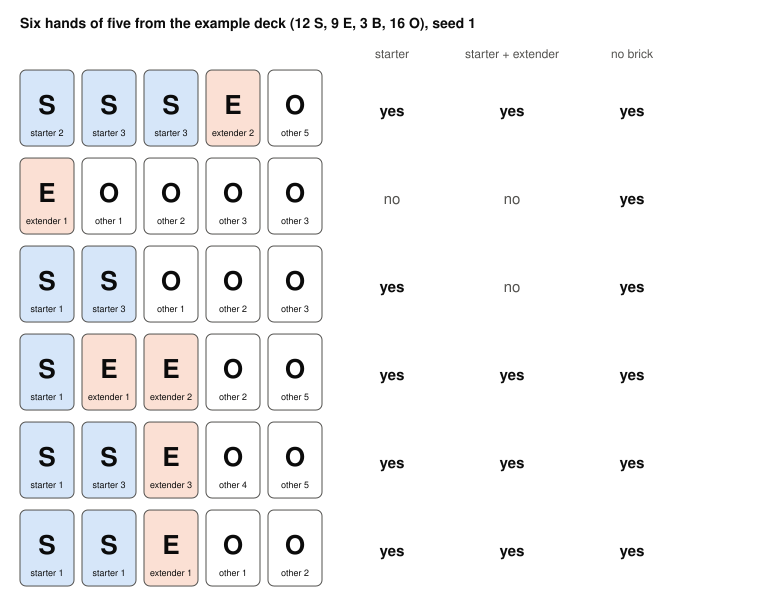
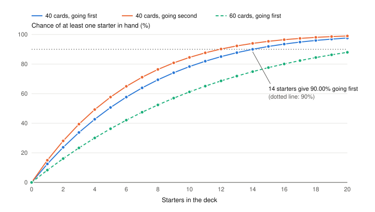
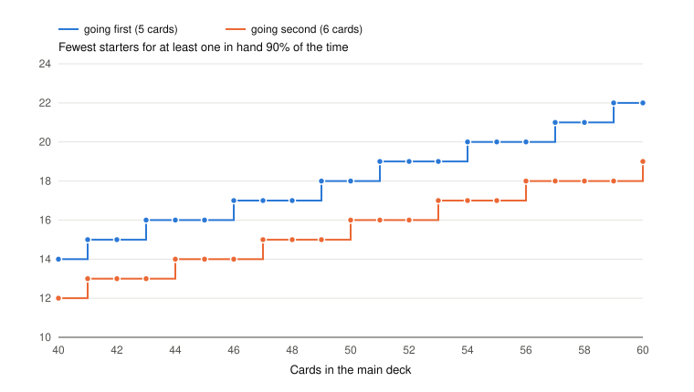

# Yu-Gi-Oh! opening hands

The question at the table is how often the opening hand has what the deck needs. In a 40-card deck, at least one starter turns up going first with chance 90.00% when the deck has 14 starters, and 87.73% with 13; going second, 12 starters reach 90.18%. Each of the first few cards past 40 lowers that chance by about 0.9 points (12 starters: 85.06% in 40 cards, 80.57% in 45), and the 20 cards out to 60 cost 0.82 points each on average (68.65% in 60). A starter and an extender together are much rarer than a starter: 61.01% going first with 12 and 9 of them. All of these are exact, as fractions. They are checked by brute force over every hand of small decks, by closed forms and by a seeded simulation of 1,000,000 hands. Of five public calculators that print values, four agree with the exact values to the precision they print; the fifth is off by up to 3.6 points in 10 of 13 values.



*Six hands dealt with seed 1 from the example deck used throughout: 12 starters (S), 9 extenders (E), 3 bricks (B) and 16 other cards (O). The last hand holds two copies of one starter.*

## Rules as modeled

- **The deck.** A main deck has 40 to 60 cards and at most 3 copies of a card, fewer for cards on the Forbidden and Limited list ([Official Rulebook, version 10](https://img.yugioh-card.com/en/downloads/rulebook/SD_RuleBook_EN_10.pdf), "Getting Started" and "Forbidden & Limited Cards").
- **The hand.** Each player draws 5 cards, and the player who goes first does not draw on the first turn (same rulebook, "Let the Duel Begin!" and "Draw Phase"). So the first turn is played with 5 cards going first and 6 going second, before any card effect.
- **Roles.** Which card is a starter depends on the deck, and the player decides it. The model only counts. A **starter** begins the deck's main play by itself, and a card that searches a starter counts as one. An **extender** adds to a play after a starter but cannot begin one. A **brick** is dead in the opening hand. **Other** is everything else: playable cards that neither start nor extend, such as cards used on the opponent's turn.
- **Needs.** A **need** is a condition on the opening hand, such as "at least one starter" or "a starter and an extender". Each card has exactly one role, so a card that is both a starter and an extender, or a hand trap, is counted under one of them.
- **"A starter and an extender"** is read in two ways. Strictly, the hand needs at least one of each. More loosely, a second starter can take the extender's place ("a starter and another engine card"). Both are reported; the loose reading gives 78.00% for the example deck going first, against 61.01% for the strict one.
- Nothing about the opponent is modeled: no interruptions, no hand traps, no choice of going first.

## Results

Exact unless marked. Percentages are rounded; the exact fractions are in [`results/tables.md`](results/tables.md).

| Question | Answer | How it is known |
|---|---|---|
| Fewest starters in 40 cards for at least one in hand 80 / 90 / 95% of the time | 11 / 14 / 18 going first, 9 / 12 / 15 going second | exact |
| Chance at 14 starters, going first | 90.003%, which is 11,389/12,654 | exact; above 90% by about 21 hands in 658,008 |
| Fewest starters for 90% at 41, 45, 50, 60 cards, going first | 15, 16, 18, 22 | exact |
| 12 starters in 40, 41, 45, 60 cards, going first | 85.06%, 84.15%, 80.57%, 68.65% | exact |
| Example deck (12 S, 9 E, 3 B), going first: a starter; a starter and an extender; no brick | 85.06%; 61.01%; 66.24% | exact; simulated, 1,000,000 hands, seed 1, each within its 95% interval |
| Same deck going second | 90.18%; 71.71%; 60.57% | exact |
| 12 starters as 4 names × 3 copies or 12 × 1: two different starters, going first | 41.52% or 47.72% | exact |
| 3 draw-2 cards in place of other cards, example deck, going first | a starter 89.01%, worth 1.56 starters | exact under the model below; simulated, 200,000 decks, seed 1 |
| 3 look-at-6 cards in place of other cards | a starter 91.50%, worth 2.78 starters | as above |
| Pot of Prosperity, the one copy allowed, revealing 6 / 3, example deck, going first | a starter 87.57% / 87.01%, worth 0.94 / 0.73 starters | exact; checked against every order of small decks |
| Pot of Prosperity with 3 draw-2 cards, against the generic model that plays both | a starter 90.90% against 91.15%; a starter and an extender 73.18% against 73.98% | exact; simulated, 200,000 decks, seed 1, each within its 95% interval |
| c draw-1 cards added to a deck of N | the same hands as the N cards without them | proved below, and checked exactly |
| Public calculators | of five that print values, four agree to the precision they print; one disagrees in 10 of 13 | exact values against values read on 2026-11-19 |

## How the results are checked

- **Closed forms.** `p_hand` sums the multivariate hypergeometric law over every hand by role. The tests compare it with closed forms for deck sizes 40 to 60 and many role counts, going first and second:
  - 1 − C(N − k, n)/C(N, n) for "at least one" of k cards;
  - C(N − b, n)/C(N, n) for "no brick";
  - inclusion and exclusion for "a starter and an extender".
- **Brute force.** `p_brute` lists every set of physical cards in small decks of 12 to 15 cards, with names at 1, 2 and 3 copies. Its results equal those of `p_hand` and of `p_named`, a dynamic program over names that also counts different names. On 40-card decks, `p_named` and `p_hand` give equal results for every role need at 1, 2 and 3 copies.
- **Simulation, once.** 1,000,000 seeded hands from the example deck put all five needs inside their 95% Wilson intervals ([`results/simulation.md`](results/simulation.md)). For the draw cards, 200,000 shuffled decks per row are dealt by code separate from the exact recursion; all 16 rows contain the exact value.
- **By hand.** The tests include small cases worked in comments: 667/1,976 for three copies, and draw cards in decks of three to five cards.
- **CI** runs all of the above except the full simulation. It reruns smaller seeded ones and checks that the committed tables, figures and README transcripts are what the scripts write.

## How many starters



*Going second is worth about two starters near 90%. Going to 60 cards costs about eight.*

| Starters in 40 | Going first | Going second |
|---:|---:|---:|
| 6 | 57.71% | 64.96% |
| 9 | 74.18% | 80.82% |
| 12 | 85.06% | 90.18% |
| 15 | 91.93% | 95.39% |
| 18 | 96.00% | 98.06% |

The thresholds are close calls in two places. 14 starters give 90.003% going first, and 13 give 87.731%. 18 give 95.998%, and 17 give 94.886%. A rough check: drawing with replacement would give 1 − (28/40)^5 = 83.19% for 12 starters, below the exact 85.06%, as it should be. Drawing without replacement makes each miss more likely to be followed by a starter.

## The cost of more than 40 cards



With 12 starters, the 41st card costs 0.91 points going first and 0.75 going second, and each card up to 45 costs about as much. Going to 60 cards costs 16.42 points going first. Keeping the 40-card chance takes 13 starters at 41 to 43 cards, 14 at 44 and 45, 16 at 50 and 19 at 60. The chance depends mostly on the share of starters in the deck.

## A starter and an extender, and bricks

Going first in 40 cards, the strict reading needs both kinds:

| Starters \ Extenders | 3 | 6 | 9 | 12 |
|---|---:|---:|---:|---:|
| 9 | 22.9% | 40.0% | 52.4% | 61.0% |
| 12 | 26.9% | 46.8% | 61.0% | 70.8% |
| 15 | 29.7% | 51.4% | 66.8% | 77.2% |

The table is symmetric in its two counts, since the need is. Going second adds 7 to 11 points across these rows ([tables](results/tables.md)).

Each brick lowers the chance of a clean hand. With 3 bricks in 40 cards, the hand has none 66.24% of the time going first and 60.57% going second. Going second is worse here, because the extra card can be a brick.

## Copies

For needs that count roles, such as "at least one starter", copies do not matter: only the number of starters does. They matter when two copies of one card cannot both be used, as with a card whose effect works once per turn. Twelve starters as four cards at 3 copies give two different starters 41.52% of the time going first. Spread over twelve different cards, they give 47.72%.

## Draw and search cards, modeled simply

Three generic kinds of card are modeled, each played at once and at no cost:

- a **draw-1** card is replaced by the top card of the deck, and any number can be played;
- a **draw-2** card is replaced by the top two, and only one can be played per turn;
- a **look-at-6** card is played after all draws, and takes the most useful of the top six cards.

Real cards of these kinds have costs and limits that are left out, so these numbers are upper bounds. In the example deck, going first, with these cards in place of other cards:

| Cards added | A starter | A starter and an extender | Worth in starters |
|---|---:|---:|---:|
| none | 85.06% | 61.01% | 0 |
| 1 draw-2 | 86.60% | 64.04% | 0.57 |
| 3 draw-2 | 89.01% | 68.96% | 1.56 |
| 3 look-at-6 | 91.50% | 74.80% | 2.78 |
| 3 draw-2 and 3 look-at-6 | 94.37% | 81.79% | 4.61 |

"Worth in starters" is the number of starters, in place of other cards, that gives the same chance of a starter; it is interpolated between whole numbers. Copies of a draw-2 are worth less each, since only one can be played.

**Draw-1 cards cancel exactly.** Add c draw-1 cards to a deck of N. Play every one as soon as it is drawn. Then the final hand is the first n cards in the shuffled deck that are not draw-1 cards. In a uniformly shuffled deck, those N cards are in uniformly random order. So the hand is a uniform draw of n from the N, the same as from the deck without the draw-1 cards. The tests check this exactly for several decks. Draw-2 cards added to the deck do better than that: three of them as cards 41 to 43 raise the example deck from 85.06% to 86.35%.

## One real card: Pot of Prosperity

The generic looker above is an upper bound. One real card of that kind, Pot of Prosperity, gives 87.57% for a starter going first in the example deck, 2.51 points above the deck without it and 3.93 points below the three generic lookers. Most of that gap is the card's limit of one copy. Its other costs take less: revealing 3 cards instead of 6 costs 0.56 points, and the rule against drawing costs 0.25 points in a deck that also holds three draw-2 cards. All exact ([`results/prosperity.md`](results/prosperity.md), simulation in [`results/prosperity_simulation.md`](results/prosperity_simulation.md)).

The card's text, as Yugipedia gives it from Konami's card database (entry 15756), read 2026-11-20, paraphrased:

- **Cost.** Banish 3 or 6 cards of the player's choice from the Extra Deck, face-down.
- **Effect.** Reveal that many cards from the top of the deck, add 1 of them to the hand, and put the rest on the bottom.
- **Limits.** Only 1 can be activated per turn, and the player cannot draw cards by card effects in the turn it is activated. It is Limited, so a deck holds one copy.

`prosperity.py` keeps each of these:

- Revealing 6 costs 6 of the 15 Extra Deck cards for the rest of the duel, so both 3 and 6 are computed. Which is better depends on how much the deck needs its Extra Deck, which the model does not see.
- A hand with the card and a draw-2 card must choose one before seeing the deck. Playing the draw-2 first makes the card unusable, and playing the card first stops the draw. The player takes the choice with the higher chance; the table also gives each fixed choice.
- The draw-2 card stays generic (draw 2, one per turn, no cost), so that only this card's own rules differ from the model above.

| Example deck, plus | A starter, first | A starter and an extender, first | A starter, second | Worth in starters |
|---|---:|---:|---:|---:|
| nothing | 85.06% | 61.01% | 90.18% | 0 |
| Pot of Prosperity, revealing 6 | 87.57% | 66.25% | 92.17% | 0.94 |
| Pot of Prosperity, revealing 3 | 87.01% | 64.85% | 91.75% | 0.73 |
| Pot of Prosperity (6) and 3 draw-2, best choice | 90.90% | 73.18% | 94.65% | 2.47 |
| the same, always Prosperity first | 90.90% | 73.13% | 94.65% | 2.47 |
| the same, always the draw-2 first | 90.52% | 72.39% | 94.29% | 2.27 |
| one generic look-at-6 and 3 draw-2 (model above) | 91.15% | 73.98% | 94.83% | 2.60 |

Alone, the card gives exactly what one generic looker gives, since nothing in the opening hand conflicts with it. Always playing Prosperity before a draw-2 is as good as the best choice for a starter, and 0.05 points short of it for a starter and an extender; always playing the draw-2 first is 0.38 points short for a starter. The exact sum is checked against a listing of every order of decks of six to eight cards. A seeded simulation of 200,000 decks for each fixed choice (seed 1) puts both exact values inside their 95% intervals: 90.87% to 91.12% around 90.90%, and 90.47% to 90.73% around 90.52%.

## Public calculators

The values that five public calculators print were read on 2026-11-19 and compared with the exact values ([table](results/tables.md#public-calculators-read-on-2026-11-19)).

- [ygo-decklab.com](https://ygo-decklab.com/en/guide/deck-probabilities) prints "at least 1" for 1 to 15 copies in 40 cards; all 15 values match to the digit shown. The same page's text says that 9 starters give "around 79%"; its own table and the exact value give 74.2%.
- [codingace.net](https://codingace.net/general/yugioh_hand.html) prints four decimals for 3, 6 and 9 copies; all agree.
- [cardgamecalculator.com](https://cardgamecalculator.com/yugioh/) agrees for 3 copies.
- [lumdera.com](https://lumdera.com/yugioh-probability-calculator/) disagrees in 10 of the 13 values in its reference table and text. It prints 77.8% for 9 copies going first, where the exact value is 74.18%, and 88.7% for 12 copies, where it is 85.06%. Its page also says that it estimates joint needs by 15,000 simulated hands; the tables here are exact.
- [deckprobability.org](https://deckprobability.org/yugioh) says that 3 copies give about 33% going first and 39% going second; the exact values are 33.76% and 39.43%. [ygeometric](https://github.com/nedhmn/ygeometric) prints no values to compare.

## Deck lists

Typical ratios from public deck lists were not collected. The [YGOPRODeck API guide](https://ygoprodeck.com/api-guide/) documents only card information, with a rate limit of 20 requests a second and rules for images. It states no license for its data and offers no endpoint for deck lists. No terms of use covering the deck pages were found on the site. The terms do not clearly allow collecting deck lists, so none were collected.

## Related work

The same counting is standard in deck building for Magic: The Gathering, for example in F. Karsten's articles on how many lands a deck needs. This folder checks its values against Yu-Gi-Oh! calculators only.

## Data

| Source | What | License | Committed |
|---|---|---|---|
| Official Rulebook, version 10 (Konami) | deck size, copies, draws | copyrighted; cited only | no |
| Public calculators above | printed percentages | not stated; quoted as numbers with their source | numbers only |
| [Yugipedia, Pot of Prosperity](https://yugipedia.com/wiki/Pot_of_Prosperity) | the card's text, from Konami's card database | card text is Konami's copyright | no; paraphrased in `prosperity.py` |

No card images are used, and the figures draw blank cards labeled by role. One card name, Pot of Prosperity, is used with its text paraphrased, not quoted, and one other is named in an open question.

## Open questions

- What does a card that banishes from the deck cost a deck that searches? Pot of Desires banishes 10 cards face-down. That changes nothing in the opening hand, because the banished cards are random, but it matters when a starter searches a card that the banish removes. That needs a model of search targets, which roles do not have.
- How often does a hand hold two starters that both need the turn's one Normal Summon? A need that counts Normal Summons would separate those hands.
- Is a looker worth more for "a starter and an extender" than for one starter, since it can take whichever card is missing? "Worth in starters" is measured on one need.
- What ratios do real tournament decks use? That needs deck lists from a source with clear terms.
- Going second, how often does the hand hold a starter or a card used on the opponent's turn, such as a hand trap? Roles are exclusive here, so the model would need a card to carry two roles.

## Usage

```bash
uv run python -m yugioh.calc --starters 12 --extenders 9 --bricks 3   # about 0.1 seconds
uv run python -m yugioh.tables               # results/tables.md, about 1 second
uv run python -m yugioh.tables --simulate    # also results/simulation.md, 1 to 2 minutes
uv run python -m yugioh.prosperity --write   # results/prosperity.md and the simulation, about 5 seconds
uv run python -m yugioh.figures              # figures/*.svg
uv run pytest tests/test_yugioh.py           # about 10 seconds
```

The calculator prints the exact chances for one deck, going first and going second:

```console
$ uv run python -m yugioh.calc --starters 12 --extenders 9 --bricks 3
Deck of 40: 12 starters, 9 extenders, 3 bricks, 16 other.

Exact chance that the hand has        going first  going second
at least one starter                       85.06%        90.18%
a starter and an extender                  61.01%        71.71%
a starter and another engine card          78.00%        86.55%
no brick                                   66.24%        60.57%
a starter and no brick                     58.17%        55.95%

Fewest starters for at least one in hand, in 40 cards:
                 80%   90%   95%
going first       11    14    18
going second       9    12    15
```

With draw cards (`--cantrips`, `--draw2`, `--lookers`, `--look`) it uses the model above; `--exact` adds the fractions:

```console
$ uv run python -m yugioh.calc --deck 43 --starters 12 --extenders 9 --bricks 3 --draw2 3
Deck of 43: 12 starters, 9 extenders, 3 bricks, 3 draw-2, 16 other.
Draw cards are played at once and at no cost (see yugioh/draws.py).

Exact chance that the hand has        going first  going second
at least one starter                       86.35%        91.16%
a starter and an extender                  63.70%        74.01%
a starter and another engine card          80.14%        88.06%
no brick                                   64.81%        59.05%
a starter and no brick                     57.61%        55.01%
```

## Files

| File | What it does |
|---|---|
| `odds.py` | Decks, roles and needs; the exact sum over hands, the dynamic program over names, brute force and simulation |
| `draws.py` | Draw-1, draw-2 and look-at-6 cards: exact recursion and separate seeded dealing |
| `prosperity.py` | Pot of Prosperity with its costs: exact sum, brute force, seeded dealing; writes `results/prosperity.md` |
| `calc.py` | The calculator |
| `tables.py` | Writes `results/tables.md` and, with `--simulate`, `results/simulation.md` |
| `figures.py` | Writes the three SVG figures, without a plotting library |
